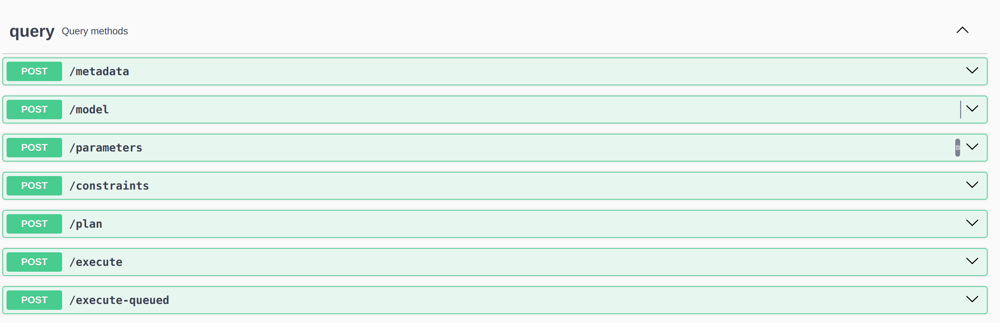
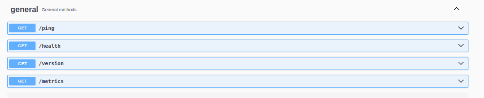
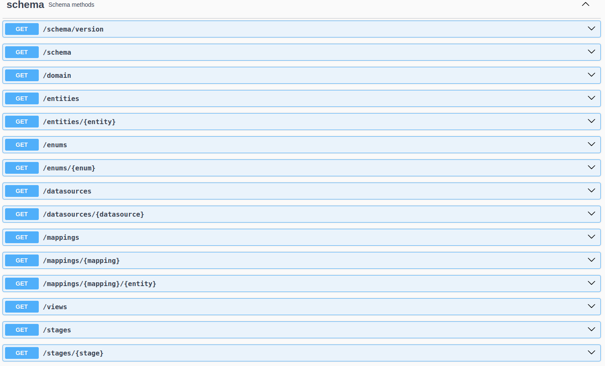
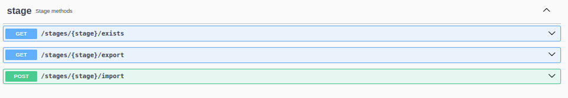

# λORM service

REST service that exposes the functionality of [λORM](https://www.npmjs.com/package/@lambdaorm/lib). It is published
as the Docker image [flaviorita/lambdaorm-svc](https://hub.docker.com/r/flaviorita/lambdaorm-svc) (2.3.x, Node 24,
with the `lambdaorm` CLI installed); it is not published on npm.

What is new in 2.3:

* [`POST /script`](Endpoints/Script.md): several queries in one transaction (off unless `SCRIPT_ENABLED=true`).
* Optional service token (`SERVICE_TOKEN`, `Authorization: Bearer <token>`); `RATE_LIMIT_MAX=0` turns the rate limit
  off — see [Configuration](Use/Configuration.md).
* Errors answer `{ error, code, message }` with a status a client can map (409, 400, …) — see [Errors](Use/Errors.md).
* `/execute` answers the affected rows of `update` and `delete`, and takes `data` / `options` as JSON objects.

## Service

The service exposes the following endpoints:

### Queries endpoints



* [Query](Endpoints/Query.md)
* [Script](Endpoints/Script.md)

### General endpoints



* [General](Endpoints/General.md)

### Schema endpoints



* [Schema](Endpoints/Schema.md)

### Stage endpoints



* [Stages](Endpoints/Stages.md)

The OpenAPI 3 document is served at `/api-docs` (Swagger UI).

## Usage

* [Configuration](Use/Configuration.md): settings, security (token) and Docker
* [Errors](Use/Errors.md)
* [Expressions](Use/Queries.md)
* [Kafka](Use/Kafka.md)
* [source](source/README.md)
* [Change log](CHANGELOG.md)

### Ping

```sh
curl -X GET "http://localhost:9291/ping?format=beautiful"
```

Result:

```json
{
  "message": "pong",
  "time": "2023-12-08T19:41:00.543Z"
}
```

### Model

```sh
curl -X POST "http://localhost:9291/model?format=beautiful" -H "Content-Type: application/json" -d '{"query": "Orders.filter(p=>p.customerId==customerId).include(p=>p.details)"}'
```

Result:

```json
[
  {
    "name": "id",
    "type": "integer"
  },
  {
    "name": "customerId",
    "type": "string"
  },
  {
    "name": "orderDate",
    "type": "dateTime"
  },
  {
    "name": "details",
    "type": "Orders.details[]",
    "children": [
      {
        "name": "orderId",
        "type": "integer"
      },
      {
        "name": "productId",
        "type": "integer"
      },
      {
        "name": "unitPrice",
        "type": "decimal"
      },
      {
        "name": "quantity",
        "type": "decimal"
      },
      {
        "name": "LambdaOrmParentId",
        "type": "integer"
      }
    ]
  }
]
```

### Parameters

```sh
curl -X POST "http://localhost:9291/parameters?format=beautiful" -H "Content-Type: application/json" -d '{"query": "Orders.filter(p=>p.customerId==customerId).include(p=>p.details)"}'
```

Result:

```json
[
  {
    "name": "customerId",
    "type": "string"
  },
  {
    "name": "details",
    "type": "Orders.details",
    "children": [
      {
        "name": "LambdaOrmParentId",
        "type": "any"
      }
    ]
  }
]
```

### Constraints

```sh
curl -X POST "http://localhost:9291/constraints?format=beautiful" -H "Content-Type: application/json" -d '{"query": "Orders.filter(p=>p.customerId==customerId).include(p=>p.details)"}'
```

Result:

```json
{
  "entity": "Orders",
  "constraints": [],
  "children": [
    {
      "entity": "Orders.details",
      "constraints": []
    }
  ]
}
```

### Plan

```sh
curl -X POST "http://localhost:9291/plan?format=beautiful" -H "Content-Type: application/json" -d '{"query": "Orders.filter(p=>p.customerId==customerId).include(p=>p.details)"}'
```

Result:

```json
{
  "entity": "Orders",
  "dialect": "PostgreSQL",
  "source": "default",
  "sentence": "SELECT o.OrderID AS \"id\", o.CustomerID AS \"customerId\", o.OrderDate AS \"orderDate\", o.OrderID AS \"__id\" FROM Orders o  WHERE o.CustomerID = $1 ",
  "children": [
    {
      "entity": "Orders.details",
      "dialect": "PostgreSQL",
      "source": "default",
      "sentence": "SELECT o1.OrderID AS \"orderId\", o1.ProductID AS \"productId\", o1.UnitPrice AS \"unitPrice\", o1.Quantity AS \"quantity\", o1.OrderID AS \"LambdaOrmParentId\" FROM \"Order Details\" o1  WHERE  o1.OrderID IN ($1) "
    }
  ]
}
```

### Import

```sh
curl -X POST -H "Content-Type: application/json" -d @data.json http://localhost:9291/stages/default/import
```

### Execute

```sh
curl -X POST "http://localhost:9291/execute?format=beautiful" -H "Content-Type: application/json" -d '{"query": "Orders.filter(p=>p.customerId==customerId).include(p=>p.details)", "data": {"customerId": "CENTC"}, "options": {"stage": "default"} }'
```

Result:

```json
[
  {
    "id": 12,
    "customerId": "CENTC",
    "orderDate": "1996-07-18T00:00:00.000Z",
    "details": [
      {
        "orderId": 12,
        "productId": 21,
        "unitPrice": 8,
        "quantity": 10
      },
      {
        "orderId": 12,
        "productId": 37,
        "unitPrice": 20.8,
        "quantity": 1
      }
    ]
  }
]
```

### Script

```sh
curl -X POST "http://localhost:9291/script" -H "Content-Type: application/json" -d '{"script": "orm.execute(\"Orders.update(p => ({ freight: freight })).filter(p => p.id == id)\", { id: id, freight: freight }); orm.execute(\"Orders.filter(p => p.id == id)\", { id: id })", "data": {"id": 12, "freight": 40}}'
```

Both queries run in one transaction; the answer is the value of the last one. See [Script](Endpoints/Script.md).

## Docker Image

The image [flaviorita/lambdaorm-svc](https://hub.docker.com/r/flaviorita/lambdaorm-svc) runs the service on Node 24 and
includes the `lambdaorm` CLI. See [Configuration](Use/Configuration.md#docker) for a `docker-compose` example.

## Clients

* Node: [@lambdaorm/client](https://www.npmjs.com/package/@lambdaorm/client) (0.9.x)

```ts
import { orm } from '@lambdaorm/client'

await orm.init('http://localhost:9291', { token: process.env.SERVICE_TOKEN }) // token only when SERVICE_TOKEN is set
const orders = await orm.execute('Orders.filter(p => p.customerId == customerId)', { customerId: 'CENTC' })
const affected = await orm.executeScript('orm.execute("Orders.update(p => ({ freight: 40 })).filter(p => p.id == id)", { id: id })', { id: 12 })
```

* CLI: [@lambdaorm/cli](https://www.npmjs.com/package/@lambdaorm/cli) with `-u <service url>` (see [CLI](../cli/index.md)).

* Other languages (Go, Python, Kotlin, C#, …): λORM ships no other client. The service's OpenAPI 3 document is the
  contract: browse it at `/api-docs` (Swagger UI), take
  [`swagger.yaml`](https://github.com/lambda-orm/core/blob/HEAD/packages/service/src/lib/infrastructure/swagger.yaml)
  from the repository and generate a client, e.g. with [openapi-generator](https://openapi-generator.tech):

```sh
openapi-generator generate -i swagger.yaml -g go -o ./lambdaorm-client
openapi-generator generate -i swagger.yaml -g python -o ./lambdaorm-client
```

  Or call it by hand: a `POST` of JSON, with `Authorization: Bearer <token>` when the service requires it.

## Labs

You can access various labs at [github.com/lambda-orm/lambdaorm-labs](https://github.com/lambda-orm/lambdaorm-labs/tree/main/labs/svc)
