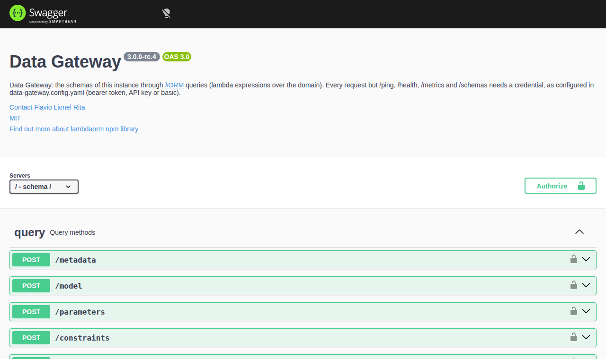
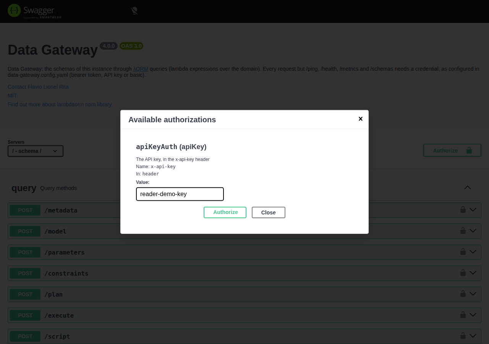

# Erste Schritte {#getting-started}

Diese Anleitung führt von einem leeren Ordner bis zur Datenbank northwind, die von einem Data Gateway veröffentlicht
wird: seine REST API, seine IDE, MCP für einen KI-Agenten und seine WebSocket API. Sie dauert etwa zehn Minuten und
benötigt nur **Docker** (mit Docker Compose).


## 1. Die Dateien {#1-the-files}

Erstellen Sie einen Ordner mit dieser Struktur (die Dateien können aus diesem Wiki heruntergeladen werden):

```text
northwind/
├── docker-compose.yml          ← PostgreSQL, the Data Gateway and its IDE
├── data-gateway.config.yaml    ← how the gateway exposes the schema and who can use it
├── data.json                   ← the rows of northwind, to import
└── workspace/
    └── lambdaORM.yaml          ← the λORM schema: domain, mapping, source, stage
```

```sh
mkdir -p northwind/workspace && cd northwind
W=https://lambda-orm.github.io/wiki/data-gateway/northwind
curl -sO $W/docker-compose.yml
curl -sO $W/data-gateway.config.yaml
curl -sO $W/data.json
curl -s $W/lambdaORM.yaml -o workspace/lambdaORM.yaml
```

### Das Schema: `workspace/lambdaORM.yaml` {#the-schema-workspacelambdaormyaml}

Ein normales λORM-[Schema](../schema/SchemaDefinition.md): die **Domäne** (Entitäten, Eigenschaften, Beziehungen), das
**Mapping** auf die Tabellen, eine **Quelle** (PostgreSQL) und der **Stage** `default`. Ein Auszug:

```yaml
domain:
  entities:
  - name: Products
    primaryKey: ["id"]
    uniqueKey: ["name", "supplierId"]
    properties:
    - { name: id, type: integer, required: true, autoIncrement: true }
    - { name: name, required: true }
    - { name: categoryId, type: integer }
    - { name: price, type: decimal, default: 0 }
    relations:
    - { name: category, from: categoryId, entity: Categories, to: id, target: products }
  # … Categories, Customers, Orders, Orders.details
infrastructure:
  mappings:
  - name: default
    entities:
    - name: Products
      mapping: Products
      properties:
      - { name: id, mapping: ProductID }
      - { name: name, mapping: ProductName }
      # …
  sources:
  - name: Northwind
    dialect: PostgreSQL
    mapping: default
    connection: ${NORTHWIND_DB}      # an environment variable: the gateway gives it to this schema
  stages:
  - name: default
    sources:
    - name: Northwind
```

### Das Gateway: `data-gateway.config.yaml` {#the-gateway-data-gatewayconfigyaml}

```yaml
orm:
  workspacePath: /workspace            # the folder with lambdaORM.yaml (a single schema: served at the root)
  schemas:
    - path: ""                         # that schema: it receives only the variables given here
      env: { NORTHWIND_DB: $NORTHWIND_DB }
authentication:
  adapter: local
  type: apikey
  header: X-Api-Key
  keys:
    - { name: reader,  value: $READER_KEY,  permissions: [ read ] }
    - { name: backend, value: $BACKEND_KEY, permissions: [ read, write, script, queue, stageImport ] }
scripts:
  enabled: true
transports:
  http:
    port: 8080
  mcpHttp:
    port: 8081
  webSocket:
    port: 8083
  management:
    port: 9090
```

- **Zwei Zugangsdaten:** `reader` darf nur lesen; `backend` darf außerdem schreiben, Skripte ausführen, Warteschlangen
  nutzen und importieren.
- **Vier Transporte:** REST auf 8080, MCP auf 8081, WebSocket auf 8083 und `management` auf 9090: die API der IDE,
  die nur die IDE erreicht (er wird nicht veröffentlicht).
- **Die Variablen des Schemas:** Jedes Schema erhält zu seiner Sicherheit nur seine eigenen Variablen; `env` übergibt
  ihm die Verbindung.

### `docker-compose.yml` {#docker-composeyml}

```yaml
services:
  postgres:
    image: postgres:16-alpine
    environment:
      POSTGRES_USER: northwind
      POSTGRES_PASSWORD: northwind
      POSTGRES_DB: northwind
    healthcheck:
      test: [ "CMD", "pg_isready", "-U", "northwind" ]
      interval: 2s
      retries: 30

  data-gateway:
    image: flaviorita/data-gateway:4.0.0
    depends_on:
      postgres: { condition: service_healthy }
    environment:
      NORTHWIND_DB: '{"host":"postgres","port":5432,"user":"northwind","password":"northwind","database":"northwind"}'
      READER_KEY: ${READER_KEY:-reader-demo-key}
      BACKEND_KEY: ${BACKEND_KEY:-backend-demo-key}
    volumes:
      - ./data-gateway.config.yaml:/config/data-gateway.config.yaml:ro
      - ./workspace:/workspace
    ports:                                  # management (9090) wird nicht veröffentlicht
      - "${HTTP_PORT:-8080}:8080"
      - "${MCP_PORT:-8081}:8081"
      - "${WS_PORT:-8083}:8083"

  ide:
    image: flaviorita/data-gateway-ide:1.0.0
    environment:
      DATA_GATEWAY_IDE_TARGETS: "http://data-gateway:9090,http://data-gateway:8080,http://data-gateway:8081,http://data-gateway:8083"
    ports:
      - "${IDE_PORT:-8090}:8080"
```

Die Keys `reader-demo-key` und `backend-demo-key` sind nur für dieses Beispiel gedacht: Geben Sie `READER_KEY` und
`BACKEND_KEY` bei jeder echten Verwendung lange Zufallswerte (`openssl rand -hex 24`).

## 2. Starten {#2-start-it}

```sh
docker compose up -d
curl http://localhost:8080/schemas
```

```json
[ { "path": "", "status": "ready", "since": "2026-11-18T14:07:33.561Z", "restarts": 0 } ]
```

Das Schema ist `ready`: Es wird an der Wurzel bereitgestellt (`/execute`, `/mcp`, …). Steht dort `error`, nennt
`reason` den Grund (eine nicht erreichbare Datenbank, eine nicht angegebene Variable); das Gateway versucht es weiterhin
erneut.

## 3. Die Tabellen erstellen {#3-create-the-tables}

Das Image enthält die [λORM-CLI](../cli/index.md). `push` erstellt die Tabellen des Stages aus dem Schema:

```sh
docker compose exec data-gateway lambdaorm push -w /workspace -s default
```

```text
create table Categories
…
add foreign key Order Details_product_FK
```

## 4. Die Daten importieren, über die REST API {#4-import-the-data-through-the-rest-api}

Der Import erfordert die Berechtigung `stageImport`, daher kann `reader` es nicht:

```sh
curl -X POST http://localhost:8080/stages/default/import -H "X-Api-Key: reader-demo-key" \
  -H "Content-Type: application/json" -d @data.json
```

```json
{ "error": "ForbiddenError", "message": "the credential \"reader\" does not have the \"stageImport\" permission" }
```

`backend` dagegen schon (die Antwort ist `204`, und der Import hinterlässt eine Audit-Zeile im Log):

```sh
curl -X POST http://localhost:8080/stages/default/import -H "X-Api-Key: backend-demo-key" \
  -H "Content-Type: application/json" -d @data.json
docker compose logs data-gateway | grep '"type":"audit"'
```

```json
{"type":"audit","time":"2026-11-18T14:07:39.720Z","schema":"","transport":"http","credential":"backend","operation":"stageImport","stage":"default","durationMs":189,"result":"ok"}
```

## 5. Abfragen {#5-query}

```sh
curl -X POST "http://localhost:8080/execute?format=beautiful" -H "X-Api-Key: reader-demo-key" \
  -H "Content-Type: application/json" -d '{
    "query": "Products.filter(p => p.price > minPrice).map(p => ({ name: p.name, category: p.category.name, price: p.price })).sort(p => desc(p.price)).page(1, 3)",
    "data": { "minPrice": 50 }
  }'
```

```json
[
  { "name": "Côte de Blaye", "category": "Beverages", "price": 263.5 },
  { "name": "Thüringer Rostbratwurst", "category": "Meat/Poultry", "price": 123.79 },
  { "name": "Mishi Kobe Niku", "category": "Meat/Poultry", "price": 97 }
]
```

`p.category.name` folgt der Beziehung: λORM verknüpft `Categories`. `plan` zeigt, wie, ohne die Abfrage auszuführen:

```sh
curl -X POST "http://localhost:8080/plan?format=beautiful" -H "X-Api-Key: reader-demo-key" -H "Content-Type: application/json" \
  -d '{"query": "Products.filter(p => p.price > minPrice).map(p => ({ name: p.name, category: p.category.name, price: p.price })).sort(p => desc(p.price)).page(1, 3)"}'
```

```json
{
  "entity": "Products",
  "dialect": "PostgreSQL",
  "source": "Northwind",
  "sentence": "SELECT p.ProductName AS \"name\", c.CategoryName AS \"category\", p.UnitPrice AS \"price\" FROM Products p INNER JOIN Categories c ON c.CategoryID = p.CategoryID WHERE p.UnitPrice > $1 ORDER BY p.UnitPrice desc  OFFSET 0 LIMIT 3 "
}
```

## 6. Schreiben und die Berechtigungen {#6-write-and-the-permissions}

Eine schreibende Abfrage mit `reader`:

```sh
curl -X POST http://localhost:8080/execute -H "X-Api-Key: reader-demo-key" -H "Content-Type: application/json" \
  -d '{"query": "Products.update(p => ({ price: price })).filter(p => p.id == id)", "data": {"id": 38, "price": 270}}'
```

```json
{ "error": "ForbiddenError", "message": "the credential \"reader\" does not have the \"write\" permission" }
```

Das Gateway hat sie **abgelehnt, bevor sie die Datenbank erreichte**, weil die Abfrage kein Select ist. Mit `backend`
liefert sie die Anzahl der aktualisierten Zeilen, `1`, und hinterlässt eine Audit-Zeile.

## 7. Ein Skript: mehrere Abfragen in einer Transaktion {#7-a-script-several-queries-in-one-transaction}

```sh
curl -X POST "http://localhost:8080/script?format=beautiful" -H "X-Api-Key: backend-demo-key" -H "Content-Type: application/json" -d '{
  "script": "orders = orm.execute(\"Orders.filter(p => p.customerId == customerId).map(p => p.id)\", { customerId: customerId }); { customer: customerId, orders: orders.length() }",
  "data": { "customerId": "ALFKI" }
}'
```

```json
{ "customer": "ALFKI", "orders": 6 }
```

Ein Skript bestimmt den Status der Antwort mit `throw { status, message }`: Ein `customer not found` mit `status: 404`
liefert `404`. Siehe [Skript](../usage/Script.md).

## 8. Die API-Dokumentation {#8-the-api-documentation}

`http://localhost:8080/doc/` ist die Swagger UI der REST API. **Authorize** fragt nach dem API-Key im Header
`X-Api-Key`; danach kann jede Methode direkt auf der Seite ausprobiert werden.





## 9. Die UI {#9-the-ui}

Öffnen Sie `http://localhost:8090`: Die IDE öffnet sich mit einer **Neuen Verbindung**. Füllen Sie sie aus:

- **Name:** `northwind`;
- **Adresse:** `data-gateway:9090`, das `management` des Gateways, wie die IDE es im Compose erreicht;
- **Authentifizierung:** API-Key, der Header `X-Api-Key` und der Key `reader-demo-key` (**Anzeigen** zeigt das
  Eingegebene an).

**Testen** sagt, wer der Key ist; **Verbinden** fügt die Verbindung hinzu. Ihre Seite zeigt die Berechtigungen des Keys,
und ihre REST API, ihr WebSocket und ihr MCP lassen sich von dort in eigenen Tabs ausprobieren.

Links der **Explorer**: die Verbindung, ihr Schema, die Domäne, ihre Entitäten mit ihren Eigenschaften und Beziehungen. Wählen Sie
das Schema `/`, schreiben Sie eine Abfrage (der Editor vervollständigt beim Tippen Entitäten und Eigenschaften), ihre
Daten, und klicken Sie auf **execute** (Strg+Enter). Das Ergebnis kann als Tabelle, Baum, JSON oder YAML angezeigt,
kopiert und exportiert werden:


**Speichern Sie sie** mit Strg+S: ein Name, eine Beschreibung und ein Ordner (Ordner werden mit dem **+** des Schemas
erstellt):


Ein Doppelklick auf eine Entität (oder ihre Schaltfläche **Öffnen**) zeigt ihr **Formular**: Eigenschaften,
Beziehungen, Schlüssel und Indizes, ihre Zeilen und ihr Diagramm.


**Ein Diagramm:** das **+** eines Ordners → **Neues Diagramm**, wählen Sie `Orders` und **Nachbarn hinzufügen**:


Die Kästen werden automatisch angeordnet; sie und die Linien lassen sich ziehen, und **Speichern** behält sie dort, wo
sie abgelegt wurden:


Alles wird unter [UI](Ui.md) erklärt.

## 10. Ein KI-Agent über MCP {#10-an-ai-agent-through-mcp}

Mit [Claude Code](https://claude.com/claude-code):

```sh
claude mcp add --transport http northwind http://localhost:8081/mcp --header "X-Api-Key: reader-demo-key"
```

Fragen Sie ihn dann zum Beispiel: *„Wie viele Produkte hat jede Kategorie?“*. Der Agent sieht die Tools, die die
Zugangsdaten `reader` verwenden dürfen (`orm_execute`, `orm_plan`, `schema_domain`, …; nicht die schreibenden), mit der
Domäne von northwind in ihren Beschreibungen, und antwortet mit einer Abfrage wie:

```json
{ "name": "orm_execute", "arguments": { "query": "Categories.map(p => ({ category: p.name, products: count(p.products.id) }))" } }
```

```json
[ { "category": "Grains/Cereals", "products": 7 }, { "category": "Beverages", "products": 12 }, … ]
```

Mit `reader` kann der Agent nichts ändern, egal worum er gebeten wird. Siehe [MCP](Mcp.md).

## 11. WebSocket {#11-websocket}

Eine Verbindung für alle Operationen, mit Benachrichtigungen. Mit `@lambdaorm/client`:

```ts
import { orm } from '@lambdaorm/client'

await orm.init('ws://localhost:8083/', { headers: { 'X-Api-Key': 'reader-demo-key' } })
const customers = await orm.execute('Customers.filter(p => p.country == country).map(p => p.name)', { country: 'Argentina' })
// [ { name: 'Cactus Comidas para llevar' }, { name: 'Océano Atlántico Ltda.' }, { name: 'Rancho grande' } ]
await orm.end()
```

oder direkt mit den JSON-RPC-Nachrichten:

```json
→ { "jsonrpc": "2.0", "id": 1, "method": "query.execute", "params": { "query": "Customers.filter(p => p.country == country).map(p => p.name)", "data": { "country": "Argentina" } } }
← { "jsonrpc": "2.0", "id": 1, "result": [ { "name": "Cactus Comidas para llevar" }, { "name": "Océano Atlántico Ltda." }, { "name": "Rancho grande" } ] }
```

Siehe [WebSocket API](WebSocket.md).

## 12. Beenden {#12-stop-it}

```sh
docker compose down            # keeps nothing: the database is in the container
```

## Nächste Schritte {#next-steps}

- Mehrere Schemas, jedes mit eigener Route, und die Umgebung jedes Schemas: [Konfiguration](Configuration.md#schemas).
- Zugangsdaten pro Schema oder pro Transport, das Audit, die Limits: [Sicherheit](Security.md).
- Jede REST-Methode: [REST API](Rest.md). Produktion: [Betrieb](Operations.md).
