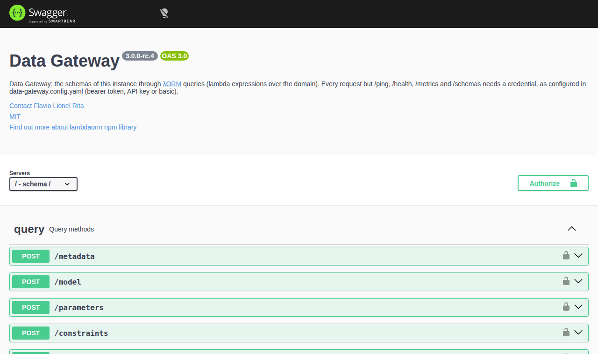
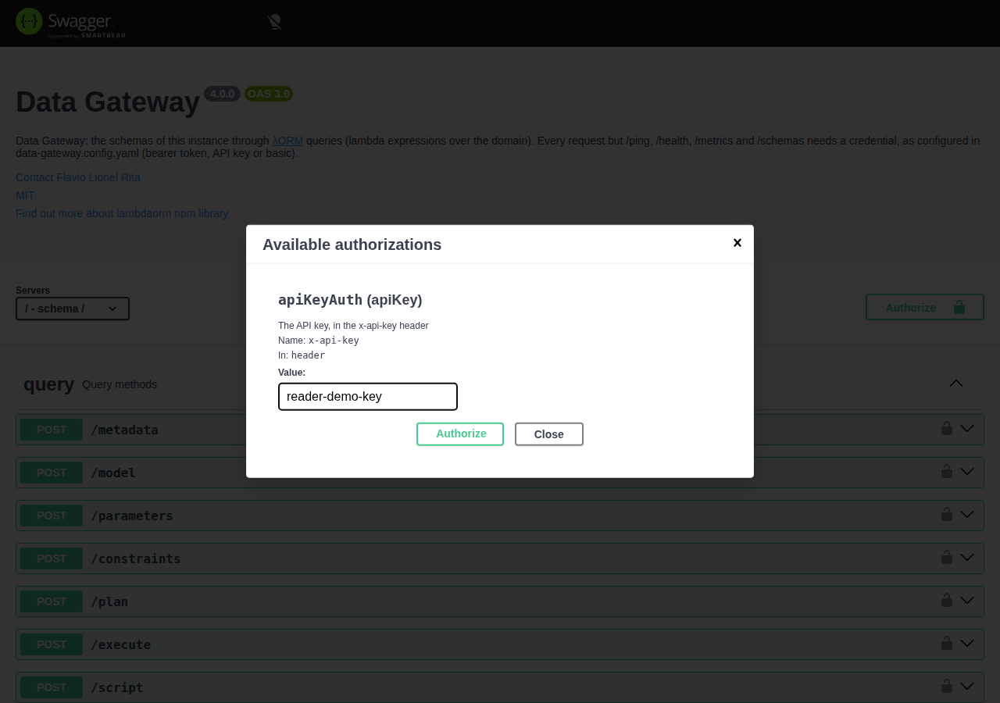
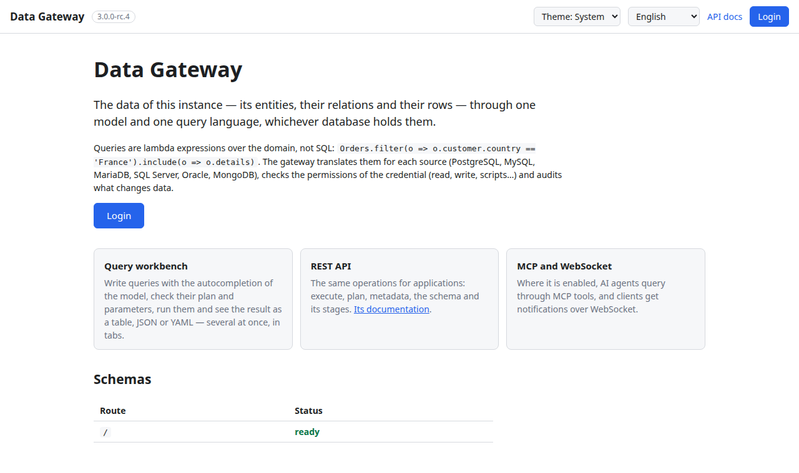
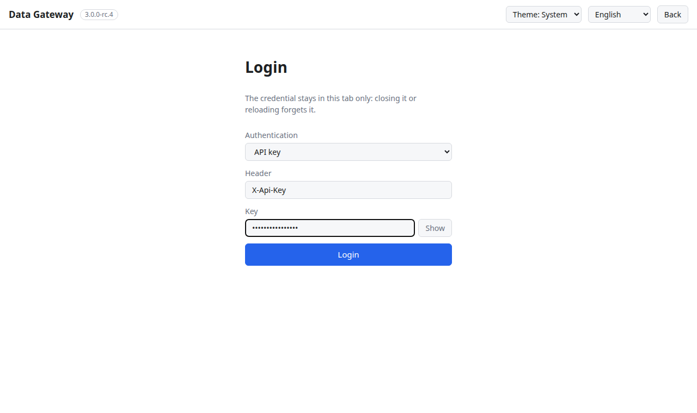
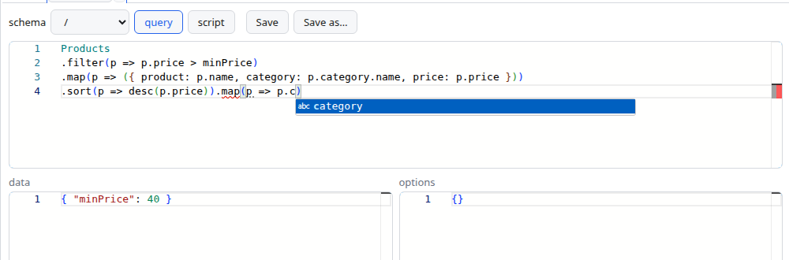

# Primeros pasos {#getting-started}

Esta guía va desde una carpeta vacía hasta la base de datos northwind publicada por un Data Gateway: su API REST, su UI web,
MCP para un agente de IA y su API WebSocket. Lleva unos diez minutos y solo necesita **Docker** (con Docker Compose).


## 1. Los archivos {#1-the-files}

Se crea una carpeta con esta estructura (los archivos se pueden descargar de esta wiki):

```text
northwind/
├── docker-compose.yml          ← PostgreSQL and the Data Gateway
├── data-gateway.config.yaml    ← how the gateway exposes the schema and who can use it
├── data.json                   ← the rows of northwind, to import
└── workspace/
    └── lambdaORM.yaml          ← the λORM schema: domain, mapping, source, stage
```

```sh
mkdir -p northwind/workspace && cd northwind
W=https://lambda-orm.github.io/wiki/data-gateway/northwind
curl -sO $W/docker-compose.yml
curl -sO $W/data-gateway.config.yaml
curl -sO $W/data.json
curl -s $W/lambdaORM.yaml -o workspace/lambdaORM.yaml
```

### El esquema: `workspace/lambdaORM.yaml` {#the-schema-workspacelambdaormyaml}

Un [esquema](../schema/SchemaDefinition.md) normal de λORM: el **dominio** (entidades, propiedades, relaciones), el
**mapping** a las tablas, una **fuente** (PostgreSQL) y el **stage** `default`. Un extracto:

```yaml
domain:
  entities:
  - name: Products
    primaryKey: ["id"]
    uniqueKey: ["name", "supplierId"]
    properties:
    - { name: id, type: integer, required: true, autoIncrement: true }
    - { name: name, required: true }
    - { name: categoryId, type: integer }
    - { name: price, type: decimal, default: 0 }
    relations:
    - { name: category, from: categoryId, entity: Categories, to: id, target: products }
  # … Categories, Customers, Orders, Orders.details
infrastructure:
  mappings:
  - name: default
    entities:
    - name: Products
      mapping: Products
      properties:
      - { name: id, mapping: ProductID }
      - { name: name, mapping: ProductName }
      # …
  sources:
  - name: Northwind
    dialect: PostgreSQL
    mapping: default
    connection: ${NORTHWIND_DB}      # an environment variable: the gateway gives it to this schema
  stages:
  - name: default
    sources:
    - name: Northwind
```

### El gateway: `data-gateway.config.yaml` {#the-gateway-data-gatewayconfigyaml}

```yaml
orm:
  workspacePath: /workspace            # the folder with lambdaORM.yaml (a single schema: served at the root)
  schemas:
    - path: ""                         # that schema: it receives only the variables given here
      env: { NORTHWIND_DB: $NORTHWIND_DB }
authentication:
  adapter: local
  type: apikey
  header: X-Api-Key
  keys:
    - { name: reader,  value: $READER_KEY,  permissions: [ read ] }
    - { name: backend, value: $BACKEND_KEY, permissions: [ read, write, script, queue, stageImport ] }
scripts:
  enabled: true
transports:
  http:
    port: 8080
    ui: { enabled: true }
  mcpHttp:
    port: 8081
  webSocket:
    port: 8083
```

- **Dos credenciales:** `reader` solo puede leer; `backend` además puede escribir, ejecutar scripts, encolar e importar.
- **Tres transportes:** REST y la UI en el 8080, MCP en el 8081, WebSocket en el 8083.
- **Las variables del esquema:** cada esquema recibe solo sus propias variables, por seguridad; `env` le da la
  conexión.

### `docker-compose.yml` {#docker-composeyml}

```yaml
services:
  postgres:
    image: postgres:16-alpine
    environment:
      POSTGRES_USER: northwind
      POSTGRES_PASSWORD: northwind
      POSTGRES_DB: northwind
    healthcheck:
      test: [ "CMD", "pg_isready", "-U", "northwind" ]
      interval: 2s
      retries: 30

  data-gateway:
    image: flaviorita/data-gateway:3.0.2
    depends_on:
      postgres: { condition: service_healthy }
    environment:
      NORTHWIND_DB: '{"host":"postgres","port":5432,"user":"northwind","password":"northwind","database":"northwind"}'
      READER_KEY: ${READER_KEY:-reader-demo-key}
      BACKEND_KEY: ${BACKEND_KEY:-backend-demo-key}
    volumes:
      - ./data-gateway.config.yaml:/config/data-gateway.config.yaml:ro
      - ./workspace:/workspace
    ports:
      - "${HTTP_PORT:-8080}:8080"
      - "${MCP_PORT:-8081}:8081"
      - "${WS_PORT:-8083}:8083"
```

Las claves `reader-demo-key` y `backend-demo-key` son solo para este ejemplo: en cualquier uso real, hay que dar a `READER_KEY` y
`BACKEND_KEY` valores aleatorios largos (`openssl rand -hex 24`).

## 2. Arrancarlo {#2-start-it}

```sh
docker compose up -d
curl http://localhost:8080/schemas
```

```json
[ { "path": "", "status": "ready", "since": "2026-11-18T14:07:33.561Z", "restarts": 0 } ]
```

El esquema está `ready`: se sirve en la raíz (`/execute`, `/mcp`, …). Si indica `error`, `reason` explica por qué (una
base de datos inaccesible, una variable no proporcionada); el gateway sigue reintentando.

## 3. Crear las tablas {#3-create-the-tables}

La imagen incluye la [CLI de λORM](../cli/index.md). `push` crea las tablas del stage a partir del esquema:

```sh
docker compose exec data-gateway lambdaorm push -w /workspace -s default
```

```text
create table Categories
…
add foreign key Order Details_product_FK
```

## 4. Importar los datos, a través de la API REST {#4-import-the-data-through-the-rest-api}

La importación necesita el permiso `stageImport`, así que `reader` no puede:

```sh
curl -X POST http://localhost:8080/stages/default/import -H "X-Api-Key: reader-demo-key" \
  -H "Content-Type: application/json" -d @data.json
```

```json
{ "error": "ForbiddenError", "message": "the credential \"reader\" does not have the \"stageImport\" permission" }
```

y `backend` sí puede (responde `204`, y la importación deja una línea de auditoría en el log):

```sh
curl -X POST http://localhost:8080/stages/default/import -H "X-Api-Key: backend-demo-key" \
  -H "Content-Type: application/json" -d @data.json
docker compose logs data-gateway | grep '"type":"audit"'
```

```json
{"type":"audit","time":"2026-11-18T14:07:39.720Z","schema":"","transport":"http","credential":"backend","operation":"stageImport","stage":"default","durationMs":189,"result":"ok"}
```

## 5. Consultar {#5-query}

```sh
curl -X POST "http://localhost:8080/execute?format=beautiful" -H "X-Api-Key: reader-demo-key" \
  -H "Content-Type: application/json" -d '{
    "query": "Products.filter(p => p.price > minPrice).map(p => ({ name: p.name, category: p.category.name, price: p.price })).sort(p => desc(p.price)).page(1, 3)",
    "data": { "minPrice": 50 }
  }'
```

```json
[
  { "name": "Côte de Blaye", "category": "Beverages", "price": 263.5 },
  { "name": "Thüringer Rostbratwurst", "category": "Meat/Poultry", "price": 123.79 },
  { "name": "Mishi Kobe Niku", "category": "Meat/Poultry", "price": 97 }
]
```

`p.category.name` sigue la relación: λORM hace el join con `Categories`. `plan` muestra cómo, sin ejecutarla:

```sh
curl -X POST "http://localhost:8080/plan?format=beautiful" -H "X-Api-Key: reader-demo-key" -H "Content-Type: application/json" \
  -d '{"query": "Products.filter(p => p.price > minPrice).map(p => ({ name: p.name, category: p.category.name, price: p.price })).sort(p => desc(p.price)).page(1, 3)"}'
```

```json
{
  "entity": "Products",
  "dialect": "PostgreSQL",
  "source": "Northwind",
  "sentence": "SELECT p.ProductName AS \"name\", c.CategoryName AS \"category\", p.UnitPrice AS \"price\" FROM Products p INNER JOIN Categories c ON c.CategoryID = p.CategoryID WHERE p.UnitPrice > $1 ORDER BY p.UnitPrice desc  OFFSET 0 LIMIT 3 "
}
```

## 6. Escribir, y los permisos {#6-write-and-the-permissions}

Una consulta que escribe, con `reader`:

```sh
curl -X POST http://localhost:8080/execute -H "X-Api-Key: reader-demo-key" -H "Content-Type: application/json" \
  -d '{"query": "Products.update(p => ({ price: price })).filter(p => p.id == id)", "data": {"id": 38, "price": 270}}'
```

```json
{ "error": "ForbiddenError", "message": "the credential \"reader\" does not have the \"write\" permission" }
```

El gateway la rechazó **antes de llegar a la base de datos**, porque la consulta no es un select. Con `backend`
responde las filas actualizadas, `1`, y deja una línea de auditoría.

## 7. Un script: varias consultas en una transacción {#7-a-script-several-queries-in-one-transaction}

```sh
curl -X POST "http://localhost:8080/script?format=beautiful" -H "X-Api-Key: backend-demo-key" -H "Content-Type: application/json" -d '{
  "script": "orders = orm.execute(\"Orders.filter(p => p.customerId == customerId).map(p => p.id)\", { customerId: customerId }); { customer: customerId, orders: orders.length() }",
  "data": { "customerId": "ALFKI" }
}'
```

```json
{ "customer": "ALFKI", "orders": 6 }
```

Un script elige el status de la respuesta con `throw { status, message }`: un `customer not found` con
`status: 404` responde `404`. Véase [Script](../usage/Script.md).

## 8. La documentación de la API {#8-the-api-documentation}

`http://localhost:8080/doc/` es el Swagger UI de la API REST. **Authorize** pide la API key en el
header `X-Api-Key`; después, cada método se puede probar desde la página.





## 9. La UI {#9-the-ui}

Se abre `http://localhost:8080/ui/`:



**Ingresar** con la API key (el botón **Mostrar** muestra lo que se escribió):



A la izquierda, el **explorador**: el esquema, su dominio, sus entidades con sus propiedades y relaciones. Se elige el
esquema `/`, se escribe una consulta (el editor completa las entidades y propiedades mientras se escribe), sus datos, y se pulsa **execute**
(Ctrl+Enter). El resultado se puede ver como tabla, árbol, JSON o YAML, copiar y exportar:




Se **guarda** con Ctrl+S: un nombre, una descripción y una carpeta (las carpetas se crean con el **+** del esquema):


Un doble clic en una entidad (o su botón **Abrir**) muestra su **formulario**: propiedades, relaciones, claves e índices, sus
filas y su diagrama.


**Un diagrama:** el **+** de una carpeta → **Nuevo diagrama**, se elige `Orders` y **Agregar sus vecinas**:


Las cajas se distribuyen solas; tanto ellas como las líneas se pueden arrastrar, y **Guardar** las conserva donde se dejaron:


Todo se explica en [UI](Ui.md).

## 10. Un agente de IA, a través de MCP {#10-an-ai-agent-through-mcp}

Con [Claude Code](https://claude.com/claude-code):

```sh
claude mcp add --transport http northwind http://localhost:8081/mcp --header "X-Api-Key: reader-demo-key"
```

Después se le pregunta, por ejemplo, *"¿cuántos productos tiene cada categoría?"*. El agente ve las herramientas que la credencial `reader`
puede usar (`orm_execute`, `orm_plan`, `schema_domain`, …; no las que escriben), con el dominio de
northwind en sus descripciones, y responde con una consulta como:

```json
{ "name": "orm_execute", "arguments": { "query": "Categories.map(p => ({ category: p.name, products: count(p.products.id) }))" } }
```

```json
[ { "category": "Grains/Cereals", "products": 7 }, { "category": "Beverages", "products": 12 }, … ]
```

Con `reader`, el agente no puede modificar nada, se le pida lo que se le pida. Véase [MCP](Mcp.md).

## 11. WebSocket {#11-websocket}

Una sola conexión para todas las operaciones, con notificaciones. Con `@lambdaorm/client`:

```ts
import { orm } from '@lambdaorm/client'

await orm.init('ws://localhost:8083/', { headers: { 'X-Api-Key': 'reader-demo-key' } })
const customers = await orm.execute('Customers.filter(p => p.country == country).map(p => p.name)', { country: 'Argentina' })
// [ { name: 'Cactus Comidas para llevar' }, { name: 'Océano Atlántico Ltda.' }, { name: 'Rancho grande' } ]
await orm.end()
```

o directamente los mensajes JSON-RPC:

```json
→ { "jsonrpc": "2.0", "id": 1, "method": "query.execute", "params": { "query": "Customers.filter(p => p.country == country).map(p => p.name)", "data": { "country": "Argentina" } } }
← { "jsonrpc": "2.0", "id": 1, "result": [ { "name": "Cactus Comidas para llevar" }, { "name": "Océano Atlántico Ltda." }, { "name": "Rancho grande" } ] }
```

Véase [API WebSocket](WebSocket.md).

## 12. Detenerlo {#12-stop-it}

```sh
docker compose down            # keeps nothing: the database is in the container
```

## Próximos pasos {#next-steps}

- Varios esquemas, una ruta cada uno, y el entorno de cada uno: [Configuración](Configuration.md#schemas).
- Credenciales por esquema o por transporte, la auditoría, los límites: [Seguridad](Security.md).
- Todos los métodos REST: [API REST](Rest.md). Producción: [Operaciones](Operations.md).
