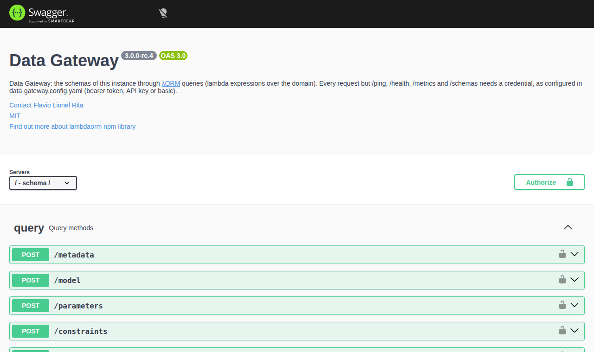
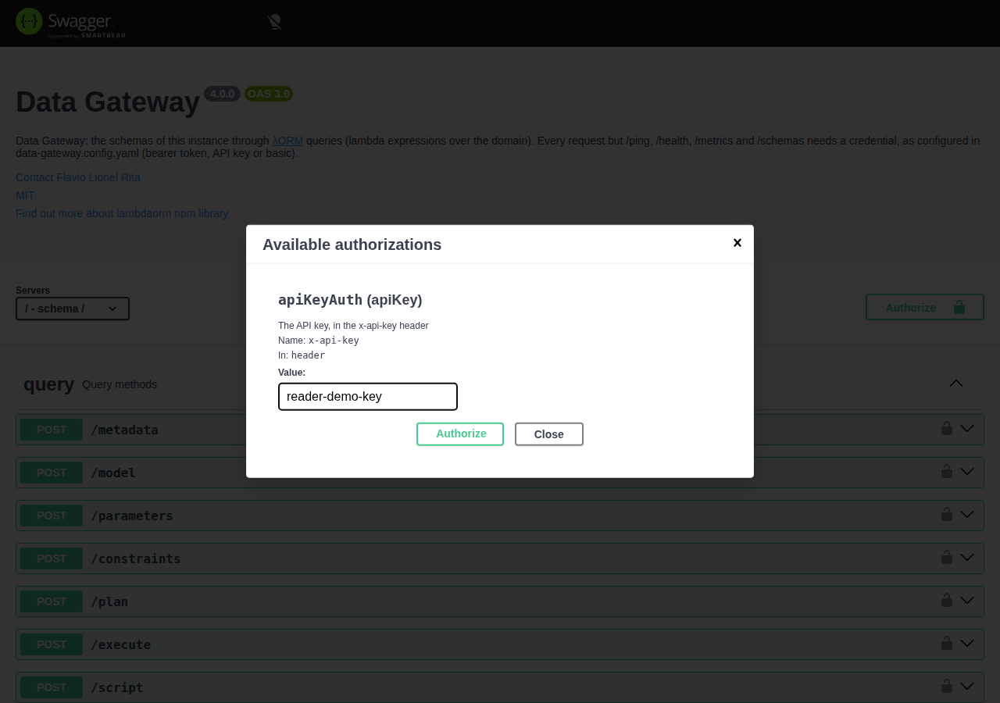
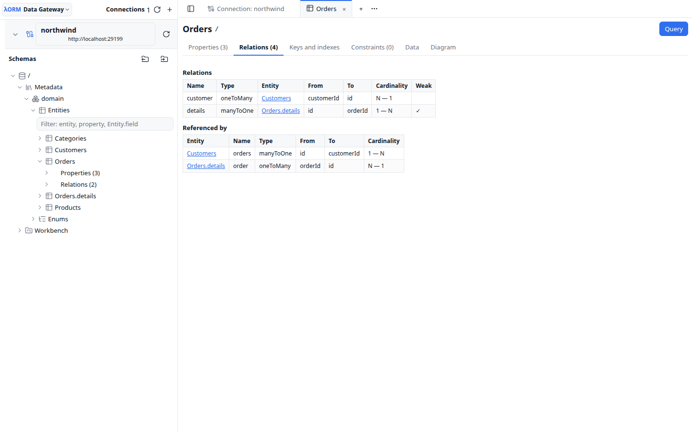

# Getting started

This guide goes from an empty folder to the northwind database published by a Data Gateway: its REST API, its IDE,
MCP for an AI agent and its WebSocket API. It takes about ten minutes and needs only **Docker** (with Docker Compose).


## 1. The files

Create a folder with this layout (the files can be downloaded from this wiki):

```text
northwind/
├── docker-compose.yml          ← PostgreSQL, the Data Gateway and its IDE
├── data-gateway.config.yaml    ← how the gateway exposes the schema and who can use it
├── data.json                   ← the rows of northwind, to import
└── workspace/
    └── lambdaORM.yaml          ← the λORM schema: domain, mapping, source, stage
```

```sh
mkdir -p northwind/workspace && cd northwind
W=https://lambda-orm.github.io/wiki/data-gateway/northwind
curl -sO $W/docker-compose.yml
curl -sO $W/data-gateway.config.yaml
curl -sO $W/data.json
curl -s $W/lambdaORM.yaml -o workspace/lambdaORM.yaml
```

### The schema: `workspace/lambdaORM.yaml`

A normal λORM [schema](../schema/SchemaDefinition.md): the **domain** (entities, properties, relations), the
**mapping** to the tables, one **source** (PostgreSQL) and the **stage** `default`. An excerpt:

```yaml
domain:
  entities:
  - name: Products
    primaryKey: ["id"]
    uniqueKey: ["name", "supplierId"]
    properties:
    - { name: id, type: integer, required: true, autoIncrement: true }
    - { name: name, required: true }
    - { name: categoryId, type: integer }
    - { name: price, type: decimal, default: 0 }
    relations:
    - { name: category, from: categoryId, entity: Categories, to: id, target: products }
  # … Categories, Customers, Orders, Orders.details
infrastructure:
  mappings:
  - name: default
    entities:
    - name: Products
      mapping: Products
      properties:
      - { name: id, mapping: ProductID }
      - { name: name, mapping: ProductName }
      # …
  sources:
  - name: Northwind
    dialect: PostgreSQL
    mapping: default
    connection: ${NORTHWIND_DB}      # an environment variable: the gateway gives it to this schema
  stages:
  - name: default
    sources:
    - name: Northwind
```

### The gateway: `data-gateway.config.yaml`

```yaml
orm:
  workspacePath: /workspace            # the folder with lambdaORM.yaml (a single schema: served at the root)
  schemas:
    - path: ""                         # that schema: it receives only the variables given here
      env: { NORTHWIND_DB: $NORTHWIND_DB }
authorization:
  roles:                               # what each role may do (its permissions)
    reader:  { permissions: [ read ] }
    backend: { permissions: [ read, write, script, queue, stageImport ] }
authentication:
  adapter: local
  type: apikey
  header: X-Api-Key
  keys:                                # each key names its roles
    - { name: reader,  value: $READER_KEY,  roles: [ reader ] }
    - { name: backend, value: $BACKEND_KEY, roles: [ backend ] }
scripts:
  enabled: true
transports:
  http:
    port: 8080
  mcpHttp:
    port: 8081
  webSocket:
    port: 8083
  management:
    port: 9090
```

- **Two roles and two keys:** the role `reader` can only read; `backend` can also write, run scripts, queue and import.
  Each key names its roles: what a key may do is always what its [roles](Security.md#roles) give it.
- **Four transports:** REST on 8080, MCP on 8081, WebSocket on 8083, and `management` on 9090: the API of the IDE,
  reached only by the IDE (it is not published).
- **The variables of the schema:** each schema receives only its own variables, for its safety; `env` gives it the
  connection.

### `docker-compose.yml`

```yaml
services:
  postgres:
    image: postgres:16-alpine
    environment:
      POSTGRES_USER: northwind
      POSTGRES_PASSWORD: northwind
      POSTGRES_DB: northwind
    healthcheck:
      test: [ "CMD", "pg_isready", "-U", "northwind" ]
      interval: 2s
      retries: 30

  data-gateway:
    image: flaviorita/data-gateway:5.0.0
    depends_on:
      postgres: { condition: service_healthy }
    environment:
      NORTHWIND_DB: '{"host":"postgres","port":5432,"user":"northwind","password":"northwind","database":"northwind"}'
      READER_KEY: ${READER_KEY:-reader-demo-key}
      BACKEND_KEY: ${BACKEND_KEY:-backend-demo-key}
    volumes:
      - ./data-gateway.config.yaml:/config/data-gateway.config.yaml:ro
      - ./workspace:/workspace
    ports:                                  # management (9090) is not published
      - "${HTTP_PORT:-8080}:8080"
      - "${MCP_PORT:-8081}:8081"
      - "${WS_PORT:-8083}:8083"

  ide:
    image: flaviorita/data-gateway-ide:1.5.0
    environment:
      DATA_GATEWAY_IDE_TARGETS: "http://data-gateway:9090,http://data-gateway:8080,http://data-gateway:8081,http://data-gateway:8083"
    ports:
      - "${IDE_PORT:-8090}:8080"
```

The keys `reader-demo-key` and `backend-demo-key` are for this example only: in any real use, give `READER_KEY` and
`BACKEND_KEY` long random values (`openssl rand -hex 24`).

The gateway runs as the user `1000` and writes in `workspace/` (the state of the stage that `push` creates, the
sessions of the IDE). If your user is another one (`id -u`), add `user: "<uid>:<gid>"` to the `data-gateway` service
with your ids, or make the folder writable by `1000`.

## 2. Start it

```sh
docker compose up -d
curl http://localhost:8080/schemas
```

```json
[ { "path": "", "status": "ready", "since": "2026-11-18T14:07:33.561Z", "restarts": 0 } ]
```

The schema is `ready`: it is served at the root (`/execute`, `/mcp`, …). If it says `error`, `reason` tells why (a
database that can't be reached, a variable not given); the gateway keeps retrying.

## 3. Create the tables

The image includes the [λORM CLI](../cli/index.md). `push` creates the tables of the stage from the schema:

```sh
docker compose exec data-gateway lambdaorm push -w /workspace -s default
```

```text
create table Categories
…
add foreign key Order Details_product_FK
```

## 4. Import the data, through the REST API

The import needs the `stageImport` permission, so `reader` can't:

```sh
curl -X POST http://localhost:8080/stages/default/import -H "X-Api-Key: reader-demo-key" \
  -H "Content-Type: application/json" -d @data.json
```

```json
{ "error": "ForbiddenError", "message": "the credential \"reader\" does not have the \"stageImport\" permission" }
```

and `backend` can (it answers `204`, and the import leaves an audit line in the log):

```sh
curl -X POST http://localhost:8080/stages/default/import -H "X-Api-Key: backend-demo-key" \
  -H "Content-Type: application/json" -d @data.json
docker compose logs data-gateway | grep '"type":"audit"'
```

```json
{"type":"audit","time":"2026-11-18T14:07:39.720Z","schema":"","transport":"http","credential":"backend","operation":"stageImport","stage":"default","durationMs":189,"result":"ok"}
```

## 5. Query

```sh
curl -X POST "http://localhost:8080/execute?format=beautiful" -H "X-Api-Key: reader-demo-key" \
  -H "Content-Type: application/json" -d '{
    "query": "Products.filter(p => p.price > minPrice).map(p => ({ name: p.name, category: p.category.name, price: p.price })).sort(p => desc(p.price)).page(1, 3)",
    "data": { "minPrice": 50 }
  }'
```

```json
[
  { "name": "Côte de Blaye", "category": "Beverages", "price": 263.5 },
  { "name": "Thüringer Rostbratwurst", "category": "Meat/Poultry", "price": 123.79 },
  { "name": "Mishi Kobe Niku", "category": "Meat/Poultry", "price": 97 }
]
```

`p.category.name` follows the relation: λORM joins `Categories`. `plan` shows how, without running it:

```sh
curl -X POST "http://localhost:8080/plan?format=beautiful" -H "X-Api-Key: reader-demo-key" -H "Content-Type: application/json" \
  -d '{"query": "Products.filter(p => p.price > minPrice).map(p => ({ name: p.name, category: p.category.name, price: p.price })).sort(p => desc(p.price)).page(1, 3)"}'
```

```json
{
  "entity": "Products",
  "dialect": "PostgreSQL",
  "source": "Northwind",
  "sentence": "SELECT p.ProductName AS \"name\", c.CategoryName AS \"category\", p.UnitPrice AS \"price\" FROM Products p INNER JOIN Categories c ON c.CategoryID = p.CategoryID WHERE p.UnitPrice > $1 ORDER BY p.UnitPrice desc  OFFSET 0 LIMIT 3 "
}
```

## 6. Write, and the permissions

A query that writes, with `reader`:

```sh
curl -X POST http://localhost:8080/execute -H "X-Api-Key: reader-demo-key" -H "Content-Type: application/json" \
  -d '{"query": "Products.update(p => ({ price: price })).filter(p => p.id == id)", "data": {"id": 38, "price": 270}}'
```

```json
{ "error": "ForbiddenError", "message": "the credential \"reader\" does not have the \"write\" permission" }
```

The gateway refused it **before reaching the database**, because the query is not a select. With `backend` it
answers the rows updated, `1`, and leaves an audit line.

## 7. A script: several queries in one transaction

```sh
curl -X POST "http://localhost:8080/script?format=beautiful" -H "X-Api-Key: backend-demo-key" -H "Content-Type: application/json" -d '{
  "script": "orders = orm.execute(\"Orders.filter(p => p.customerId == customerId).map(p => p.id)\", { customerId: customerId }); { customer: customerId, orders: orders.length() }",
  "data": { "customerId": "ALFKI" }
}'
```

```json
{ "customer": "ALFKI", "orders": 6 }
```

A script chooses the status of the answer with `throw { status, message }`: a `customer not found` with
`status: 404` answers `404`. See [Script](../usage/Script.md).

## 8. The API documentation

`http://localhost:8080/doc/` (also `/api-docs`, and `/` redirects there) is the Swagger UI of the REST API: every
method of the schema with its body and its answers. **Authorize** asks for the API key in the `X-Api-Key` header; then
every method can be tried from the page with **Try it out**. The document itself, to generate a client, is
`http://localhost:8080/openapi.json`.





## 9. The UI

Open `http://localhost:8090`: the IDE opens on a **New connection**. Fill it in:

- **Name:** `northwind`;
- **Address:** `data-gateway:9090`, the `management` of the gateway as the IDE reaches it in the compose;
- **Authentication:** API key, the header `X-Api-Key` and the key `reader-demo-key` (**Show** shows what was typed).

**Test** says who the key is; **Connect** adds the connection. Its page shows who the key is there: its roles with
their permissions. Its REST API, WebSocket and MCP can be tried from **Administration › Tools** in the explorer.

On the left, the **explorer**: the connection, its schema, the domain, its entities with their properties and relations. Choose the
schema `/`, write a query (the editor completes the entities and properties as you type), its data, and **execute**
(Ctrl+Enter). The result can be seen as a table, tree, JSON or YAML, copied and exported:


**Save it** with Ctrl+S: a name, a description and a folder (folders are created with the **+** of the schema):


A double click on an entity (or its **Open** button) shows its **form**: properties, relations, keys and indexes, its
rows and its diagram.




**A diagram:** the **+** of a folder → **New diagram**, choose `Orders` and **Add their neighbours**:


The boxes are laid out by themselves; they and the lines can be dragged, and **Save** keeps them where they were left:


Everything is explained in [UI](../ide/index.md).

## 10. An AI agent, through MCP

With [Claude Code](https://claude.com/claude-code):

```sh
claude mcp add --transport http northwind http://localhost:8081/mcp --header "X-Api-Key: reader-demo-key"
```

Then ask it, for example, *"how many products does each category have?"*. The agent sees the tools the `reader`
credential can use (`orm_execute`, `orm_plan`, `schema_domain`, …; not the ones that write), with the domain of
northwind in their descriptions, and answers with a query like:

```json
{ "name": "orm_execute", "arguments": { "query": "Categories.map(p => ({ category: p.name, products: count(p.products.id) }))" } }
```

```json
[ { "category": "Grains/Cereals", "products": 7 }, { "category": "Beverages", "products": 12 }, … ]
```

With `reader`, the agent cannot change anything, whatever it is asked. See [MCP](Mcp.md).

## 11. From your code: Node and Go {#11-websocket}

The [clients](Clients.md) of the gateway give the same API over REST, WebSocket and MCP: the scheme of the URL chooses
the transport. In Node:

```ts
import { connect } from '@lambdaorm/data-gateway-client-node'

const gateway = await connect('ws://localhost:8083/', { apiKey: 'reader-demo-key' })
const customers = await gateway.execute('Customers.filter(p => p.country == country).map(p => p.name)', { country: 'Argentina' })
// [ { name: 'Cactus Comidas para llevar' }, { name: 'Océano Atlántico Ltda.' }, { name: 'Rancho grande' } ]
await gateway.close()
```

and in Go, the same query:

```go
gw, err := gateway.Connect(ctx, "ws://localhost:8083/", gateway.WithAPIKey("reader-demo-key"))
if err != nil {
	log.Fatal(err)
}
defer gw.Close()
customers, err := gw.Execute(ctx, "Customers.filter(p => p.country == country).map(p => p.name)", map[string]any{"country": "Argentina"}, nil)
```

Over WebSocket these are JSON-RPC messages:

```json
→ { "jsonrpc": "2.0", "id": 1, "method": "query.execute", "params": { "query": "Customers.filter(p => p.country == country).map(p => p.name)", "data": { "country": "Argentina" } } }
← { "jsonrpc": "2.0", "id": 1, "result": [ { "name": "Cactus Comidas para llevar" }, { "name": "Océano Atlántico Ltda." }, { "name": "Rancho grande" } ] }
```

The clients, step by step in a project of your own: [Node](ClientNode.md) and [Go](ClientGo.md). The messages:
[WebSocket API](WebSocket.md).

## 12. Stop it

```sh
docker compose down            # keeps nothing: the database is in the container
```

## Next steps

- Several schemas, one route each, and the environment of each: [Configuration](Configuration.md#schemas).
- Credentials per schema or per transport, the audit, the limits: [Security](Security.md).
- Every REST method: [REST API](Rest.md). Production: [Operations](Operations.md).
