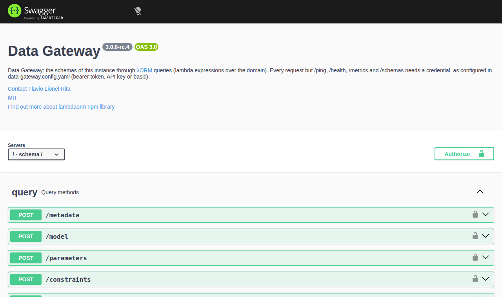
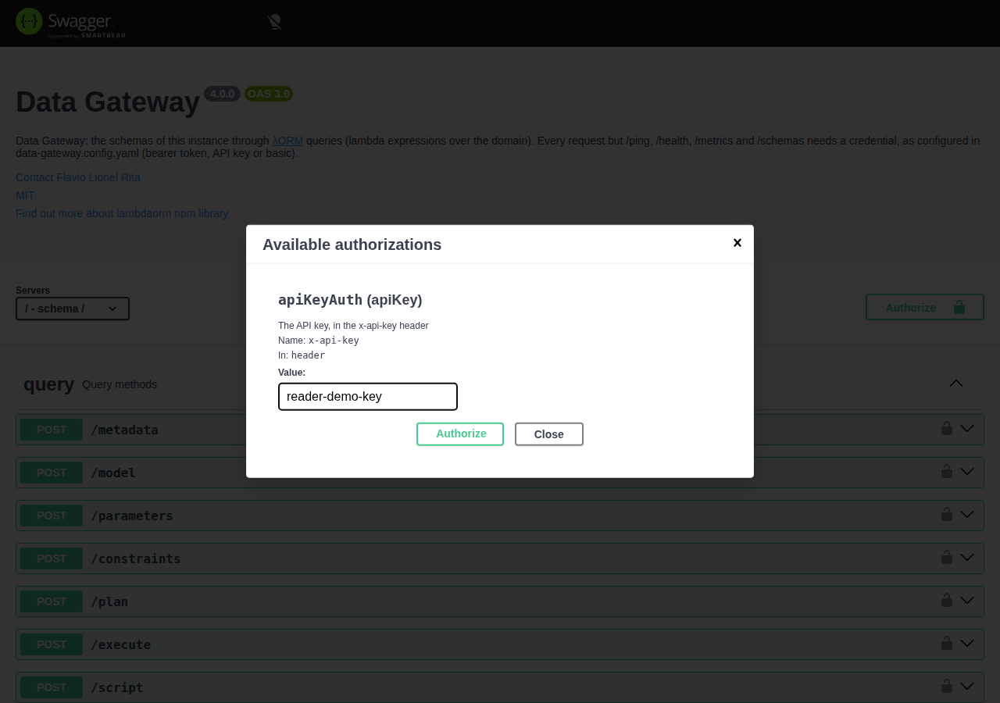
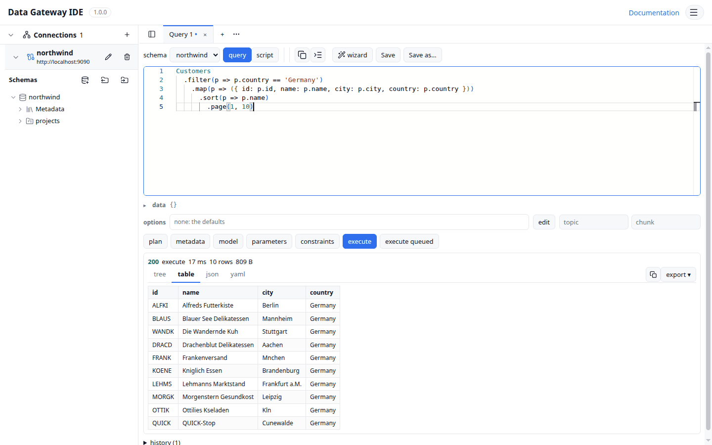

# Primeiros passos {#getting-started}

Este guia vai de uma pasta vazia até o banco de dados northwind publicado por um Data Gateway: sua API REST, sua IDE,
o MCP para um agente de IA e sua API WebSocket. Leva cerca de dez minutos e precisa apenas do **Docker** (com Docker Compose).


## 1. Os arquivos {#1-the-files}

Crie uma pasta com esta estrutura (os arquivos podem ser baixados desta wiki):

```text
northwind/
├── docker-compose.yml          ← PostgreSQL, o Data Gateway e sua IDE
├── data-gateway.config.yaml    ← como o gateway expõe o esquema e quem pode usá-lo
├── data.json                   ← as linhas do northwind, para importar
└── workspace/
    └── lambdaORM.yaml          ← o esquema λORM: domínio, mapeamento, fonte, stage
```

```sh
mkdir -p northwind/workspace && cd northwind
W=https://lambda-orm.github.io/wiki/data-gateway/northwind
curl -sO $W/docker-compose.yml
curl -sO $W/data-gateway.config.yaml
curl -sO $W/data.json
curl -s $W/lambdaORM.yaml -o workspace/lambdaORM.yaml
```

### O esquema: `workspace/lambdaORM.yaml` {#the-schema-workspacelambdaormyaml}

Um [esquema](../schema/SchemaDefinition.md) normal do λORM: o **domínio** (entidades, propriedades, relações), o
**mapeamento** para as tabelas, uma **fonte** (PostgreSQL) e o **stage** `default`. Um trecho:

```yaml
domain:
  entities:
  - name: Products
    primaryKey: ["id"]
    uniqueKey: ["name", "supplierId"]
    properties:
    - { name: id, type: integer, required: true, autoIncrement: true }
    - { name: name, required: true }
    - { name: categoryId, type: integer }
    - { name: price, type: decimal, default: 0 }
    relations:
    - { name: category, from: categoryId, entity: Categories, to: id, target: products }
  # … Categories, Customers, Orders, Orders.details
infrastructure:
  mappings:
  - name: default
    entities:
    - name: Products
      mapping: Products
      properties:
      - { name: id, mapping: ProductID }
      - { name: name, mapping: ProductName }
      # …
  sources:
  - name: Northwind
    dialect: PostgreSQL
    mapping: default
    connection: ${NORTHWIND_DB}      # an environment variable: the gateway gives it to this schema
  stages:
  - name: default
    sources:
    - name: Northwind
```

### O gateway: `data-gateway.config.yaml` {#the-gateway-data-gatewayconfigyaml}

```yaml
orm:
  workspacePath: /workspace            # the folder with lambdaORM.yaml (a single schema: served at the root)
  schemas:
    - path: ""                         # that schema: it receives only the variables given here
      env: { NORTHWIND_DB: $NORTHWIND_DB }
authorization:
  roles:                               # what each role may do (its permissions)
    reader:  { permissions: [ read ] }
    backend: { permissions: [ read, write, script, queue, stageImport ] }
authentication:
  adapter: local
  type: apikey
  header: X-Api-Key
  keys:                                # each key names its roles
    - { name: reader,  value: $READER_KEY,  roles: [ reader ] }
    - { name: backend, value: $BACKEND_KEY, roles: [ backend ] }
scripts:
  enabled: true
transports:
  http:
    port: 8080
  mcpHttp:
    port: 8081
  webSocket:
    port: 8083
  management:
    port: 9090
```

- **Dois papéis e duas chaves:** o papel `reader` só pode ler; `backend` também pode gravar, executar scripts,
  enfileirar e importar. Cada chave nomeia seus papéis: o que uma chave pode fazer é sempre o que seus
  [papéis](Security.md#roles) lhe dão.
- **Quatro transportes:** REST na 8080, MCP na 8081, WebSocket na 8083 e `management` na 9090: a API da IDE,
  alcançada apenas pela IDE (não é publicada).
- **As variáveis do esquema:** cada esquema recebe apenas suas próprias variáveis, por segurança; `env` lhe fornece a
  conexão.

### `docker-compose.yml` {#docker-composeyml}

```yaml
services:
  postgres:
    image: postgres:16-alpine
    environment:
      POSTGRES_USER: northwind
      POSTGRES_PASSWORD: northwind
      POSTGRES_DB: northwind
    healthcheck:
      test: [ "CMD", "pg_isready", "-U", "northwind" ]
      interval: 2s
      retries: 30

  data-gateway:
    image: flaviorita/data-gateway:5.0.0
    depends_on:
      postgres: { condition: service_healthy }
    environment:
      NORTHWIND_DB: '{"host":"postgres","port":5432,"user":"northwind","password":"northwind","database":"northwind"}'
      READER_KEY: ${READER_KEY:-reader-demo-key}
      BACKEND_KEY: ${BACKEND_KEY:-backend-demo-key}
    volumes:
      - ./data-gateway.config.yaml:/config/data-gateway.config.yaml:ro
      - ./workspace:/workspace
    ports:                                  # management (9090) não é publicado
      - "${HTTP_PORT:-8080}:8080"
      - "${MCP_PORT:-8081}:8081"
      - "${WS_PORT:-8083}:8083"

  ide:
    image: flaviorita/data-gateway-ide:1.5.0
    environment:
      DATA_GATEWAY_IDE_TARGETS: "http://data-gateway:9090,http://data-gateway:8080,http://data-gateway:8081,http://data-gateway:8083"
    ports:
      - "${IDE_PORT:-8090}:8080"
```

As chaves `reader-demo-key` e `backend-demo-key` servem apenas para este exemplo: em qualquer uso real, atribua a `READER_KEY` e
`BACKEND_KEY` valores longos e aleatórios (`openssl rand -hex 24`).

O gateway roda como o usuário `1000` e escreve em `workspace/` (o estado do stage que o `push` cria, as sessões do
IDE). Se o seu usuário for outro (`id -u`), adicione `user: "<uid>:<gid>"` ao serviço `data-gateway` com os seus ids,
ou torne a pasta gravável pelo `1000`.

## 2. Inicie {#2-start-it}

```sh
docker compose up -d
curl http://localhost:8080/schemas
```

```json
[ { "path": "", "status": "ready", "since": "2026-11-18T14:07:33.561Z", "restarts": 0 } ]
```

O esquema está `ready`: ele é servido na raiz (`/execute`, `/mcp`, …). Se indicar `error`, `reason` diz o motivo (um
banco de dados inacessível, uma variável não informada); o gateway continua tentando.

## 3. Crie as tabelas {#3-create-the-tables}

A imagem inclui a [CLI do λORM](../cli/index.md). `push` cria as tabelas do stage a partir do esquema:

```sh
docker compose exec data-gateway lambdaorm push -w /workspace -s default
```

```text
create table Categories
…
add foreign key Order Details_product_FK
```

## 4. Importe os dados, pela API REST {#4-import-the-data-through-the-rest-api}

A importação precisa da permissão `stageImport`, então `reader` não consegue:

```sh
curl -X POST http://localhost:8080/stages/default/import -H "X-Api-Key: reader-demo-key" \
  -H "Content-Type: application/json" -d @data.json
```

```json
{ "error": "ForbiddenError", "message": "the credential \"reader\" does not have the \"stageImport\" permission" }
```

e `backend` consegue (responde `204`, e a importação deixa uma linha de auditoria no log):

```sh
curl -X POST http://localhost:8080/stages/default/import -H "X-Api-Key: backend-demo-key" \
  -H "Content-Type: application/json" -d @data.json
docker compose logs data-gateway | grep '"type":"audit"'
```

```json
{"type":"audit","time":"2026-11-18T14:07:39.720Z","schema":"","transport":"http","credential":"backend","operation":"stageImport","stage":"default","durationMs":189,"result":"ok"}
```

## 5. Consulte {#5-query}

```sh
curl -X POST "http://localhost:8080/execute?format=beautiful" -H "X-Api-Key: reader-demo-key" \
  -H "Content-Type: application/json" -d '{
    "query": "Products.filter(p => p.price > minPrice).map(p => ({ name: p.name, category: p.category.name, price: p.price })).sort(p => desc(p.price)).page(1, 3)",
    "data": { "minPrice": 50 }
  }'
```

```json
[
  { "name": "Côte de Blaye", "category": "Beverages", "price": 263.5 },
  { "name": "Thüringer Rostbratwurst", "category": "Meat/Poultry", "price": 123.79 },
  { "name": "Mishi Kobe Niku", "category": "Meat/Poultry", "price": 97 }
]
```

`p.category.name` segue a relação: o λORM faz o join com `Categories`. `plan` mostra como, sem executar a consulta:

```sh
curl -X POST "http://localhost:8080/plan?format=beautiful" -H "X-Api-Key: reader-demo-key" -H "Content-Type: application/json" \
  -d '{"query": "Products.filter(p => p.price > minPrice).map(p => ({ name: p.name, category: p.category.name, price: p.price })).sort(p => desc(p.price)).page(1, 3)"}'
```

```json
{
  "entity": "Products",
  "dialect": "PostgreSQL",
  "source": "Northwind",
  "sentence": "SELECT p.ProductName AS \"name\", c.CategoryName AS \"category\", p.UnitPrice AS \"price\" FROM Products p INNER JOIN Categories c ON c.CategoryID = p.CategoryID WHERE p.UnitPrice > $1 ORDER BY p.UnitPrice desc  OFFSET 0 LIMIT 3 "
}
```

## 6. Gravação e permissões {#6-write-and-the-permissions}

Uma consulta que grava, com `reader`:

```sh
curl -X POST http://localhost:8080/execute -H "X-Api-Key: reader-demo-key" -H "Content-Type: application/json" \
  -d '{"query": "Products.update(p => ({ price: price })).filter(p => p.id == id)", "data": {"id": 38, "price": 270}}'
```

```json
{ "error": "ForbiddenError", "message": "the credential \"reader\" does not have the \"write\" permission" }
```

O gateway a recusou **antes de chegar ao banco de dados**, porque a consulta não é um select. Com `backend`, ele
responde as linhas atualizadas, `1`, e deixa uma linha de auditoria.

## 7. Um script: várias consultas em uma só transação {#7-a-script-several-queries-in-one-transaction}

```sh
curl -X POST "http://localhost:8080/script?format=beautiful" -H "X-Api-Key: backend-demo-key" -H "Content-Type: application/json" -d '{
  "script": "orders = orm.execute(\"Orders.filter(p => p.customerId == customerId).map(p => p.id)\", { customerId: customerId }); { customer: customerId, orders: orders.length() }",
  "data": { "customerId": "ALFKI" }
}'
```

```json
{ "customer": "ALFKI", "orders": 6 }
```

Um script escolhe o status da resposta com `throw { status, message }`: um `customer not found` com
`status: 404` responde `404`. Veja [Script](../usage/Script.md).

## 8. A documentação da API {#8-the-api-documentation}

`http://localhost:8080/doc/` (também `/api-docs`, e `/` redireciona para lá) é o Swagger UI da API REST: cada método
do esquema com seu corpo e suas respostas. **Authorize** pede a API key no header `X-Api-Key`; a partir daí, todos os
métodos podem ser testados na própria página com **Try it out**. O documento em si, para gerar um cliente, é
`http://localhost:8080/openapi.json`.





## 9. A UI {#9-the-ui}

Abra `http://localhost:8090`: a IDE abre em uma **Nova conexão**. Preencha-a:

- **Nome:** `northwind`;
- **Endereço:** `data-gateway:9090`, o `management` do gateway como a IDE o alcança no compose;
- **Autenticação:** API key, o header `X-Api-Key` e a chave `reader-demo-key` (**Mostrar** mostra o que foi digitado).

**Testar** diz quem é a chave; **Conectar** adiciona a conexão. Sua página mostra quem é a chave ali: seus papéis com
suas permissões. Sua API REST, seu WebSocket e seu MCP são testados em **Administração › Ferramentas** no explorador.

À esquerda, o **explorador**: a conexão, seu esquema, o domínio, suas entidades com suas propriedades e relações. Escolha o
esquema `/`, escreva uma consulta (o editor completa as entidades e propriedades enquanto você digita), seus dados, e clique em **execute**
(Ctrl+Enter). O resultado pode ser visto como tabela, árvore, JSON ou YAML, copiado e exportado:




**Salve-a** com Ctrl+S: um nome, uma descrição e uma pasta (as pastas são criadas com o **+** do esquema):


Um duplo clique em uma entidade (ou seu botão **Abrir**) mostra seu **formulário**: propriedades, relações, chaves e índices, suas
linhas e seu diagrama.


**Um diagrama:** o **+** de uma pasta → **Novo diagrama**, escolha `Orders` e **Adicionar as vizinhas**:


As caixas se organizam sozinhas; elas e as linhas podem ser arrastadas, e **Salvar** as mantém onde foram deixadas:


Tudo é explicado em [UI](../ide/index.md).

## 10. Um agente de IA, por MCP {#10-an-ai-agent-through-mcp}

Com o [Claude Code](https://claude.com/claude-code):

```sh
claude mcp add --transport http northwind http://localhost:8081/mcp --header "X-Api-Key: reader-demo-key"
```

Depois pergunte, por exemplo, *"quantos produtos cada categoria tem?"*. O agente vê as ferramentas que a credencial `reader`
pode usar (`orm_execute`, `orm_plan`, `schema_domain`, …; não as que gravam), com o domínio do
northwind em suas descrições, e responde com uma consulta como:

```json
{ "name": "orm_execute", "arguments": { "query": "Categories.map(p => ({ category: p.name, products: count(p.products.id) }))" } }
```

```json
[ { "category": "Grains/Cereals", "products": 7 }, { "category": "Beverages", "products": 12 }, … ]
```

Com `reader`, o agente não pode alterar nada, seja o que for que lhe peçam. Veja [MCP](Mcp.md).

## 11. A partir do seu código: Node e Go {#11-websocket}

Os [clientes](Clients.md) do gateway dão a mesma API por REST, WebSocket e MCP: o esquema da URL escolhe o
transporte. Em Node:

```ts
import { connect } from '@lambdaorm/data-gateway-client-node'

const gateway = await connect('ws://localhost:8083/', { apiKey: 'reader-demo-key' })
const customers = await gateway.execute('Customers.filter(p => p.country == country).map(p => p.name)', { country: 'Argentina' })
// [ { name: 'Cactus Comidas para llevar' }, { name: 'Océano Atlántico Ltda.' }, { name: 'Rancho grande' } ]
await gateway.close()
```

e em Go, a mesma consulta:

```go
gw, err := gateway.Connect(ctx, "ws://localhost:8083/", gateway.WithAPIKey("reader-demo-key"))
if err != nil {
	log.Fatal(err)
}
defer gw.Close()
customers, err := gw.Execute(ctx, "Customers.filter(p => p.country == country).map(p => p.name)", map[string]any{"country": "Argentina"}, nil)
```

Por WebSocket são mensagens JSON-RPC:

```json
→ { "jsonrpc": "2.0", "id": 1, "method": "query.execute", "params": { "query": "Customers.filter(p => p.country == country).map(p => p.name)", "data": { "country": "Argentina" } } }
← { "jsonrpc": "2.0", "id": 1, "result": [ { "name": "Cactus Comidas para llevar" }, { "name": "Océano Atlántico Ltda." }, { "name": "Rancho grande" } ] }
```

Os clientes, passo a passo num projeto seu: [Clientes](Clients.md#step-by-step). As mensagens:
[API WebSocket](WebSocket.md).

## 12. Pare {#12-stop-it}

```sh
docker compose down            # keeps nothing: the database is in the container
```

## Próximos passos {#next-steps}

- Vários esquemas, cada um com sua rota, e o ambiente de cada um: [Configuração](Configuration.md#schemas).
- Credenciais por esquema ou por transporte, a auditoria, os limites: [Segurança](Security.md).
- Todos os métodos REST: [API REST](Rest.md). Produção: [Operações](Operations.md).
