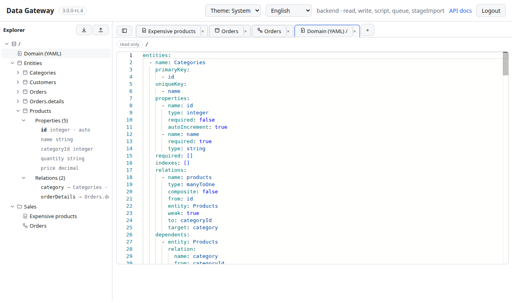
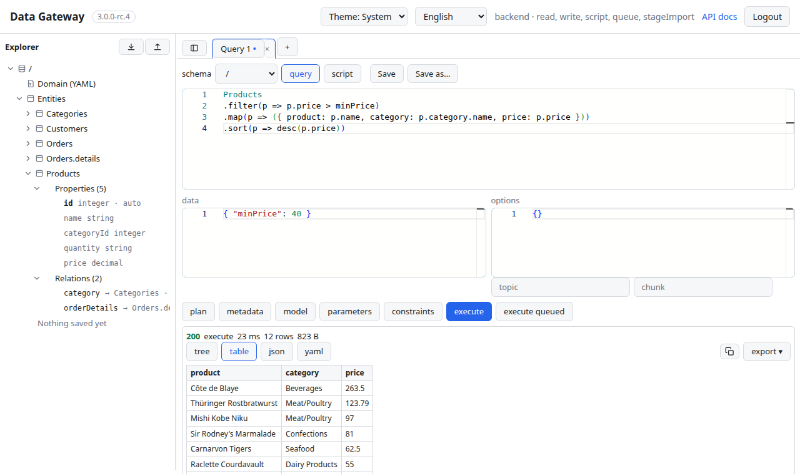

# UI {#ui}

Eine Schritt-für-Schritt-Tour, von der ersten Verbindung bis zu einem Diagramm, finden Sie unter
[Erste Schritte](GettingStarted.md#9-the-ui).

Die UI des Data Gateway ist die **data-gateway-ide**, ein eigenes Image
([`flaviorita/data-gateway-ide`](https://hub.docker.com/r/flaviorita/data-gateway-ide)): ein Explorer der Schemas und
ihrer Entitäten, das Formular jeder Entität, Abfrage-Tabs mit Autovervollständigung der Domäne, gespeicherte Abfragen und
Diagramme der Domäne. Sie eignet sich, um Abfragen auszuprobieren, die Sprache zu lernen und zu prüfen, was ein Agent
über MCP tut.

Wie eine Datenbank-IDE verbindet sie sich mit Data Gateways, einem oder mehreren, jedes mit seinen Zugangsdaten; deren
Schemas, Workspaces und Projekte bleiben in ihnen.

## Bereitstellen {#deploying-it}

Seit 4.0.0 stellt das Gateway keine UI bereit und beantwortet kein CORS. Die IDE erreicht es über seinen
**`management`**-Port ([Transporte](Transports.md#management)): die Routen der REST API für jedes Schema plus die
[Administration](Admin.md). Ein Gateway ohne diesen Port hat keine IDE, und genau das kann ein Produktions-Gateway
wollen, dessen Schemas in seinen Volumes mitkommen.

```yaml
# data-gateway.config.yaml
transports:
  http: { port: 8080 }
  management: { port: 9090 }    # die API der IDE; ohne Port nicht bereitgestellt
```

```yaml
# docker-compose.yml
services:
  data-gateway:
    image: flaviorita/data-gateway:4.0.0
    # 9090 wird nicht veröffentlicht: nur die IDE erreicht ihn, im Netzwerk des Compose
  ide:
    image: flaviorita/data-gateway-ide:1.0.0
    environment:
      DATA_GATEWAY_IDE_TARGETS: "http://data-gateway:9090,http://data-gateway:8080"
    ports:
      - "127.0.0.1:8090:8080"
```

- **Der Browser spricht nur mit dem Server der IDE.** Dieser stellt die Seite bereit und leitet jede Anfrage an das
  Gateway weiter (ein Proxy): REST, MCP und den WebSocket gleichermaßen. Die Gateways sehen den Browser nie.
- **`DATA_GATEWAY_IDE_TARGETS`** listet die Origins, die die IDE erreichen darf, durch Kommas getrennt, oder `*` für
  alle (eine lokal ausgeführte IDE). Ohne die Variable erreicht die IDE keinen und sagt das: Ein offener Proxy würde
  jeden Host seines Netzwerks erreichen.
- **Die IDE behält keine Verbindung und keine Zugangsdaten.** Sie bleiben im Browser. Sie leitet die Zugangsdaten an das
  Gateway weiter und verwirft die Cookies und den Origin der Seite.
- **Halten Sie `management` in einem internen Netzwerk.** Es schreibt die Schemas und ihre Variablen und führt DDL aus;
  veröffentlicht wird die IDE.

### Wo die IDE läuft {#where-the-ide-runs}

| Bereitgestellt wird | Wofür | `management` |
| --- | --- | --- |
| Nur das Gateway, ohne `management` | Produktion, mit den Schemas in seinen Volumes: keine IDE, keine Administration | kein Port |
| Das Gateway und das Image der IDE | eine gemeinsame IDE im Browser | nur im internen Netzwerk, nie veröffentlicht: der Container der IDE erreicht es |
| Nur das Gateway, mit `management` | eine IDE auf Ihrem eigenen Rechner: das Image mit `docker run` (und später die Desktop-App) | Ihr Rechner muss seinen Port erreichen (unten) |

Eine IDE auf Ihrem Rechner erreicht ein `management` an einem anderen Ort, ohne es offen zu veröffentlichen:

| Das Gateway läuft | Wie die IDE es erreicht | `management` veröffentlicht |
| --- | --- | --- |
| auf demselben Rechner | `localhost:9090` | — |
| in einem internen Netzwerk oder hinter einem VPN | `interner-host:9090` | nur in dieses Netzwerk |
| auf einem Server, ohne VPN | ein SSH-Tunnel, `ssh -L 9090:localhost:9090 server`, und die Verbindung zu `localhost:9090` | nur auf dem Loopback des Servers |
| in Kubernetes | `kubectl port-forward svc/data-gateway 9090`, und die Verbindung zu `localhost:9090` | ein interner `Service`, kein Ingress |

Über einen Tunnel brauchen auch die Tabs REST, WebSocket und MCP ihren Weg: ihre Ports ebenfalls tunneln oder ihre URLs
in der Verbindung festlegen (**Andere URLs seiner Transporte**).

## Verbindungen {#connections}

Die IDE hat keine Startseite und keine Anmeldung: Sie öffnet sich im Arbeitsbereich, beim ersten Mal mit einer
**Neuen Verbindung**.

| Feld | Was es ist |
| --- | --- |
| **Name** | wie die Verbindung angezeigt wird |
| **Protokoll** und **Adresse** | das `management` des Gateways, wie **der Server der IDE** es erreicht: `data-gateway:9090` (Host, Port und Base-Path), nicht die Adresse des Browsers |
| **Authentifizierung** | API-Key (der Header, Standard `X-Api-Key`, und der Key), Bearer-Token, Basic (Benutzer und Passwort) oder keine |
| **Key merken** | den Key im Browser behalten; sonst bleibt er nur in diesem Tab und wird nach dem Schließen erneut abgefragt |
| **Andere URLs seiner Transporte** | REST, WebSocket und MCP des Gateways, nur wenn die IDE sie nicht unter den Ports erreicht, die das Gateway nennt (ein Proxy davor, ein anderes Netzwerk) |

**Testen** prüft die Verbindung: wer die Zugangsdaten sind (`/whoami`) und die Version des Gateways. **Anzeigen /
Verbergen** zeigt den eingegebenen Key an.

- Die Seite einer Verbindung zeigt, wer diese Zugangsdaten sind, und **ihre Rollen**: jede Berechtigung mit dem, was
  sie erlaubt.
- Der Explorer listet die Verbindungen, jede mit ihren Schemas; Tabs mehrerer Verbindungen können nebeneinander
  geöffnet sein. Eine Verbindung wird in ihrer Zeile bearbeitet oder entfernt (Entfernen nimmt sie nur aus der IDE).
- Aus einer Verbindung, in Tabs, mit ihren Zugangsdaten: ihre **REST API** (Swagger, um jede Methode auszuprobieren),
  ihr **WebSocket** (seine Methoden, eine JSON-RPC-Konsole und was zurückkommt) und ihr **MCP** (die Tools eines
  Schemas, mit ihren Argumenten aufgerufen). Ein Transport, den das Gateway nicht bereitstellt, ist deaktiviert.

**Einstellungen** (das Menü ☰): das Design (System, Hell, Dunkel und weitere), die Sprache (English, Español,
Português, Français, Italiano, Deutsch, Nederlands, Català, Galego, Euskara) und das regionale Format der Zahlen und
Daten der Ergebnisse. Der Browser merkt sie sich.


## Explorer {#explorer}

Links die Verbindungen und die Schemas jeder Verbindung. Seine Größe lässt sich durch Ziehen am Rand ändern, und er
lässt sich mit der Panel-Schaltfläche der Tab-Leiste ausblenden. Für jedes Schema:

- **Domäne (YAML).** Die Domäne des Schemas (Entitäten, Eigenschaften, Beziehungen, Schlüssel, Enums) in einem
  **schreibgeschützten** Editor mit Syntaxhervorhebung, Suche und Einklappen. Er zeigt nur die Domäne: nie die Quellen,
  die Verbindungen oder den Rest der Konfiguration.
- **Entitäten.** Jede Entität klappt auf in:
    - **Eigenschaften** mit ihren Typen (der Primärschlüssel fett);
    - **Beziehungen** mit der verbundenen Entität und der Kardinalität (`customer → Customers · N — 1`); die
      Schaltfläche **Öffnen** einer Beziehung öffnet die verbundene Entität.
  Die Schaltfläche **Öffnen** (↗) einer Entität, ein Doppelklick oder Enter öffnen ihr [Formular](#entity-form).
- **Was gespeichert ist** im Schema: Ordner, Abfragen und Diagramme ([siehe unten](#saved-queries-and-diagrams)).

- **Filter.** Das Feld über den Entitäten behält die, deren Name oder der Name einer Eigenschaft oder Beziehung den
  Text enthält (`21 von 192`); die passenden Eigenschaften und Beziehungen erscheinen unter ihrer Entität.
- Die Breite des Explorers bleibt erhalten; ein Doppelklick auf seinen Rand (oder Enter) passt sie an die Namen an,
  und die Pfeiltasten ändern sie über die Tastatur (Shift: 60 px).
- Ein Schema, das nicht gestartet ist, erscheint abgeblendet, mit seinem Zustand und seinem Grund.



## Entitätsformular {#entity-form}

Wie eine Tabelle in einer Datenbank-IDE, in einem eigenen Tab, mit diesen Abschnitten:

| Abschnitt | Zeigt |
| --- | --- |
| **Eigenschaften** | jede Eigenschaft: Typ (oder Enum), Länge, Pflichtfeld, Primärschlüssel (und eindeutig), Autoinkrement, Standardwert, **die Entität und Eigenschaft, auf die ein Fremdschlüssel verweist** (ein Link dorthin) sowie ihre Lese-/Schreibausdrücke |
| **Beziehungen** | ihre Beziehungen (Name, Typ, Entität, from, to, Kardinalität, schwach) und **Referenziert von**: die Beziehungen anderer Entitäten, die auf sie verweisen; jede Entität ist ein Link zu ihrem Formular |
| **Schlüssel und Indizes** | Primärschlüssel, eindeutiger Schlüssel, Indizes mit ihren Feldern, Constraints mit ihrer Meldung und Bedingung |
| **Daten** | ihre Zeilen in einer Tabelle, **schreibgeschützt**, 50 pro Seite, mit Zurück / Weiter; sie können wie jedes Ergebnis kopiert und exportiert werden |
| **Diagramm** | die Entität und ihre Nachbarn |

Die Schaltfläche **Abfragen** öffnet einen Abfrage-Tab mit `Entity.page(1, 10)`.


## Abfragen {#queries}

Jede Abfrage ist ein Tab mit eigenem Schema, Text, Daten, Optionen und Ergebnis; beim Wechseln der Tabs geht nichts
verloren. Ein Tab wird mit **+**, aus einer Entität (**Abfragen**) oder aus einer gespeicherten Abfrage geöffnet und mit
seinem × geschlossen.

- **Editor** mit Autovervollständigung der Domäne des Schemas (Entitäten, Eigenschaften, Beziehungen und Funktionen)
  und den beim Tippen im Text markierten Fehlern von λORM. **Modus:** Abfrage oder Skript (Skripte nur, wenn das Schema
  sie aktiviert hat und die Zugangsdaten `script` besitzen).
- **Daten** und **Optionen** (JSON) und für Ausführungen in der Warteschlange das **Topic** und der **Chunk**.
- **Aktionen:** `plan`, `metadata`, `model`, `parameters` (füllt die Daten mit den Variablen der Abfrage),
  `constraints`, `execute` (Strg+Enter), `execute queued` und im Skriptmodus `execute script`. Eine Aktion, die die
  Zugangsdaten nicht verwenden dürfen, ist deaktiviert, und ihr Tooltip nennt den Grund.
- **Ergebnis:** Status, Operation, Zeit, Zeilen und Größe sowie vier Ansichten: **Baum**, **Tabelle** (wenn das
  Ergebnis eine Liste von Zeilen ist), **JSON** und **YAML**. Baum und Tabelle zeigen bis zu 200 Zeilen; die Exporte
  enthalten alle.
    - Das **Kopieren**-Symbol kopiert das Angezeigte (die Tabelle als tabulatorgetrennten Text, bereit zum Einfügen in
      eine Tabellenkalkulation).
    - **exportieren** lädt das gesamte Ergebnis als **JSON**, **YAML** oder **TXT (tabulatorgetrennt)** herunter.
- **Verlauf** der letzten Abfragen jedes Schemas, um eine davon zurückzuholen.

- **Ein Fehler mit einem Vorschlag** (`entity Area not found; did you mean Areas?`) hat eine Schaltfläche
  **Areas verwenden**, die den Namen in der Abfrage ersetzt.




## Gespeicherte Abfragen und Diagramme {#saved-queries-and-diagrams}

Das **+** eines Schemas oder eines Ordners fügt hinzu:

- **Neuer Ordner.** Ordner lassen sich verschachteln, um das Gespeicherte zu organisieren.
- **Neue Abfrage.** Ein Abfrage-Tab, dessen Ordner dieser ist.
- **Neues Diagramm.** Siehe [Diagramme](#diagrams).

Jedes gespeicherte Element hat einen **Namen** und eine **Beschreibung** (angezeigt, wenn der Mauszeiger darüber liegt).
Seine Zeile hat **Bearbeiten** (Name, Beschreibung und Ordner) und **Löschen** (mit Bestätigung; ein Ordner nimmt seinen Inhalt
mit). Elemente werden **durch Ziehen** auf einen Ordner oder auf das Schema **verschoben**. Zwei Elemente derselben Art
können in einem Ordner nicht denselben Namen haben.

Ein Abfrage-Tab hat **Speichern** (Strg+S) und **Speichern unter…**: Beim ersten Speichern werden Name, Beschreibung und Ordner
abgefragt. Ein **•** im Tab kennzeichnet nicht gespeicherte Änderungen; nach dem Speichern steht dort **gespeichert**. Wird
eine bereits geöffnete gespeicherte Abfrage geöffnet, wechselt die UI zu ihrem Tab.


## Diagramme {#diagrams}

Ein Diagramm der Domäne zeigt die ausgewählten Entitäten als Kästen, mit ihren Eigenschaften, Typen, **PK** und **FK**
(die Pflichtfelder fett), und die Beziehungen als Linien mit ihrer Kardinalität (**1 — N**, **1 — 1**); eine Vererbung
ist eine gestrichelte Linie.

**Neues Diagramm** fragt nach Name, Beschreibung, Ordner und **den Entitäten**: Sie werden gesucht, einzeln angehakt oder
mit **Nachbarn hinzufügen** ergänzt (die mit den ausgewählten verbundenen Entitäten).


In einem Diagramm:

| Aktion | Wie |
| --- | --- |
| Anordnen | automatisch beim Öffnen (die Kästen werden von [ELK](https://eclipse.dev/elk/) platziert); **neu anordnen** stellt dies wieder her |
| Einen Kasten verschieben | ziehen |
| Eine Linie verschieben | seitlich ziehen; ihre Enden bleiben an den Zeilen der Felder, die sie verbindet; ein Doppelklick setzt sie zurück |
| Eine Entität entfernen | das **×** ihres Kastens (angezeigt, wenn der Mauszeiger darüber liegt) oder den Kasten anklicken und Entf drücken |
| Entitäten hinzufügen oder entfernen | **Entitäten…** |
| Namen der Beziehungen | **Beziehungsnamen** |
| Nur die Namen der Entitäten | **nur Namen** |
| Zoomen und verschieben | das Mausrad; den Hintergrund ziehen; **einpassen** zeigt alles |
| Eine Entität öffnen | Doppelklick auf ihren Kasten |
| Exportieren | **SVG** oder **PNG** |

Das Diagramm wird (mit **Speichern** oder Strg+S) mit der Position jedes Kastens und jeder Linie, der Namensoption und den
Entitäten gespeichert.


## Wo gespeichert wird {#where-it-is-saved}

Mit der Berechtigung `workbenchWrite` geht das Gespeicherte (Ordner, Abfragen, Diagramme) in den Ordner `workbench/`
jedes Workspace, im Gateway ([Administration](Admin.md)), geteilt mit allen, die ihn verwenden. Ohne sie bleibt es
**im Browser**, in seiner IndexedDB, getrennt nach Gateway und nach Zugangsdaten: Was mit einem Zugang gespeichert wird,
ist mit einem anderen nicht sichtbar. Dafür wird nur der Name der Zugangsdaten verwendet, nie deren Secret. Im Browser:

- Es liegt in diesem Browser auf diesem Gerät: Ein anderer Browser oder ein anderes Gerät sieht es nicht.
- Es geht verloren, wenn die Websitedaten des Browsers gelöscht werden. Der Browser wird gebeten, es zu behalten, und
  der Explorer exportiert **alles in eine JSON-Datei** (⤓) und importiert es wieder (⤒), wobei es zum Vorhandenen
  **hinzugefügt** wird oder es **ersetzt**: eine Sicherung, eine Möglichkeit, es in einen anderen Browser zu übertragen
  oder mit jemandem zu teilen.
- In einem Browser, der kein Speichern erlaubt (manche privaten Fenster), weist der Explorer darauf hin: Das Gespeicherte
  bleibt nur erhalten, bis die Seite geschlossen wird.

## In Ihrer eigenen Anwendung {#in-your-own-application}

Die UI ist mit [`@lambdaorm/ui`](https://www.npmjs.com/package/@lambdaorm/ui) gebaut, einer Bibliothek von
React-Komponenten, die jede Webanwendung gegen ein Data Gateway verwenden kann. Das Gateway beantwortet kein CORS: Die
Anwendung ruft es über ihr eigenes Backend auf, wie es die IDE tut.

```sh
npm install @lambdaorm/ui react react-dom
```

```tsx
import { Workspace } from '@lambdaorm/ui'
import '@lambdaorm/ui/styles.css'

<Workspace
  baseUrl="/api/gateway"                         // Ihr Backend, das an das Gateway weiterleitet (es beantwortet kein CORS)
  headers={() => ({ 'X-Api-Key': key })}         // wie authentifiziert wird; die Bibliothek behält keine Zugangsdaten
  locale="es"
  theme="dark"
  workspaceKey={`gateway.example.com|${user}`}   // trennt das Gespeicherte
/>
```

| Komponente | Was sie ist |
| --- | --- |
| `Workspace` | der gesamte Arbeitsbereich: Explorer, Entitätsformulare, Abfragen, gespeicherte Elemente und Diagramme |
| `QueryWorkbench` | ein Abfrage-Editor mit seinen Aktionen und seinem Ergebnis |
| `QueryTabs` | mehrere Workbenches in Tabs |
| `DomainDiagram` | ein Diagramm der Domäne (eine Entität und ihre Nachbarn, das ganze Modell oder ausgewählte Entitäten) |
| `EntityView` | das Formular einer Entität |
| `ResultViewer` | ein Ergebnis als Baum, Tabelle, JSON oder YAML, mit Kopieren und Export |

Das Gespeicherte kann an einem anderen Ort als im Browser abgelegt werden, indem `store` übergeben wird (ein
`WorkspaceStore`, zum Beispiel ein eigenes Backend).

## Administration {#administration-ui}

Über den `management`-Port und mit seinen Berechtigungen bearbeitet der Explorer auch die Schemas (als YAML und als Formulare),
legt sie an und entfernt sie, speichert Gespeichertes in den Workspaces, setzt die Variablen der Verbindungen und führt
die Befehle der CLI aus: siehe [Administration](Admin.md). Die Schemas werden alle 5 s neu gelesen: ein hinzugefügtes,
entferntes oder neu geladenes erscheint ohne Neuladen der Seite, und eine neue Version, die nicht gestartet ist, wird
mit ⚠ und ihrem Grund markiert.
