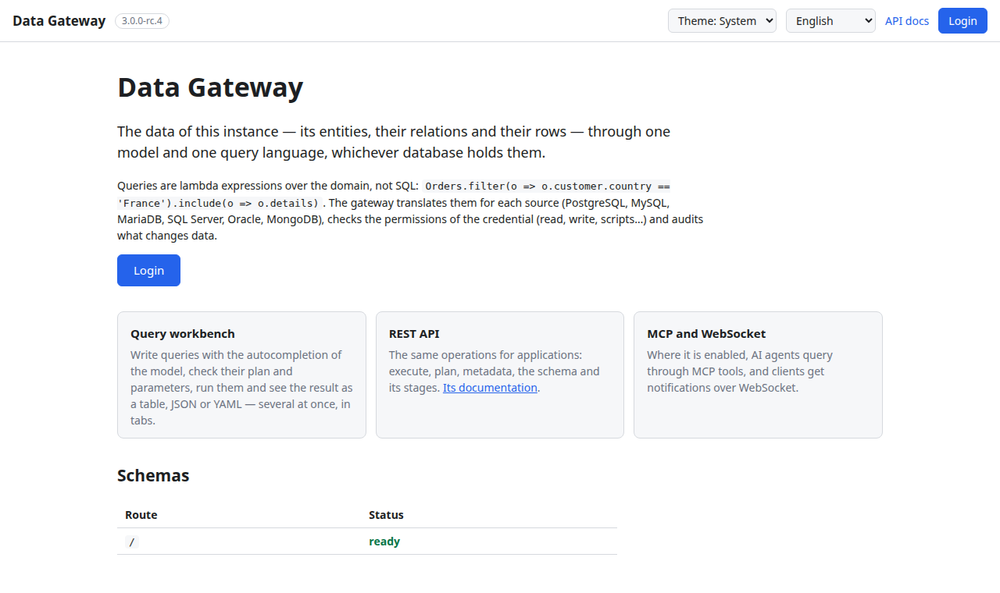
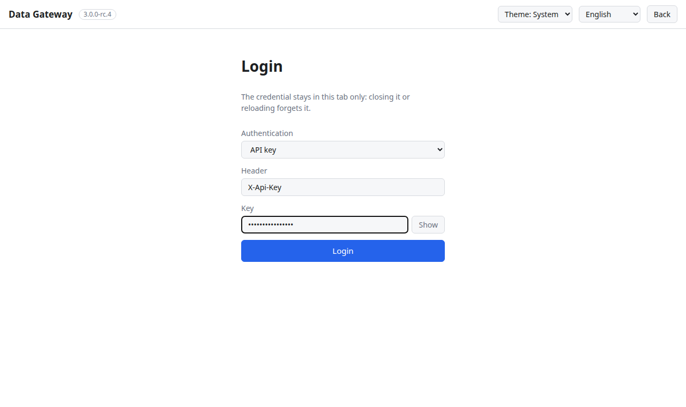
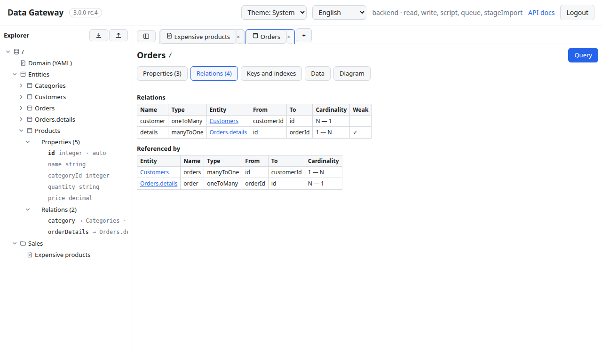
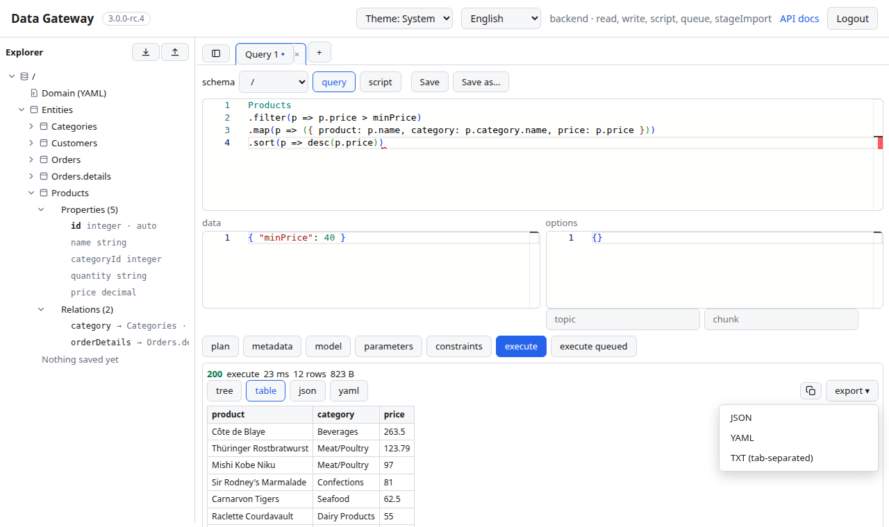
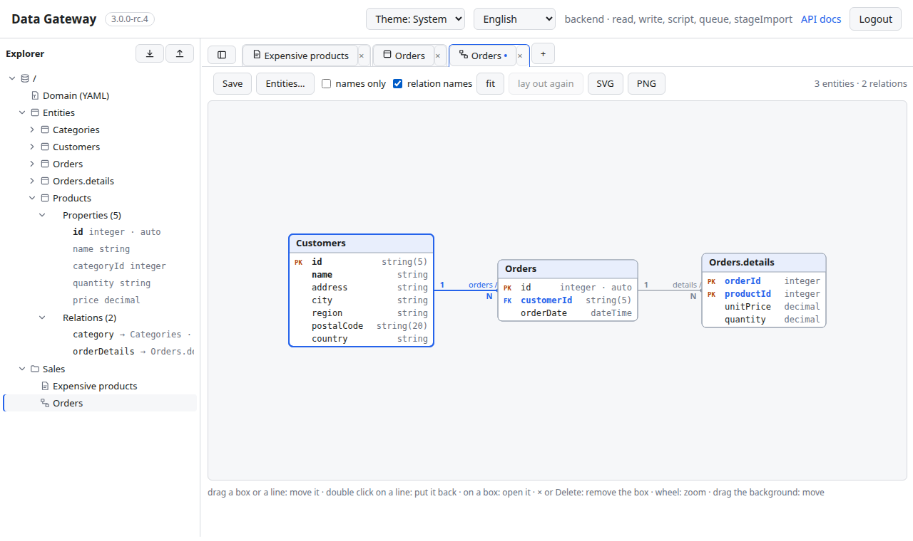

# UI {#ui}

Un recorrido paso a paso, desde el login hasta un diagrama, está en [Primeros pasos](GettingStarted.md#9-the-ui).

El gateway sirve una interfaz web para explorar sus esquemas y consultarlos: un explorador de los esquemas y sus
entidades, el formulario de cada entidad, pestañas de consultas con el autocompletado del dominio, consultas guardadas y diagramas del
dominio. Es útil para probar consultas, para aprender el lenguaje y para comprobar lo que hace un agente a través de MCP.

```yaml
transports:
  http:
    port: 8080
    ui: { enabled: true }       # off by default
```

Está en `http://localhost:8080/ui/` (con `basePath: /data-gateway`, en `/data-gateway/ui/`). La sirve el
mismo transporte `http` y llama a su [API REST](Rest.md) con la credencial que se introduce: no tiene otro acceso.

## Páginas {#pages}

**Inicio.** Qué es el Data Gateway, su versión, los esquemas de la instancia con su estado (`ready`, `error`, …), un
enlace a la documentación de la API (Swagger) y el botón **Ingresar**.



**Ingreso.** La autenticación de la instancia y la credencial:

| Autenticación | Pide |
| --- | --- |
| API key | el header (por defecto `X-Api-Key`) y la clave |
| Bearer token | el token |
| Basic | el usuario y la contraseña |
| Ninguna | nada |

El botón **Mostrar / Ocultar** muestra lo que se escribió. La credencial se comprueba contra un esquema (`/whoami`): si es incorrecta,
se indica y se permanece en la página. **La credencial se guarda solo en esa pestaña del navegador**: al cerrarla o recargarla se
olvida, y nunca se almacena.



**Consultas.** El workspace, después del login: arriba, el nombre y los permisos de la credencial, la documentación de la API y
**Salir** (vuelve a la página de inicio).

En la parte superior de cada página hay dos selectores:

- **Tema:** Sistema (como el sistema operativo), Claro u Oscuro.
- **Idioma:** English, Español, Português, Français, Italiano, Deutsch, Nederlands, Català, Galego, Euskara.

El navegador recuerda ambos.


## Explorador {#explorer}

A la izquierda, los esquemas de la instancia. Se puede redimensionar arrastrando su borde y ocultar con el botón de panel de
la barra de pestañas. Para cada esquema:

- **Dominio (YAML).** El dominio del esquema (entidades, propiedades, relaciones, claves, enums) en un editor de
  **solo lectura**, con resaltado de sintaxis, búsqueda y plegado. Muestra solo el dominio: nunca las fuentes, las conexiones
  ni el resto de la configuración.
- **Entidades.** Cada entidad se despliega en:
    - **Propiedades**, con sus tipos (la clave primaria en negrita);
    - **Relaciones**, con la entidad relacionada y la cardinalidad (`customer → Customers · N — 1`); el botón **Abrir**
      de una relación abre la entidad relacionada.
  El botón **Abrir** (↗) de una entidad, un doble clic o Enter abren su [formulario](#entity-form).
- **Lo guardado** en el esquema: carpetas, consultas y diagramas ([más abajo](#saved-queries-and-diagrams)).

- **Filtro.** La caja sobre las entidades deja las que tienen el texto en su nombre o en el de una propiedad o relación
  (`21 de 192`); las propiedades y relaciones que coinciden se muestran bajo su entidad.
- El ancho del explorador se guarda; un doble clic en su borde (o Enter) lo ajusta a los nombres, y las flechas lo
  cambian desde el teclado (Shift: 60 px).
- Un esquema que no arrancó se ve atenuado, con su estado y su motivo.


## Formulario de entidad {#entity-form}

Como una tabla en un IDE de bases de datos, en su propia pestaña, con estas secciones:

| Sección | Muestra |
| --- | --- |
| **Propiedades** | cada propiedad: tipo (o enum), longitud, obligatoria, clave primaria (y única), autoincremento, valor por defecto, **la entidad y la propiedad que referencia una clave foránea** (un enlace a ella), y sus expresiones de lectura / escritura |
| **Relaciones** | sus relaciones (nombre, tipo, entidad, from, to, cardinalidad, débil) y **Referenciada por**: las relaciones de otras entidades que apuntan a ella; cada entidad es un enlace a su formulario |
| **Claves e índices** | clave primaria, clave única, índices con sus campos, restricciones con su mensaje y su condición |
| **Datos** | sus filas en una tabla, **de solo lectura**, 50 por página, con Anterior / Siguiente; se pueden copiar y exportar como cualquier resultado |
| **Diagrama** | la entidad y sus vecinas |

El botón **Consultar** abre una pestaña de consulta con `Entity.page(1, 10)`.





## Consultas {#queries}

Cada consulta es una pestaña, con su propio esquema, texto, datos, opciones y resultado; al cambiar de pestaña no se pierde nada. Una pestaña se
abre con **+**, desde una entidad (**Consultar**) o desde una consulta guardada, y se cierra con su ×.

- **Editor** con el autocompletado del dominio del esquema (entidades, propiedades, relaciones y funciones) y los
  errores de λORM marcados en el texto mientras se escribe. **Modo:** consulta o script (scripts solo cuando el esquema los tiene
  habilitados y la credencial tiene `script`).
- **Datos** y **opciones** (JSON), y para las ejecuciones encoladas el **topic** y el **chunk**.
- **Acciones:** `plan`, `metadata`, `model`, `parameters` (rellena los datos con las variables de la consulta),
  `constraints`, `execute` (Ctrl+Enter), `execute queued` y, en modo script, `execute script`. Una acción que la
  credencial no puede usar está deshabilitada, y su tooltip explica por qué.
- **Resultado:** status, operación, tiempo, filas y tamaño, y cuatro vistas: **tree** (árbol), **table** (tabla, cuando el resultado es una lista
  de filas), **JSON** y **YAML**. El árbol y la tabla muestran hasta 200 filas; las exportaciones las contienen todas.
    - El icono de **copiar** copia lo que se muestra (la tabla como texto separado por tabulaciones, listo para pegar en una hoja de cálculo).
    - **Exportar** descarga el resultado completo como **JSON**, **YAML** o **TXT (separado por tabulaciones)**.
- **Historial** de las últimas consultas de cada esquema, para recuperar una.

- **Un error con una sugerencia** (`entity Area not found; did you mean Areas?`) tiene un botón **usar Areas** que
  reemplaza el nombre en la consulta.




## Consultas guardadas y diagramas {#saved-queries-and-diagrams}

El **+** de un esquema o de una carpeta añade:

- **Nueva carpeta.** Las carpetas se anidan, para organizar lo guardado.
- **Nueva consulta.** Una pestaña de consulta cuya carpeta es esa.
- **Nuevo diagrama.** Véase [Diagramas](#diagrams).

Cada elemento guardado tiene un **nombre** y una **descripción** (que se muestra al pasar el puntero por encima). Su fila tiene **Editar** (nombre,
descripción y carpeta) y **Eliminar** (con confirmación; una carpeta se lleva lo que contiene). Los elementos se **mueven
arrastrándolos** a una carpeta o al esquema. Dos elementos del mismo tipo no pueden tener el mismo nombre en una carpeta.

Una pestaña de consulta tiene **Guardar** (Ctrl+S) y **Guardar como…**: el primer guardado pide el nombre, la descripción y la carpeta.
Un **•** en la pestaña marca cambios sin guardar; una vez guardada indica **guardada**. Abrir una consulta guardada que ya
está abierta lleva a su pestaña.


## Diagramas {#diagrams}

Un diagrama del dominio muestra las entidades elegidas como cajas, con sus propiedades, tipos, **PK** y **FK** (las
obligatorias en negrita), y las relaciones como líneas con su cardinalidad (**1 — N**, **1 — 1**); una herencia es una
línea discontinua.

**Nuevo diagrama** pide el nombre, la descripción, la carpeta y **las entidades**: se buscan, se marcan una
a una o se completan con **Agregar sus vecinas** (las entidades relacionadas con las elegidas).


En un diagrama:

| Acción | Cómo |
| --- | --- |
| Distribuir | automático al abrirlo (las cajas las coloca [ELK](https://eclipse.dev/elk/)); **acomodar de nuevo** vuelve a ello |
| Mover una caja | arrastrarla |
| Mover una línea | arrastrarla hacia un lado; sus extremos se mantienen en las filas de los campos que une; un doble clic la devuelve a su sitio |
| Quitar una entidad | la **×** de su caja (se muestra al pasar el puntero por encima), o hacer clic en la caja y pulsar Supr |
| Añadir o quitar entidades | **Entidades…** |
| Nombres de las relaciones | **nombres de relaciones** |
| Solo los nombres de las entidades | **solo nombres** |
| Zoom y desplazamiento | la rueda del ratón; arrastrar el fondo; **ajustar** lo muestra todo |
| Abrir una entidad | doble clic en su caja |
| Exportar | **SVG** o **PNG** |

El diagrama se guarda (**Guardar** o Ctrl+S) con la posición de cada caja y cada línea, la opción de nombres y las entidades.



## Dónde se guarda {#where-it-is-saved}

Lo guardado (carpetas, consultas, diagramas) permanece **en el navegador**, en su IndexedDB, separado por gateway y por
credencial: lo que guarda una credencial no se ve con otra. Para ello solo se usa el nombre de la credencial,
nunca su secreto.

- Está en ese navegador en ese dispositivo: otro navegador u otro dispositivo no lo ven.
- Se pierde si se borran los datos del sitio en el navegador. Se pide al navegador que lo conserve, y el explorador exporta
  **todo a un archivo JSON** (⤓) y lo vuelve a importar (⤒), con **Agregar a lo que hay** o **Reemplazar todo**: una copia de seguridad,
  una forma de llevarlo a otro navegador o de compartirlo con alguien.
- En un navegador que no permite almacenar (algunas ventanas privadas), el explorador lo indica: lo guardado dura hasta que se
  cierra la página.

## En tu propia aplicación {#in-your-own-application}

La UI está construida con [`@lambdaorm/ui`](https://www.npmjs.com/package/@lambdaorm/ui), una librería de componentes React
que cualquier aplicación web puede usar contra un Data Gateway:

```sh
npm install @lambdaorm/ui react react-dom
```

```tsx
import { Workspace } from '@lambdaorm/ui'
import '@lambdaorm/ui/styles.css'

<Workspace
  baseUrl="https://gateway.example.com"          // the http transport of the gateway
  headers={() => ({ 'X-Api-Key': key })}         // how to authenticate; the library keeps no credential
  locale="es"
  theme="dark"
  workspaceKey={`gateway.example.com|${user}`}   // separates what is saved
/>
```

| Componente | Qué es |
| --- | --- |
| `Workspace` | el workspace completo: explorador, formularios de entidades, consultas, elementos guardados y diagramas |
| `QueryWorkbench` | un editor de consultas con sus acciones y su resultado |
| `QueryTabs` | varios workbenches en pestañas |
| `DomainDiagram` | un diagrama del dominio (una entidad y sus vecinas, el modelo completo o entidades elegidas) |
| `EntityView` | el formulario de una entidad |
| `ResultViewer` | un resultado como árbol, tabla, JSON o YAML, con copia y exportación |

Lo guardado puede ir a otro lugar distinto del navegador indicando `store` (un `WorkspaceStore`, por ejemplo un backend
propio).

## Administración {#administration-ui}

Con `admin.enabled` y sus permisos, el explorador también edita los esquemas (como YAML y como formularios), los crea
y elimina, guarda lo guardado en los workspaces, define las variables de las conexiones y corre los comandos de la
CLI: ver [Administración](Admin.md). Los esquemas se vuelven a leer cada 5 s: uno agregado, quitado o recargado se ve
sin recargar la página, y una versión nueva que no arrancó se marca con ⚠ y su motivo.
