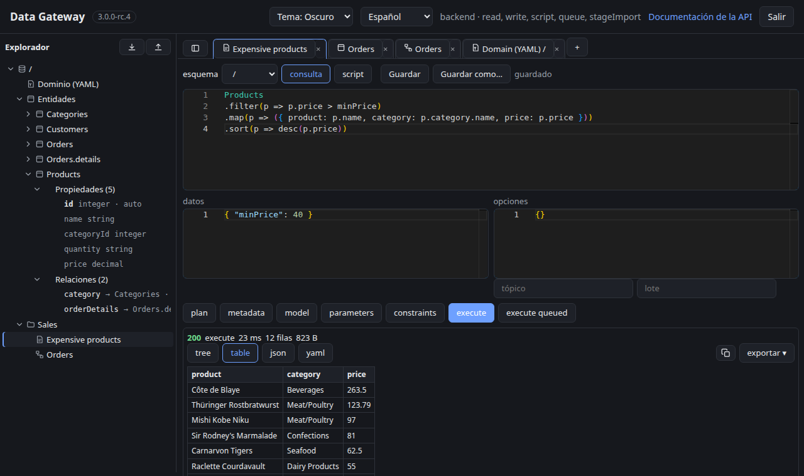
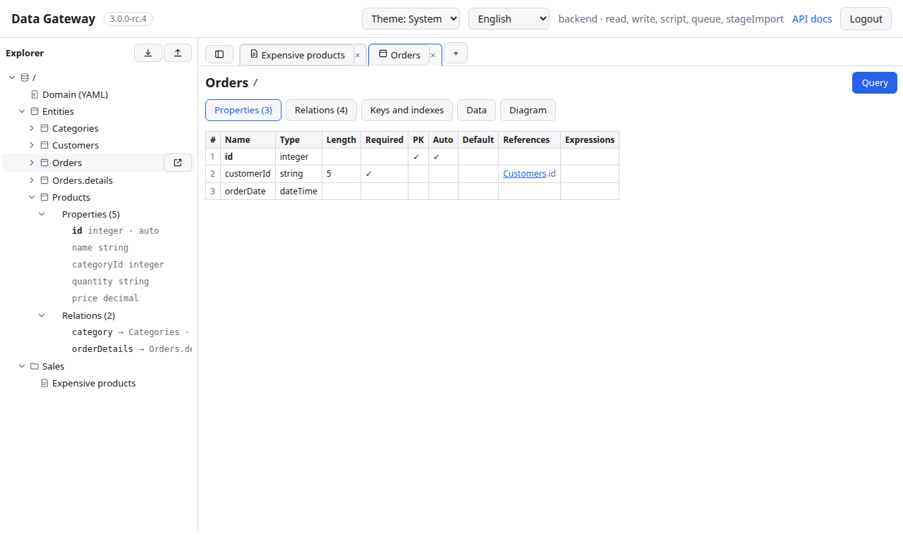

# UI

A step by step tour, from the first connection to a diagram, is in [Getting started](GettingStarted.md#9-the-ui).

The UI of the Data Gateway is the **data-gateway-ide**, an image of its own
([`flaviorita/data-gateway-ide`](https://hub.docker.com/r/flaviorita/data-gateway-ide)): an explorer of the schemas and
their entities, the form of each entity, query tabs with the autocompletion of the domain, saved queries and diagrams of
the domain. It is useful to try queries, to learn the language and to check what an agent does through MCP.

Like a database IDE, it connects to data gateways, one or several, each with its credential; their schemas,
workspaces and projects stay in them.

## Deploying it

Since 4.0.0 the gateway serves no UI and answers no CORS. The IDE reaches it through its **`management`** port
([Transports](Transports.md#management)): the routes of the REST API for every schema plus the
[administration](Admin.md). A gateway without that port has no IDE, which is what a production gateway whose schemas
come in its volumes may want.

```yaml
# data-gateway.config.yaml
transports:
  http: { port: 8080 }
  management: { port: 9090 }    # the API of the IDE; without a port, not exposed
```

```yaml
# docker-compose.yml
services:
  data-gateway:
    image: flaviorita/data-gateway:4.0.0
    # 9090 is not published: only the IDE reaches it, on the network of the compose
  ide:
    image: flaviorita/data-gateway-ide:1.0.0
    environment:
      DATA_GATEWAY_IDE_TARGETS: "http://data-gateway:9090,http://data-gateway:8080"
    ports:
      - "127.0.0.1:8090:8080"
```

- **The browser talks only to the server of the IDE.** It serves the page and forwards each request to the gateway (a
  proxy): REST, MCP and the WebSocket alike. The gateways never see the browser.
- **`DATA_GATEWAY_IDE_TARGETS`** lists the origins the IDE may reach, separated by commas, or `*` for any (an IDE run
  locally). Without it, the IDE reaches none and says so: an open proxy would reach any host of its network.
- **The IDE keeps no connection and no credential.** They stay in the browser. It forwards the credential to the
  gateway and drops the cookies and the origin of the page.
- **Keep `management` on an internal network.** It writes the schemas and their variables and runs DDL; the IDE is
  the one to publish.

### Where the IDE runs {#where-the-ide-runs}

| You deploy | For | `management` |
| --- | --- | --- |
| Only the gateway, without `management` | production, with the schemas in its volumes: no IDE, no administration | no port |
| The gateway and the IDE image | an IDE shared in the browser | on the internal network only, never published: the IDE container reaches it |
| Only the gateway, with `management` | an IDE on your own machine: the image run with `docker run` (and, later, the desktop app) | your machine has to reach its port (below) |

An IDE on your machine reaches a `management` that is elsewhere without publishing it open:

| The gateway runs | How the IDE reaches it | `management` published |
| --- | --- | --- |
| on the same machine | `localhost:9090` | — |
| in an internal network, or behind a VPN | `internal-host:9090` | only to that network |
| on a server, without a VPN | an SSH tunnel, `ssh -L 9090:localhost:9090 server`, and the connection to `localhost:9090` | only on the loopback of the server |
| in Kubernetes | `kubectl port-forward svc/data-gateway 9090`, and the connection to `localhost:9090` | an internal `Service`, no ingress |

Through a tunnel, the REST, WebSocket and MCP tabs need their own way too: tunnel their ports as well, or set their
URLs in the connection (**Other URLs of its transports**).

## Connections

The IDE has no home page and no login: it opens on the workspace, and the first time on a **New connection**.

| Field | What it is |
| --- | --- |
| **Name** | how the connection is shown |
| **Protocol** and **address** | the `management` of the gateway as **the server of the IDE** reaches it: `data-gateway:9090` (host, port and base path), not the address of the browser |
| **Authentication** | API key (the header, default `X-Api-Key`, and the key), bearer token, basic (user and password) or none |
| **Remember the key** | keep the key in the browser; otherwise it is kept in that tab only, and asked again after closing it |
| **Other URLs of its transports** | the REST, WebSocket and MCP of the gateway, only when the IDE doesn't reach them at the ports the gateway tells (a proxy in front, another network) |

**Test** checks the connection: who the credential is (`/whoami`) and the version of the gateway. **Show / Hide** shows
the key that was typed.

- The page of a connection shows who that credential is and **its roles**: each permission, with what it allows.
- The explorer lists the connections, each with its schemas; tabs of several connections can be open side by side.
  A connection is edited or removed from its row (removing it takes it from the IDE only).
- From a connection, in tabs, with its credential: its **REST API** (Swagger, to try every method), its **WebSocket**
  (its methods, a JSON-RPC console and what comes back) and its **MCP** (the tools of a schema, called with their
  arguments). A transport the gateway doesn't expose is disabled.

**Preferences** (the menu ☰): the theme (System, Light, Dark and others), the language (English, Español, Português,
Français, Italiano, Deutsch, Nederlands, Català, Galego, Euskara) and the regional format of the numbers and dates of
the results. They are remembered by the browser.



## Explorer

On the left, the connections and the schemas of each one. It can be resized by dragging its edge and hidden with the panel button of
the tab bar. For each schema:

- **Domain (YAML).** The domain of the schema (entities, properties, relations, keys, enums) in a **read-only**
  editor, with syntax highlighting, search and folding. It shows only the domain: never the sources, the connections
  nor the rest of the configuration.
- **Entities.** Each entity unfolds into:
    - **Properties**, with their types (the primary key in bold);
    - **Relations**, with the related entity and the cardinality (`customer → Customers · N — 1`); the **Open** button
      of a relation opens the related entity.
  The **Open** button (↗) of an entity, a double click or Enter open its [form](#entity-form).
- **What is saved** in the schema: folders, queries and diagrams ([below](#saved-queries-and-diagrams)).

- **Filter.** The box above the entities keeps those whose name, or the name of a property or relation, contains the
  text (`21 of 192`); the properties and relations that matched show under their entity.
- The width of the explorer is kept; a double click on its edge (or Enter) fits it to the names, and the arrows
  change it from the keyboard (Shift: 60 px).
- A schema that didn't start shows muted, with its state and its reason.


## Entity form

Like a table in a database IDE, in its own tab, with these sections:

| Section | Shows |
| --- | --- |
| **Properties** | each property: type (or enum), length, required, primary key (and unique), auto increment, default, **the entity and property a foreign key references** (a link to it), and its read / write expressions |
| **Relations** | its relations (name, type, entity, from, to, cardinality, weak) and **Referenced by**: the relations of other entities that point to it; each entity is a link to its form |
| **Keys and indexes** | primary key, unique key, indexes with their fields, constraints with their message and condition |
| **Data** | its rows in a table, **read only**, 50 per page, with Previous / Next; they can be copied and exported like any result |
| **Diagram** | the entity and its neighbours |

The **Query** button opens a query tab with `Entity.page(1, 10)`.




## Queries

Each query is a tab, with its own schema, text, data, options and result; switching tabs loses nothing. A tab is
opened with **+**, from an entity (**Query**) or from a saved query, and closed with its ×.

- **Editor** with the autocompletion of the schema's domain (entities, properties, relations and functions) and the
  errors of λORM marked in the text while typing. **Mode:** query or script (scripts only when the schema has them
  enabled and the credential has `script`).
- **Data** and **options** (JSON), and for queued executions the **topic** and the **chunk**.
- **Actions:** `plan`, `metadata`, `model`, `parameters` (fills the data with the query's variables),
  `constraints`, `execute` (Ctrl+Enter), `execute queued` and, in script mode, `execute script`. An action the
  credential cannot use is disabled, and its tooltip says why.
- **Result:** status, operation, time, rows and size, and four views: **tree**, **table** (when the result is a list
  of rows), **JSON** and **YAML**. The tree and the table show up to 200 rows; the exports have all of them.
    - The **copy** icon copies what is shown (the table as tab-separated text, ready to paste in a spreadsheet).
    - **Export** downloads the whole result as **JSON**, **YAML** or **TXT (tab-separated)**.
- **History** of the last queries of each schema, to bring one back.

- **An error with a suggestion** (`entity Area not found; did you mean Areas?`) has a **use Areas** button that
  replaces the name in the query.


## Saved queries and diagrams

The **+** of a schema or of a folder adds:

- **New folder.** Folders nest, to organise what is saved.
- **New query.** A query tab whose folder is that one.
- **New diagram.** See [Diagrams](#diagrams).

Each saved item has a **name** and a **description** (shown when the pointer is over it). Its row has **Edit** (name,
description and folder) and **Delete** (with confirmation; a folder takes what it holds). Items are **moved by
dragging** them onto a folder or onto the schema. Two items of the same kind cannot have the same name in a folder.

A query tab has **Save** (Ctrl+S) and **Save as…**: the first save asks for the name, the description and the folder.
A **•** in the tab marks changes that are not saved; once saved it says **saved**. Opening a saved query that is
already open goes to its tab.


## Diagrams

A diagram of the domain shows the chosen entities as boxes, with their properties, types, **PK** and **FK** (the
required ones in bold), and the relations as lines with their cardinality (**1 — N**, **1 — 1**); an inheritance is a
dashed line.

**New diagram** asks for the name, the description, the folder and **the entities**: they are searched, checked one
by one, or completed with **Add their neighbours** (the entities related to the chosen ones).


In a diagram:

| Action | How |
| --- | --- |
| Lay out | automatic when it opens (the boxes are placed by [ELK](https://eclipse.dev/elk/)); **lay out again** returns to it |
| Move a box | drag it |
| Move a line | drag it sideways; its ends stay on the rows of the fields it joins; a double click puts it back |
| Remove an entity | the **×** of its box (shown when the pointer is over it), or click the box and press Delete |
| Add or remove entities | **Entities…** |
| Names of the relations | **relation names** |
| Only the names of the entities | **names only** |
| Zoom and move | the mouse wheel; drag the background; **fit** shows it all |
| Open an entity | double click its box |
| Export | **SVG** or **PNG** |

The diagram is saved (**Save** or Ctrl+S) with the place of every box and line, the names option and the entities.


## Where it is saved

With the `workbenchWrite` permission, what is saved (folders, queries, diagrams) goes to the `workbench/` folder of
each workspace, in the gateway ([Administration](Admin.md)), shared by everyone who uses it. Without it, it stays **in
the browser**, in its IndexedDB, separated by gateway and by credential: what one credential saves is not seen with
another. Only the name of the credential is used for this, never its secret. In the browser:

- It is in that browser on that device: another browser or another device doesn't see it.
- It goes if the site data of the browser is cleared. The browser is asked to keep it, and the explorer exports
  **everything to a JSON file** (⤓) and imports it back (⤒), **adding** to what there is or **replacing** it: a backup,
  a way to move it to another browser or to share it with someone.
- In a browser that doesn't allow storing (some private windows), the explorer says so: what is saved lasts until the
  page is closed.

## In your own application

The UI is built with [`@lambdaorm/ui`](https://www.npmjs.com/package/@lambdaorm/ui), a library of React components
that any web application can use against a Data Gateway. The gateway answers no CORS: the application calls it through
its own backend, as the IDE does.

```sh
npm install @lambdaorm/ui react react-dom
```

```tsx
import { Workspace } from '@lambdaorm/ui'
import '@lambdaorm/ui/styles.css'

<Workspace
  baseUrl="/api/gateway"                         // your backend, which forwards to the gateway (it answers no CORS)
  headers={() => ({ 'X-Api-Key': key })}         // how to authenticate; the library keeps no credential
  locale="es"
  theme="dark"
  workspaceKey={`gateway.example.com|${user}`}   // separates what is saved
/>
```

| Component | What it is |
| --- | --- |
| `Workspace` | the whole workspace: explorer, entity forms, queries, saved items and diagrams |
| `QueryWorkbench` | one query editor with its actions and result |
| `QueryTabs` | several workbenches in tabs |
| `DomainDiagram` | a diagram of the domain (an entity and its neighbours, the whole model, or chosen entities) |
| `EntityView` | the form of an entity |
| `ResultViewer` | a result as tree, table, JSON or YAML, with copy and export |

What is saved can go to another place than the browser by giving `store` (a `WorkspaceStore`, for example a backend of
your own).

## Administration {#administration-ui}

Through the `management` port and with its permissions, the explorer also edits the schemas (as YAML and as forms), creates and
removes them, saves what is saved in the workspaces, sets the variables of the connections and runs the commands of
the CLI: see [Administration](Admin.md). The schemas are read again every 5 s: one added, removed or reloaded shows
without reloading the page, and a new version that didn't start is marked ⚠ with its reason.
