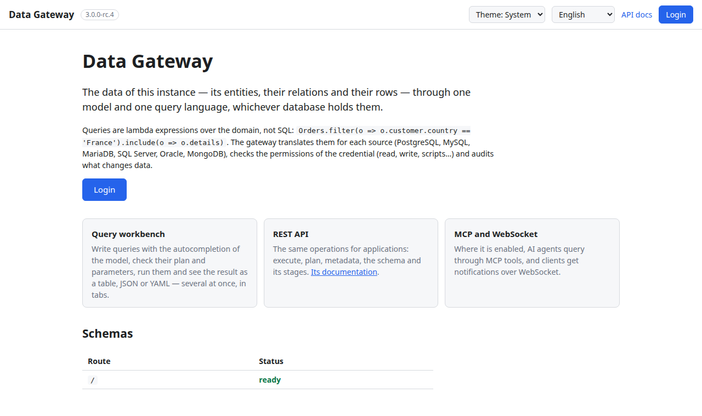
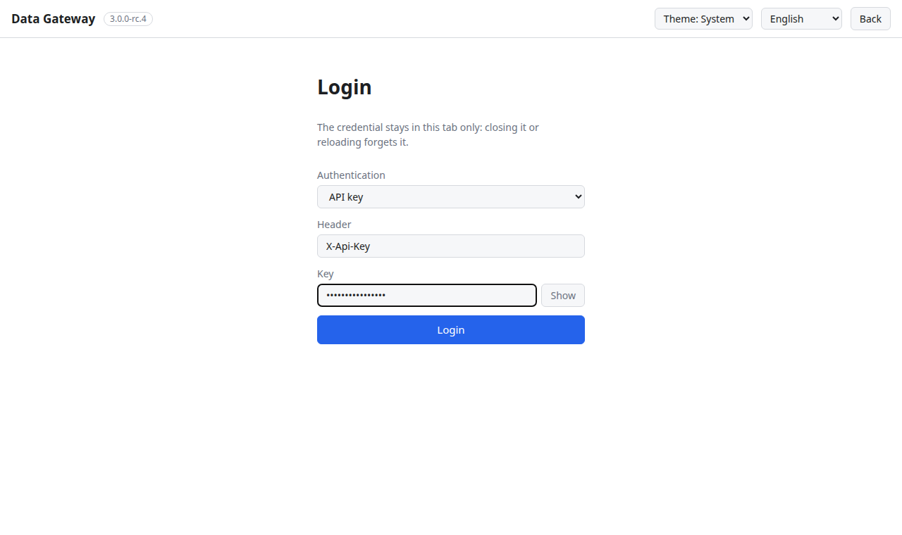

# UI {#ui}

Um tour passo a passo, do login até um diagrama, está em [Primeiros passos](GettingStarted.md#9-the-ui).

O gateway serve uma interface web para explorar seus esquemas e consultá-los: um explorador dos esquemas e de suas
entidades, o formulário de cada entidade, abas de consulta com o autocompletar do domínio, consultas salvas e diagramas do
domínio. Ela é útil para experimentar consultas, aprender a linguagem e verificar o que um agente faz por MCP.

```yaml
transports:
  http:
    port: 8080
    ui: { enabled: true }       # off by default
```

Ela fica em `http://localhost:8080/ui/` (com `basePath: /data-gateway`, em `/data-gateway/ui/`). É servida pelo
mesmo transporte `http` e chama sua [API REST](Rest.md) com a credencial informada: não tem nenhum outro acesso.

## Páginas {#pages}

**Início.** O que é o Data Gateway, sua versão, os esquemas da instância com seu estado (`ready`, `error`, …), um
link para a documentação da API (Swagger) e o botão **Entrar**.



**Login.** A autenticação da instância e a credencial:

| Autenticação | Pede |
| --- | --- |
| API key | o header (padrão `X-Api-Key`) e a chave |
| Bearer token | o token |
| Basic | o usuário e a senha |
| Nenhuma | nada |

O botão **Mostrar / Ocultar** mostra o que foi digitado. A credencial é verificada em um esquema (`/whoami`): uma incorreta
é informada e a página permanece. **A credencial fica apenas naquela aba do navegador**: fechá-la ou recarregar a página
a esquece, e ela nunca é armazenada.



**Consultas.** O espaço de trabalho, após o login: no topo, o nome e as permissões da credencial, a documentação da API e
**Sair** (volta para a página inicial).

No topo de todas as páginas há dois seletores:

- **Tema:** Sistema (como o sistema operacional), Claro ou Escuro.
- **Idioma:** English, Español, Português, Français, Italiano, Deutsch, Nederlands, Català, Galego, Euskara.

Ambos são lembrados pelo navegador.


## Explorador {#explorer}

À esquerda, os esquemas da instância. Ele pode ser redimensionado arrastando sua borda e ocultado com o botão de painel
da barra de abas. Para cada esquema:

- **Domínio (YAML).** O domínio do esquema (entidades, propriedades, relações, chaves, enums) em um editor
  **somente leitura**, com realce de sintaxe, busca e recolhimento. Ele mostra apenas o domínio: nunca as fontes, as conexões
  nem o resto da configuração.
- **Entidades.** Cada entidade se expande em:
    - **Propriedades**, com seus tipos (a chave primária em negrito);
    - **Relações**, com a entidade relacionada e a cardinalidade (`customer → Customers · N — 1`); o botão **Abrir**
      de uma relação abre a entidade relacionada.
  O botão **Abrir** (↗) de uma entidade, um duplo clique ou Enter abrem seu [formulário](#entity-form).
- **O que está salvo** no esquema: pastas, consultas e diagramas ([abaixo](#saved-queries-and-diagrams)).


## Formulário da entidade {#entity-form}

Como uma tabela em uma IDE de banco de dados, em sua própria aba, com estas seções:

| Seção | Mostra |
| --- | --- |
| **Propriedades** | cada propriedade: tipo (ou enum), tamanho, obrigatória, chave primária (e única), autoincremento, padrão, **a entidade e a propriedade que uma chave estrangeira referencia** (um link para ela) e suas expressões de leitura / escrita |
| **Relações** | suas relações (nome, tipo, entidade, de, para, cardinalidade, fraca) e **Referenciada por**: as relações de outras entidades que apontam para ela; cada entidade é um link para seu formulário |
| **Chaves e índices** | chave primária, chave única, índices com seus campos, restrições com sua mensagem e condição |
| **Dados** | suas linhas em uma tabela, **somente leitura**, 50 por página, com Anterior / Próxima; elas podem ser copiadas e exportadas como qualquer resultado |
| **Diagrama** | a entidade e suas vizinhas |

O botão **Consultar** abre uma aba de consulta com `Entity.page(1, 10)`.


## Consultas {#queries}

Cada consulta é uma aba, com seu próprio esquema, texto, dados, opções e resultado; trocar de aba não perde nada. Uma aba é
aberta com **+**, a partir de uma entidade (**Consultar**) ou de uma consulta salva, e fechada com seu ×.

- **Editor** com o autocompletar do domínio do esquema (entidades, propriedades, relações e funções) e os
  erros do λORM marcados no texto durante a digitação. **Modo:** consulta ou script (scripts apenas quando o esquema os tem
  habilitados e a credencial tem `script`).
- **Dados** e **opções** (JSON) e, para execuções enfileiradas, o **tópico** e o **lote**.
- **Ações:** `plan`, `metadata`, `model`, `parameters` (preenche os dados com as variáveis da consulta),
  `constraints`, `execute` (Ctrl+Enter), `execute queued` e, no modo script, `execute script`. Uma ação que a
  credencial não pode usar fica desabilitada, e sua dica diz por quê.
- **Resultado:** estado, operação, tempo, linhas e tamanho, e quatro visualizações: **árvore**, **tabela** (quando o resultado é uma lista
  de linhas), **JSON** e **YAML**. A árvore e a tabela mostram até 200 linhas; as exportações têm todas.
    - O ícone **copiar** copia o que é mostrado (a tabela como texto separado por tabulações, pronto para colar em uma planilha).
    - **Exportar** baixa o resultado inteiro como **JSON**, **YAML** ou **TXT (separado por tabulações)**.
- **Histórico** das últimas consultas de cada esquema, para recuperar uma delas.


## Consultas salvas e diagramas {#saved-queries-and-diagrams}

O **+** de um esquema ou de uma pasta adiciona:

- **Nova pasta.** As pastas se aninham, para organizar o que é salvo.
- **Nova consulta.** Uma aba de consulta cuja pasta é aquela.
- **Novo diagrama.** Veja [Diagramas](#diagrams).

Cada item salvo tem um **nome** e uma **descrição** (exibida quando o ponteiro está sobre ele). Sua linha tem **Editar** (nome,
descrição e pasta) e **Excluir** (com confirmação; uma pasta leva o que contém). Os itens são **movidos arrastando-os**
para uma pasta ou para o esquema. Dois itens do mesmo tipo não podem ter o mesmo nome em uma pasta.

Uma aba de consulta tem **Salvar** (Ctrl+S) e **Salvar como…**: o primeiro salvamento pede o nome, a descrição e a pasta.
Um **•** na aba marca alterações não salvas; depois de salva, ela indica **salvo**. Abrir uma consulta salva que
já está aberta leva à sua aba.


## Diagramas {#diagrams}

Um diagrama do domínio mostra as entidades escolhidas como caixas, com suas propriedades, tipos, **PK** e **FK** (as
obrigatórias em negrito), e as relações como linhas com sua cardinalidade (**1 — N**, **1 — 1**); uma herança é uma
linha tracejada.

**Novo diagrama** pede o nome, a descrição, a pasta e **as entidades**: elas são buscadas, marcadas uma
a uma ou completadas com **Adicionar as vizinhas** (as entidades relacionadas às escolhidas).


Em um diagrama:

| Ação | Como |
| --- | --- |
| Organizar | automático ao abrir (as caixas são posicionadas pelo [ELK](https://eclipse.dev/elk/)); **reorganizar** volta a esse layout |
| Mover uma caixa | arraste-a |
| Mover uma linha | arraste-a para o lado; suas extremidades ficam nas linhas dos campos que ela une; um duplo clique a recoloca |
| Remover uma entidade | o **×** de sua caixa (exibido quando o ponteiro está sobre ela), ou clique na caixa e pressione Delete |
| Adicionar ou remover entidades | **Entidades…** |
| Nomes das relações | **nomes das relações** |
| Apenas os nomes das entidades | **só nomes** |
| Zoom e movimentação | a roda do mouse; arraste o fundo; **ajustar** mostra tudo |
| Abrir uma entidade | duplo clique em sua caixa |
| Exportar | **SVG** ou **PNG** |

O diagrama é salvo (**Salvar** ou Ctrl+S) com a posição de cada caixa e linha, a opção de nomes e as entidades.


## Onde é salvo {#where-it-is-saved}

O que é salvo (pastas, consultas, diagramas) fica **no navegador**, em seu IndexedDB, separado por gateway e por
credencial: o que uma credencial salva não é visto com outra. Apenas o nome da credencial é usado para isso,
nunca seu segredo.

- Fica naquele navegador, naquele dispositivo: outro navegador ou outro dispositivo não o vê.
- É perdido se os dados do site forem apagados no navegador. Pede-se ao navegador que os mantenha, e o explorador exporta
  **tudo para um arquivo JSON** (⤓) e o importa de volta (⤒), **adicionando** ao que existe ou **substituindo**: um backup,
  uma forma de levá-lo para outro navegador ou de compartilhá-lo com alguém.
- Em um navegador que não permite armazenar dados (algumas janelas privadas), o explorador avisa: o que é salvo dura até a
  página ser fechada.

## Na sua própria aplicação {#in-your-own-application}

A UI é construída com [`@lambdaorm/ui`](https://www.npmjs.com/package/@lambdaorm/ui), uma biblioteca de componentes React
que qualquer aplicação web pode usar com um Data Gateway:

```sh
npm install @lambdaorm/ui react react-dom
```

```tsx
import { Workspace } from '@lambdaorm/ui'
import '@lambdaorm/ui/styles.css'

<Workspace
  baseUrl="https://gateway.example.com"          // the http transport of the gateway
  headers={() => ({ 'X-Api-Key': key })}         // how to authenticate; the library keeps no credential
  locale="es"
  theme="dark"
  workspaceKey={`gateway.example.com|${user}`}   // separates what is saved
/>
```

| Componente | O que é |
| --- | --- |
| `Workspace` | o espaço de trabalho inteiro: explorador, formulários de entidades, consultas, itens salvos e diagramas |
| `QueryWorkbench` | um editor de consultas com suas ações e seu resultado |
| `QueryTabs` | várias bancadas em abas |
| `DomainDiagram` | um diagrama do domínio (uma entidade e suas vizinhas, o modelo inteiro ou entidades escolhidas) |
| `EntityView` | o formulário de uma entidade |
| `ResultViewer` | um resultado como árvore, tabela, JSON ou YAML, com cópia e exportação |

O que é salvo pode ir para outro lugar além do navegador informando `store` (um `WorkspaceStore`, por exemplo um backend
próprio).
