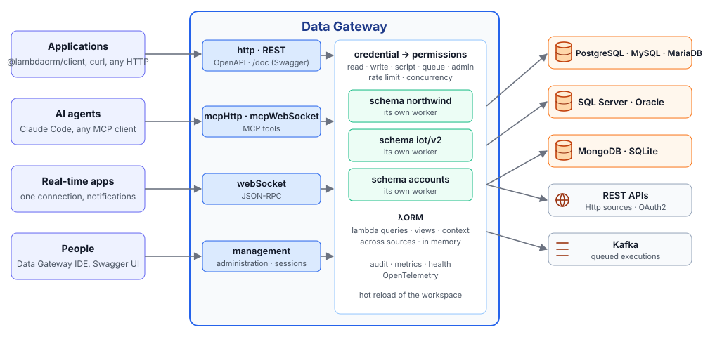
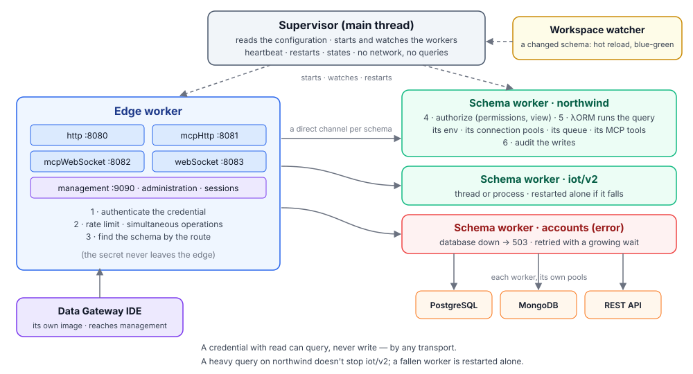

# Data Gateway {#data-gateway}

## Zielsetzung {#objective}

Anwendungen, KI-Agenten und Personen **kontrollierten Zugriff auf die Daten von λORM-Schemas über das Netzwerk** geben –
per Konfiguration, ohne dafür ein Backend schreiben zu müssen.

Ein λORM-Schema beschreibt bereits eine Domäne (ihre Entitäten, Beziehungen und Regeln) und wo ihre Daten liegen (eine
oder mehrere Datenbanken unterschiedlicher Datenbank-Engines). Das Data Gateway veröffentlicht dieses Schema, sodass:

- eine **Anwendung** es über eine REST API (oder eine WebSocket-Verbindung) abfragt und beschreibt, mit denselben
  Lambda-Abfragen, die sie in Node verwenden würde;
- ein **KI-Agent** die Domäne über MCP erkundet und abfragt und dabei die Entitäten und die Sprache kennt;
- eine **Person** in seiner IDE die Schemas erkundet, jede Entität als Formular liest, Abfragen ausprobiert und
  Diagramme zeichnet;

und sodass **wer was tun darf** an einer einzigen Stelle festgelegt wird, für alle gleich: Alle Zugangsdaten haben
Berechtigungen, und jede Änderung wird protokolliert.

## Umfang {#scope}

**Was es tut:**

- Stellt pro Instanz **ein oder mehrere λORM-Schemas** bereit, jedes unter einer Route (`/iot/v1`, `/iot/v2`, `/accounts`).
- Stellt sie über vier **Transporte** für die Daten bereit, jeden nur, wenn er einen Port hat: REST (`http`), MCP
  (`mcpHttp`, `mcpWebSocket`) und eine JSON-RPC-API über WebSocket (`webSocket`); dazu einen fünften, `management`,
  für die IDE und die Administration, der in einem internen Netz bleibt.
- Alle Operationen von λORM: Abfragen (`execute`, `plan`, `metadata`, `model`, `parameters`, `constraints`), Skripte
  (mehrere Abfragen in einer Transaktion), Ausführungen in einer Warteschlange (Kafka), das Schema und sein Modell sowie
  Stages (Export, Import).
- **Authentifizierung** (API-Key, Bearer-Token, Basic) und **Berechtigungen** pro Zugangsdaten (`read`, `write`, `script`,
  `queue`, `stageImport`), global, pro Transport oder pro Schema.
- **Administration** der Workspaces über `management`: Schemas werden angelegt, bearbeitet (als YAML oder Element für
  Element) und entfernt, die Variablen ihrer Verbindungen gesetzt und die Befehle der CLI (`push`, `pull`, `import`, …)
  mit einer Vorschau ausgeführt, mit eigenen Berechtigungen; die Schemas werden neu geladen, ohne das Gateway neu zu
  starten.
- **Isolation**: Jedes Schema läuft in einem eigenen Worker, mit eigener Umgebung und eigenen Verbindungen; fällt eines
  aus, sind die anderen nicht betroffen.
- **Audit** von Schreibvorgängen, **Metriken** (Prometheus), **Health** (Kubernetes-Probes), Limits (Rate, Nebenläufigkeit,
  Größen, Zeit).
- Eine **IDE** (ein eigenes Image, das den `management`-Port des Gateways erreicht): Explorer, Entitätsformulare,
  Abfrage-Tabs mit Autovervollständigung, gespeicherte Abfragen und Diagramme der Domäne.

**Was es nicht tut:**

- Es definiert weder die Domäne noch migriert es die Datenbanken: Das übernehmen das [Schema](../schema/SchemaDefinition.md)
  und die [CLI](../cli/index.md) (`push`, `pull`, …).
- Es akzeptiert kein SQL: nur λORM-Abfragen, die für jede Quelle übersetzt werden.
- Keine eigenen Benutzer oder Rollen über die Zugangsdaten seiner Konfiguration hinaus (noch keine Anmeldung bei einem
  Identity Provider).
- Ohne die Berechtigung `workbenchWrite` speichert die IDE das Gespeicherte in jedem Browser.

## Beschreibung {#description}

Das Data Gateway ist eine Node-Anwendung, die als Docker-Image
[`flaviorita/data-gateway`](https://hub.docker.com/r/flaviorita/data-gateway) veröffentlicht wird. Sie liest **eine
Konfigurationsdatei** (`data-gateway.config.yaml`), die angibt, wo sich die Schemas befinden, wie sie bereitgestellt
werden und wer sie verwenden darf; die Schemas selbst bleiben in ihren λORM-Workspaces (`lambdaORM.yaml`).

Intern startet und überwacht ein **Supervisor** die Worker. Der **Edge-Worker** lauscht auf den Ports der Transporte,
authentifiziert jede Anfrage und sendet sie über einen direkten Kanal an den **Worker des Schemas**, der die
Berechtigungen prüft, die Operation mit λORM gegen seine Datenbanken ausführt und sie protokolliert. Eine aufwendige
Abfrage in einem Schema bremst kein anderes aus; ein Schema, dessen Datenbank nicht erreichbar ist, antwortet mit `503`
und wird erneut versucht, während die anderen weiterarbeiten.

### Konzepte {#concepts}

| Konzept | Was es ist |
| --- | --- |
| **Schema** | ein λORM-Workspace (ein Ordner mit `lambdaORM.yaml`): Domäne, Quellen, Mappings, Stages; unter einer Route bereitgestellt |
| **Route** | wo ein Schema erreichbar ist: `/iot/v1/execute`, `/iot/v1/mcp`, `ws://host/iot/v1`; ein einzelnes Schema kann an der Wurzel liegen |
| **Transport** | ein Zugang, auf einem eigenen Port: `http`, `mcpHttp`, `mcpWebSocket`, `webSocket` und `management` (der der IDE) |
| **Zugangsdaten** | ein Key, Token oder Benutzer mit einem **Namen** und **Berechtigungen**; vom Client mit jeder Anfrage gesendet |
| **Berechtigung** | `read`, `write`, `script`, `queue`, `stageImport`: was die Zugangsdaten tun dürfen, auf jedem Transport; die Administration hat eigene (`schemaRead`, `ddl`, …), die nie standardmäßig vergeben werden |
| **Stage** | ein λORM-Szenario eines Schemas (welche Quellen welche Entitäten enthalten); ausgewählt mit `options.stage` |
| **Worker** | wo ein Schema läuft: ein eigener Thread oder Prozess |

### Eine Anfrage Schritt für Schritt {#a-request-step-by-step}

1. Ein Client sendet `POST /iot/v1/execute` mit `X-Api-Key: …` und `{ "query": "Orders.filter(…)", "data": {…} }`.
2. Der Transport `http` findet die Zugangsdaten (`agent`, Berechtigungen `[read]`) und das Schema `iot/v1`.
3. Der Worker des Schemas analysiert die Abfrage: Sie liest nur, also genügt `read`.
4. λORM übersetzt sie für jede Quelle des Stages, führt sie aus und führt die Ergebnisse zusammen.
5. Die Antwort wird als JSON zurückgegeben. Hätte sie Daten geschrieben, hätten die Zugangsdaten `write` benötigt, und
   die Operation hätte eine Audit-Zeile hinterlassen.

## In diesem Abschnitt {#in-this-section}

- [Erste Schritte](GettingStarted.md): Schritt für Schritt von einem leeren Ordner zur REST API, zur IDE, zu MCP und WebSocket.
- [Konfiguration](Configuration.md): die Konfigurationsdatei, Schemas, Umgebung, Laufzeit und jeder Schlüssel.
- [Transporte](Transports.md): die fünf Transporte (vier für die Daten und `management`, der der IDE), ihre Routen und Optionen.
- [REST API](Rest.md): jede Methode des Transports `http`, mit Beispielen.
- [MCP](Mcp.md): die Tools, Ressourcen und Transporte für KI-Agenten.
- [WebSocket API](WebSocket.md): die JSON-RPC-Methoden und die Benachrichtigungen.
- [Sicherheit](Security.md): Authentifizierung, Berechtigungen, Audit, Limits und Fehler.
- [Administration](Admin.md): die Workspaces, aus der IDE bearbeitet, die Befehle, die Nebenläufigkeit.
- [UI](../ide/index.md): die IDE: Verbindungen, Explorer, Entitätsformulare, Abfragen, gespeicherte Abfragen und Diagramme.
- [Clients](Clients.md): `@lambdaorm/client`, die CLI und das OpenAPI-Dokument.
- [Betrieb](Operations.md): Docker, Kubernetes, Health, Metriken und Logs.
- [Änderungsprotokoll](CHANGELOG.md)
