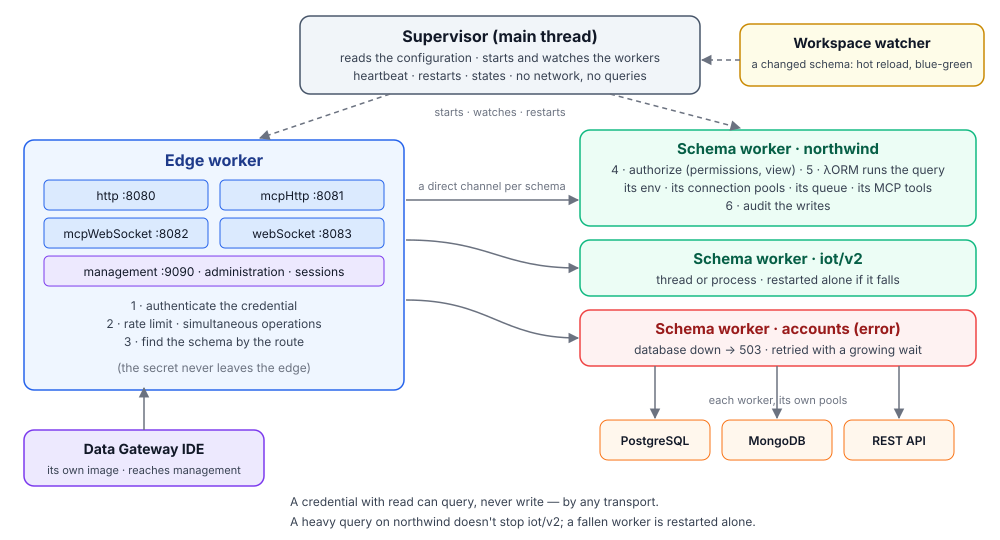

# Data Gateway {#data-gateway}

## Objetivo {#objective}

Dar a aplicaciones, agentes de IA y personas **acceso gobernado a los datos de esquemas de λORM a través de la red**,
mediante configuración, sin escribir un backend para ello.

Un esquema de λORM ya describe un dominio (sus entidades, relaciones y reglas) y dónde residen sus datos (una o varias
bases de datos de distintos motores). El Data Gateway publica ese esquema para que:

- una **aplicación** lo consulte y escriba a través de una API REST (o una conexión WebSocket), con las mismas consultas
  lambda que usaría en Node;
- un **agente de IA** explore el dominio y lo consulte a través de MCP, conociendo las entidades y el lenguaje;
- una **persona** explore los esquemas, lea cada entidad como un formulario, pruebe consultas y dibuje diagramas en una UI web;

y para que **quién puede hacer qué** se decida en un único lugar, igual para todos ellos: cada credencial tiene permisos,
y cada cambio se audita.

## Alcance {#scope}

**Qué hace:**

- Sirve **uno o varios esquemas de λORM** por instancia, cada uno en una ruta (`/iot/v1`, `/iot/v2`, `/accounts`).
- Los expone mediante cuatro **transportes**, cada uno solo cuando tiene un puerto: REST (`http`), MCP (`mcpHttp`,
  `mcpWebSocket`) y una API JSON-RPC sobre WebSocket (`webSocket`).
- Todas las operaciones de λORM: consultas (`execute`, `plan`, `metadata`, `model`, `parameters`, `constraints`), scripts
  (varias consultas en una transacción), ejecuciones encoladas (Kafka), el esquema y su modelo, y los stages (exportación,
  importación).
- **Autenticación** (API key, bearer token, basic) y **permisos** por credencial (`read`, `write`, `script`,
  `queue`, `stageImport`), de forma global, por transporte o por esquema.
- **Aislamiento**: cada esquema se ejecuta en su propio worker, con su propio entorno y sus propias conexiones; si uno falla, no
  afecta a los demás.
- **Auditoría** de escrituras, **métricas** (Prometheus), **salud** (probes de Kubernetes), límites (tasa, concurrencia, tamaños,
  tiempo).
- Una **UI web**: explorador, formularios de entidades, pestañas de consultas con autocompletado, consultas guardadas y diagramas del dominio.

**Qué no hace:**

- No define el dominio ni migra las bases de datos: de eso se encargan el [esquema](../schema/SchemaDefinition.md) y la
  [CLI](../cli/index.md) (`push`, `pull`, …).
- No acepta SQL: solo consultas de λORM, traducidas para cada fuente.
- No tiene usuarios ni roles propios más allá de las credenciales de su configuración (todavía no hay login contra un proveedor
  de identidad).
- La UI guarda lo que se guarda en cada navegador; no hay almacenamiento compartido de consultas guardadas en el servidor.

## Descripción {#description}

El Data Gateway es una aplicación Node publicada como la imagen Docker
[`flaviorita/data-gateway`](https://hub.docker.com/r/flaviorita/data-gateway). Lee **un único archivo de configuración**
(`data-gateway.config.yaml`) que indica dónde están los esquemas, cómo se exponen y quién puede usarlos; los esquemas
en sí permanecen en sus workspaces de λORM (`lambdaORM.yaml`).

Internamente, un **supervisor** arranca y vigila los workers. El **edge worker** escucha en los puertos de los transportes,
autentica cada petición y la envía, por un canal directo, al **worker del esquema**, que comprueba los
permisos, ejecuta la operación con λORM contra sus bases de datos y la audita. Una consulta pesada en un esquema no
ralentiza a otro; un esquema cuya base de datos está caída responde `503` y se reintenta, mientras los demás siguen funcionando.

### Conceptos {#concepts}

| Concepto | Qué es |
| --- | --- |
| **Esquema** | un workspace de λORM (una carpeta con `lambdaORM.yaml`): dominio, fuentes, mappings, stages; servido en una ruta |
| **Ruta** | dónde se accede a un esquema: `/iot/v1/execute`, `/iot/v1/mcp`, `ws://host/iot/v1`; un único esquema puede estar en la raíz |
| **Transporte** | una vía de entrada, en su propio puerto: `http`, `mcpHttp`, `mcpWebSocket`, `webSocket` |
| **Credencial** | una clave, un token o un usuario con un **nombre** y **permisos**; el cliente la envía en cada petición |
| **Permiso** | `read`, `write`, `script`, `queue`, `stageImport`: lo que la credencial puede hacer, en todos los transportes |
| **Stage** | un escenario de λORM de un esquema (qué fuentes contienen qué entidades); se elige con `options.stage` |
| **Worker** | donde se ejecuta un esquema: un hilo o un proceso propio |

### Una petición, paso a paso {#a-request-step-by-step}

1. Un cliente envía `POST /iot/v1/execute` con `X-Api-Key: …` y `{ "query": "Orders.filter(…)", "data": {…} }`.
2. El transporte `http` encuentra la credencial (`agent`, permisos `[read]`) y el esquema `iot/v1`.
3. El worker del esquema analiza la consulta: solo selecciona, así que basta con `read`.
4. λORM la traduce para cada fuente del stage, la ejecuta y une los resultados.
5. La respuesta vuelve como JSON. Si hubiera escrito datos, la credencial habría necesitado `write`, y la operación
   habría dejado una línea de auditoría.

## En esta sección {#in-this-section}

- [Primeros pasos](GettingStarted.md): paso a paso, desde una carpeta vacía hasta la API REST, la UI, MCP y WebSocket.
- [Configuración](Configuration.md): el archivo de configuración, los esquemas, el entorno, el runtime y todas las claves.
- [Transportes](Transports.md): los cuatro transportes, sus rutas y opciones.
- [API REST](Rest.md): todos los métodos del transporte `http`, con ejemplos.
- [MCP](Mcp.md): las herramientas, los recursos y los transportes para agentes de IA.
- [API WebSocket](WebSocket.md): los métodos JSON-RPC y las notificaciones.
- [Seguridad](Security.md): autenticación, permisos, auditoría, límites y errores.
- [UI](Ui.md): la interfaz web: explorador, formularios de entidades, consultas, consultas guardadas y diagramas.
- [Clientes](Clients.md): `@lambdaorm/client`, la CLI y el documento OpenAPI.
- [Operaciones](Operations.md): Docker, Kubernetes, salud, métricas y logs.
- [Registro de cambios](CHANGELOG.md)
