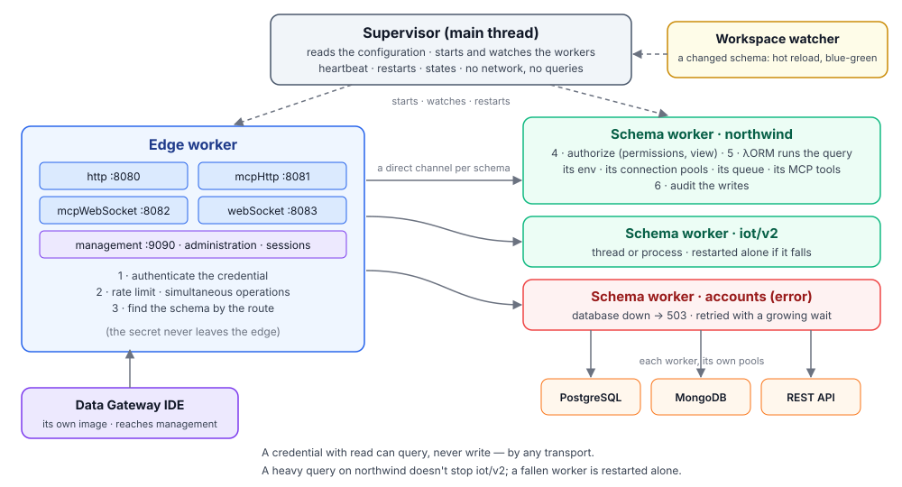

# Data Gateway

## Objective

Give applications, AI agents and people **governed access to the data of λORM schemas over the network**, by
configuration, without writing a backend for it.

A λORM schema already describes a domain (its entities, relations and rules) and where its data lives (one or many
databases of different engines). The Data Gateway publishes that schema so that:

- an **application** queries and writes it through a REST API (or a WebSocket connection), with the same lambda
  queries it would use in Node;
- an **AI agent** explores the domain and queries it through MCP, knowing the entities and the language;
- a **person** explores the schemas, reads each entity as a form, tries queries and draws diagrams in its IDE;

and so that **who can do what** is decided in one place, the same for all of them: each credential has permissions,
and every change is audited.

## Scope

**What it does:**

- Serves **one or several λORM schemas** per instance, each at a route (`/iot/v1`, `/iot/v2`, `/accounts`).
- Exposes them by four **transports**, each one only when it has a port: REST (`http`), MCP (`mcpHttp`,
  `mcpWebSocket`) and a JSON-RPC API over WebSocket (`webSocket`).
- Every operation of λORM: queries (`execute`, `plan`, `metadata`, `model`, `parameters`, `constraints`), scripts
  (several queries in one transaction), queued executions (Kafka), the schema and its model, and stages (export,
  import).
- **Authentication** (API key, bearer token, basic) and **permissions** per credential (`read`, `write`, `script`,
  `queue`, `stageImport`), globally, per transport or per schema.
- **Isolation**: each schema runs in its own worker, with its own environment and connections; one that fails doesn't
  affect the others.
- **Audit** of writes, **metrics** (Prometheus), **health** (Kubernetes probes), limits (rate, concurrency, sizes,
  time).
- An **IDE** (its own image, reaching the gateway's `management` port): explorer, entity forms, query tabs with
  autocompletion, saved queries and diagrams of the domain.

**What it doesn't do:**

- It doesn't define the domain nor migrate the databases: that is the [schema](../schema/SchemaDefinition.md) and the
  [CLI](../cli/index.md) (`push`, `pull`, …).
- It doesn't accept SQL: only λORM queries, translated for each source.
- No users nor roles of its own beyond the credentials of its configuration (no login against an identity provider
  yet).
- Without the `workbenchWrite` permission, the IDE keeps what is saved in each browser.

## Description

The Data Gateway is a Node application published as the Docker image
[`flaviorita/data-gateway`](https://hub.docker.com/r/flaviorita/data-gateway). It reads **one configuration file**
(`data-gateway.config.yaml`) that says where the schemas are, how they are exposed and who can use them; the schemas
themselves stay in their λORM workspaces (`lambdaORM.yaml`).

Inside, a **supervisor** starts and watches the workers. The **edge worker** listens on the ports of the transports,
authenticates each request and sends it, by a direct channel, to the **worker of the schema**, which checks the
permissions, runs the operation with λORM against its databases and audits it. A heavy query in one schema doesn't
slow down another; a schema whose database is down answers `503` and is retried, while the others keep working.

### Concepts

| Concept | What it is |
| --- | --- |
| **Schema** | a λORM workspace (a folder with `lambdaORM.yaml`): domain, sources, mappings, stages; served at a route |
| **Route** | where a schema is reached: `/iot/v1/execute`, `/iot/v1/mcp`, `ws://host/iot/v1`; a single schema can be at the root |
| **Transport** | a way in, on its own port: `http`, `mcpHttp`, `mcpWebSocket`, `webSocket` |
| **Credential** | a key, token or user with a **name** and **permissions**; sent by the client in each request |
| **Permission** | `read`, `write`, `script`, `queue`, `stageImport`: what the credential can do, on every transport |
| **Stage** | a λORM scenario of a schema (which sources hold which entities); chosen with `options.stage` |
| **Worker** | where a schema runs: a thread or a process of its own |

### A request, step by step

1. A client sends `POST /iot/v1/execute` with `X-Api-Key: …` and `{ "query": "Orders.filter(…)", "data": {…} }`.
2. The `http` transport finds the credential (`agent`, permissions `[read]`) and the schema `iot/v1`.
3. The schema's worker analyses the query: it only selects, so `read` is enough.
4. λORM translates it for each source of the stage, runs it and joins the results.
5. The answer goes back as JSON. Had it written data, the credential would have needed `write`, and the operation
   would have left an audit line.

## In this section

- [Getting started](GettingStarted.md): step by step, from an empty folder to the REST API, the IDE, MCP and WebSocket.
- [Configuration](Configuration.md): the configuration file, schemas, environment, runtime and every key.
- [Transports](Transports.md): the five transports (four of data and `management`, the IDE's), their routes and options.
- [REST API](Rest.md): every method of the `http` transport, with examples.
- [MCP](Mcp.md): the tools, resources and transports for AI agents.
- [WebSocket API](WebSocket.md): the JSON-RPC methods and the notifications.
- [Security](Security.md): authentication, permissions, audit, limits and errors.
- [UI](../ide/Guide.md): the IDE: connections, explorer, entity forms, queries, saved queries and diagrams.
- [Clients](Clients.md): `@lambdaorm/client`, the CLI and the OpenAPI document.
- [Operations](Operations.md): Docker, Kubernetes, health, metrics and logs.
- [Change log](CHANGELOG.md)
