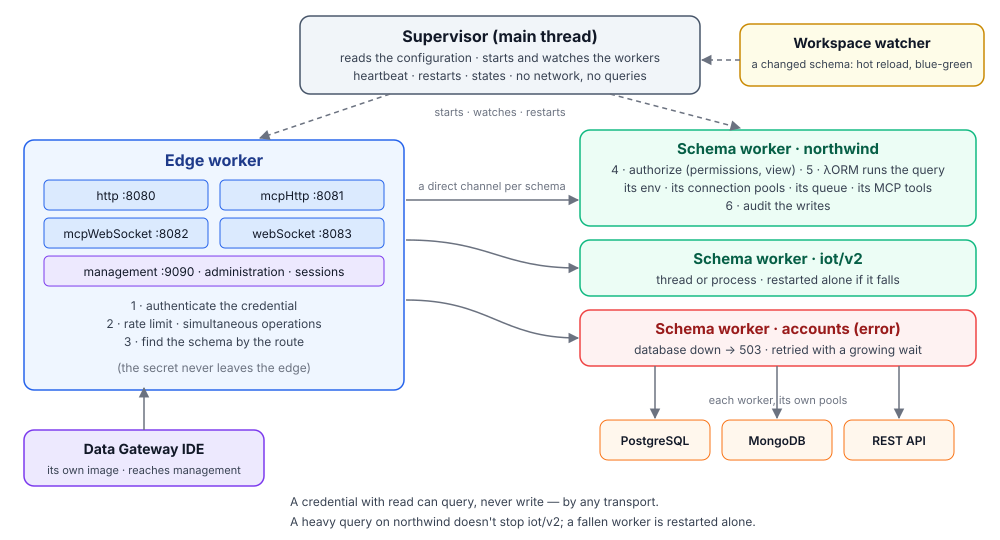

# Data Gateway {#data-gateway}

## Objetivo {#objective}

Dar a aplicações, agentes de IA e pessoas **acesso governado aos dados de esquemas do λORM pela rede**, por
configuração, sem escrever um backend para isso.

Um esquema do λORM já descreve um domínio (suas entidades, relações e regras) e onde seus dados estão (um ou vários
bancos de dados de mecanismos diferentes). O Data Gateway publica esse esquema para que:

- uma **aplicação** o consulte e grave dados por uma API REST (ou uma conexão WebSocket), com as mesmas consultas
  lambda que usaria no Node;
- um **agente de IA** explore o domínio e o consulte por MCP, conhecendo as entidades e a linguagem;
- uma **pessoa** explore os esquemas, leia cada entidade como um formulário, experimente consultas e desenhe diagramas em sua IDE;

e para que **quem pode fazer o quê** seja decidido em um só lugar, igual para todos eles: cada credencial tem permissões,
e toda alteração é auditada.

## Escopo {#scope}

**O que ele faz:**

- Serve **um ou vários esquemas do λORM** por instância, cada um em uma rota (`/iot/v1`, `/iot/v2`, `/accounts`).
- Expõe-nos por quatro **transportes** de dados, cada um apenas quando tem uma porta: REST (`http`), MCP (`mcpHttp`,
  `mcpWebSocket`) e uma API JSON-RPC sobre WebSocket (`webSocket`); e um quinto, `management`, para o IDE e a
  administração, mantido em uma rede interna.
- Todas as operações do λORM: consultas (`execute`, `plan`, `metadata`, `model`, `parameters`, `constraints`), scripts
  (várias consultas em uma só transação), execuções enfileiradas (Kafka), o esquema e seu modelo, e stages (exportação,
  importação).
- **Autenticação** (API key, bearer token, basic) e **permissões** por credencial (`read`, `write`, `script`,
  `queue`, `stageImport`), globalmente, por transporte ou por esquema.
- **Administração** dos workspaces por meio do `management`: esquemas criados, editados (como YAML ou elemento a
  elemento) e removidos, as variáveis de suas conexões e os comandos da CLI (`push`, `pull`, `import`, …) com uma
  pré-visualização, sob permissões próprias; os esquemas são recarregados sem reiniciar o gateway.
- **Isolamento**: cada esquema é executado em seu próprio worker, com seu próprio ambiente e suas próprias conexões; um que falhe não
  afeta os demais.
- **Auditoria** das escritas, **métricas** (Prometheus), **saúde** (probes do Kubernetes), limites (taxa, concorrência, tamanhos,
  tempo).
- Uma **IDE** (imagem própria, que alcança a porta `management` do gateway): explorador, formulários de entidades, abas de
  consulta com autocompletar, consultas salvas e diagramas do domínio.

**O que ele não faz:**

- Não define o domínio nem migra os bancos de dados: isso é papel do [esquema](../schema/SchemaDefinition.md) e da
  [CLI](../cli/index.md) (`push`, `pull`, …).
- Não aceita SQL: apenas consultas do λORM, traduzidas para cada fonte.
- Não tem usuários nem papéis próprios além das credenciais de sua configuração (ainda sem login em um provedor de
  identidade).
- Sem a permissão `workbenchWrite`, a IDE guarda o que é salvo em cada navegador.

## Descrição {#description}

O Data Gateway é uma aplicação Node publicada como a imagem Docker
[`flaviorita/data-gateway`](https://hub.docker.com/r/flaviorita/data-gateway). Ele lê **um arquivo de configuração**
(`data-gateway.config.yaml`) que diz onde estão os esquemas, como são expostos e quem pode usá-los; os esquemas
em si permanecem em seus workspaces do λORM (`lambdaORM.yaml`).

Internamente, um **supervisor** inicia e monitora os workers. O **edge worker** escuta nas portas dos transportes,
autentica cada requisição e a envia, por um canal direto, ao **worker do esquema**, que verifica as
permissões, executa a operação com o λORM em seus bancos de dados e a audita. Uma consulta pesada em um esquema não
deixa outro mais lento; um esquema cujo banco de dados está fora do ar responde `503` e é tentado novamente, enquanto os demais continuam funcionando.

### Conceitos {#concepts}

| Conceito | O que é |
| --- | --- |
| **Esquema** | um workspace do λORM (uma pasta com `lambdaORM.yaml`): domínio, fontes, mapeamentos, stages; servido em uma rota |
| **Rota** | onde um esquema é acessado: `/iot/v1/execute`, `/iot/v1/mcp`, `ws://host/iot/v1`; um esquema único pode ficar na raiz |
| **Transporte** | uma forma de entrada, em sua própria porta: `http`, `mcpHttp`, `mcpWebSocket`, `webSocket` e `management` (o do IDE) |
| **Credencial** | uma chave, token ou usuário com um **nome** e **permissões**; enviada pelo cliente em cada requisição |
| **Permissão** | `read`, `write`, `script`, `queue`, `stageImport`: o que a credencial pode fazer, em todos os transportes; a administração tem as suas (`schemaRead`, `ddl`, …), nunca dadas por padrão |
| **Stage** | um cenário do λORM de um esquema (quais fontes guardam quais entidades); escolhido com `options.stage` |
| **Worker** | onde um esquema é executado: uma thread ou um processo próprio |

### Uma requisição, passo a passo {#a-request-step-by-step}

1. Um cliente envia `POST /iot/v1/execute` com `X-Api-Key: …` e `{ "query": "Orders.filter(…)", "data": {…} }`.
2. O transporte `http` encontra a credencial (`agent`, permissões `[read]`) e o esquema `iot/v1`.
3. O worker do esquema analisa a consulta: ela apenas faz seleções, então `read` é suficiente.
4. O λORM a traduz para cada fonte do stage, executa-a e une os resultados.
5. A resposta volta como JSON. Se tivesse gravado dados, a credencial precisaria de `write`, e a operação
   teria deixado uma linha de auditoria.

## Nesta seção {#in-this-section}

- [Primeiros passos](GettingStarted.md): passo a passo, de uma pasta vazia à API REST, à IDE, ao MCP e ao WebSocket.
- [Configuração](Configuration.md): o arquivo de configuração, esquemas, ambiente, runtime e todas as chaves.
- [Transportes](Transports.md): os cinco transportes (quatro de dados e `management`, o do IDE), suas rotas e opções.
- [API REST](Rest.md): todos os métodos do transporte `http`, com exemplos.
- [MCP](Mcp.md): as ferramentas, os recursos e os transportes para agentes de IA.
- [API WebSocket](WebSocket.md): os métodos JSON-RPC e as notificações.
- [Segurança](Security.md): autenticação, permissões, auditoria, limites e erros.
- [Administração](Admin.md): os workspaces editados a partir do IDE, os comandos, a concorrência.
- [UI](../ide/index.md): a IDE: conexões, explorador, formulários de entidades, consultas, consultas salvas e diagramas.
- [Clientes](Clients.md): `@lambdaorm/client`, a CLI e o documento OpenAPI.
- [Operações](Operations.md): Docker, Kubernetes, saúde, métricas e logs.
- [Registro de alterações](CHANGELOG.md)
