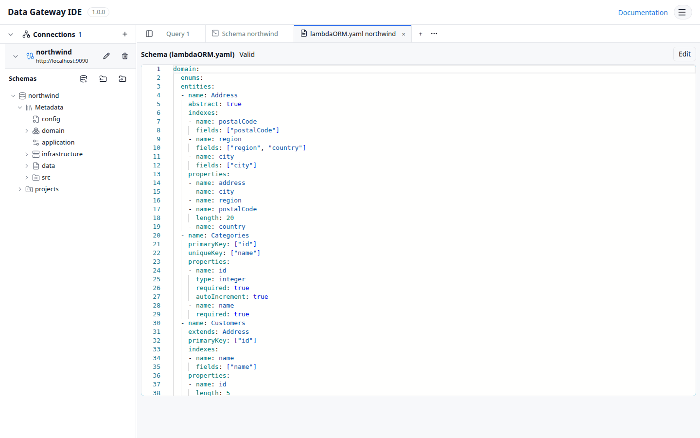
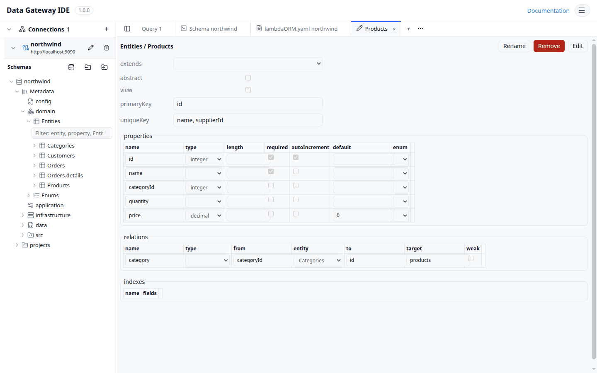
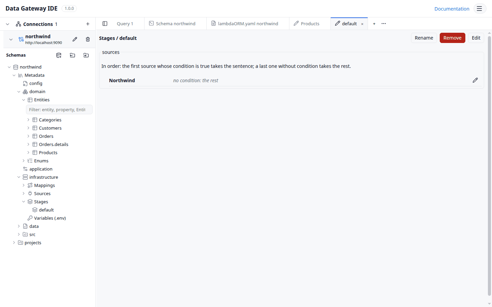
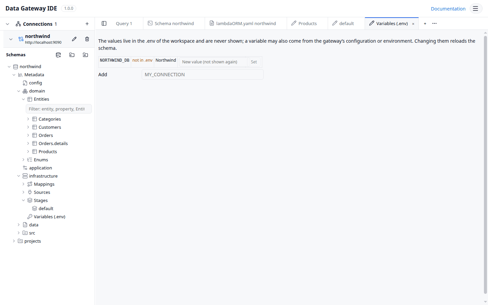

# Verwaltung

Über den Port `management` bearbeiten Zugangsdaten mit den Berechtigungen der Verwaltung die Schemas aus der IDE: ihre
`lambdaORM.yaml` als YAML oder als Formulare, die Variablen ihrer Verbindungen, die Befehle der CLI auf ihren Stages und
neue Schemas. Was das Gateway mit jeder Änderung macht, erklärt die [Verwaltung](../data-gateway/Admin.md).

| Berechtigung | Erlaubt, in der IDE |
| --- | --- |
| `schemaRead` | die Zeilen **config**, **application**, **infrastructure**, **data** und **src** des Explorers; die **Informationen** eines Schemas |
| `schemaWrite` | **Bearbeiten** im YAML und in den Formularen; **+** neue Entitäten, Enums, Quellen, Mappings, Stages; ✎ der Entitäten |
| `schemaAdmin` | **Neues Schema**, ein Schema entfernen; die Variablen der `.env` setzen und entfernen |
| `ddl` | **push**, **pull**, **drop** |
| `stageImport` | **import**, **incorporate** |
| `build` | **build** |
| `workbenchWrite` | **export → data/** |

Die Schemas werden alle 5 Sekunden neu gelesen (alle 60, solange die Ereignisse des Gateways ankommen): Ein
hinzugefügtes, entferntes oder neu geladenes erscheint, ohne die Seite neu zu laden, und eine neue Version, die nicht
gestartet ist, zeigt ⚠ mit ihrem Grund, während die vorherige antwortet.

## Der Tab des Schemas {#the-schema-tab}

Ein Klick auf ein Schema öffnet **Schema Name**: einen **Stage**, die Befehle, seine **Informationen** und die **Letzten
Befehle**.

| Befehl | Was er tut | Vor dem Ausführen |
| --- | --- | --- |
| **fetch** | vergleicht das Modell mit den Datenbanken des Stage | läuft sofort: `Keine Unterschiede: die Datenbanken entsprechen dem Modell` |
| **export** | die Daten des Stage, zum Herunterladen (`northwind-default.json`) | läuft sofort |
| **export → data/** | die Daten des Stage, nach `data/` des Workspace | läuft sofort |
| **import…** | eine Exportdatei in den Stage | zeigt die Zeilen, die er schreibt |
| **push…** | wendet das Modell auf die Datenbanken an (legt Tabellen an und ändert sie) | zeigt die Anweisungen, nach Quelle |
| **pull…** | übernimmt die Datenbanken ins Modell | zeigt, wie sich `lambdaORM.yaml` ändert |
| **drop…** | löscht die Tabellen des Stage | zeigt die Anweisungen; du gibst den Namen des Stage zur Bestätigung ein |
| **introspect…** | erstellt eine Entität aus einer Datendatei | zeigt, wie sich `lambdaORM.yaml` ändert |
| **incorporate…** | erstellt eine Entität aus einer Datendatei und importiert ihre Zeilen | zeigt die Änderung und die Zeilen |
| **build…** | erzeugt den Code des Modells: eine `.zip` oder `src/` des Workspace | die Sprache: `node` oder `client-node` |
| **version** | die λORM-Versionen im Gateway | läuft sofort |

Push und drop haben **weitermachen, wenn ein Befehl fehlschlägt (tryAllCan)**. **push ausführen** (rot) führt ihn aus;
**Abbrechen** nicht. Jeder Befehl läuft als Job: Sein Zustand (**läuft**, **fertig**, **fehlgeschlagen**) und sein
Ergebnis erscheinen darunter, und **Letzte Befehle** listet sie auf (ein Klick zeigt einen erneut). Ein Befehl, den die
Zugangsdaten nicht ausführen können, ist deaktiviert.

**Informationen** enthält **Name**, **Beschreibung** und **Version** des Schemas (die Schlüssel ganz oben in seiner
`lambdaORM.yaml`), mit **Bearbeiten**.

## Das YAML {#the-yaml}

**config** öffnet die `lambdaORM.yaml` des Schemas in einem Editor, der sie beim Tippen prüft (`3 Fehler`, `Gültig`),
mit den Vorschlägen ihres Schemas. **Bearbeiten**, dann **Speichern** (Strg+S): `Gespeichert: das Gateway lädt das
Schema neu`. Ein Schema mit Fehlern wird nicht gespeichert. Die Geheimnisse werden nie angezeigt: Die Verbindungen
stehen in den Variablen ([unten](#variables)).

Wenn jemand anderes eine neue Version gespeichert hat, während du bearbeitet hast, werden beide nebeneinander
angezeigt, **Im Gateway** und **Deine**: **Meine darüber speichern**, oder **Die des Gateways übernehmen**.

## Formulare {#forms}

Jedes Element des Schemas hat sein eigenes Formular: eine Entität, ein Enum, eine Quelle, ein Mapping, ein Stage. Es
öffnet sich schreibgeschützt: **Bearbeiten** → **Speichern** oder **Abbrechen**; **Umbenennen**; **Entfernen** (es sagt
vorher, was es verwendet). Das **+** von **Entitäten**, **Enums**, **Quellen**, **Mappings** und **Stages** öffnet ein
neues. Speichern ändert nur dieses Element und behält die Kommentare der Datei.

| Formular | Felder |
| --- | --- |
| **Entität** | extends, abstract, view, primaryKey, uniqueKey; ihre **properties** (name, type, length, required, autoIncrement, default, enum), **relations** (name, type, from, entity, to, target, weak) und **indexes** |
| **Enum** | seine Werte (name, value) |
| **Quelle** | dialect (PostgreSQL, MySQL, MariaDB, SqlServer, Oracle, MongoDB, SQLjs), mapping, connection (`${NORTHWIND_DB}`) |
| **Mapping** | extends; der Name jeder Entität in der Datenbank |
| **Stage** | seine Quellen der Reihe nach, jede mit einer Bedingung: die erste, deren Bedingung wahr ist, nimmt die Anweisung; eine letzte ohne Bedingung nimmt den Rest |

Die Bedingung einer Quelle in einem Stage wird in einem eigenen Dialog bearbeitet: ein Ausdruck
(`entity.in(["Products","Orders"]) && read`) mit Vorschlägen, beim Tippen vom Gateway geprüft, und die Variablen einer
Anweisung zum Einfügen.

**application** wird als YAML bearbeitet (ihre Start-Tasks und Listener).

## Variablen (.env) {#variables}

Die Variablen der `.env` des Workspace: jede **definiert** oder **nicht in .env**, und wo sie verwendet wird. Ihre
Werte werden nie angezeigt. Mit `schemaAdmin` **Neuer Wert** und **Setzen**, **Entfernen**, und **Hinzufügen** einer
neuen; eine Änderung lädt das Schema neu. Eine Variable kann auch aus der Konfiguration oder der Umgebung des Gateways
kommen.

## data und src {#data-and-src}

**data** listet die Dateien von `data/` des Workspace, und **src** die des Modells: Jede öffnet sich schreibgeschützt,
mit den Farben ihres Typs.

## Neues Schema, ein Schema entfernen {#new-schema-remove-a-schema}

Mit `schemaAdmin` **Neues Schema** (im Kopf von **Schemas**): seine **Route** (`sales/v1`), **Name** und
**Beschreibung**, beginnend mit **einem leeren Schema** oder **einer Kopie von** einem anderen: `Schema sales/v1
erstellt: es startet gleich`. Ein Gateway, dessen Schema an der Wurzel (`/`) liegt, bedient nur dieses eine.

Das 🗑 eines Schemas entfernt es, nachdem seine Route eingegeben wurde: Sein Workspace kommt nach `.trash` des Volumes,
nichts wird gelöscht.
