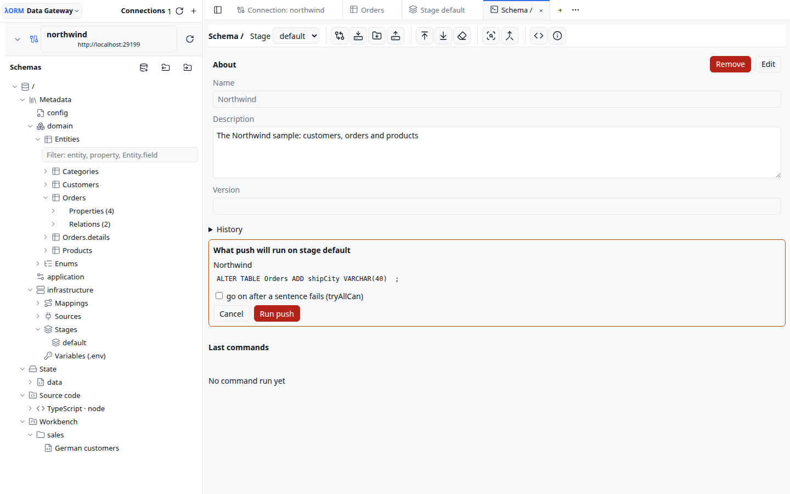
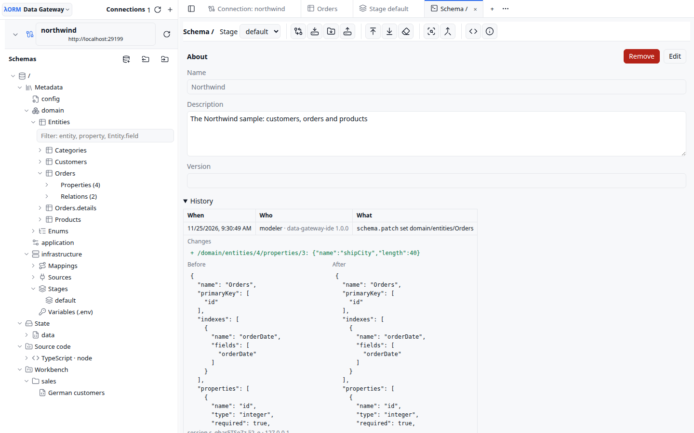
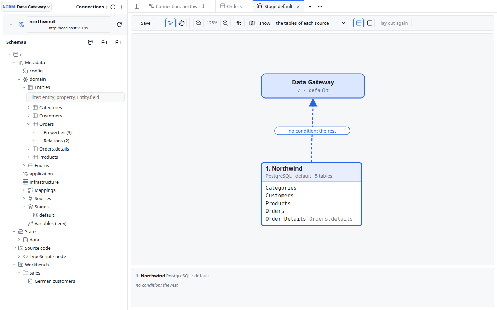

# Verwaltung

Über den Port `management` bearbeiten Zugangsdaten mit den Berechtigungen der Verwaltung die Schemas aus der IDE: ihre
`lambdaORM.yaml` als YAML oder als Formulare, die Variablen ihrer Verbindungen, die Befehle der CLI auf ihren Stages
(push, pull, import…), den Code ihrer Domäne und neue Schemas. So modellierst du ein Schema und wendest es auf die
Datenbanken an, ohne Terminal und ohne Deploy. Was das Gateway mit jeder Änderung macht, erklärt die
[Verwaltung](../data-gateway/Admin.md).

| Berechtigung | Erlaubt, in der IDE |
| --- | --- |
| `schemaRead` | die Zeilen **config**, **application**, **infrastructure**, **Zustand** und **Quellcode** des Explorers; die **Informationen** und den **Verlauf** eines Schemas |
| `schemaWrite` | **Bearbeiten** im YAML und in den Formularen; **+** neue Entitäten, Enums, Quellen, Mappings, Stages; **Bearbeiten** und **Entfernen** einer Entität |
| `schemaAdmin` | **Neues Schema**, **Entfernen** eines Schemas; die Variablen der `.env` setzen und entfernen |
| `ddl` | **push**, **pull**, **drop** |
| `stageImport` | **import**, **incorporate** |
| `build` | **build**, und einen Code von **Quellcode** neu erzeugen oder löschen |
| `workbenchWrite` | **export → data/** |

Die Schemas werden alle 5 Sekunden neu gelesen (alle 60, solange die Ereignisse des Gateways ankommen): Ein
hinzugefügtes, entferntes oder neu geladenes erscheint, ohne die Seite neu zu laden, und eine neue Version, die nicht
gestartet ist, zeigt ⚠ mit ihrem Grund, während die vorherige antwortet. Eine Änderung von jemand anderem wird
angekündigt, mit dem, der sie gemacht hat, und **Aktualisieren** ([Sitzungen](Connections.md#sessions)).

## Der Tab des Schemas {#the-schema-tab}

Ein Klick auf ein Schema öffnet **Schema Name**: eine Werkzeugleiste mit dem **Stage** und den Befehlen, dann seine
**Informationen**, seinen **Verlauf** und die **Letzten Befehle**.

Die Befehle sind Symbole; der Mauszeiger darüber sagt, was jeder tut. Ein Befehl, den die Zugangsdaten nicht ausführen
können, ist deaktiviert.

| Befehl | Was er tut | Vor dem Ausführen |
| --- | --- | --- |
| **fetch** | vergleicht das Modell mit den Datenbanken des Stage | läuft sofort: `Keine Unterschiede: die Datenbanken entsprechen dem Modell` |
| **export** | die Daten des Stage, zum Herunterladen (`northwind-default.json`, **Herunterladen**) | läuft sofort |
| **export → data/** | die Daten des Stage, nach `data/` des Workspace | läuft sofort |
| **import…** | eine Exportdatei in den Stage | fragt nach der Datei, dann zeigt er die Zeilen, die er schreibt |
| **push…** | wendet das Modell auf die Datenbanken an (legt Tabellen an und ändert sie) | zeigt die Anweisungen, nach Quelle |
| **pull…** | übernimmt die Datenbanken ins Modell | zeigt, wie sich `lambdaORM.yaml` ändert |
| **drop…** | löscht die Tabellen des Stage | zeigt die Anweisungen; du gibst den Namen des Stage zur Bestätigung ein |
| **introspect…** | erstellt eine Entität aus einer Datendatei | fragt nach der Datei und der Entität, dann zeigt er, wie sich `lambdaORM.yaml` ändert |
| **incorporate…** | erstellt eine Entität aus einer Datendatei und importiert ihre Zeilen | fragt nach der Datei und der Entität, dann zeigt er die Änderung und die Zeilen |
| **build…** | erzeugt den Code der Domäne ([unten](#source-code)) | die Sprache und was erzeugt wird |
| **version** | die λORM-Versionen im Gateway | läuft sofort |

Um einen Befehl auszuführen, der vorher zeigt, was er tun wird:

1. Wähle den **Stage**.
2. Klicke auf den Befehl (und wähle bei import, introspect und incorporate die Datei und **Ansehen, was er tut**).
3. Lies die Vorschau: die Anweisungen nach Quelle, die Änderung der `lambdaORM.yaml` (`+3 −0 Zeilen`) oder die Zeilen
   jeder Entität. Push und drop haben **weitermachen, wenn ein Befehl fehlschlägt (tryAllCan)**; drop fragt nach dem
   Namen des Stage.
4. **push ausführen** (rot) führt genau das aus; **Abbrechen** nicht.

Jeder Befehl läuft als Job: Sein Zustand (**läuft**, **fertig**, **fehlgeschlagen**) und sein Ergebnis erscheinen
darunter, und **Letzte Befehle** listet sie mit dem Stage, den Zugangsdaten und dem Zeitpunkt auf (ein Klick zeigt
einen erneut).

**Informationen** enthält **Name**, **Beschreibung** und **Version** des Schemas (die Schlüssel ganz oben in seiner
`lambdaORM.yaml`), mit **Bearbeiten** und, mit `schemaAdmin`, **Entfernen** ([unten](#new-schema-remove-a-schema)).

## Verlauf {#history}

Der **Verlauf** des Schema-Tabs (eingeklappt) listet seine Änderungen, die neuesten zuerst: **Wann**, **Wer** (die
Zugangsdaten und ihr Client: die IDE, die CLI, das Gateway) und **Was** (`schema set`, `ddl push`…). Ein Klick auf eine
Änderung zeigt ihre **Änderungen** (`+` hinzugefügt, `-` entfernt, `~` ersetzt), das Element **Vorher** und **Nachher**
und die DDL-Dateien, die ein push geschrieben hat. **Ältere Änderungen** liest weitere. Jede Entität hat ihren eigenen
in ihrem Tab **Verlauf** ([Entitäten](Entities.md#history)). Das Gateway speichert ihn seit data-gateway 4.1.0.

## Das YAML {#the-yaml}

**config** öffnet die `lambdaORM.yaml` des Schemas in einem Editor, der sie beim Tippen prüft (`3 Fehler`,
`2 Warnungen`, `Gültig`), mit den Vorschlägen ihres Schemas. **Bearbeiten**, dann **Speichern** (Strg+S): `Gespeichert:
das Gateway lädt das Schema neu`; **Abbrechen** verwirft die Änderungen. Ein Schema mit Fehlern wird nicht gespeichert.
Die Geheimnisse werden nie angezeigt: Die Verbindungen stehen in den Variablen ([unten](#variables)).

Wenn jemand anderes eine neue Version gespeichert hat, während du bearbeitet hast, werden beide nebeneinander
angezeigt, **Im Gateway** und **Deine**, mit dem, der sie geändert hat, und wann: **Meine darüber speichern**, oder
**Die des Gateways übernehmen**.

## Formulare {#forms}

Jedes Element des Schemas hat sein eigenes Formular, in einem eigenen Tab: eine Entität, ein Enum, eine Quelle, ein
Mapping, ein Stage. Es öffnet sich schreibgeschützt, mit **Bearbeiten** → **Speichern** oder **Abbrechen**;
**Umbenennen**; **Entfernen** (es sagt vorher, was es verwendet: `Customers wird verwendet von: …`). Das **+** von
**Entitäten**, **Enums**, **Quellen**, **Mappings** und **Stages** im Explorer öffnet ein neues (`Neu in Entitäten`).
Speichern ändert nur dieses Element und behält die Kommentare der Datei. Hat jemand anderes das Element inzwischen
geändert, sagt das Formular wer und zeigt, was es jetzt enthält.

| Formular | Felder |
| --- | --- |
| **Entität** | extends, abstract, view, primaryKey, uniqueKey; dann die Tabs **Eigenschaften** (name, type, length, required, autoIncrement, default, enum, expressions), **Beziehungen** (name, type, from, entity, to, target, weak), **Indizes** (name, fields) und **Einschränkungen** (message, condition), jeder mit seiner Anzahl |
| **Enum** | seine Werte (name, value) |
| **Quelle** | dialect (PostgreSQL, MySQL, MariaDB, SqlServer, Oracle, MongoDB, SQLjs), mapping, connection (`${NORTHWIND_DB}`) |
| **Mapping** | extends; der Name jeder Entität in der Datenbank |
| **Stage** | seine Quellen der Reihe nach, jede mit einer Bedingung: die erste, deren Bedingung wahr ist, nimmt die Anweisung; eine letzte ohne Bedingung nimmt den Rest |

Die **Ausdrücke** einer Eigenschaft (`readExp`, `writeExp`, `readValue`, `writeValue`) und die **Bedingung** einer
Einschränkung werden unter ihrer Tabelle bearbeitet, jeweils in einem Editor mit den Eigenschaften der Entität und den
Funktionen als Vorschlägen ([Entitäten](Entities.md#properties)).

In einem Stage bearbeitet ✎ die Bedingung einer Quelle in einem eigenen Dialog: ein Ausdruck
(`entity.in(["Products","Orders"]) && read`) mit Vorschlägen (Strg+Leertaste), beim Tippen vom Gateway geprüft, und die
**Variablen des Satzes** zum Einfügen per Klick; **Übernehmen** behält ihn. ↑ und ↓ ändern die Reihenfolge der
Quellen, × entfernt eine, **Source hinzufügen** fügt eine hinzu.

**application** wird als YAML bearbeitet (ihre Start-Tasks und Listener).

## Das Diagramm eines Stage {#the-diagram-of-a-stage}

Das ◇ eines Stage im Explorer öffnet **Stage Name**: das **Data Gateway** und darunter jede Source des Stage in ihrer
Reihenfolge, mit ihrem Dialekt, ihrem Mapping und den Tabellen, die in ihr liegen (benannt nach ihrem Mapping), sowie
den Tabellen, deren Lesen oder Schreiben sie übernimmt, während sie in einer anderen Source liegen (ein Replikat zum
Lesen). Ein Klick auf den Pfeil einer Source zeigt darunter ihre Bedingung, in den Farben des Editors; eine Entität,
die keine Source nimmt, wird über der Zeichnung gemeldet.

Seine Leiste: die Werkzeuge **auswählen** und **verschieben**, der Zoom und **einpassen**, die **Übersicht**,
**zeigen** (die Tabellen jeder Source oder nur den Namen jeder Source), das Gateway oben oder links, und **neu
anordnen**. Die Boxen werden dorthin gezogen, wo du sie haben willst (mehrere auf einmal ausgewählt). **Speichern**
bewahrt es so, wie es gelassen wurde, in der [Workbench](Projects.md) auf (beim ersten Mal fragt es nach einem Namen,
einer Beschreibung und einem Ordner; **Speichern unter…** macht eine Kopie); das ◇ seines Stage öffnet dann das
gespeicherte. Es braucht data-gateway 4.1.0 oder neuer.

## Variablen (.env) {#variables}

**infrastructure → Variablen (.env)**: die Variablen der `.env` des Workspace, jede **definiert** oder **nicht in
.env**, und wo sie verwendet wird. Ihre Werte werden nie angezeigt. Mit `schemaAdmin` **Neuer Wert** und **Setzen**,
**Entfernen**, und **Hinzufügen** einer neuen; eine Änderung lädt das Schema neu. Eine Variable kann auch aus der
Konfiguration oder der Umgebung des Gateways kommen.

## Zustand {#state}

**Zustand → data** listet die Dateien von `data/` des Workspace (die dort gespeicherten Exporte, die Daten der
Stages): Jede öffnet sich schreibgeschützt, mit den Farben ihres Typs.

## Quellcode {#source-code}

**Quellcode** listet den aus der Domäne erzeugten Code, einen Knoten für jeden Code in `src/`, benannt nach seiner
Sprache und, bei einem Build des Gateways, seinem Ordner (`TypeScript · node`, `TypeScript · client-node`); seine
Dateien öffnen sich schreibgeschützt. Jeder Knoten hat ⤓ **als .zip herunterladen**, ↻ **neu erzeugen** und 🗑
**löschen** (vorher gefragt: seine Dateien gehen, auch die von Hand geschriebenen Repositories).

**build** (das </> von **Quellcode**, oder **build…** im Schema-Tab) fragt:

- die Sprache: `node` (`@lambdaorm/lib`) oder `client-node` (`@lambdaorm/client`);
- **Was erzeugt wird**: das **Modell** (`-m`, neu geschrieben) und die **Repositories** (`-r`; ein vorhandenes bleibt),
  mindestens eines;
- dann **.zip herunterladen**, oder **In src/ des Workspace schreiben**, das die erstellten und aktualisierten Dateien
  auflistet.

## Neues Schema, ein Schema entfernen {#new-schema-remove-a-schema}

Mit `schemaAdmin` **Neues Schema** (im Kopf von **Schemas**): seine **Route** (`sales/v1`), **Name** und
**Beschreibung**, beginnend mit **einem leeren Schema** oder **einer Kopie von** einem anderen: `Schema sales/v1
erstellt: es startet gleich`. Ein Gateway, dessen Schema an der Wurzel (`/`) liegt, bedient nur dieses eine.

**Entfernen** in den **Informationen** eines Schemas (oder das 🗑 eines Schemas, das nicht gestartet ist) entfernt es,
nachdem seine Route eingegeben wurde: Sein Workspace kommt nach `.trash` des Volumes, nichts wird gelöscht, und seine
Tabs schließen sich.
