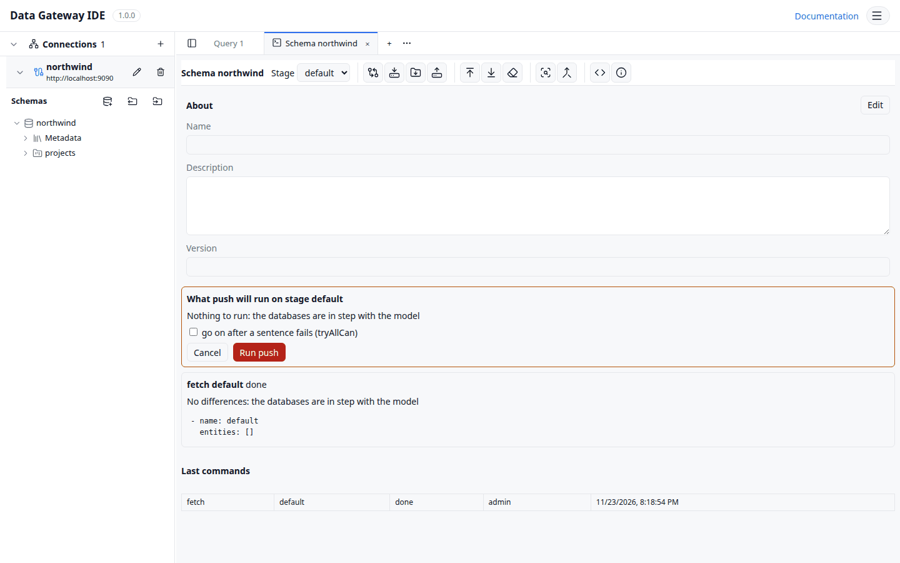
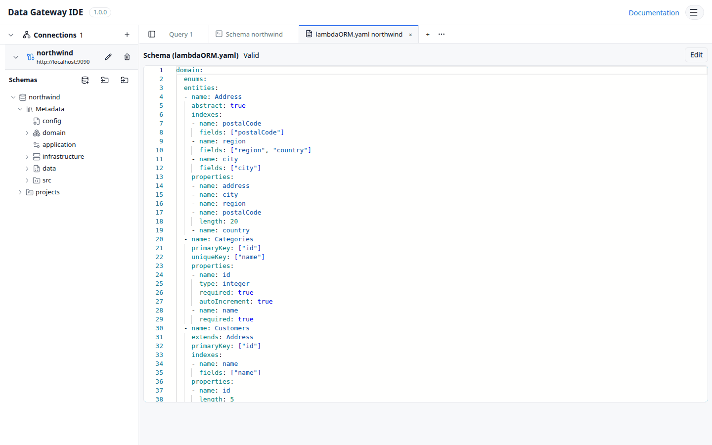
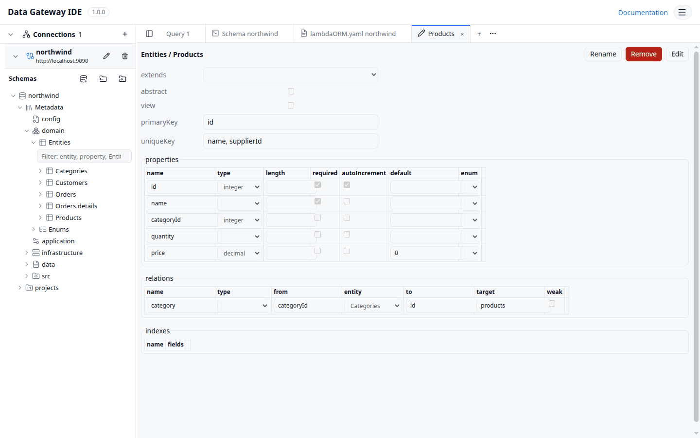
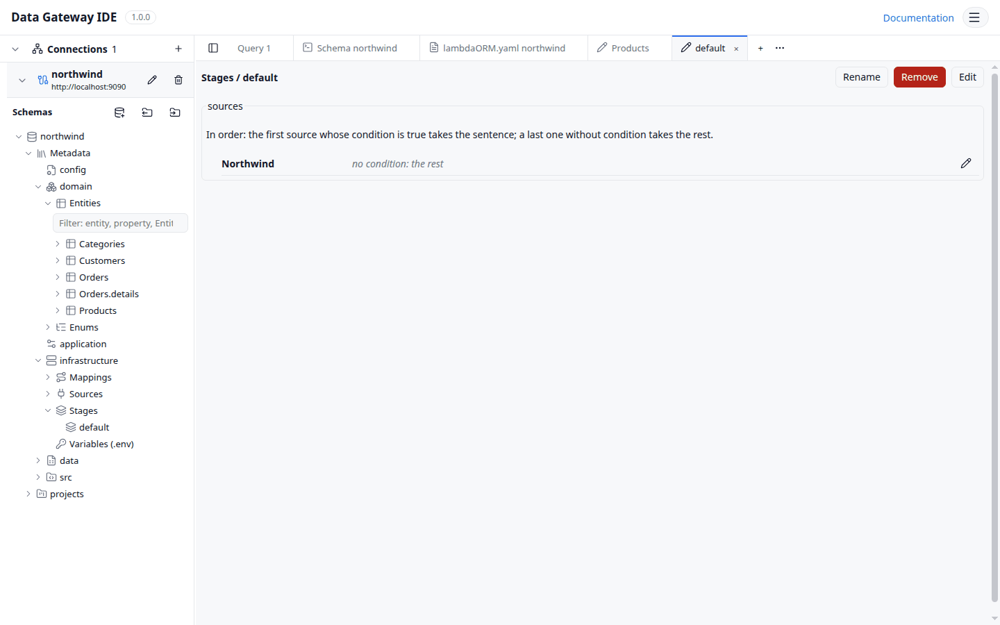
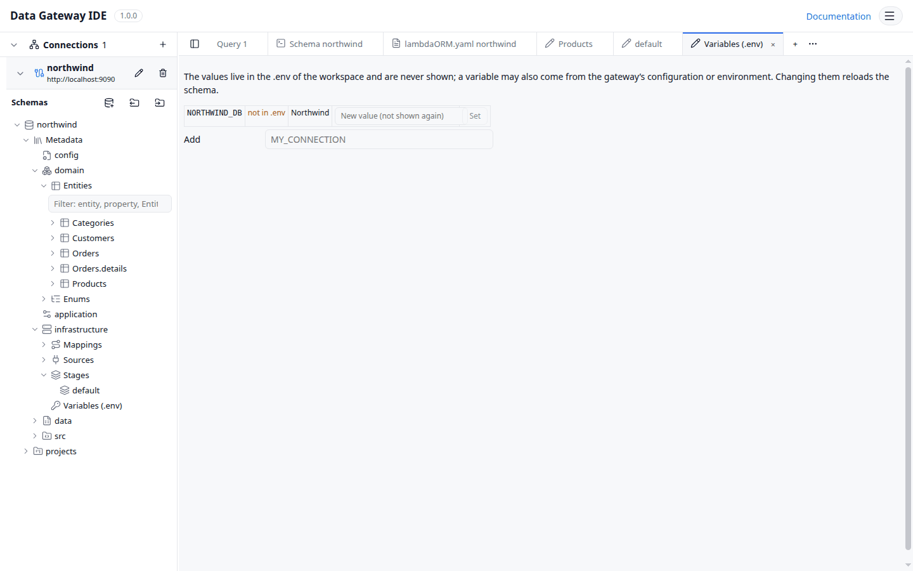

# Administración {#administration}

A través del puerto `management`, una credencial con los permisos de administración edita los esquemas desde el IDE:
su `lambdaORM.yaml` como YAML o como formularios, las variables de sus conexiones, los comandos del CLI sobre sus
stages, y esquemas nuevos. Lo que hace el gateway con cada cambio se explica en
[Administración](../data-gateway/Admin.md).

| Permiso | Permite, en el IDE |
| --- | --- |
| `schemaRead` | las filas **config**, **application**, **infrastructure**, **data** y **src** del explorador; la **Información** de un esquema |
| `schemaWrite` | **Editar** en el YAML y los formularios; **+** entidades, enums, sources, mappings, stages nuevos; ✎ de las entidades |
| `schemaAdmin` | **Nuevo esquema**, eliminar un esquema; definir y eliminar las variables del `.env` |
| `ddl` | **push**, **pull**, **drop** |
| `stageImport` | **import**, **incorporate** |
| `build` | **build** |
| `workbenchWrite` | **export → data/** |

Los esquemas se vuelven a leer cada 5 segundos (cada 60 mientras llegan los eventos del gateway): uno agregado,
eliminado o recargado se muestra sin recargar la página, y una versión nueva que no arrancó muestra ⚠ con su motivo
mientras atiende la anterior.

## La pestaña del esquema {#the-schema-tab}

Un clic en un esquema abre **Esquema nombre**: un **Stage**, los comandos, su **Información** y los **Últimos
comandos**.

| Comando | Qué hace | Antes de ejecutarse |
| --- | --- | --- |
| **fetch** | compara el modelo con las bases de datos del stage | se ejecuta enseguida: `Sin diferencias: las bases coinciden con el modelo` |
| **export** | los datos del stage, para descargar (`northwind-default.json`) | se ejecuta enseguida |
| **export → data/** | los datos del stage, a `data/` del workspace | se ejecuta enseguida |
| **import…** | un archivo exportado al stage | muestra las filas que va a escribir |
| **push…** | aplica el modelo a las bases de datos (crea y altera tablas) | muestra las sentencias, por source |
| **pull…** | trae las bases de datos al modelo | muestra cómo va a cambiar `lambdaORM.yaml` |
| **drop…** | elimina las tablas del stage | muestra las sentencias; escribes el nombre del stage para confirmar |
| **introspect…** | crea una entidad desde un archivo de datos | muestra cómo va a cambiar `lambdaORM.yaml` |
| **incorporate…** | crea una entidad desde un archivo de datos e importa sus filas | muestra el cambio y las filas |
| **build…** | genera el código del modelo: un `.zip`, o `src/` del workspace | el lenguaje: `node` o `client-node` |
| **version** | las versiones de λORM en el gateway | se ejecuta enseguida |

Push y drop tienen **seguir aunque falle una sentencia (tryAllCan)**. **Ejecutar push** (en rojo) lo ejecuta;
**Cancelar** no. Cada comando se ejecuta como un job: su estado (**en curso**, **terminado**, **falló**) y su resultado
se muestran debajo, y **Últimos comandos** los lista (un clic vuelve a mostrar uno). Un comando que la credencial no
puede ejecutar está deshabilitado.

**Información** tiene el **Nombre**, la **Descripción** y la **Versión** del esquema (las claves de arriba de su
`lambdaORM.yaml`), con **Editar**.

## El YAML {#the-yaml}

**config** abre el `lambdaORM.yaml` del esquema en un editor que lo verifica mientras escribes (`3 errores`,
`Válido`), con las sugerencias de su schema. **Editar**, luego **Guardar** (Ctrl+S): `Guardado: la gateway recarga el
esquema`. Un esquema con errores no se guarda. Los secretos nunca se muestran: las conexiones están en las variables
([abajo](#variables)).

Si otra persona guardó una versión nueva mientras editabas, se muestran las dos una al lado de otra, **En la gateway** y
**El tuyo**: **Guardar el mío encima**, o **Tomar el de la gateway**.

## Formularios {#forms}

Cada elemento del esquema tiene su propio formulario: una entidad, un enum, un source, un mapping, un stage. Se abre
en solo lectura: **Editar** → **Guardar** o **Cancelar**; **Renombrar**; **Eliminar** (antes dice qué lo usa). El **+**
de **Entidades**, **Enums**, **Sources**, **Mappings** y **Stages** abre uno nuevo. Guardar cambia solo ese elemento, y
conserva los comentarios del archivo.

| Formulario | Campos |
| --- | --- |
| **Entidad** | extends, abstract, view, primaryKey, uniqueKey; sus **properties** (name, type, length, required, autoIncrement, default, enum), **relations** (name, type, from, entity, to, target, weak) e **indexes** |
| **Enum** | sus valores (name, value) |
| **Source** | dialect (PostgreSQL, MySQL, MariaDB, SqlServer, Oracle, MongoDB, SQLjs), mapping, connection (`${NORTHWIND_DB}`) |
| **Mapping** | extends; el nombre de cada entidad en la base de datos |
| **Stage** | sus sources en orden, cada uno con una condición: el primero cuya condición es verdadera toma la sentencia; uno último sin condición toma el resto |

La condición de un source en un stage se edita en su propio diálogo: una expresión (`entity.in(["Products","Orders"])
&& read`) con sugerencias, verificada por el gateway mientras escribes, y las variables de una sentencia para insertar.

**application** se edita como YAML (sus tareas de inicio y listeners).

## Variables (.env) {#variables}

Las variables del `.env` del workspace: cada una **definida** o **no está en .env**, y dónde se usa. Sus valores nunca
se muestran. Con `schemaAdmin`, **Valor nuevo** y **Definir**, **Eliminar**, y **Agregar** una nueva; cambiarlas
recarga el esquema. Una variable también puede venir de la configuración o del entorno del gateway.

## data y src {#data-and-src}

**data** lista los archivos de `data/` del workspace, y **src** los del modelo: cada uno se abre en solo lectura, con
los colores de su tipo.

## Nuevo esquema, eliminar un esquema {#new-schema-remove-a-schema}

Con `schemaAdmin`, **Nuevo esquema** (en la cabecera de **Esquemas**): su **Ruta** (`sales/v1`), **Nombre** y
**Descripción**, partiendo de **un esquema vacío** o de **una copia de** otro: `Esquema sales/v1 creado: arranca en un
momento`. Un gateway cuyo esquema está en la raíz (`/`) sirve solo ese.

El 🗑 de un esquema lo elimina, después de escribir su ruta: su workspace va a `.trash` del volumen, no se borra nada.
