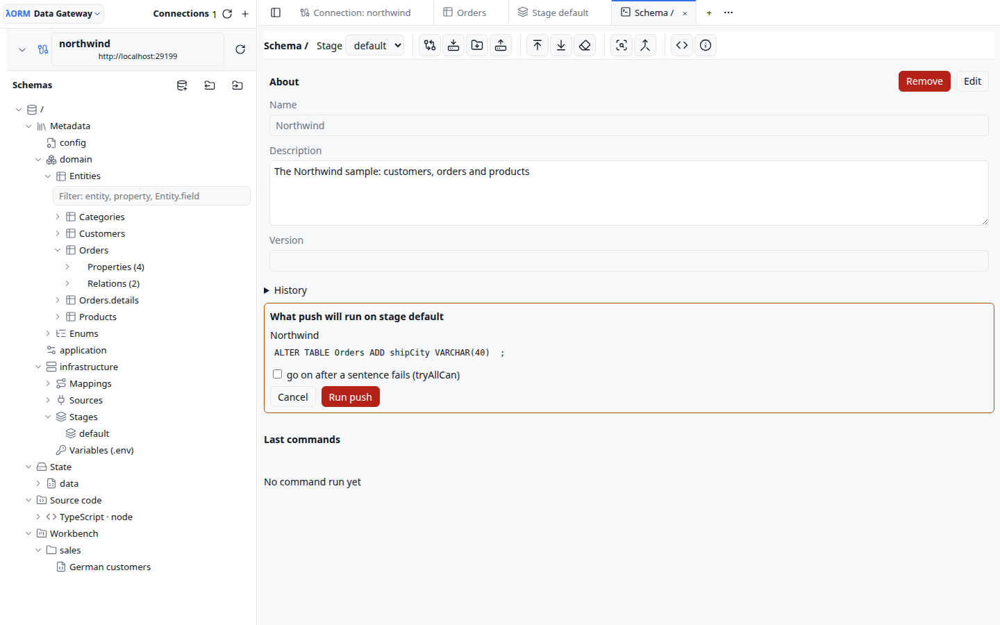
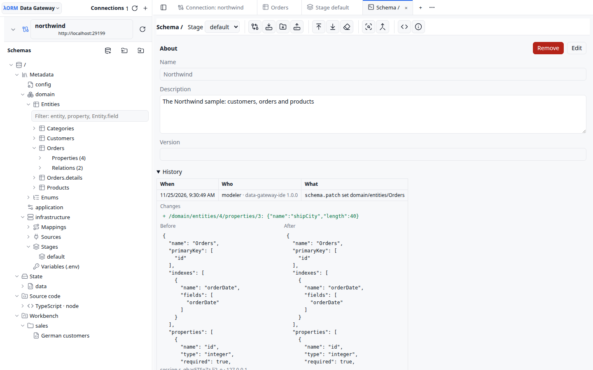
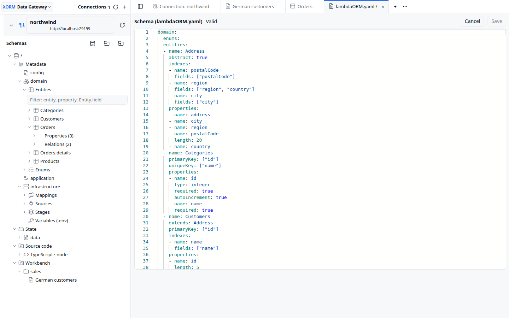
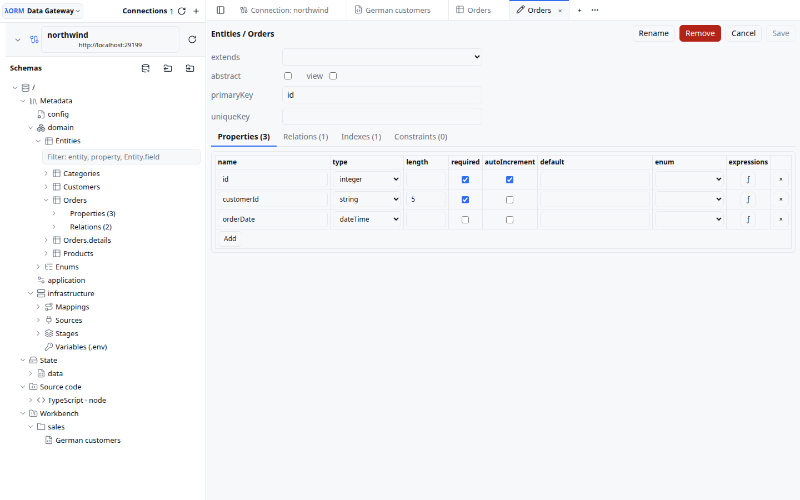
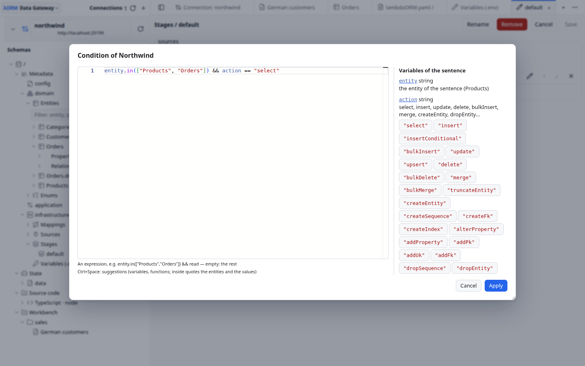
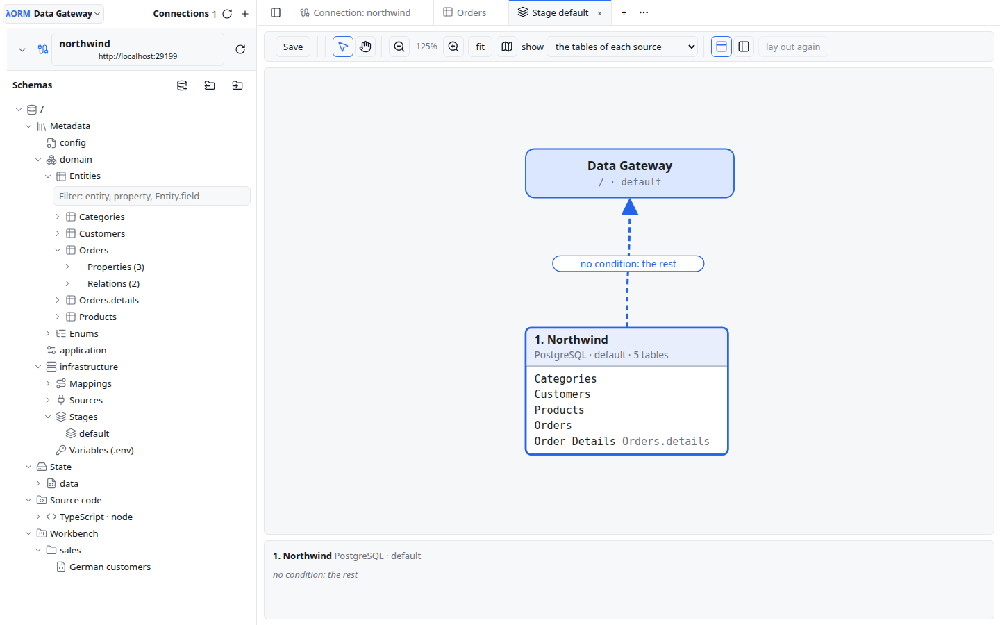
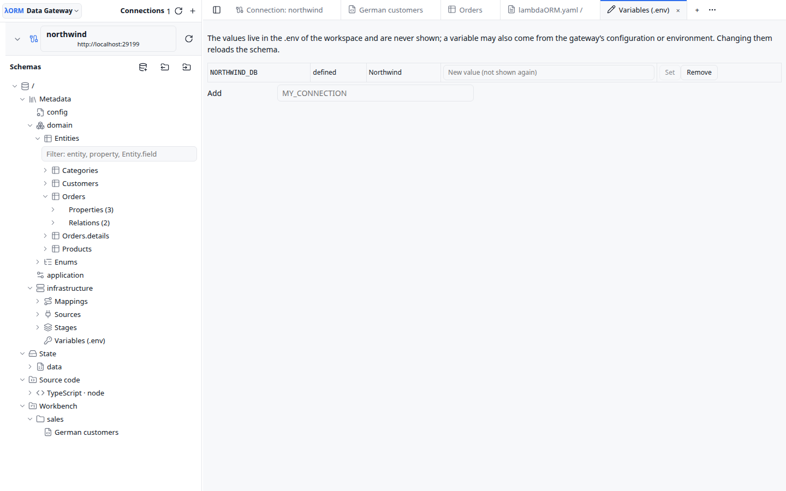

# Administration

Through the `management` port, a credential with the permissions of administration edits the schemas from the IDE:
their `lambdaORM.yaml` as YAML or as forms, the variables of their connections, the commands of the CLI on their
stages (push, pull, import…), the code of their domain, and new schemas. It is the way to model a schema and apply it
to the databases without a terminal or a deploy. What the gateway does with each change is explained in
[Administration](../data-gateway/Admin.md).

| Permission | Allows, in the IDE |
| --- | --- |
| `schemaRead` | the rows **config**, **application**, **infrastructure**, **State** and **Source code** of the explorer; the **About** and the **History** of a schema |
| `schemaWrite` | **Edit** in the YAML and the forms; **+** new entities, enums, sources, mappings, stages; **Edit** and **Remove** of an entity |
| `schemaAdmin` | **New schema**, **Remove** a schema; set and remove the variables of the `.env` |
| `ddl` | **push**, **pull**, **drop** |
| `stageImport` | **import**, **incorporate** |
| `build` | **build**, and building again or deleting a code of **Source code** |
| `workbenchWrite` | **export → data/** |

The schemas are read again every 5 seconds (every 60 while the events of the gateway arrive): one added, removed or
reloaded shows without reloading the page, and a new version that didn't start shows ⚠ with its reason while the
previous one serves. A change made by someone else is announced with who made it and **Refresh**
([Sessions](Connections.md#sessions)).

## The schema tab {#the-schema-tab}

A click on a schema opens **Schema name**: a toolbar with the **Stage** and the commands, then its **About**, its
**History**, and the **Last commands**.

The commands are icons; the pointer over one says what it does. A command the credential can't run is disabled.

| Command | What it does | Before running |
| --- | --- | --- |
| **fetch** | compares the model with the databases of the stage | runs at once: `No differences: the databases are in step with the model` |
| **export** | the data of the stage, to download (`northwind-default.json`, **Download**) | runs at once |
| **export → data/** | the data of the stage, to `data/` of the workspace | runs at once |
| **import…** | an export file into the stage | asks for the file, then shows the rows it will write |
| **push…** | applies the model to the databases (creates and alters tables) | shows the sentences, by source |
| **pull…** | brings the databases into the model | shows how `lambdaORM.yaml` will change |
| **drop…** | removes the tables of the stage | shows the sentences; you type the name of the stage to confirm |
| **introspect…** | creates an entity from a data file | asks for the file and the entity, then shows how `lambdaORM.yaml` will change |
| **incorporate…** | creates an entity from a data file and imports its rows | asks for the file and the entity, then shows the change and the rows |
| **build…** | generates the code of the domain ([below](#source-code)) | the language and what it generates |
| **version** | the versions of λORM in the gateway | runs at once |

To run a command that shows first what it will do:

1. Choose the **Stage**.
2. Click the command (and, for import, introspect and incorporate, choose the file and **See what it will do**).
3. Read the preview: the sentences by source, the change of `lambdaORM.yaml` (`+3 −0 lines`) or the rows of each
   entity. Push and drop have **go on after a sentence fails (tryAllCan)**; drop asks for the name of the stage.
4. **Run push** (red) runs exactly that; **Cancel** doesn't.

Each command runs as a job: its state (**running**, **done**, **failed**) and its result show under it, and **Last
commands** lists them with the stage, the credential and when (a click shows one again).

**About** has the **Name**, **Description** and **Version** of the schema (the keys at the top of its
`lambdaORM.yaml`), with **Edit** and, with `schemaAdmin`, **Remove** ([below](#new-schema-remove-a-schema)).

## History {#history}

The **History** of the schema tab (folded) lists its changes, the newest first: **When**, **Who** (the credential and
its client: the IDE, the CLI, the gateway) and **What** (`schema set`, `ddl push`…). A click on a change shows its
**Changes** (`+` added, `-` removed, `~` replaced), the element **Before** and **After**, and the files of DDL a push
wrote. **Older changes** reads more. Each entity has its own in its **History** tab ([Entities](Entities.md#history)).
The gateway keeps it since data-gateway 4.1.0.

## The YAML {#the-yaml}

**config** opens the `lambdaORM.yaml` of the schema in an editor that checks it while you type (`3 errors`,
`2 warnings`, `Valid`), with the suggestions of its schema. **Edit**, then **Save** (Ctrl+S): `Saved: the gateway
reloads the schema`; **Cancel** drops the changes. A schema with errors is not saved. The secrets are never shown: the
connections are in the variables ([below](#variables)).

If someone else saved a new version while you were editing, both are shown side by side, **On the gateway** and
**Yours**, with who changed it and when: **Save mine over it**, or **Take the one on the gateway**.

## Forms {#forms}

Each element of the schema has its own form, in its own tab: an entity, an enum, a source, a mapping, a stage. It opens
read only, with **Edit** → **Save** or **Cancel**; **Rename**; **Remove** (it says first what uses it: `Customers is
used by: …`). The **+** of **Entities**, **Enums**, **Sources**, **Mappings** and **Stages** in the explorer opens a new
one (`New in Entities`). Saving changes only that element, and keeps the comments of the file. If someone else changed
the element meanwhile, the form says who and shows what it has now.

| Form | Fields |
| --- | --- |
| **Entity** | extends, abstract, view, primaryKey, uniqueKey; then the tabs **Properties** (name, type, length, required, autoIncrement, default, enum, expressions), **Relations** (name, type, from, entity, to, target, weak), **Indexes** (name, fields) and **Constraints** (message, condition), each with how many it has |
| **Enum** | its values (name, value) |
| **Source** | dialect (PostgreSQL, MySQL, MariaDB, SqlServer, Oracle, MongoDB, SQLjs), mapping, connection (`${NORTHWIND_DB}`) |
| **Mapping** | extends; the name of each entity in the database |
| **Stage** | its sources in order, each with a condition: the first whose condition is true takes the sentence; a last one without condition takes the rest |

The **expressions** of a property (`readExp`, `writeExp`, `readValue`, `writeValue`) and the **condition** of a
constraint are edited under their table, each in an editor with the properties of the entity and the functions as
suggestions ([Entities](Entities.md#properties)).

In a stage, ✎ edits the condition of a source in its own dialog: an expression (`entity.in(["Products","Orders"]) &&
read`) with suggestions (Ctrl+Space), checked by the gateway while you type, and the **Variables of the sentence** to
insert with a click; **Apply** keeps it. ↑ and ↓ change the order of the sources, × takes one out, **Add source** adds
one.

**application** is edited as YAML (its start tasks and listeners).

## The diagram of a stage

The ◇ of a stage in the explorer opens **Stage name**: the **Data Gateway** and, under it, each source of the stage in
its order, with its dialect, its mapping and the tables that live in it (named by its mapping), and the tables whose
reads or writes it takes while they live in another source (a replica for reading). A click on the arrow of a source
shows its condition below, in the colours of the editor; an entity that no source takes is told above the drawing.

Its bar: the **select** and **move** tools, the zoom and **fit**, the **outline**, **show** (the tables of each source,
or only the name of each source), the gateway on top or on the left, and **lay out again**. The boxes are dragged where
you want them (several selected at once). **Save** keeps it, as it was left, in the [workbench](Projects.md) (the first
time it asks for a name, a description and a folder; **Save as…** makes a copy); the ◇ of its stage then opens the one
saved. It needs data-gateway 4.1.0 or later.

## Variables (.env) {#variables}

**infrastructure → Variables (.env)**: the variables of the `.env` of the workspace, each one **defined** or **not in
.env**, and where it is used. Their values are never shown. With `schemaAdmin`, **New value** and **Set**, **Remove**,
and **Add** a new one; changing them reloads the schema. A variable may also come from the configuration or the
environment of the gateway.

## State

**State → data** lists the files of `data/` of the workspace (the exports saved there, the data of the stages): each
one opens read only, with the colours of its type.

## Source code {#source-code}

**Source code** lists the code generated from the domain, a node for each code in `src/`, named by its language and,
for a build of the gateway, its folder (`TypeScript · node`, `TypeScript · client-node`); its files open read only.
Each node has ⤓ **Download as .zip**, ↻ **Build again** and 🗑 **Delete** (asked first: its files go, the repositories
written by hand too).

**build** (the </> of **Source code**, or **build…** in the schema tab) asks:

- the language: `node` (`@lambdaorm/lib`) or `client-node` (`@lambdaorm/client`);
- **What it generates**: the **model** (`-m`, rewritten) and the **repositories** (`-r`; one already there stays), at
  least one;
- then **Download .zip**, or **Write in src/ of the workspace**, which lists the files created and updated.

## New schema, remove a schema {#new-schema-remove-a-schema}

With `schemaAdmin`, **New schema** (in the head of **Schemas**): its **Route** (`sales/v1`), **Name** and
**Description**, starting from **an empty schema** or **a copy of** another one: `Schema sales/v1 created: it starts in
a moment`. A gateway whose schema is at the root (`/`) serves only that one.

**Remove** in the **About** of a schema (or the 🗑 of a schema that didn't start) removes it, after typing its route:
its workspace goes to `.trash` of the volume, nothing is deleted, and its tabs close.
