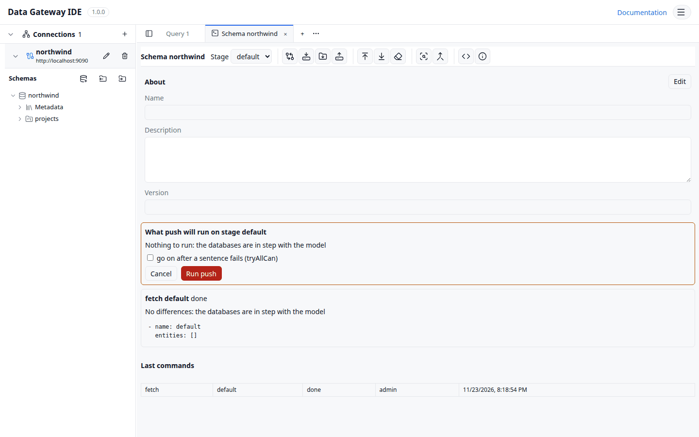
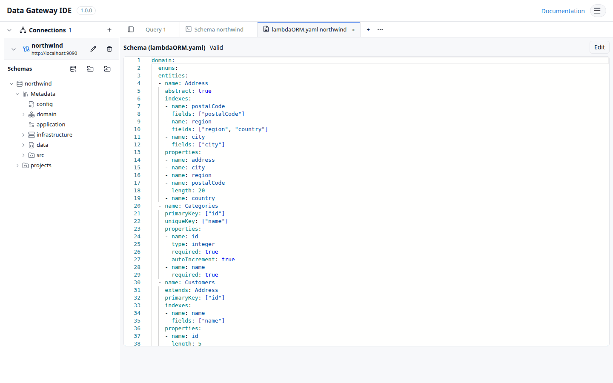
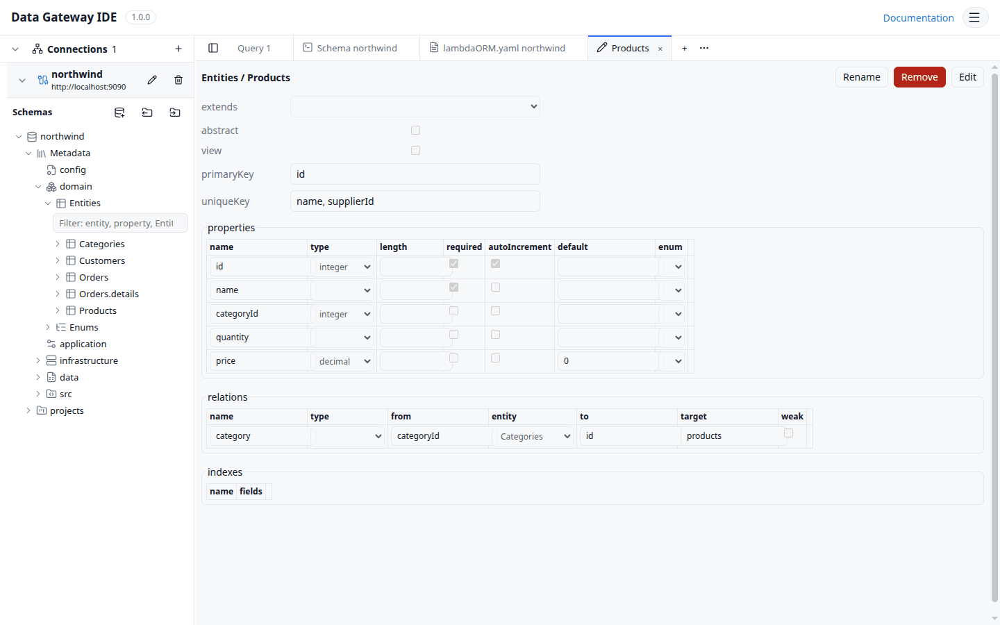
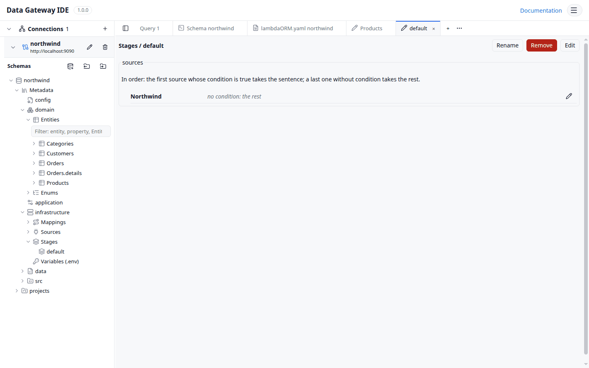
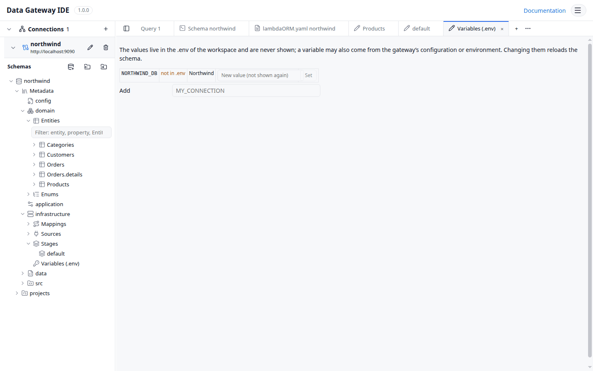

# Administração {#administration}

Pela porta `management`, uma credencial com as permissões de administração edita os esquemas a partir da IDE: o seu
`lambdaORM.yaml` como YAML ou como formulários, as variáveis das suas conexões, os comandos da CLI sobre os seus
stages, e novos esquemas. O que o gateway faz com cada alteração está explicado em
[Administração](../data-gateway/Admin.md).

| Permissão | Permite, na IDE |
| --- | --- |
| `schemaRead` | as linhas **config**, **application**, **infrastructure**, **data** e **src** do explorador; as **Informações** de um esquema |
| `schemaWrite` | **Editar** no YAML e nos formulários; **+** novas entidades, enums, sources, mappings, stages; ✎ das entidades |
| `schemaAdmin` | **Novo esquema**, remover um esquema; definir e remover as variáveis do `.env` |
| `ddl` | **push**, **pull**, **drop** |
| `stageImport` | **import**, **incorporate** |
| `build` | **build** |
| `workbenchWrite` | **export → data/** |

Os esquemas são lidos de novo a cada 5 segundos (a cada 60 enquanto chegam os eventos do gateway): um adicionado,
removido ou recarregado aparece sem recarregar a página, e uma versão nova que não iniciou mostra ⚠ com o seu motivo
enquanto a anterior atende.

## A aba do esquema {#the-schema-tab}

Um clique em um esquema abre **Esquema nome**: um **Stage**, os comandos, as suas **Informações** e os **Últimos
comandos**.

| Comando | O que faz | Antes de executar |
| --- | --- | --- |
| **fetch** | compara o modelo com os bancos de dados do stage | executa na hora: `Sem diferenças: os bancos estão de acordo com o modelo` |
| **export** | os dados do stage, para baixar (`northwind-default.json`) | executa na hora |
| **export → data/** | os dados do stage, para `data/` do workspace | executa na hora |
| **import…** | um arquivo exportado no stage | mostra as linhas que vai gravar |
| **push…** | aplica o modelo aos bancos de dados (cria e altera tabelas) | mostra as sentenças, por source |
| **pull…** | traz os bancos de dados para o modelo | mostra como o `lambdaORM.yaml` vai mudar |
| **drop…** | remove as tabelas do stage | mostra as sentenças; você digita o nome do stage para confirmar |
| **introspect…** | cria uma entidade a partir de um arquivo de dados | mostra como o `lambdaORM.yaml` vai mudar |
| **incorporate…** | cria uma entidade a partir de um arquivo de dados e importa as suas linhas | mostra a alteração e as linhas |
| **build…** | gera o código do modelo: um `.zip`, ou `src/` do workspace | a linguagem: `node` ou `client-node` |
| **version** | as versões do λORM no gateway | executa na hora |

Push e drop têm **continuar se uma sentença falhar (tryAllCan)**. **Executar push** (vermelho) o executa;
**Cancelar** não. Cada comando roda como um job: o seu estado (**em andamento**, **concluído**, **falhou**) e o seu
resultado aparecem abaixo dele, e **Últimos comandos** os lista (um clique mostra um de novo). Um comando que a
credencial não pode executar fica desativado.

**Informações** tem o **Nome**, a **Descrição** e a **Versão** do esquema (as chaves no topo do seu
`lambdaORM.yaml`), com **Editar**.

## O YAML {#the-yaml}

**config** abre o `lambdaORM.yaml` do esquema em um editor que o verifica enquanto você digita (`3 erros`,
`Válido`), com as sugestões do seu esquema. **Editar**, depois **Salvar** (Ctrl+S): `Salvo: a gateway recarrega o
esquema`. Um esquema com erros não é salvo. Os segredos nunca são mostrados: as conexões estão nas variáveis
([abaixo](#variables)).

Se outra pessoa salvou uma versão nova enquanto você editava, as duas são mostradas lado a lado, **Na gateway** e
**O seu**: **Salvar o meu por cima**, ou **Usar o da gateway**.

## Formulários {#forms}

Cada elemento do esquema tem o seu próprio formulário: uma entidade, um enum, uma source, um mapping, um stage. Ele
abre somente leitura: **Editar** → **Salvar** ou **Cancelar**; **Renomear**; **Remover** (antes, diz o que o usa). O
**+** de **Entidades**, **Enums**, **Sources**, **Mappings** e **Stages** abre um novo. Salvar altera só esse
elemento, e mantém os comentários do arquivo.

| Formulário | Campos |
| --- | --- |
| **Entidade** | extends, abstract, view, primaryKey, uniqueKey; as suas **properties** (name, type, length, required, autoIncrement, default, enum), **relations** (name, type, from, entity, to, target, weak) e **indexes** |
| **Enum** | os seus valores (name, value) |
| **Source** | dialect (PostgreSQL, MySQL, MariaDB, SqlServer, Oracle, MongoDB, SQLjs), mapping, connection (`${NORTHWIND_DB}`) |
| **Mapping** | extends; o nome de cada entidade no banco de dados |
| **Stage** | as suas sources em ordem, cada uma com uma condição: a primeira cuja condição é verdadeira fica com a sentença; uma última sem condição fica com o resto |

A condição de uma source em um stage é editada no seu próprio diálogo: uma expressão (`entity.in(["Products","Orders"])
&& read`) com sugestões, verificada pelo gateway enquanto você digita, e as variáveis de uma sentença para inserir.

**application** é editado como YAML (as suas tarefas de início e listeners).

## Variáveis (.env) {#variables}

As variáveis do `.env` do workspace: cada uma **definida** ou **não está no .env**, e onde é usada. Os seus valores
nunca são mostrados. Com `schemaAdmin`, **Valor novo** e **Definir**, **Remover**, e **Adicionar** uma nova; alterá-las
recarrega o esquema. Uma variável também pode vir da configuração ou do ambiente do gateway.

## data e src {#data-and-src}

**data** lista os arquivos de `data/` do workspace, e **src** os do modelo: cada um abre somente leitura, com as cores
do seu tipo.

## Novo esquema, remover um esquema {#new-schema-remove-a-schema}

Com `schemaAdmin`, **Novo esquema** (no cabeçalho de **Esquemas**): a sua **Rota** (`sales/v1`), **Nome** e
**Descrição**, partindo de **um esquema vazio** ou de **uma cópia de** outro: `Esquema sales/v1 criado: inicia em um
momento`. Um gateway cujo esquema está na raiz (`/`) serve só esse.

O 🗑 de um esquema o remove, depois de digitar a sua rota: o seu workspace vai para `.trash` do volume, nada é apagado.
