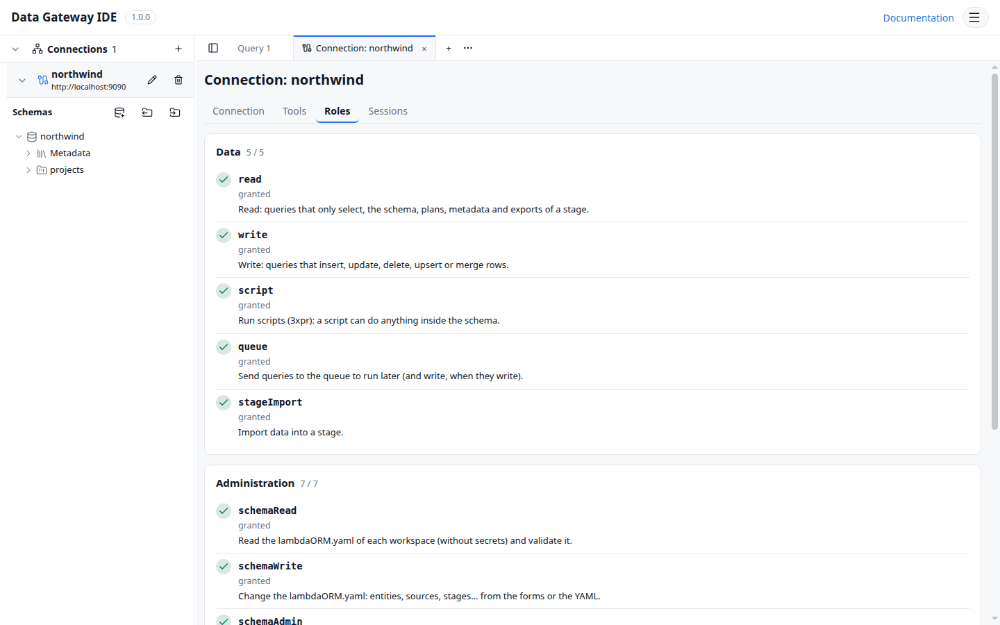
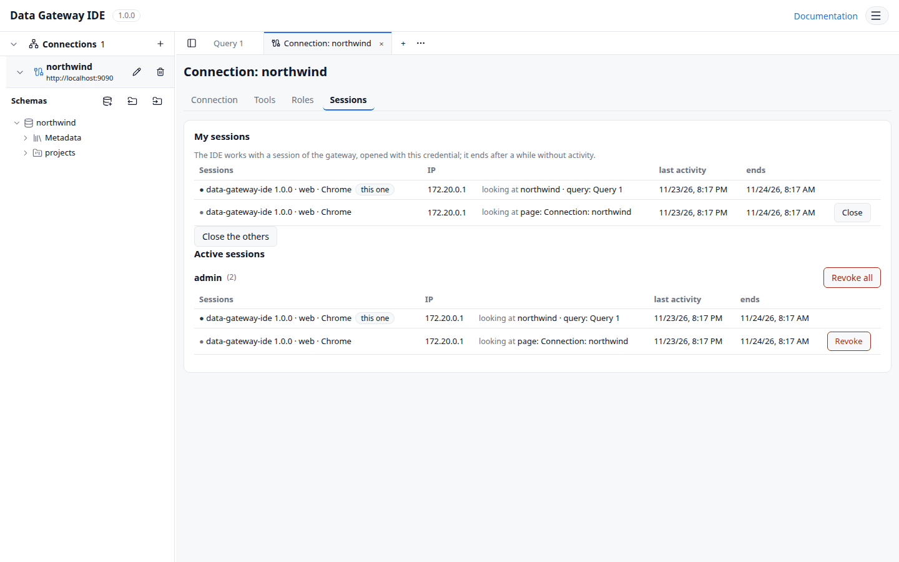

# Verbindungen

Eine Verbindung ist ein Gateway, mit dem die IDE arbeitet: die Adresse seines Ports `management` und Zugangsdaten. Die
IDE hat weder Login noch Startseite: Sie behält ihre Verbindungen und öffnet sich beim ersten Mal mit einer **Neuen
Verbindung**. Mehrere Verbindungen können gleichzeitig offen sein, jede mit ihren Schemas im Explorer und ihren Tabs
nebeneinander.

## Eine neue Verbindung {#a-new-connection}

Das **+** von **Verbindungen** im Explorer oder das Menü ☰ → **Neue Verbindung**:

| Feld | Was es ist |
| --- | --- |
| **Name** | wie die Verbindung angezeigt wird (`local`, `production`…) |
| **Protokoll** | `REST · http` oder `REST · https` |
| **Management-Adresse** | `host:port/base path` des `management` des Gateways, **so wie der Server der IDE es erreicht**: `data-gateway:9090` für eine Web-IDE im selben Compose, `localhost:9090` für die Desktop-App auf dem Rechner des Gateways |
| **Authentifizierung** | **API-Schlüssel** (sein **Header**, standardmäßig `X-Api-Key`, und sein **Schlüssel**), **Bearer-Token**, **Basic (Benutzer und Passwort)** oder **Keine** |
| **Schlüssel in diesem Browser merken** | mit der Verbindung aufbewahrt; sonst nur in diesem Tab des Browsers, und nach dem Schließen erneut abgefragt |
| **Andere URLs seiner Transporte** | die URLs seines REST, WebSocket und MCP, nur wenn die IDE sie nicht an den Ports erreicht, die das Gateway nennt (ein Proxy davor, ein anderes Netzwerk) |

**Anzeigen** zeigt den eingegebenen Schlüssel. **Testen** öffnet eine Sitzung und schließt sie sofort wieder: `Verbunden
als admin · data-gateway 4.0.0`, oder warum es nicht ging. **Verbinden** fügt die Verbindung hinzu.

Die Verbindung bleibt im Browser (in der Desktop-App in deren Daten); ihre Schemas, Workspaces und Projekte liegen im
Gateway. Eine Verbindung zu entfernen entfernt sie nur aus der IDE: Im Gateway wird nichts entfernt.

## Ihre Zeile im Explorer {#its-row-in-the-explorer}

| Element | Was es tut |
| --- | --- |
| ✎ **Verbindung bearbeiten** | öffnet ihre Seite |
| 🗑 **Entfernen** | fragt nach und entfernt sie aus der IDE |
| ⚠ anstelle ihres Symbols | es gibt etwas zu sehen: der Mauszeiger darüber sagt was |

Die Probleme, die sie meldet, in Rot unter ihrem Namen:

- **Schlüssel fehlt: Verbindung öffnen, um ihn einzugeben** — der Schlüssel wurde nicht gemerkt und der Tab des
  Browsers wurde geschlossen.
- **Die Anmeldedaten sind nicht gültig.**
- **Der IDE-Server erreicht das data-gateway nicht** — seine Adresse, oder sein `management` ist nicht offen; der
  Grund folgt (ein nicht erlaubtes Ziel: [Bereitstellen](Deploying.md#its-targets)).
- **Die Sitzung ist beendet: …** — widerrufen ([unten](#sessions)).
- **Die Sitzung läuft in 2 Minuten ab: speichere, was du bearbeitest.**

## Ihre Seite {#its-page}

✎ öffnet **Verbindung: Name** mit vier Tabs.

### Verbindung {#connection}

Das Formular oben, mit **Speichern** (sie unverändert zu speichern verbindet sie erneut, nach einem Widerruf) und
**Entfernen**. Darunter, wer die Zugangsdaten sind: ihr Name, die URL und ihre Authentifizierung.

### Werkzeuge {#tools}

Die REST API, WebSocket und MCP des Gateways, jedes in einem eigenen Tab, mit den Zugangsdaten der Verbindung. Ein
Transport, den das Gateway nicht anbietet, ist deaktiviert. Die IDE erfährt vom Gateway, wo sie sind (`GET /transports`
seines `management`), oder aus **Andere URLs seiner Transporte**.

| Werkzeug | Was es enthält |
| --- | --- |
| **REST-API (Swagger)** | die OpenAPI des Gateways, jede Methode mit **Try it out**; die Zugangsdaten gehen mit jeder Anfrage mit |
| **WebSocket** | ein **Schema**, **Verbinden** / **Trennen**, seine Methoden (aus seiner AsyncAPI: ein Klick füllt die Anfrage), die **Anfrage** (JSON-RPC) mit **Senden** (Strg+Enter) und die gesendeten und empfangenen **Nachrichten** (die letzten 200) |
| **MCP** | ein **Schema** und **Verbinden**, dann seine **Tools des Schemas**: wenn eines gewählt ist, seine **Argumente** (mit den erforderlichen gefüllt), **Aufrufen** (Strg+Enter) und sein **Ergebnis** |

### Rollen {#roles}

Was die Zugangsdaten dürfen: jede Berechtigung, **erteilt** oder **nicht erteilt**, mit dem, was sie erlaubt.

| Berechtigung | Erlaubt |
| --- | --- |
| `read` | Abfragen, die nur auswählen, das Schema, Pläne, Metadaten und Exporte eines Stage |
| `write` | Abfragen, die Zeilen einfügen, ändern, löschen, upserten oder mergen |
| `script` | Skripte ausführen |
| `queue` | Abfragen in die Warteschlange stellen, um sie später auszuführen |
| `stageImport` | Daten in einen Stage importieren |
| `schemaRead` | die `lambdaORM.yaml` jedes Workspace lesen (ohne Geheimnisse) und prüfen |
| `schemaWrite` | die `lambdaORM.yaml` ändern: Entitäten, Quellen, Stages…, über die Formulare oder das YAML |
| `schemaAdmin` | Schemas anlegen und entfernen, die Variablen ihrer `.env` setzen |
| `workbenchWrite` | Abfragen, Skripte und Diagramme in den Projekten der Workspaces speichern |
| `ddl` | die Struktur der Datenbanken eines Stage ändern (push, drop) |
| `build` | den Code der Domäne in `src/` des Workspace erzeugen |
| `sessionAdmin` | alle Sitzungen von `management` sehen und die anderer Zugangsdaten widerrufen |

Die Berechtigungen werden jeden Zugangsdaten in der Konfiguration des Gateways gegeben
([Sicherheit](../data-gateway/Security.md)).

### Sitzungen {#sessions}

Verbinden meldet sich beim `management` des Gateways an ([Sitzungen](../data-gateway/Transports.md#sessions)): Die IDE
behält das Token in diesem Tab des Browsers, und jede Anfrage trägt es, nie den Schlüssel.

- Wenn die Sitzung **abläuft** (30 Minuten ohne Aktivität, oder 12 Stunden) und der Schlüssel zur Hand ist, öffnet die
  IDE von selbst eine neue; ohne ihn fragt sie nach dem Schlüssel.
- Wenn sie **widerrufen** wird, sagt die IDE, wer sie widerrufen hat, und verbindet sich nicht von selbst wieder, auch
  nicht mit gemerktem Schlüssel: die Verbindung erneut zu speichern verbindet sie.
- Die IDE hält den WebSocket der Ereignisse des Gateways offen: die Sitzung erscheint als *verbunden* (ein grüner ●),
  und ein Schema, das sich ändert, oder etwas, das jemand anderes gespeichert hat, erscheint sofort.

**Meine Sitzungen** listet die Sitzungen derselben Zugangsdaten: diese (**diese**) und die anderen (ein anderer Tab,
Browser oder Computer), jede mit ihrem Client, ihrer Adresse, was sie gerade ansieht, ihrer letzten Aktivität und wann
sie abläuft. **Schließen** schließt eine; **Die anderen schließen** alle außer dieser.

Mit `sessionAdmin` listet **Aktive Sitzungen** jede Sitzung des Gateways nach Zugangsdaten: **Widerrufen** eine, oder
**Alle widerrufen** von Zugangsdaten (vorher gefragt; bei deinen bleibt diese Sitzung).

