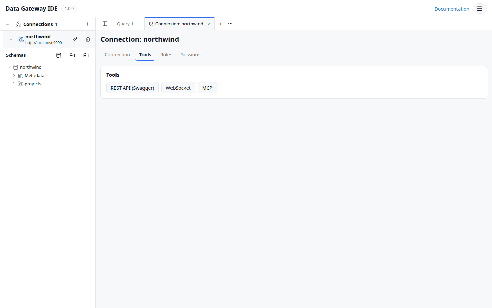

# Verbindungen

Eine Verbindung ist ein Gateway, mit dem die IDE arbeitet: die Adresse seines Ports `management` und Zugangsdaten. Die
IDE hat weder Login noch Startseite: Sie behält ihre Verbindungen und öffnet sich beim ersten Mal mit einer **Neuen
Verbindung**. Mehrere Verbindungen können gleichzeitig offen sein, jede mit ihren Schemas im [Explorer](Explorer.md)
und ihren Tabs nebeneinander.

Lege eine Verbindung pro Gateway und Zugangsdaten an, die du nutzt: eine lokale, die einer Testumgebung, dasselbe
Gateway mit Zugangsdaten, die nur lesen, und mit anderen, die verwalten.

## Eine neue Verbindung {#a-new-connection}

Das **+** neben **Verbindungen**, oben im Explorer:

| Feld | Was es ist |
| --- | --- |
| **Name** | wie die Verbindung angezeigt wird (`local`, `production`…) |
| **Protokoll** | `REST · http` oder `REST · https` |
| **Management-Adresse** | `host:port/base path` des `management` des Gateways, **so wie der Server der IDE es erreicht**: `data-gateway:9090` für eine Web-IDE im selben Compose, `localhost:9090` für die Desktop-App auf dem Rechner des Gateways |
| **Authentifizierung** | **API-Schlüssel** (sein **Header**, standardmäßig `X-Api-Key`, und sein **Schlüssel**), **Bearer-Token (JWT)** (sein **Token**: ein Schlüssel des Gateways oder das [Token eines Identitätsanbieters](../data-gateway/Security.md#jwt); wenn es abläuft, sagt die Verbindung es und fragt nach einem neuen), **Basic (Benutzer und Passwort)**, **OpenID Connect (Anmeldung)** (IDE 1.3.0: sein **Aussteller**, **Client-ID** und **Scopes**; siehe unten) oder **Keine** |
| **Schlüssel in diesem Browser merken** | mit der Verbindung aufbewahrt; sonst nur in diesem Tab des Browsers, und nach dem Schließen erneut abgefragt |
| **Andere URLs seiner Transporte** (eingeklappt) | die **REST-URL**, **WebSocket-URL** und **MCP-URL**, nur wenn die IDE sie nicht an den Ports erreicht, die das Gateway nennt (ein Proxy davor, ein anderes Netzwerk) |
| **Beobachtbarkeit** (eingeklappt) | die **Grafana-URL** und ihre **Tempo-Datenquelle (uid)** (standardmäßig `tempo`): Eine Entität zeigt dann einen Link zu ihren Traces ([Entitäten](Entities.md)) |

**OpenID Connect (Anmeldung)**: Die Seite der Connection hat **Anmelden**, das die Anmeldung des Identitätsanbieters
öffnet (im Browser ein eigenes Fenster; in der Desktop-App der Browser des Systems, der zur App zurückkehrt); das Token
bleibt in diesem Tab und wird vor Ablauf erneuert; **Abmelden** beendet auch die Sitzung des Anbieters. Der Anbieter
braucht einen öffentlichen Client mit PKCE, dessen Redirect-URIs die IDE annehmen (`…/oidc-callback.html` der IDE und
`http://127.0.0.1:*` für die Desktop-App); der Server der IDE erreicht ihn, daher gehört sein Origin in
`DATA_GATEWAY_IDE_TARGETS` ([Bereitstellung](Deploying.md)).

**Anzeigen** zeigt den eingegebenen Schlüssel. **Testen** öffnet eine Sitzung und schließt sie sofort wieder: `Verbunden
als admin · data-gateway 4.0.0`, oder warum es nicht ging. **Verbinden** fügt die Verbindung hinzu und öffnet ihre
Seite.

Die Verbindung bleibt im Browser (in der Desktop-App in deren Daten); ihre Schemas, Workspaces und das, was darin
gespeichert ist, liegen im Gateway.

## Ihre Zeile im Explorer {#its-row-in-the-explorer}

| Element | Was es tut |
| --- | --- |
| ▸ | klappt ihre Schemas ein und aus |
| ihr Name und ihre Adresse | öffnen ihre Seite |
| ⟳ **Aktualisieren** | liest neu, was sich anderswo geändert hat: ihre Schemas, deren Domänen und das Gespeicherte |
| ⚠ anstelle ihres Symbols | es gibt etwas zu sehen: der Mauszeiger darüber sagt was |

Die Probleme, die sie meldet, in Rot unter ihrem Namen:

- **Schlüssel fehlt: Verbindung öffnen, um ihn einzugeben** — der Schlüssel wurde nicht gemerkt und der Tab des
  Browsers wurde geschlossen.
- **Die Anmeldedaten sind nicht gültig.**
- **Der IDE-Server erreicht das data-gateway nicht** — seine Adresse, oder sein `management` ist nicht offen; der
  Grund folgt (ein nicht erlaubtes Ziel: [Bereitstellen](Deploying.md#its-targets)).
- **Die Sitzung ist beendet: …** — widerrufen ([unten](#sessions)).
- **Die Sitzung läuft in 2 Minuten ab: speichere, was du bearbeitest.**

## Ihre Seite {#its-page}

Ein Klick auf ihren Namen öffnet **Verbindung: Name**, mit vier Tabs.

### Verbindung {#connection}

Das Formular oben, mit **Speichern** (sie unverändert zu speichern verbindet sie erneut, nach einem Widerruf) und
**Entfernen**, das vorher fragt und sie nur aus der IDE entfernt: Im Gateway wird nichts entfernt, und ihre Tabs
schließen sich. Unter dem Formular, wer die Zugangsdaten sind: ihr Name, die URL und ihre Authentifizierung.

### Werkzeuge {#tools}

**REST-API (Swagger)**, **WebSocket** und **MCP**: die Transporte des Gateways, jeder in einem eigenen Tab geöffnet
(`REST API · northwind`…), mit den Zugangsdaten der Verbindung. Ein Transport, den das Gateway nicht anbietet, ist
deaktiviert (`von diesem data-gateway nicht angeboten`). Die IDE erfährt vom Gateway, wo sie sind (`GET /transports`
seines `management`), oder aus **Andere URLs seiner Transporte**.

| Werkzeug | Was es enthält |
| --- | --- |
| **REST-API (Swagger)** | die OpenAPI des Gateways, jede Methode mit **Try it out**; die Zugangsdaten gehen mit jeder Anfrage mit |
| **WebSocket** | ein **Schema**, **Verbinden** / **Trennen**, seine **Methoden** (aus seiner AsyncAPI: ein Klick füllt die Anfrage), die **Anfrage** (JSON-RPC) mit **Senden** (Strg+Enter) und die gesendeten und empfangenen **Nachrichten** (die letzten 200) |
| **MCP** | ein **Schema** und **Verbinden**, dann die **Tools des Schemas**: wenn eines gewählt ist, seine **Argumente** (mit den erforderlichen gefüllt), **Aufrufen** (Strg+Enter) und sein **Ergebnis** |

### Rollen {#roles}

Was die Zugangsdaten dürfen, in zwei Gruppen, **Daten** und **Verwaltung**, jede mit der Anzahl der erteilten
(`1 / 5`): jede Berechtigung, **erteilt** oder **nicht erteilt**, mit dem, was sie erlaubt.

| Berechtigung | Erlaubt |
| --- | --- |
| `read` | Abfragen, die nur auswählen, das Schema, Pläne, Metadaten und Exporte eines Stage |
| `write` | Abfragen, die Zeilen einfügen, ändern, löschen, upserten oder mergen |
| `script` | Skripte ausführen |
| `queue` | Abfragen in die Warteschlange stellen, um sie später auszuführen |
| `stageImport` | Daten in einen Stage importieren |
| `schemaRead` | die `lambdaORM.yaml` jedes Workspace lesen (ohne Geheimnisse) und prüfen |
| `schemaWrite` | die `lambdaORM.yaml` ändern: Entitäten, Sources, Stages…, über die Formulare oder das YAML |
| `schemaAdmin` | Schemas anlegen und entfernen, die Variablen ihrer `.env` setzen |
| `workbenchWrite` | Abfragen, Skripte und Diagramme in den Projekten der Workspaces speichern |
| `ddl` | die Struktur der Datenbanken eines Stage ändern (push, drop) |
| `build` | den Code der Domäne (Modell und Repositories) in `src/` des Workspace erzeugen |
| `sessionAdmin` | alle Sitzungen von `management` sehen und die anderer Zugangsdaten widerrufen |
| `approve` | die Schreibvorgänge, die auf eine Person warten, genehmigen oder ablehnen |
| `destructive` | mit `ddl` ein Push oder eine Migration, die Daten verliert (data-gateway 4.4) |
| `roles` | die im Zustand des Gateways gespeicherten Rollen sehen und ändern (data-gateway 4.4) |

**Rollen des Gateways** (mit `roles`, data-gateway 4.4, IDE 1.4.0): darunter die [Rollen](../data-gateway/Security.md#roles)
des Gateways, die seiner Konfiguration (nur lesen) und die seines Zustands. **+ Rolle hinzufügen**; eine der
Konfiguration **Erweitern** mit mehr Berechtigungen, Views oder Stages, in allen Schemas oder in einem; eine des
Zustands **Bearbeiten** oder **Entfernen**, mit einem Grund. **Ihre Änderungen** sagt, wer was wann geändert hat.

Die Berechtigungen werden jeden Zugangsdaten in der Konfiguration des Gateways gegeben
([Sicherheit](../data-gateway/Security.md)).

### Wartende Schreibvorgänge {#approvals}

Seit IDE 1.3.0, mit Anmeldedaten, die `approve` haben: die
[Schreibvorgänge von Agenten, die auf eine Person warten](../data-gateway/Security.md#approvals), in allen Schemas
des Gateways, jeder mit dem Anfragenden und wann, seiner Abfrage (oder seinem Skript), **Was ausgeführt würde** (seine
Anweisungen) und **Ihre Daten**. **Genehmigen** führt ihn als der Anfragende aus; **Ablehnen** fragt nach einem Grund
(optional). Wer einen Schreibvorgang angefragt hat, kann ihn nicht genehmigen. Die Liste wird alle 15 Sekunden neu
gelesen.

### Sitzungen {#sessions}

Verbinden meldet sich beim `management` des Gateways an ([Sitzungen](../data-gateway/Transports.md#sessions)): Die IDE
behält das Token in diesem Tab des Browsers, und jede Anfrage trägt es, nie den Schlüssel.

- Wenn die Sitzung **abläuft** (30 Minuten ohne Aktivität, oder 12 Stunden) und der Schlüssel zur Hand ist, öffnet die
  IDE von selbst eine neue; ohne ihn fragt sie nach dem Schlüssel.
- Wenn sie **widerrufen** wird, sagt die IDE, wer sie widerrufen hat, und verbindet sich nicht von selbst wieder, auch
  nicht mit gemerktem Schlüssel: Die Verbindung erneut zu speichern verbindet sie.
- Die IDE hält den WebSocket der Ereignisse des Gateways offen: Die Sitzung erscheint als *verbunden* (ein grüner ●),
  und ein Schema, das sich ändert, oder etwas, das jemand anderes gespeichert hat, erscheint sofort. Eine Änderung aus
  einer anderen Sitzung (eine andere Person, eine andere IDE, die CLI über das Gateway) wird unter der Verbindung
  angekündigt, `modeler hat Orders in / geändert`, mit **Aktualisieren**.

**Meine Sitzungen** listet die Sitzungen derselben Zugangsdaten: diese (**diese**) und die anderen (ein anderer Tab,
Browser oder Computer), jede mit ihrem Client, ihrer Adresse, was sie gerade ansieht (ihr Schema und ihr aktiver Tab),
ihrer letzten Aktivität und wann sie abläuft. **Schließen** schließt eine; **Die anderen schließen** alle außer dieser.

Mit `sessionAdmin` listet **Aktive Sitzungen** jede Sitzung des Gateways nach Zugangsdaten: **Widerrufen** eine, oder
**Alle widerrufen** von Zugangsdaten (vorher gefragt; bei deinen bleibt diese Sitzung).

