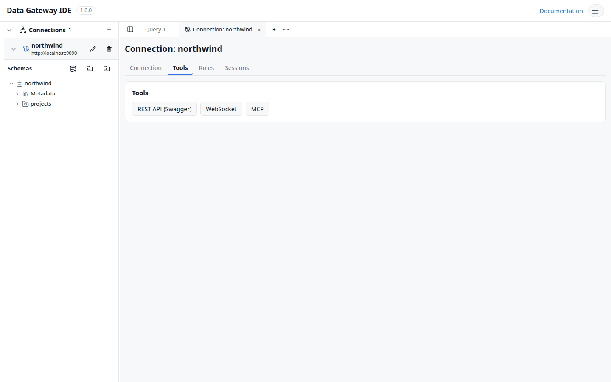
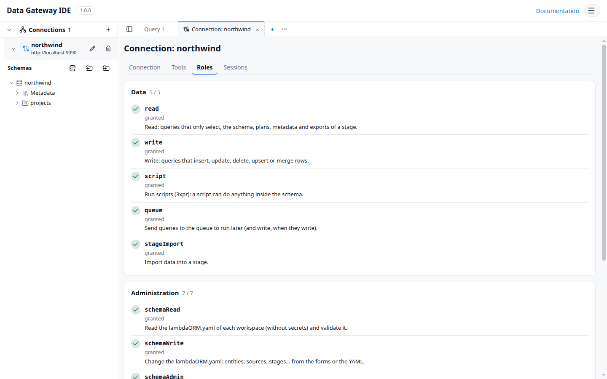
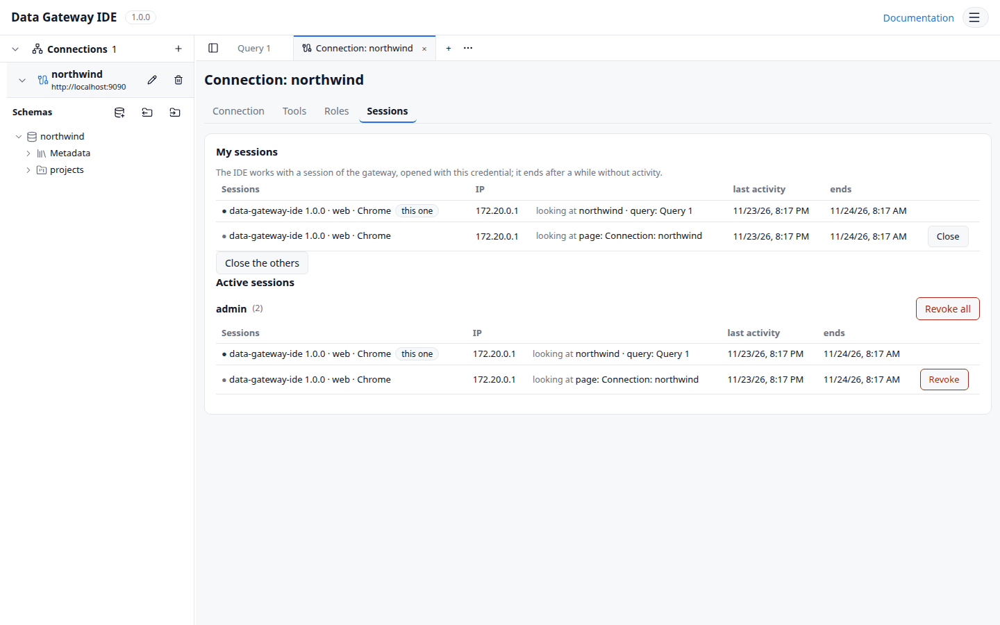

# Conexiones {#connections}

Una conexión es un gateway con el que trabaja el IDE: la dirección de su puerto `management` y una credencial. El IDE no
tiene login ni página de inicio: guarda sus conexiones, y la primera vez se abre en una **Nueva conexión**. Puede haber
varias conexiones abiertas a la vez, cada una con sus esquemas en el explorador y sus pestañas una al lado de otra.

## Una conexión nueva {#a-new-connection}

El **+** de **Conexiones** en el explorador, o el menú ☰ → **Nueva conexión**:

| Campo | Qué es |
| --- | --- |
| **Nombre** | cómo se muestra la conexión (`local`, `production`…) |
| **Protocolo** | `REST · http` o `REST · https` |
| **Dirección del management** | `host:puerto/ruta base` del `management` del gateway, **como lo alcanza el servidor del IDE**: `data-gateway:9090` para un IDE web en el mismo compose, `localhost:9090` para la aplicación de escritorio en la máquina del gateway |
| **Autenticación** | **API key** (su **Header**, por defecto `X-Api-Key`, y su **Clave**), **Token Bearer**, **Basic (usuario y contraseña)** o **Ninguna** |
| **Recordar la clave en este navegador** | se guarda con la conexión; si no, solo en esa pestaña del navegador, y se vuelve a pedir después de cerrarla |
| **Otras URLs de sus transportes** | las URLs de su REST, WebSocket y MCP, solo cuando el IDE no los alcanza en los puertos que dice el gateway (un proxy adelante, otra red) |

**Mostrar** muestra la clave que se escribió. **Probar** abre una sesión y la cierra enseguida: `Conectado como admin ·
data-gateway 4.0.0`, o por qué no pudo. **Conectar** agrega la conexión.

La conexión queda en el navegador (en la aplicación de escritorio, en sus datos); sus esquemas, workspaces y proyectos
están en el gateway. Quitar una conexión la quita solo del IDE: no se borra nada del gateway.

## Su fila en el explorador {#its-row-in-the-explorer}

| Elemento | Qué hace |
| --- | --- |
| ✎ **Editar la conexión** | abre su página |
| 🗑 **Quitar** | pregunta, y la quita del IDE |
| ⚠ en lugar de su icono | algo para ver: el puntero encima dice qué |

Los problemas que indica, en rojo debajo de su nombre:

- **Falta su clave: abrí la conexión para ingresarla** — la clave no se recordó y se cerró la pestaña del navegador.
- **La credencial no es válida.**
- **El servidor del IDE no llega a la data-gateway** — su dirección, o su `management` no está expuesto; sigue el
  motivo (un destino no permitido: [Despliegue](Deploying.md#its-targets)).
- **La sesión terminó: …** — revocada ([abajo](#sessions)).
- **La sesión vence en 2 minutos: guardá lo que estés editando.**

## Su página {#its-page}

✎ abre **Conexión: nombre**, con cuatro pestañas.

### Conexión {#connection}

El formulario de arriba, con **Guardar** (guardarlo sin cambios lo vuelve a conectar, después de una revocación) y
**Quitar**. Debajo, quién es la credencial: su nombre, la URL y su autenticación.

### Herramientas {#tools}

La API REST, el WebSocket y el MCP del gateway, cada uno en su propia pestaña, con la credencial de la conexión. Un
transporte que el gateway no expone está deshabilitado. El IDE sabe dónde están por el gateway (`GET /transports` de
su `management`), o por **Otras URLs de sus transportes**.

| Herramienta | Qué tiene |
| --- | --- |
| **API REST (Swagger)** | el OpenAPI del gateway, cada método con **Try it out**; la credencial va con cada petición |
| **WebSocket** | un **Esquema**, **Conectar** / **Desconectar**, sus métodos (de su AsyncAPI: un clic llena el pedido), el **Pedido** (JSON-RPC) con **Enviar** (Ctrl+Enter) y los **Mensajes** enviados y recibidos (los últimos 200) |
| **MCP** | un **Esquema** y **Conectar**, luego sus **Tools del esquema**: elegida una, sus **Argumentos** (llenos con los obligatorios), **Llamar** (Ctrl+Enter) y su **Resultado** |

### Roles {#roles}

Lo que puede hacer la credencial: cada permiso, **otorgado** o **no otorgado**, con lo que permite.

| Permiso | Permite |
| --- | --- |
| `read` | consultas que solo seleccionan, el esquema, planes, metadatos y exportar un stage |
| `write` | consultas que insertan, actualizan, borran, hacen upsert o merge de filas |
| `script` | ejecutar scripts |
| `queue` | enviar consultas a la cola, para ejecutarlas después |
| `stageImport` | importar datos en un stage |
| `schemaRead` | leer el `lambdaORM.yaml` de cada workspace (sin secretos) y validarlo |
| `schemaWrite` | cambiar el `lambdaORM.yaml`: entidades, sources, stages…, desde los formularios o el YAML |
| `schemaAdmin` | crear y eliminar esquemas, definir las variables de su `.env` |
| `workbenchWrite` | guardar consultas, scripts y diagramas en los proyectos de los workspaces |
| `ddl` | cambiar la estructura de las bases de datos de un stage (push, drop) |
| `build` | generar el código del dominio en `src/` del workspace |
| `sessionAdmin` | ver todas las sesiones de `management` y revocar las de otras credenciales |

Los permisos se dan a cada credencial en la configuración del gateway
([Seguridad](../data-gateway/Security.md)).

### Sesiones {#sessions}

Conectarse inicia sesión en el `management` del gateway ([sesiones](../data-gateway/Transports.md#sessions)): el IDE
guarda el token en esa pestaña del navegador, y cada petición lo lleva, nunca la clave.

- Cuando la sesión **vence** (30 minutos sin actividad, o 12 horas) y la clave está a mano, el IDE abre otra por sí
  solo; sin ella, pide la clave.
- Cuando se **revoca**, el IDE dice quién la revocó y no vuelve por sí solo, aunque la clave esté recordada: guardar la
  conexión de nuevo la conecta.
- El IDE mantiene abierto el WebSocket de eventos del gateway: la sesión se muestra como *conectado* (un ● verde), y un
  esquema que cambia, o algo que guardó otra persona, se ve enseguida.

**Mis sesiones** lista las sesiones de la misma credencial: esta (**esta**) y las otras (otra pestaña, navegador o
computadora), cada una con su cliente, su dirección, lo que está mirando, su última actividad y cuándo vence.
**Cerrar** cierra una; **Cerrar las otras**, todas menos esta.

Con `sessionAdmin`, **Sesiones activas** lista todas las sesiones del gateway por credencial: **Revocar** una, o
**Revocar todas** las de una credencial (pregunta antes; en la tuya, esta sesión queda).

