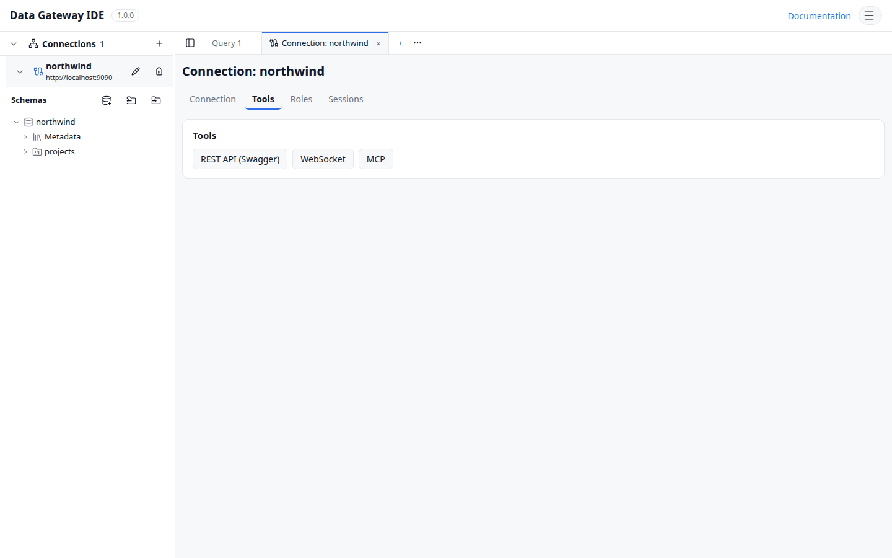
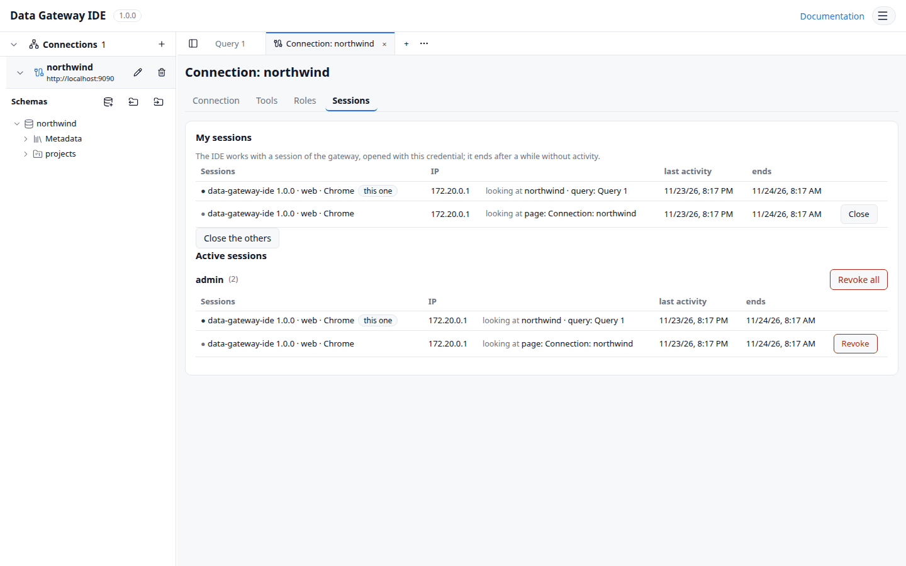

# Connections

A connection is a gateway the IDE works with: the address of its `management` port and a credential. The IDE has no
login and no home page: it keeps its connections, and the first time it opens on a **New connection**. Several
connections can be open at once, each one a tree of the [explorer](Explorer.md): its **Administration** (what its
credential may administer of the gateway) and its **Schemas**, with their tabs side by side.

Add one connection per gateway and credential you use: a local one, the one of a test environment, the same gateway
with a credential that only reads and another one that administers.

## A new connection

The **+** next to **Connections**, at the top of the explorer:

| Field | What it is |
| --- | --- |
| **Name** | how the connection is shown (`local`, `production`…) |
| **Protocol** | `REST · http` or `REST · https` |
| **Management address** | `host:port/base path` of the `management` of the gateway, **as the server of the IDE reaches it**: `data-gateway:9090` for a web IDE in the same compose, `localhost:9090` for the desktop app on the machine of the gateway |
| **Authentication** | **API key** (its **Header**, default `X-Api-Key`, and its **Key**), **Bearer token (JWT)** (its **Token**: a key of the gateway or the [token of an identity provider](../data-gateway/Security.md#jwt); when it expires the connection says so and asks for a new one), **Basic (user and password)**, **OpenID Connect (sign in)** (IDE 1.3.0: its **Issuer**, **Client ID** and **Scopes**; see below) or **None** |
| **Remember the key in this browser** | kept with the connection; otherwise only in that tab of the browser, and asked again after closing it |
| **Other URLs of its transports** (folded) | the **REST URL**, **WebSocket URL** and **MCP URL**, only when the IDE doesn't reach them at the ports the gateway tells (a proxy in front, another network) |

**OpenID Connect (sign in)**: the page of the connection has **Sign in**, which opens the login of the identity
provider (in the browser, a window of its own; in the desktop app, the browser of the system, back to the app); the
token stays in that tab and is renewed before it ends; **Sign out** ends the session of the provider too. The provider
needs a public client with PKCE whose redirect URIs take the IDE (`…/oidc-callback.html` of the IDE, and
`http://127.0.0.1:*` for the desktop app); the server of the IDE reaches it, so its origin goes in
`DATA_GATEWAY_IDE_TARGETS` ([Deploying](Deploying.md)).

**Show** shows the key that was typed. **Test** opens a session and closes it at once: `Connected as admin ·
data-gateway 4.0.0`, or why it couldn't. **Connect** adds the connection and opens its page.


The connection stays in the browser (in the desktop app, in its data); its schemas, workspaces and what is saved in
them are in the gateway.

## Its row in the explorer

| Element | What it does |
| --- | --- |
| ▸ | folds and unfolds its schemas |
| its name and address | open its page |
| ⟳ **Refresh** | reads again what changed elsewhere: its schemas, their domains and what is saved |
| ⚠ in place of its icon | something to see: the pointer over it says what |

The problems it tells, in red under its name:

- **Its key: open the connection to enter it** — the key was not remembered and the tab of the browser was closed.
- **The credential is not valid.**
- **The IDE server can't reach the data-gateway** — its address, or its `management` is not exposed; the reason
  follows (a target not allowed: [Deploying](Deploying.md#its-targets)).
- **The session ended: …** — revoked ([below](#sessions)).
- **The session ends in 2 minutes: save what you are editing.**

## Its page

A click on its name opens **Connection: name** (since IDE 1.5.0, only the connection; its tools, roles, sessions and
writes that wait are in its [Administration](#administration)):

- **The form** above, with **Save** (saving it unchanged connects it again, after a revocation) and **Remove**, which
  asks first and removes it from the IDE only: nothing is removed from the gateway, and its tabs close.
- **Who I am here** (data-gateway 5.0, `GET /admin/me`): the user of the credential, its context and each of its roles
  as it applies, with its permissions, its schemas and, in each one, its views and stages (the one used when nothing is
  chosen, marked). In each schema the permissions are those of the roles that allow the view and the stage chosen. A
  role the gateway doesn't have says *unknown: it gives nothing*. With a gateway before 5.0, its name and permissions.

## Its administration {#administration}

**Since IDE 1.5.0, with data-gateway 5.0.** In the explorer, each connection has the node **Administration** above its
**Schemas**, with what its credential may administer; what needs a permission it doesn't have doesn't show:

```text
northwind  http://data-gateway:9090
├─ Administration
│  ├─ Roles                    (roles)        each role a node: Edit, Remove
│  ├─ Access                   (roles)
│  ├─ Persist                  (roles or persist)
│  │  ├─ Config                its lambdaORM.yaml, in Monaco
│  │  └─ Connection            (persist)
│  ├─ Sessions
│  ├─ Writes that wait         (approve)
│  ├─ Tools                    REST API · WebSocket · MCP
│  └─ Observability            (observability)   Metrics · Logs · Traces
└─ Schemas
   └─ /
```

### Roles {#roles}

**Permissions by role:** a role by row and a permission by column (the configuration and the state together), with its
schemas. **+ Add a role** opens a new one. Each role is a node of its own: all it gives, its permissions and, by schema,
its views and stages with the defaults marked, where it comes from (*its configuration*, or who changed it and when),
with **Edit** and **Remove**.

**Edit** has a box per permission (those its configuration gives, checked and fixed: what is saved extends a role of
the configuration, never takes from it), its **Schemas** (none: every schema) and, for each schema chosen, its views
and stages to check with its **Default view** and **Default stage**, **Most rows**, *Its writes wait for a person to
approve them* and **Why (optional)**. A role *locked* in the configuration can't be extended; a role that 4.4 kept for
one schema is marked *of one schema (4.4): it doesn't apply; remove it*. **Its changes** says who changed what and when.
See [roles](../data-gateway/Security.md#roles).

### Access {#access}

**Access: keys and tokens:** who may come in, as the configuration says it (`GET /admin/access`): by **Where**
(*everywhere*, a transport, a schema) each **Method** and **Credential** with its roles and its **Context**; a method
`jwt` says its issuer and the claim of its roles. Never a secret.

### Persist {#persist}

Where the gateway keeps its administration (the sessions, the roles, its observability, the writes that wait and the
changes of each): its database or file, who reads and writes it, who says it (*state.source of the configuration*,
*by default: the SQLite of the volume*, *the administration*), how often the replicas read it again, whether it is
required and whether it can be read now.

- **Config:** the `lambdaORM.yaml` of the administration, in Monaco: the entities, the mapping and the source of the
  state as λORM uses them. With `persist` its mapping can be edited (the table of each entity and its columns):
  **Save the mapping** copies the state to the new tables and the gateway restarts.
- **Connection** (with `persist`): **Now**, the database of the moment, and **Another database**: **Copy the state and
  move** copies it there with λORM and the gateway restarts with it (open connections reconnect); **Back to the
  configuration** undoes it. See [where the state is kept](../data-gateway/Admin.md#persist).

### Tools {#tools}

**REST API (Swagger)**, **WebSocket** and **MCP**: the transports of the gateway, each one opened in a tab of its own
(`REST API · northwind`…), with the credential of the connection. A transport the gateway doesn't expose is disabled
(`not exposed by this data-gateway`). The IDE learns where they are from the gateway (`GET /transports` of its
`management`), or from **Other URLs of its transports**.

| Tool | What it has |
| --- | --- |
| **REST API (Swagger)** | the OpenAPI of the gateway, every method with **Try it out**; the credential goes with each request |
| **WebSocket** | a **Schema**, **Connect** / **Disconnect**, its **Methods** (from its AsyncAPI: a click fills the request), the **Request** (JSON-RPC) with **Send** (Ctrl+Enter) and the **Messages** sent and received (the last 200) |
| **MCP** | a **Schema** and **Connect**, then the **Tools of the schema**: one chosen, its **Arguments** (filled with the required ones), **Call** (Ctrl+Enter) and its **Result** |



### Observability {#observability}

With `observability`: what the gateway sends and where, in three nodes, **Metrics** (*Send by OTLP*, *Every (ms)*,
*lambdaorm.entity in the metrics*; `/metrics` for Prometheus is served always), **Logs** (*To the console*, its
**Level**, by OTLP) and **Traces** (*Sampled (0–1)*, *Follow the decision of the caller*, *Text of the queries in the
spans*); **Where it goes: the OTLP exporter** (its **Endpoint**; its headers only in `OTEL_EXPORTER_OTLP_HEADERS`) and
**Where it is seen** (**Grafana URL**, the datasources of **Tempo**, **Prometheus** and **Loki**, the **Organization of
Grafana**), with **Open in Grafana**. **Save and apply** keeps it over the configuration and applies it at once (the
edge restarts and the schemas whose telemetry changes reload); **Back to the configuration** undoes it. The link of an
entity to its traces ([Entities](Entities.md)) comes from here, not from each IDE.

### Writes that wait {#approvals}

Since IDE 1.3.0, with a credential that has `approve`: the
[writes of agents that wait for a person](../data-gateway/Security.md#approvals) in every schema of the gateway, each
with who asked and when, its query (or script), **What it would run** (its sentences) and **Its data**. **Approve** runs
it as who asked; **Reject** asks for a reason (optional). A write can't be approved by who asked for it. The list is
read again every 15 seconds.

### Sessions {#sessions}

Connecting logs in to the `management` of the gateway ([sessions](../data-gateway/Transports.md#sessions)): the IDE
keeps the token in that tab of the browser, and every request carries it, never the key.

- When the session **expires** (30 minutes without activity, or 12 hours) and the key is at hand, the IDE opens another
  one by itself; without it, it asks for the key.
- When it is **revoked**, the IDE says who revoked it and doesn't come back by itself, even with the key remembered:
  saving the connection again connects it.
- The IDE keeps the WebSocket of events of the gateway open: the session shows as *connected* (a green ●), and a schema
  that changes, or something saved by someone else, shows at once. A change made by another session (another person,
  another IDE, the CLI through the gateway) is announced under the connection, `modeler changed Orders in /`, with
  **Refresh**.

**My sessions** lists the sessions of the same credential: this one (**this one**) and the others (another tab,
browser or computer), each with its client, its address, what it is looking at (its schema and its active tab), its
last activity and when it ends. **Close** closes one; **Close the others**, all but this one.

With `sessionAdmin`, **Active sessions** lists every session of the gateway by credential: **Revoke** one, or **Revoke
all** of a credential (asked first; on yours, this session stays).


