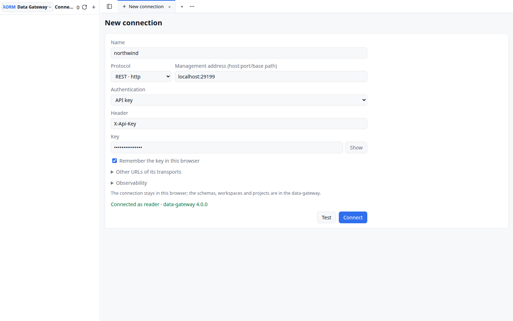
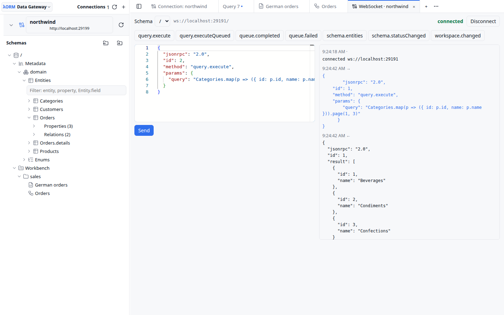
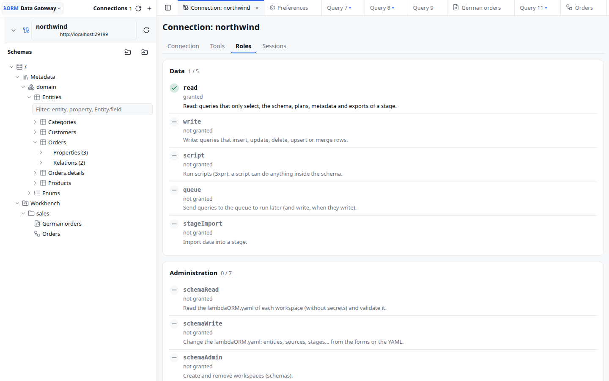
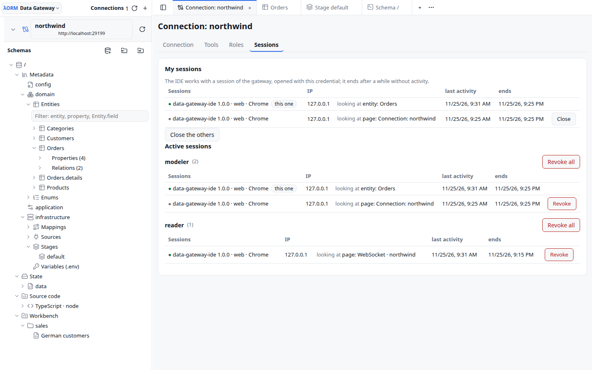

# Conexões {#connections}

Uma conexão é um gateway com o qual a IDE trabalha: o endereço da sua porta `management` e uma credencial. A IDE não
tem login nem página inicial: ela guarda as suas conexões e, na primeira vez, abre em uma **Nova conexão**. Várias
conexões podem estar abertas ao mesmo tempo, cada uma com seus esquemas no [explorador](Explorer.md) e suas abas lado
a lado.

Adicione uma conexão por gateway e credencial que você usa: uma local, a de um ambiente de testes, o mesmo gateway com
uma credencial que só lê e outra que administra.

## Uma nova conexão {#a-new-connection}

O **+** ao lado de **Conexões**, no topo do explorador:

| Campo | O que é |
| --- | --- |
| **Nome** | como a conexão é mostrada (`local`, `production`…) |
| **Protocolo** | `REST · http` ou `REST · https` |
| **Endereço do management** | `host:porta/caminho base` do `management` do gateway, **como o servidor da IDE o alcança**: `data-gateway:9090` para uma IDE web no mesmo compose, `localhost:9090` para o aplicativo de desktop na máquina do gateway |
| **Autenticação** | **API key** (seu **Header**, por padrão `X-Api-Key`, e sua **Chave**), **Token Bearer** (seu **Token**), **Basic (usuário e senha)** ou **Nenhuma** |
| **Lembrar a chave neste navegador** | guardada com a conexão; caso contrário, só naquela aba do navegador, e pedida de novo depois de fechá-la |
| **Outras URLs dos seus transportes** (recolhido) | a **URL do REST**, a **URL do WebSocket** e a **URL do MCP**, só quando a IDE não os alcança nas portas que o gateway informa (um proxy na frente, outra rede) |
| **Observabilidade** (recolhido) | a **URL do Grafana** e o seu **Datasource do Tempo (uid)** (`tempo` por padrão): uma entidade então mostra um link para os seus rastreamentos ([Entidades](Entities.md)) |

**Mostrar** mostra a chave digitada. **Testar** abre uma sessão e a fecha em seguida: `Conectado como admin ·
data-gateway 4.0.0`, ou por que não conseguiu. **Conectar** adiciona a conexão e abre a sua página.

A conexão fica no navegador (no aplicativo de desktop, nos seus dados); seus esquemas, workspaces e o que neles se
salva estão no gateway.

## Sua linha no explorador {#its-row-in-the-explorer}

| Elemento | O que faz |
| --- | --- |
| ▸ | recolhe e expande os seus esquemas |
| seu nome e endereço | abrem a sua página |
| ⟳ **Atualizar** | lê de novo o que mudou em outro lugar: seus esquemas, seus domínios e o que está salvo |
| ⚠ no lugar do seu ícone | algo a ver: o ponteiro sobre ele diz o quê |

Os problemas que ela informa, em vermelho sob o seu nome:

- **Falta a chave: abra a conexão para informá-la** — a chave não foi lembrada e a aba do navegador foi fechada.
- **A credencial não é válida.**
- **O servidor do IDE não chega à data-gateway** — o seu endereço, ou o seu `management` não está exposto; o motivo
  vem em seguida (um destino não permitido: [Implantação](Deploying.md#its-targets)).
- **A sessão terminou: …** — revogada ([abaixo](#sessions)).
- **A sessão expira em 2 minutos: salve o que estiver editando.**

## Sua página {#its-page}

Um clique no seu nome abre **Conexão: nome**, com quatro abas.

### Conexão {#connection}

O formulário acima, com **Salvar** (salvá-la sem mudanças a conecta de novo, depois de uma revogação) e **Remover**,
que pergunta antes e a remove apenas da IDE: nada é removido do gateway, e as suas abas se fecham. Abaixo do
formulário, quem é a credencial: seu nome, a URL e sua autenticação.

### Ferramentas {#tools}

**API REST (Swagger)**, **WebSocket** e **MCP**: os transportes do gateway, cada um aberto em uma aba própria
(`REST API · northwind`…), com a credencial da conexão. Um transporte que o gateway não expõe fica desativado
(`esta data-gateway não o expõe`). A IDE descobre onde eles estão pelo gateway (`GET /transports` do seu
`management`), ou por **Outras URLs dos seus transportes**.

| Ferramenta | O que tem |
| --- | --- |
| **API REST (Swagger)** | o OpenAPI do gateway, cada método com **Try it out**; a credencial vai com cada requisição |
| **WebSocket** | um **Esquema**, **Conectar** / **Desconectar**, seus **Métodos** (do seu AsyncAPI: um clique preenche a requisição), a **Requisição** (JSON-RPC) com **Enviar** (Ctrl+Enter) e as **Mensagens** enviadas e recebidas (as últimas 200) |
| **MCP** | um **Esquema** e **Conectar**, depois as **Tools do esquema**: escolhida uma, seus **Argumentos** (preenchidos com os obrigatórios), **Chamar** (Ctrl+Enter) e seu **Resultado** |

### Papéis {#roles}

O que a credencial pode fazer, em dois grupos, **Dados** e **Administração**, cada um com quantas estão concedidas
(`1 / 5`): cada permissão, **concedida** ou **não concedida**, com o que ela permite.

| Permissão | Permite |
| --- | --- |
| `read` | consultas que só selecionam, o esquema, planos, metadados e exportações de um stage |
| `write` | consultas que inserem, atualizam, apagam, fazem upsert ou merge de linhas |
| `script` | executar scripts |
| `queue` | enviar consultas à fila, para executar depois |
| `stageImport` | importar dados em um stage |
| `schemaRead` | ler o `lambdaORM.yaml` de cada workspace (sem segredos) e validá-lo |
| `schemaWrite` | alterar o `lambdaORM.yaml`: entidades, sources, stages…, pelos formulários ou pelo YAML |
| `schemaAdmin` | criar e remover esquemas, definir as variáveis do seu `.env` |
| `workbenchWrite` | salvar consultas, scripts e diagramas nos projetos dos workspaces |
| `ddl` | alterar a estrutura dos bancos de dados de um stage (push, drop) |
| `build` | gerar o código do domínio (modelo e repositórios) em `src/` do workspace |
| `sessionAdmin` | ver todas as sessões do `management` e revogar as de outras credenciais |

As permissões são dadas a cada credencial na configuração do gateway
([Segurança](../data-gateway/Security.md)).

### Sessões {#sessions}

Conectar faz login no `management` do gateway ([sessões](../data-gateway/Transports.md#sessions)): a IDE guarda o
token naquela aba do navegador, e cada requisição o leva, nunca a chave.

- Quando a sessão **expira** (30 minutos sem atividade, ou 12 horas) e a chave está à mão, a IDE abre outra sozinha;
  sem ela, pede a chave.
- Quando ela é **revogada**, a IDE diz quem a revogou e não volta sozinha, mesmo com a chave lembrada: salvar a
  conexão de novo a conecta.
- A IDE mantém aberto o WebSocket de eventos do gateway: a sessão aparece como *conectado* (um ● verde), e um esquema
  que muda, ou algo salvo por outra pessoa, aparece na hora. Uma mudança feita por outra sessão (outra pessoa, outra
  IDE, a CLI através do gateway) é anunciada sob a conexão, `modeler alterou Orders em /`, com **Atualizar**.

**Minhas sessões** lista as sessões da mesma credencial: esta (**esta**) e as outras (outra aba, navegador ou
computador), cada uma com seu cliente, seu endereço, o que está olhando (seu esquema e sua aba ativa), sua última
atividade e quando expira. **Fechar** fecha uma; **Fechar as outras**, todas menos esta.

Com `sessionAdmin`, **Sessões ativas** lista todas as sessões do gateway por credencial: **Revogar** uma, ou **Revogar
todas** de uma credencial (com confirmação; na sua, esta sessão permanece).

