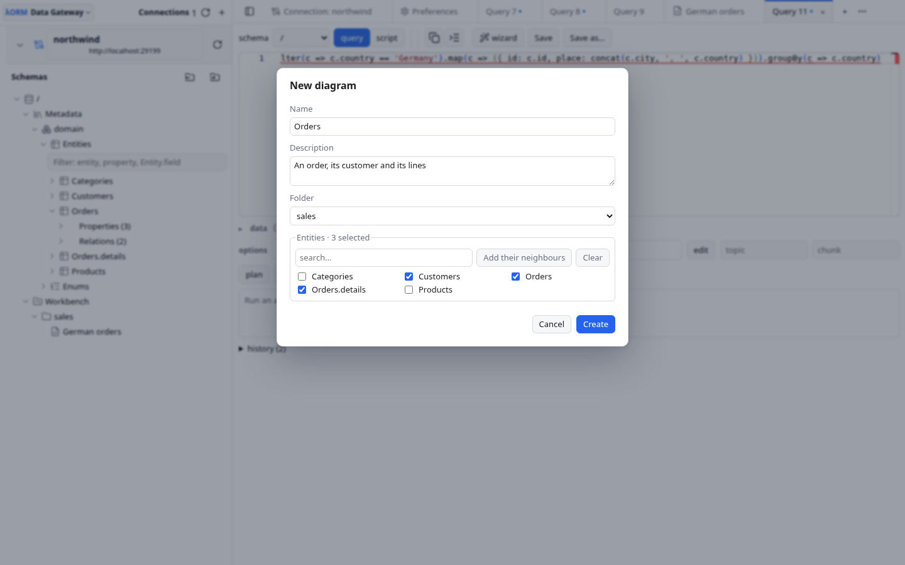

# Diagramme

Ein Diagramm der Domäne zeichnet die gewählten Entitäten als Boxen, mit ihren Eigenschaften, Typen, **PK** und **FK**
(die erforderlichen fett, eine abstrakte Entität kursiv), und ihre Beziehungen als Linien mit ihrer Kardinalität
(**1 — N**, **1 — 1**); eine Vererbung ist eine gestrichelte Linie mit einem hohlen Dreieck. Nutze eines, um einen Teil
der Domäne zu erklären, um zu sehen, was eine Entität erreicht, bevor du eine Abfrage schreibst, oder um es für ein
Dokument zu exportieren. Diagramme werden wie die Abfragen in der [Workbench](Projects.md) gespeichert.

## Ein neues Diagramm {#a-new-diagram}

1. Das **+** eines Ordners (oder von **Workbench**) → **Neues Diagramm**.
2. Ein **Name**, eine **Beschreibung** und sein **Ordner**.
3. **Die Entitäten**: gesucht, einzeln angehakt oder mit **Nachbarn hinzufügen** ergänzt (die Entitäten, die mit den
   angehakten verwandt sind); **Leeren** hakt sie alle ab.
4. **Erstellen** speichert es und öffnet es.

## In einem Diagramm {#in-a-diagram}

| Um | Tu |
| --- | --- |
| es anzuordnen | es wird beim Öffnen angeordnet ([ELK](https://eclipse.dev/elk/)); **neu anordnen** kehrt dahin zurück, nachdem Boxen verschoben wurden |
| eine Box oder eine Linie zu verschieben | ziehe sie; eine Linie hält ihre Enden an den Zeilen der Felder, die sie verbindet; ein Doppelklick auf eine Linie setzt sie zurück |
| mehrere auszuwählen | Umschalt oder Strg und Klick, oder Umschalt und den Hintergrund ziehen (mit dem Werkzeug **auswählen** wählt das Ziehen des Hintergrunds aus); Strg+A alle, Esc keine; eine zu ziehen verschiebt sie alle |
| Entitäten hinzuzufügen | das **+** einer Box: ihre verwandten Tabellen, die nicht im Diagramm sind, zum Anhaken, dann **hinzufügen**; oder **Entitäten…** |
| eine Entität zu entfernen | ihr **×**, oder sie auswählen und Entf; **ausgewählte entfernen (n)** |
| zu zoomen und zu verschieben | das Mausrad; den Hintergrund ziehen (das Werkzeug **verschieben**); **verkleinern** und **vergrößern**, mit dem Zoom dazwischen (5 % bis 300 %); **einpassen** zeigt es ganz |
| zu sehen, wo du bist | **Übersicht**: die ganze Zeichnung klein auf der rechten Seite, mit einem Rahmen um das, was die Ansicht zeigt; ein Klick oder Ziehen darauf verschiebt die Ansicht dorthin |
| eine Entität zu öffnen | Doppelklick auf ihre Box: ihre [Ansicht](Entities.md) |
| seine Daten abzufragen | **Abfrage des Diagramms**: ein Abfrage-Tab, der liest, was es zeigt, ausgehend von der ausgewählten Box oder der mit den meisten Beziehungen |
| weniger zu sehen | **anzeigen**: alle Eigenschaften, Schlüssel (PK und FK), Primärschlüssel oder nur der Tabellenname; **Beziehungsnamen** auf den Linien |
| es zu exportieren | **exportieren**: **PDF**, **PNG** oder **SVG**, das ganze Diagramm, mit den Farben des Designs |

Die Leiste endet damit, wie viele Entitäten und Beziehungen es zeigt (`Entitäten: 6 · Beziehungen: 5`).

**Speichern** (Strg+S) bewahrt die Entitäten auf, den Platz jeder Box und Linie, was es zeigt und die Namen der
Beziehungen; **gespeichert** sagt, dass es keine Änderungen hat. Ein noch nicht gespeichertes Diagramm bleibt nach einem
Neuladen in seinem Tab.

## Das Diagramm einer Entität {#the-diagram-of-an-entity}

Der Tab **Diagramm** einer [Entität](Entities.md#diagram) zeichnet sie mit ihren Nachbarn, nur lesen: **Entität**
zentriert es auf eine andere, und die Tiefe geht zu **2 Ebenen** oder **ganzes Modell**.

Ihre **Optionen** (IDE 1.5.0) wählen, was gezeichnet wird: die Namen der Beziehungen, ihre verbundenen Entitäten und
die Entitäten, die sie erweitert (anfangs angekreuzt).

**Eine abstrakte Entität** (IDE 1.5.0) wird in jedem Diagramm abgesetzt gezeichnet: ein gestrichelter Rand, eine
Kopfzeile in eigener Farbe, ihr Name kursiv mit «abstract»; die Entitäten, die sie erweitern, erreichen sie mit einer
gestrichelten Linie. So auch im exportierten SVG und PNG, im hellen und im dunklen Design.

## Das Diagramm eines Stage {#the-diagram-of-a-stage}

Jeder Stage eines Schemas hat ein Diagramm davon, wohin seine Sources jede Entität bringen: das Gateway, seine Sources
der Reihe nach und die Tabellen jeder einzelnen ([Verwaltung](Administration.md#the-diagram-of-a-stage)). Es wird wie
die anderen in der Workbench gespeichert.

## Das Diagramm des Assistenten {#the-diagram-of-the-wizard}

Der [Abfrage-Assistent](QueryWizard.md) verwendet dasselbe Diagramm, mit einem Häkchen an jedem Feld seiner Tabellen.
