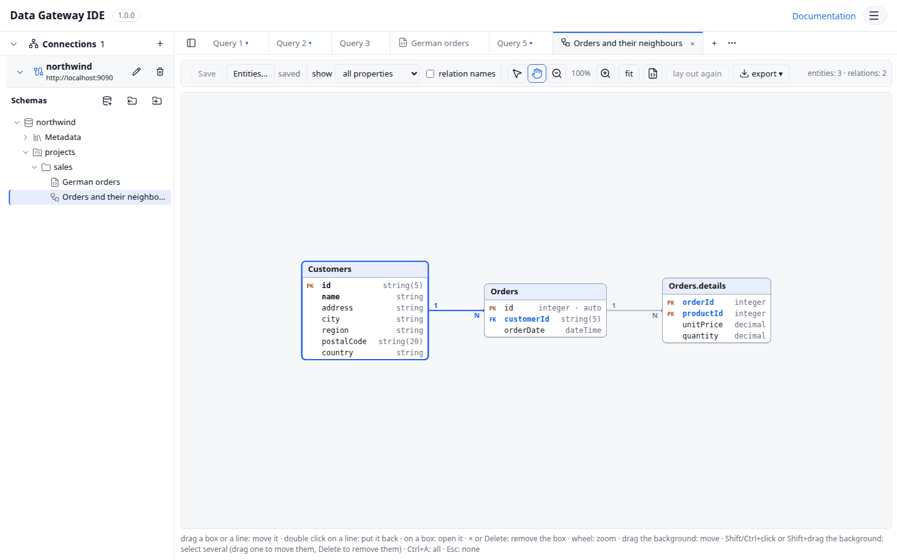

# Diagramas {#diagrams}

Un diagrama del dominio dibuja las entidades elegidas como cajas, con sus propiedades, tipos, **PK** y **FK** (las
obligatorias en negrita, una entidad abstracta en cursiva), y sus relaciones como líneas con su cardinalidad
(**1 — N**, **1 — 1**); una herencia es una línea punteada con un triángulo hueco. Úsalo para explicar una parte del
dominio, para ver a qué llega una entidad antes de escribir una consulta, o para exportarlo a un documento. Los
diagramas se guardan en el [workbench](Projects.md), como las consultas.

## Un diagrama nuevo {#a-new-diagram}

1. El **+** de una carpeta (o de **Workbench**) → **Nuevo diagrama**.
2. Un **Nombre**, una **Descripción** y su **Carpeta**.
3. **Las entidades**: buscadas, marcadas una por una, o completadas con **Agregar sus vecinas** (las entidades
   relacionadas con las marcadas); **Limpiar** las desmarca todas.
4. **Crear** lo guarda y lo abre.

## En un diagrama {#in-a-diagram}

| Para | Haz |
| --- | --- |
| acomodarlo | se acomoda al abrirse ([ELK](https://eclipse.dev/elk/)); **acomodar de nuevo** vuelve a eso después de mover cajas |
| mover una caja o una línea | arrástrala; una línea mantiene sus extremos en las filas de los campos que une; un doble clic en una línea la vuelve a su lugar |
| seleccionar varias | Shift o Ctrl y clic, o Shift y arrastrar el fondo (con la herramienta **seleccionar**, arrastrar el fondo selecciona); Ctrl+A todas, Esc ninguna; arrastrar una las mueve a todas |
| agregar entidades | el **+** de una caja: sus tablas relacionadas que no están en el diagrama, para marcar, luego **agregar**; o **Entidades…** |
| quitar una entidad | su **×**, o seleccionarla y Supr; **quitar las seleccionadas (n)** |
| hacer zoom y moverlo | la rueda; arrastrar el fondo (la herramienta **mover**); **alejar** y **acercar**, con el zoom entre ellos (5 % a 300 %); **ajustar** lo muestra entero |
| ver dónde estás | **outline**: el dibujo entero en pequeño a la derecha, con un marco sobre lo que muestra la vista; un clic o un arrastre sobre él lleva la vista ahí |
| abrir una entidad | doble clic en su caja: su [vista](Entities.md) |
| consultar sus datos | **consulta del diagrama**: una pestaña de consulta que lee lo que muestra, desde la caja seleccionada o la más relacionada |
| ver menos | **mostrar**: todas las propiedades, claves (PK y FK), clave primaria, o solo el nombre de la tabla; **nombres de relaciones** en las líneas |
| exportarlo | **exportar**: **PDF**, **PNG** o **SVG**, el diagrama entero, con los colores del tema |

La barra termina con cuántas entidades y relaciones muestra (`entidades: 6 · relaciones: 5`).

**Guardar** (Ctrl+S) conserva las entidades, el lugar de cada caja y línea, lo que muestra y los nombres de las
relaciones; **guardado** dice que no tiene cambios. Un diagrama todavía sin guardar queda en su pestaña después de una
recarga.

## El diagrama de una entidad {#the-diagram-of-an-entity}

La pestaña **Diagrama** de una [entidad](Entities.md#diagram) la dibuja con sus vecinas, solo lectura: **entidad** lo
centra en otra, y la profundidad va a **2 niveles** o **todo el modelo**.

Sus **opciones** (IDE 1.5.0) eligen qué se dibuja: los nombres de las relaciones, sus entidades relacionadas y las
entidades que extiende (marcadas al principio).

**Una entidad abstracta** (IDE 1.5.0) se dibuja aparte en todo diagrama: un borde punteado, una cabecera de su propio
color, su nombre en cursiva con «abstract»; las entidades que la extienden llegan a ella con una línea punteada. Así
queda también en el SVG y el PNG exportados, en el tema claro y el oscuro.

## El diagrama de un stage {#the-diagram-of-a-stage}

Cada stage de un esquema tiene un diagrama de a dónde llevan sus sources cada entidad: el gateway, sus sources en orden y
las tablas de cada uno ([Administración](Administration.md#the-diagram-of-a-stage)). Se guarda en el workbench como los
demás.

## El diagrama del asistente {#the-diagram-of-the-wizard}

El [asistente de consultas](QueryWizard.md) usa el mismo diagrama, con una casilla en cada campo de sus tablas.
