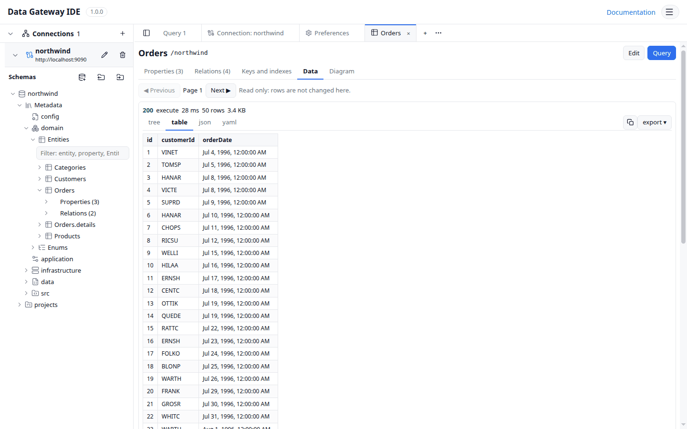
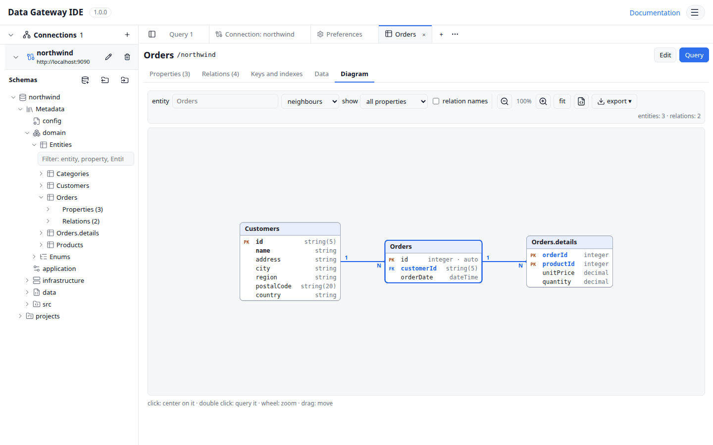

# Entitäten

Jede Entität der Domäne hat ein Formular, wie eine Tabelle in einer Datenbank-IDE: ein Klick auf ihre Zeile im
[Explorer](Explorer.md) öffnet es in einem eigenen Tab.

Seine Kopfzeile hat den Namen der Entität, ihr Schema und **abstrakt**, **Sicht** oder **erweitert Entity**, wenn sie
das ist; **Bearbeiten** (mit `schemaWrite`, ihr Formular der [Verwaltung](Administration.md#forms)) und **Abfragen**,
das einen Abfrage-Tab mit `Entity.page(1, 10)` öffnet.

## Eigenschaften {#properties}

| Spalte | Was sie ist |
| --- | --- |
| **#** | ihre Position |
| **Name** | fett: der Primärschlüssel |
| **Typ** | `string`, `integer`, `decimal`, `dateTime`…, oder das Enum, aus dem sie ihre Werte nimmt (`Status (enum)`) |
| **Länge** | eines Strings |
| **Pflicht** | ✓, wenn sie nicht null sein kann |
| **PK** | ✓ im Primärschlüssel (`U`, wenn sie auch eindeutig ist) |
| **Auto** | ✓, wenn die Datenbank ihren Wert vergibt |
| **Standard** | ihr Standardwert |
| **Verweist auf** | bei einem Fremdschlüssel die Entität und die Eigenschaft, auf die er verweist: ein Link zu dieser Entität |
| **Ausdrücke** | die Ausdrücke, die sie lesen oder schreiben |

## Beziehungen {#relations}

**Beziehungen** listet ihre Beziehungen: Name, Typ (`oneToMany`: zu einer, wie eine Bestellung zu ihrem Kunden; `manyToOne`: zu vielen, wie eine Bestellung zu ihren Positionen; `oneToOne`; λORM benennt sie von der Seite der anderen Entität), die
Entität, die sie erreichen, die Felder, die sie verbinden (**Von**, **Nach**), die Kardinalität (`N — 1`, `1 — N`) und
ob sie schwach ist. **Referenziert von** listet die Beziehungen anderer Entitäten, die diese erreichen. Jede Entität ist
ein Link zu ihrem Formular.

## Schlüssel und Indizes {#keys-and-indexes}

Der Primärschlüssel, der eindeutige Schlüssel, die Indizes mit ihren Feldern und die Einschränkungen mit ihrer Meldung
und ihrer Bedingung.

## Daten {#data}

Ihre Zeilen, 50 pro Seite, **◀ Zurück** und **Weiter ▶**: nur lesen (hier wird keine Zeile geändert). Sie werden wie
die Tabelle eines [Ergebnisses](Queries.md#the-result) angezeigt: Sie können kopiert und exportiert werden
(`Orders-page-1.json`). Eine abstrakte Entität hat keine Daten.

## Diagramm {#diagram}

Die Entität und ihre Nachbarn, nur lesen. Das Feld **Entität** zentriert das Diagramm auf eine andere, und die Tiefe
geht von **Nachbarn** zu **2 Ebenen** oder **ganzes Modell**. Ein Klick auf eine Box zentriert sie; ein Doppelklick
öffnet ihr Formular. Der Rest des Diagramms (Zoom, anzeigen, exportieren) ist wie in [Diagramme](Diagrams.md).

