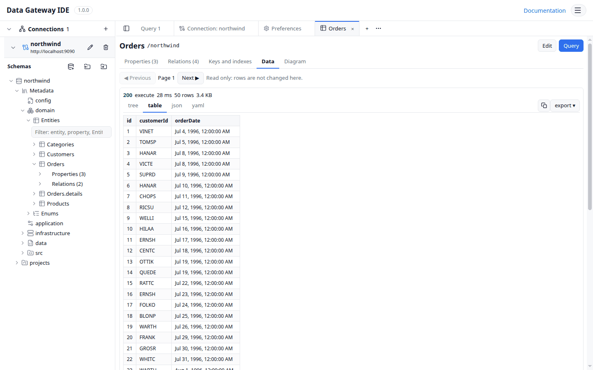
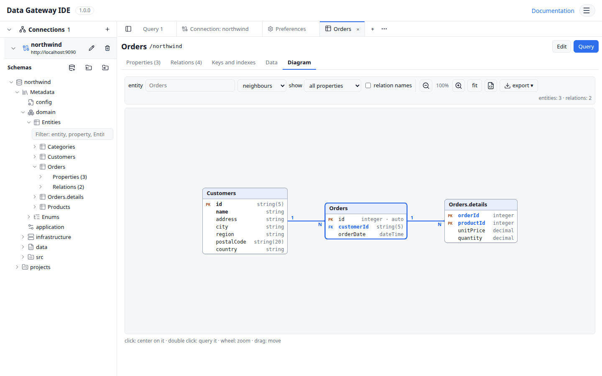

# Entidades {#entities}

Cada entidad del dominio tiene un formulario, como una tabla en un IDE de bases de datos: un clic en su fila del
[explorador](Explorer.md) lo abre en su propia pestaña.

Su cabecera tiene el nombre de la entidad, su esquema, y **abstracta**, **vista** o **extiende Entity** cuando lo es;
**Editar** (con `schemaWrite`, su formulario de [administración](Administration.md#forms)) y **Consultar**, que abre
una pestaña de consulta con `Entity.page(1, 10)`.

## Propiedades {#properties}

| Columna | Qué es |
| --- | --- |
| **#** | su posición |
| **Nombre** | en negrita, la clave primaria |
| **Tipo** | `string`, `integer`, `decimal`, `dateTime`…, o el enum del que toma sus valores (`Status (enum)`) |
| **Largo** | de un string |
| **Obligatoria** | ✓ cuando no puede ser nula |
| **PK** | ✓ en la clave primaria (`U` cuando además es única) |
| **Auto** | ✓ cuando la base de datos da su valor |
| **Por defecto** | su valor por defecto |
| **Referencia a** | para una clave foránea, la entidad y la propiedad a la que referencia: un enlace a esa entidad |
| **Expresiones** | las expresiones que la leen o la escriben |

## Relaciones {#relations}

**Relaciones** lista sus relaciones: nombre, tipo (`oneToMany`: a una, como un pedido a su cliente; `manyToOne`: a muchas, como un pedido a sus líneas; `oneToOne`; λORM las nombra desde el lado de la otra entidad), la entidad
a la que llegan, los campos que unen (**Desde**, **Hasta**), la cardinalidad (`N — 1`, `1 — N`) y si es débil.
**Referenciada por** lista las relaciones de otras entidades que llegan a esta. Cada entidad es un enlace a su
formulario.

## Claves e índices {#keys-and-indexes}

La clave primaria, la clave única, los índices con sus campos, y las restricciones con su mensaje y su condición.

## Datos {#data}

Sus filas, 50 por página, **◀ Anterior** y **Siguiente ▶**: solo lectura (aquí no se modifica ninguna fila). Se
muestran como la tabla de un [resultado](Queries.md#the-result): se pueden copiar y exportar (`Orders-page-1.json`).
Una entidad abstracta no tiene datos.

## Diagrama {#diagram}

La entidad y sus vecinas, solo lectura. La caja **entidad** centra el diagrama en otra, y la profundidad va de
**vecinas** a **2 niveles** o **todo el modelo**. Un clic en una caja la centra; un doble clic abre su formulario. El
resto del diagrama (zoom, mostrar, exportar) es como en [Diagramas](Diagrams.md).

