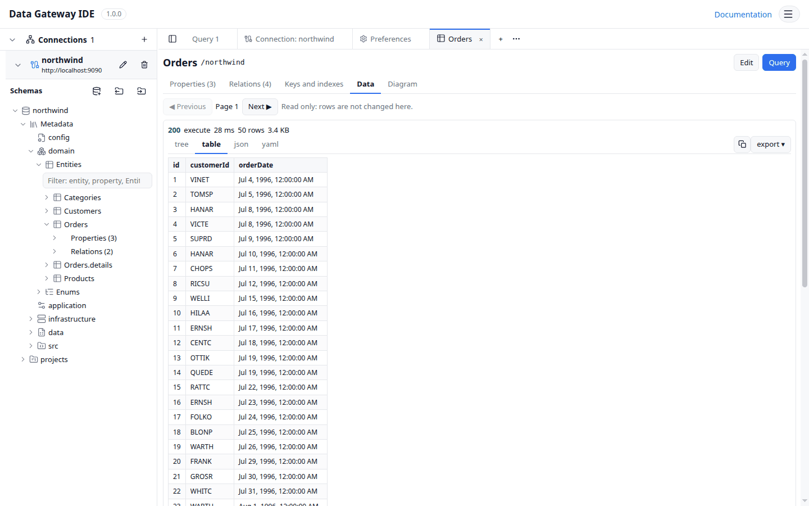
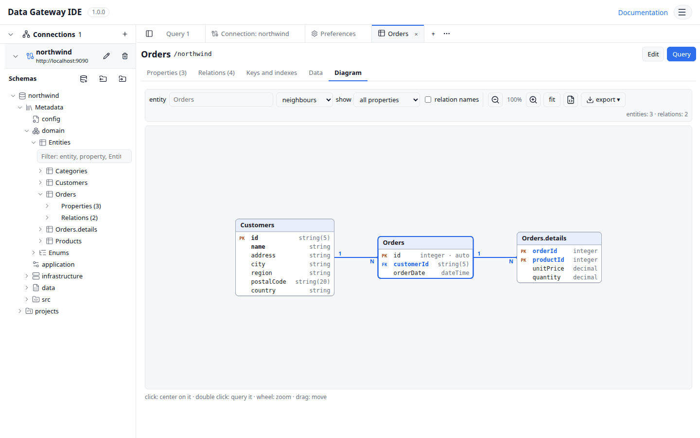

# Entities

Each entity of the domain has a form, like a table in a database IDE: a click on its row in the
[explorer](Explorer.md) opens it in its own tab.

Its header has the name of the entity, its schema, and **abstract**, **view** or **extends Entity** when it is one;
**Edit** (with `schemaWrite`, its form of [administration](Administration.md#forms)) and **Query**, which opens a query
tab with `Entity.page(1, 10)`.

## Properties

| Column | What it is |
| --- | --- |
| **#** | its position |
| **Name** | in bold, the primary key |
| **Type** | `string`, `integer`, `decimal`, `dateTime`…, or the enum it takes its values from (`Status (enum)`) |
| **Length** | of a string |
| **Required** | ✓ when it can't be null |
| **PK** | ✓ in the primary key (`U` when it is also unique) |
| **Auto** | ✓ when the database gives its value |
| **Default** | its default value |
| **References** | for a foreign key, the entity and the property it references: a link to that entity |
| **Expressions** | the expressions that read or write it |

## Relations

**Relations** lists its relations: name, type (`oneToMany`: to one, as an order to its customer; `manyToOne`: to many, as an order to its lines; `oneToOne`; λORM names them from the side of the other entity), the entity
they reach, the fields they join (**From**, **To**), the cardinality (`N — 1`, `1 — N`) and whether it is weak.
**Referenced by** lists the relations of other entities that reach this one. Each entity is a link to its form.

## Keys and indexes

The primary key, the unique key, the indexes with their fields, and the constraints with their message and their
condition.

## Data

Its rows, 50 per page, **◀ Previous** and **Next ▶**: read only (no row is changed here). They are shown as the table
of a [result](Queries.md#the-result): they can be copied and exported (`Orders-page-1.json`). An abstract entity has no
data.

## Diagram

The entity and its neighbours, read only. The **entity** box centres the diagram on another one, and the depth goes
from **neighbours** to **2 levels** or the **whole model**. A click on a box centres it; a double click opens its form.
The rest of the diagram (zoom, show, export) is as in [Diagrams](Diagrams.md).

