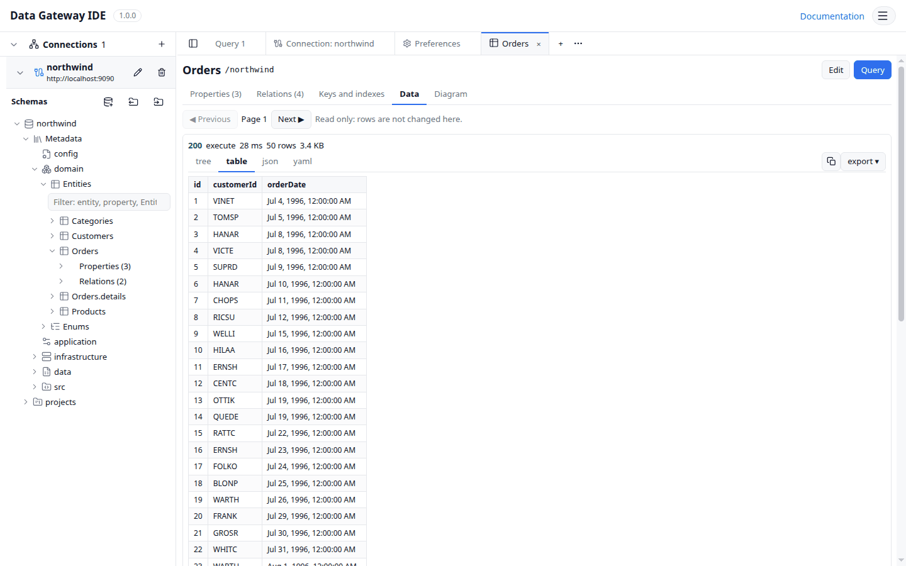
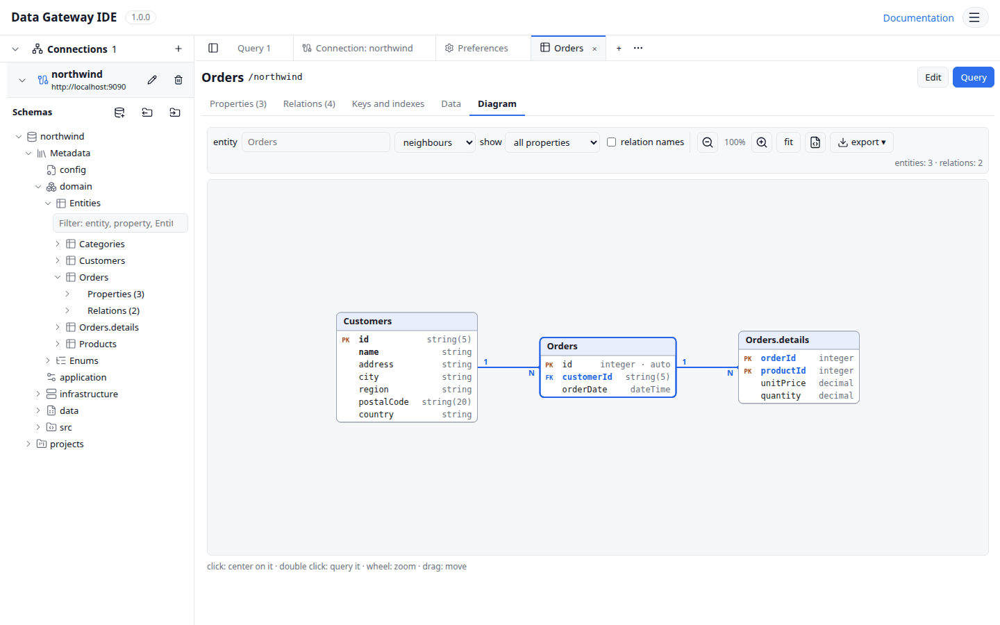

# Entidades {#entities}

Cada entidade do domínio tem uma vista, como uma tabela em uma IDE de bancos de dados: suas propriedades, suas
relações, suas chaves, suas restrições, suas linhas, seu diagrama e o histórico das suas alterações. Um clique na sua
linha no [explorador](Explorer.md) a abre em uma aba própria; um link para outra entidade (uma relação, uma
referência) abre aquela.

Seu cabeçalho tem o nome da entidade, o seu esquema, e **abstrata**, **visão** ou **estende Entidade** quando ela o é.
Seus botões:

| Botão | Faz | Precisa de |
| --- | --- | --- |
| **Ver rastreamentos** | abre os rastreamentos desta entidade no Grafana (Tempo, filtrados por `lambdaorm.entity`) | a **Observabilidade** da [conexão](Connections.md#a-new-connection) |
| **Remover** | diz o que usa a entidade e, confirmado, a remove do esquema | `schemaWrite` |
| **Editar** | abre o seu [formulário](Administration.md#forms), já em edição: **Cancelar** ou **Salvar** voltam a esta vista | `schemaWrite` |
| **Consultar** | abre uma aba de consulta com `Entity.page(1, 10)` (não em uma entidade abstrata) | |

Sob o cabeçalho, as suas abas: **Propriedades (n)**, **Relações (n)**, **Chaves e índices**, **Restrições (n)**,
**Dados**, **Diagrama** e **Histórico**.
A contagem de **Relações** inclui as relações de outras entidades que apontam para esta (**Referenciada por**), por isso pode ser maior do que a do explorador.

## Propriedades {#properties}

| Coluna | O que é |
| --- | --- |
| **#** | a sua posição |
| **Nome** | em negrito, a chave primária |
| **Tipo** | `string`, `integer`, `decimal`, `dateTime`…, ou o enum de onde ela tira os seus valores (`Status (enum)`) |
| **Tamanho** | de uma string |
| **Obrigatória** | ✓ quando não pode ser nula |
| **PK** | ✓ na chave primária (`U` quando também está na chave única) |
| **Auto** | ✓ quando o banco de dados dá o seu valor |
| **Padrão** | o seu valor padrão |
| **Referencia** | para uma chave estrangeira, a entidade e a propriedade que ela referencia: um link para essa entidade |
| **Expressões** | **ƒ Expressão** quando ela tem expressões ou restrições a usam |

Um clique em **ƒ Expressão** mostra, sob a tabela, as expressões dessa propriedade com as cores do editor, cada uma
com o que faz, e as restrições cuja condição a usa:

| Expressão | O que faz |
| --- | --- |
| `readExp` | substitui a coluna ao ler: o λORM a traduz para a consulta (`mask(email)`) |
| `writeExp` | pensada para o que se escreve na coluna (o λORM ainda não a aplica: use `writeValue`) |
| `readValue` | transforma cada valor depois de lê-lo, no gateway (`decrypt(email, $DATA_SECRET_KEY)`) |
| `writeValue` | transforma cada valor antes de escrevê-lo, no gateway (`encrypt(email, $DATA_SECRET_KEY)`) |

## Relações {#relations}

**Relações** lista as suas relações: nome, tipo (`oneToMany`: para uma, como um pedido para o seu cliente;
`manyToOne`: para muitas, como um pedido para as suas linhas; `oneToOne`; o λORM as nomeia a partir do lado da outra
entidade), a entidade que alcançam, os campos que unem (**De**, **Para**), a cardinalidade (`N — 1`, `1 — N`) e se é
fraca. **Referenciada por** lista as relações de outras entidades que alcançam esta. Cada entidade é um link para a sua
vista. O contador da aba soma as duas.

## Chaves e índices {#keys-and-indexes}

A chave primária, a chave única, e os índices com os seus campos.

## Restrições {#constraints}

As condições que o λORM verifica antes de cada insert e update (depois do `writeValue`): uma condição falsa rejeita a
sentença com a sua mensagem. Cada uma com a sua **Mensagem**, a sua **Condição** com as cores do editor e as
**Propriedades que usa**.

## Dados {#data}

Suas linhas, 50 por página, **◀ Anterior** e **Próxima ▶**. Uma entidade abstrata não tem dados.

- **Ordenar** por uma coluna: um clique no seu cabeçalho (crescente ▲, decrescente ▼, nenhum). **Filtrar** com uma
  condição sobre `p` (`p.price > 18`) e **Aplicar** (ou Enter).
- **Exportar** a página (**CSV**, **JSON**, **XLSX**) ou tudo (**CSV ∀**, **JSON ∀**, **XLSX ∀**): todas as páginas,
  com a sua ordem e o seu filtro, até 100 000 linhas, com as linhas lidas até o momento e **Cancelar**. O `.xlsx` é um
  arquivo do Excel de verdade (`Orders.xlsx`, `Orders-page-1.csv`).

Com uma credencial que tem `write` e uma entidade com chave primária, a tabela é também um **backoffice** (desde o
IDE 1.2.0):

- **Alterar uma célula:** duplo clique, o novo valor, Enter (Escape a deixa). Ela muda só enquanto a célula ainda tem
  o que foi lido: se alguém a alterou nesse meio-tempo, nada é alterado e a tabela avisa e a mostra agora. A chave, o
  calculado (`view`, `readExp`) e o `autoIncrement` não são editados; um valor que não é do seu tipo (`x` num número)
  não é enviado.
- **+ Adicionar uma linha:** um formulário com as propriedades da entidade (as obrigatórias marcadas com `*`).
- **✕** no fim de uma linha a exclui, depois de mostrar a sua chave e perguntar.

Tudo passa pelo gateway com a credencial da connection: as suas permissões, a sua
[view](../data-gateway/Security.md#views) e a auditoria. Sem `write`, a tabela é somente leitura.

Desde a IDE 1.3.0:

- Os **pontos** (`point`) aparecem como longitude, latitude com **↗** para um mapa, e são editados em dois campos; os
  **vetores** (`vector`) mostram os primeiros números e quantos (`[0.12, -0.03, 0.5, …] (1536)`), e são escritos como
  JSON no formulário da linha, conferidos contra as suas dimensões.
- Uma propriedade que guarda [arquivos](../data-gateway/Configuration.md#files) (data-gateway 4.3.0) mostra seu
  arquivo: um clique o abre (uma URL de vida curta); com `write`, **⤒** envia outro, direto ao armazenamento, e **✕** o
  tira da linha.

## Diagrama {#diagram}

A entidade e as suas vizinhas, somente leitura. A caixa **entidade** centraliza o diagrama em outra, e a profundidade
vai de **vizinhas** a **2 níveis** ou ao **modelo inteiro**. Um clique em uma caixa a centraliza; um duplo clique abre
a sua vista. O resto do diagrama (zoom, mostrar, outline, exportar) é como em [Diagramas](Diagrams.md).

## Histórico {#history}

Com `schemaRead` (o gateway guarda o histórico dos seus esquemas desde o data-gateway 4.1.0): as alterações desta
entidade, as mais novas primeiro, com **Quando**, **Quem** (a credencial e o seu cliente: a IDE, a CLI) e **O quê**.
Um clique em uma alteração mostra as suas **Alterações** (`+` adicionado, `-` removido, `~` substituído) e a entidade
**Antes** e **Depois**; **Alterações anteriores** lê mais. O esquema inteiro também tem o seu histórico
([Administração](Administration.md#history)).
