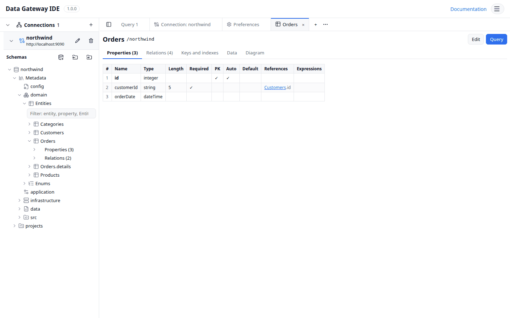

# Explorador {#explorer}

A la izquierda, las conexiones y los esquemas de cada una: su metadata, su dominio y lo que se guarda en ellos.
Todo se abre en una pestaña a la derecha.

## Su árbol {#its-tree}

```text
Connections                          + New connection
└─ northwind  http://localhost:9090  ✎ Edit the connection · 🗑 Remove
   Schemas                           New schema · Export · Import
   └─ northwind                      its tab: commands and about
      ├─ Metadata
      │  ├─ config                   the lambdaORM.yaml                 (schemaRead)
      │  ├─ domain                   the domain as YAML, read only
      │  │  ├─ Entities              filter · each entity: Properties, Relations
      │  │  └─ Enums
      │  ├─ application              its start tasks and listeners       (schemaRead)
      │  ├─ infrastructure           Mappings · Sources · Stages · Variables (.env)  (schemaRead)
      │  ├─ data                     the files of data/                  (schemaRead)
      │  └─ src                      the files of the model              (schemaRead)
      └─ projects                    folders, queries and diagrams
```



Lo que necesita un permiso no se muestra sin él: con solo `read`, un esquema tiene su **domain** y sus **proyectos**.

| Fila | Un clic | Sus botones |
| --- | --- | --- |
| un esquema | lo despliega y abre su pestaña ([Administración](Administration.md#the-schema-tab)) | 🗑 eliminarlo (`schemaAdmin`) |
| **domain** | lo despliega; un doble clic abre el dominio como YAML (solo el dominio: nunca los sources, las conexiones ni el resto de la configuración) | |
| una entidad | la despliega y abre su [formulario](Entities.md) | ✎ editarla (`schemaWrite`), ↗ abrirla |
| una relación de una entidad | abre la entidad a la que llega (`customer → Customers · N — 1`) | |
| **config**, un elemento de infrastructure | lo abre ([Administración](Administration.md)) | |
| una carpeta, una consulta, un diagrama | lo abre ([Proyectos](Projects.md)) | ✎ editar, 🗑 eliminar, **+** en una carpeta |

Un esquema que no arrancó se muestra atenuado, con su estado y su motivo (o `La gateway no da el motivo: mirá su log`);
uno cuya versión nueva no arrancó muestra ⚠ mientras atiende la anterior.

## El filtro de las entidades {#the-filter-of-the-entities}

La caja sobre las entidades (`Filtrar: entidad, propiedad, Entidad.campo`) deja las que tienen el texto en su nombre, o
en el nombre de una de sus propiedades o relaciones: `21 de 192`, o `Nada coincide`. Las propiedades y relaciones que
coincidieron se muestran debajo de su entidad, aunque esté plegada. `Orders.customer` busca la relación `customer` de
`Orders`. Escape lo borra.

## Teclado {#keyboard}

| Tecla | Hace |
| --- | --- |
| Tab | se mueve entre filas |
| → / ← | despliega / pliega |
| Enter | abre la fila (o la despliega) |

## Su ancho {#its-width}

Arrastra su borde para cambiarle el ancho (entre 180 y 720 px); un doble clic en el borde lo ajusta a los nombres.
Desde el teclado, en el borde: ← y → lo cambian de a 20 px (con Shift, 60), Enter lo ajusta. El botón ◫ a la izquierda
de las pestañas lo oculta y lo muestra. El ancho se recuerda.

## Las pestañas {#the-tabs}

| Pestaña | Se abre desde | Título |
| --- | --- | --- |
| una consulta | **+** de las pestañas, **Consultar** de una entidad, una consulta guardada | `Consulta 1`, la entidad, el nombre de la consulta guardada |
| una entidad | una fila de una entidad | su nombre |
| un diagrama | un diagrama guardado | su nombre |
| el dominio | doble clic en **domain** | `Dominio (YAML) esquema` |
| un esquema, su YAML, un elemento | las filas de [administración](Administration.md) | `Esquema northwind`, `lambdaORM.yaml northwind`… |
| una conexión, preferencias, herramientas | la conexión, el menú ☰ | `Conexión: northwind`, `Preferencias`, `API REST · northwind`… |

- **+** abre una pestaña de consulta en la conexión activa; **×** cierra una pestaña; hasta 20 pestañas.
- Un clic derecho en una pestaña, o **⋯**: **Cerrar**, **Cerrar los demás**, **Cerrar todos**.
- Un **•** después del título marca cambios sin guardar.
- Con varias conexiones, el título dice cuál: `Orders · production`.

**Donde estaba.** Las pestañas abiertas (con el texto de cada consulta como se escribió, y los diagramas todavía sin
guardar), la activa y lo que estaba desplegado en el explorador se guardan en el navegador: una recarga, o el día
siguiente, empieza donde estaba.
