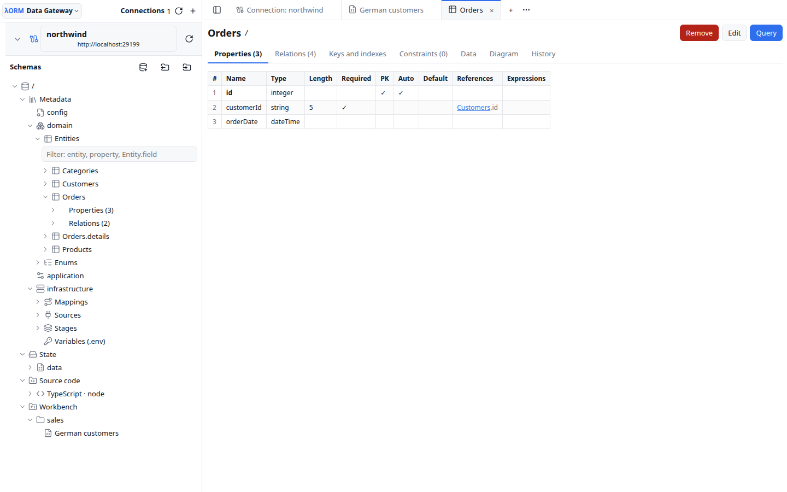

# Explorador {#explorer}

À esquerda, as conexões e os esquemas de cada uma: seus metadados, seu estado, seu código-fonte e o que está salvo
neles. É onde tudo começa: um clique abre uma entidade, uma consulta, um diagrama ou um formulário em uma aba à
direita.

## Sua árvore {#its-tree}

```text
λORM Data Gateway ▾   Conexões 1            ⟳ · + Nova conexão
northwind  http://data-gateway:9090         ⟳ Atualizar
Esquemas                                    Novo esquema · Exportar · Importar
└─ /                                        sua aba: comandos, informações, histórico   ⟳
   ├─ Metadados
   │  ├─ config                             o lambdaORM.yaml                    (schemaRead)
   │  ├─ domain                             duplo clique: o domínio como YAML, somente leitura
   │  │  ├─ Entidades  +                    filtro · cada entidade: Propriedades (n), Relações (n)
   │  │  └─ Enums  +
   │  ├─ application                        suas tarefas de início e listeners  (schemaRead)
   │  └─ infrastructure                                                         (schemaRead)
   │     ├─ Mappings  +
   │     ├─ Sources  +
   │     ├─ Stages  +                       cada stage: ◇ o seu diagrama
   │     └─ Variáveis (.env)
   ├─ Estado                                                                    (schemaRead)
   │  └─ data                               os arquivos de data/
   ├─ Código-fonte  </>                     o código gerado, por linguagem      (schemaRead)
   │  └─ TypeScript · node                  ⤓ .zip · ↻ gerar de novo · 🗑 excluir
   └─ Workbench  +                          projetos, pastas, consultas e diagramas
```



O que precisa de uma permissão não aparece sem ela: só com `read`, um esquema tem os seus **Metadados → domain** e o
seu **Workbench**. O **+** de **Entidades**, **Enums**, **Mappings**, **Sources** e **Stages** (com `schemaWrite`)
abre o formulário de um novo ([Administração](Administration.md#forms)).

| Linha | Um clique | Seus botões |
| --- | --- | --- |
| uma conexão | o seu nome abre a sua página ([Conexões](Connections.md)) | ⟳ atualizar |
| um esquema | o expande e abre a sua aba ([Administração](Administration.md#the-schema-tab)) | ⟳ atualizá-lo |
| **config** | abre o `lambdaORM.yaml` ([Administração](Administration.md#the-yaml)) | |
| **domain** | o expande; um duplo clique abre o domínio como YAML (só o domínio: nunca as sources, as conexões ou o resto da configuração) | |
| uma entidade | a expande e abre a sua [vista](Entities.md) | |
| uma propriedade de uma entidade | nada: o seu nome, em negrito para a chave primária, e o seu tipo | |
| uma relação de uma entidade | abre a entidade que ela alcança (`customer → Customers · N — 1`) | ↗ abri-la |
| um enum, um mapping, uma source, um stage | abre o seu formulário ([Administração](Administration.md#forms)) | um stage: ◇ o seu [diagrama](Administration.md#the-diagram-of-a-stage) |
| **application**, **Variáveis (.env)** | o abre ([Administração](Administration.md)) | |
| um arquivo de **data** ou de um código | o abre, somente leitura | |
| um código de **Código-fonte** | expande os seus arquivos | ⤓, ↻, 🗑 ([Administração](Administration.md#source-code)) |
| uma pasta, uma consulta, um diagrama | o abre ([Workbench](Projects.md)) | **+** em uma pasta, ✎ editar, 🗑 excluir |

Um esquema que não iniciou aparece esmaecido, com o seu estado e o seu motivo (ou `A gateway não informa o motivo: veja
o log.`), o seu **config** para corrigi-lo e, com `schemaAdmin`, 🗑 para removê-lo; um cuja versão nova não iniciou
mostra ⚠ enquanto a anterior atende.

**Atualizar.** Os esquemas são lidos de novo sozinhos, e na hora quando o gateway anuncia uma mudança. ⟳ lê de novo o
que mudou em outro lugar (por outra IDE, pela CLI, por alguém editando os arquivos): na raiz, todas as conexões; em uma
conexão, seus esquemas, seus domínios e o que está salvo; em um esquema, só ele.

## O filtro das entidades {#the-filter-of-the-entities}

A caixa sobre as entidades (`Filtrar: entidade, propriedade, Entidade.campo`) mantém aquelas cujo nome, ou o nome de
uma das suas propriedades ou relações, contém o texto: `21 de 192`, ou `Nada corresponde`. As propriedades e relações
que corresponderam aparecem sob a sua entidade, mesmo recolhida. `Orders.customer` procura a relação `customer` de
`Orders`. Escape o limpa.

## Teclado {#keyboard}

| Tecla | Faz |
| --- | --- |
| Tab | move entre as linhas |
| → / ← | expande / recolhe |
| Enter | abre a linha (ou a expande) |

## Sua largura {#its-width}

Arraste a sua borda para mudar a largura (entre 180 e 720 px); um duplo clique na borda a ajusta aos nomes. Pelo
teclado, na borda: ← e → a mudam em 20 px (com Shift, 60), Enter a ajusta. O botão ◫ à esquerda das abas o oculta e o
mostra. A largura é lembrada.

## As abas {#the-tabs}

| Aba | Aberta a partir de | Título |
| --- | --- | --- |
| uma consulta | **+** das abas, **Consultar** de uma entidade, uma consulta salva, o assistente | `Consulta 1`, a entidade, o nome da consulta salva |
| uma entidade | uma linha de uma entidade | o seu nome |
| um diagrama | um diagrama salvo | o seu nome |
| o domínio | duplo clique em **domain** | `Domínio (YAML) /` |
| um esquema | uma linha de um esquema | `Esquema /` |
| o seu YAML, um elemento, um diagrama de stage | as linhas da [administração](Administration.md) | `lambdaORM.yaml /`, `Orders`, `Novo em Entidades`, `Stage default`… |
| um arquivo | um arquivo de data ou de um código | o seu nome |
| uma conexão, as preferências, as ferramentas | a conexão, o menu | `Conexão: northwind`, `Preferências`, `REST API · northwind`… |

- **+** abre uma aba de consulta na conexão da aba ativa, no seu primeiro esquema que está pronto; **×** fecha uma aba;
  até 20 abas.
- Um clique direito em uma aba, ou **⋯** no fim da barra: **Fechar**, **Fechar os outros**, **Fechar todos**.
- Um **•** depois do título marca alterações não salvas.
- Com várias conexões, o título diz qual: `Orders · production`.
- Sem nenhuma aba aberta: `Abra uma consulta, uma entidade ou um diagrama no explorador, ou comece uma consulta com +.`

**Onde estava.** As abas abertas (com o texto de cada consulta como foi digitado, e os diagramas ainda não salvos), a
ativa e o que estava expandido no explorador são guardados no navegador: um recarregamento, ou o dia seguinte, começa
onde estava.
