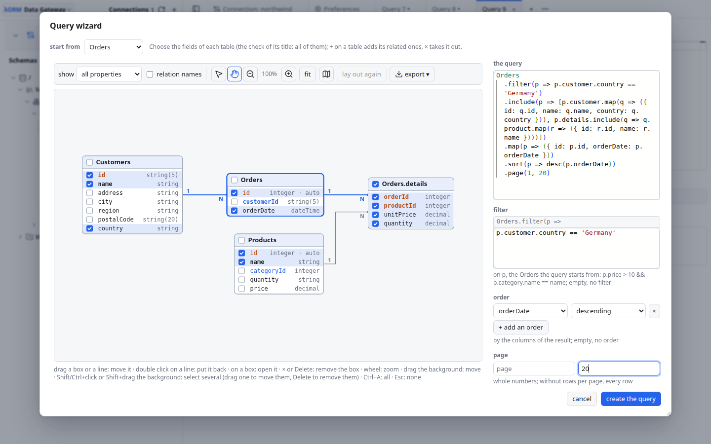

# Getting started

From nothing to a query, a query written by the wizard and a diagram, on Northwind. About 10 minutes, with Docker and
a browser (or the [desktop app](Download.md)).

## 1. A gateway with Northwind

Follow steps 1 to 4 of the Data Gateway's [Getting started](../data-gateway/GettingStarted.md): its compose starts
Postgres, a gateway with Northwind and the web IDE, creates the tables and imports the data. The gateway has its
`management` port, the port of the IDE, on 9090, reached only by the IDE in the compose.

With the [desktop app](Download.md) instead of the web IDE, publish that port on your machine only, in the
`data-gateway` service of the compose:

```yaml
    ports:
      - "127.0.0.1:9090:9090"   # management, for the desktop IDE
```

## 2. The connection

Open the IDE: the web one at `http://localhost:8090`, or the desktop app. The first time it opens on a **New
connection**:

| Field | Value |
| --- | --- |
| **Name** | `northwind` |
| **Protocol** | `REST · http` |
| **Management address** | `data-gateway:9090` in the web IDE (as the IDE reaches it in the compose); `localhost:9090` in the desktop app |
| **Authentication** | **API key**, **Header** `X-Api-Key`, **Key** `reader-demo-key` |
| **Remember the key in this browser** | ticked, so it is not asked again |

**Test** says who the key is and the version of the gateway; **Connect** adds the connection.


The page of the connection opens. Its **Roles** tab shows what `reader` may do: `read`, nothing else. With it you read
and query; what you save stays in your browser ([Workbench](Projects.md#where-it-is-saved)).

## 3. The explorer

On the left, the connection and its schema (`/`, the only one of this gateway). Unfold **Metadata → domain →
Entities**: the entities of Northwind. A click on `Orders` opens its view: its properties, its relations, its keys, its
rows and its diagram ([Entities](Entities.md)).


## 4. A query

The **Query** button of `Orders` opens a query tab with `Orders.page(1, 10)`. Replace it with:

```ts
Customers
	.filter(p => p.country == 'Germany')
	.map(p => ({ id: p.id, name: p.name, city: p.city, country: p.country }))
	.sort(p => p.name)
	.page(1, 10)
```

The editor suggests while you type: after `Customers.` the clauses, after `p.` the fields and relations. **execute**
(Ctrl+Enter) runs it; **table** shows the rows as a table.


## 5. A query of the wizard

A new tab (**+**), then **wizard**:

1. **start from** `Orders`;
2. the **+** of `Orders`: tick `Customers` and `Orders.details`, **add (2)**; the **+** of `Orders.details`: `Products`;
3. the fields: every field of a table starts ticked. Untick the check in the title of `Orders` (only its key, `id`,
   stays) and tick `orderDate`; do the same in `Customers` and tick `name` and `country`, and in `Products` and tick
   `name`. Leave the lines (`Orders.details`) with all their fields;
4. **filter:** `p.customer.country == 'Germany'`;
5. **+ add an order:** `orderDate`, **descending**; **rows per page:** `20`;
6. **create the query**, then **execute**.

Each order comes with its customer and its lines, each line with its product. The [Query wizard](QueryWizard.md) page
explains every step.



## 6. Save it

**Save** (Ctrl+S) asks for a name, a description and a folder. A folder is created first with the **+** of
**Workbench** → **New project**. The saved query keeps its wizard: its **wizard** button opens it as it was left.


## 7. A diagram

The **+** of the folder → **New diagram**: a name, tick `Orders` and **Add their neighbours** (its customer and its
lines), **Create**. The boxes are laid out by themselves; drag them and **Save** keeps them where they were left
([Diagrams](Diagrams.md)).


## Next

- The connection page: its sessions, and the REST API, WebSocket and MCP of the gateway in tabs
  ([Connections](Connections.md)).
- Administering the schemas from the IDE needs a credential with `schemaRead` and `schemaWrite`
  ([Administration](Administration.md)).
- A web IDE for a team, next to the gateways ([Deploying](Deploying.md)).
