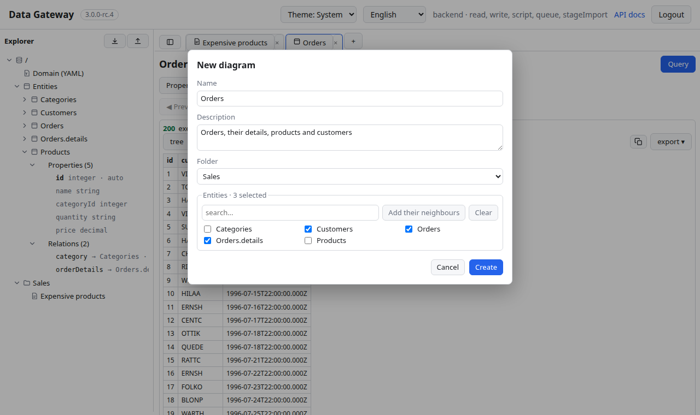

# UI {#ui}

Un recorrido paso a paso, desde la primera conexión hasta un diagrama, está en [Primeros pasos](../data-gateway/GettingStarted.md#9-the-ui).

La UI del Data Gateway es el **data-gateway-ide**, una imagen propia
([`flaviorita/data-gateway-ide`](https://hub.docker.com/r/flaviorita/data-gateway-ide)): un explorador de los esquemas y
sus entidades, el formulario de cada entidad, pestañas de consultas con el autocompletado del dominio, consultas
guardadas y diagramas del dominio. Es útil para probar consultas, para aprender el lenguaje y para comprobar lo que hace
un agente a través de MCP.

Como un IDE de bases de datos, se conecta a data gateways, uno o varios, cada uno con su credencial; sus esquemas,
workspaces y proyectos quedan en ellos.

## Desplegarlo {#deploying-it}

Desde 4.0.0 el gateway no sirve ninguna UI ni responde CORS. El IDE llega a él por su puerto **`management`**
([Transportes](../data-gateway/Transports.md#management)): las rutas de la API REST para todos los esquemas más la
[administración](../data-gateway/Admin.md). Un gateway sin ese puerto no tiene IDE, que es lo que puede querer un gateway de producción
cuyos esquemas vienen en sus volúmenes.

```yaml
# data-gateway.config.yaml
transports:
  http: { port: 8080 }
  management: { port: 9090 }    # la API del IDE; sin un puerto, no se expone
```

```yaml
# docker-compose.yml
services:
  data-gateway:
    image: flaviorita/data-gateway:4.0.0
    # 9090 no se publica: solo el IDE llega a él, en la red del compose
  ide:
    image: flaviorita/data-gateway-ide:1.0.0
    environment:
      DATA_GATEWAY_IDE_TARGETS: "http://data-gateway:9090,http://data-gateway:8080"
    ports:
      - "127.0.0.1:8090:8080"
```

Con `trustedProxies` de `management` apuntando a la red del IDE, el gateway ve la dirección de cada navegador en sus
[sesiones](#sessions); si no, todas las sesiones muestran la dirección del IDE.

- **El navegador habla solo con el servidor del IDE.** Este sirve la página y reenvía cada petición al gateway (un
  proxy): REST, MCP y el WebSocket por igual. Los gateways nunca ven al navegador.
- **`DATA_GATEWAY_IDE_TARGETS`** lista los orígenes a los que el IDE puede llegar, separados por comas, o `*` para
  cualquiera (un IDE que corre en local). Sin ella, el IDE no llega a ninguno y lo indica: un proxy abierto llegaría a
  cualquier host de su red.
- **El IDE no guarda ninguna conexión ni ninguna credencial.** Quedan en el navegador. Reenvía la credencial al
  gateway y descarta las cookies y el origen de la página.
- **`management` se mantiene en una red interna.** Escribe los esquemas y sus variables y corre DDL; lo que se publica
  es el IDE.

### Dónde corre el IDE {#where-the-ide-runs}

| Se despliega | Para | `management` |
| --- | --- | --- |
| Solo el gateway, sin `management` | producción, con los esquemas en sus volúmenes: sin IDE ni administración | sin puerto |
| El gateway y la imagen del IDE | un IDE compartido en el navegador | solo en la red interna, nunca publicado: lo alcanza el contenedor del IDE |
| Solo el gateway, con `management` | un IDE en tu propia máquina: la [aplicación de escritorio](index.md#download), o la imagen con `docker run` | tu máquina tiene que llegar a su puerto (abajo) |

Un IDE en tu máquina llega a un `management` que está en otro lado sin publicarlo abierto:

| El gateway corre | Cómo llega el IDE | `management` publicado |
| --- | --- | --- |
| en la misma máquina | `localhost:9090` | — |
| en una red interna, o detrás de una VPN | `host-interno:9090` | solo hacia esa red |
| en un servidor, sin VPN | un túnel SSH, `ssh -L 9090:localhost:9090 servidor`, y la conexión a `localhost:9090` | solo en el loopback del servidor |
| en Kubernetes | `kubectl port-forward svc/data-gateway 9090`, y la conexión a `localhost:9090` | un `Service` interno, sin ingress |

Con un túnel, las pestañas REST, WebSocket y MCP también necesitan su camino: se tunelizan sus puertos, o se fijan sus
URLs en la conexión (**Otras URLs de sus transportes**).

## Conexiones {#connections}

El IDE no tiene página de inicio ni login: se abre en el workspace, y la primera vez en una **Nueva conexión**.

| Campo | Qué es |
| --- | --- |
| **Nombre** | cómo se muestra la conexión |
| **Protocolo** y **dirección** | el `management` del gateway tal como lo alcanza **el servidor del IDE**: `data-gateway:9090` (host, puerto y base path), no la dirección del navegador |
| **Autenticación** | API key (el header, por defecto `X-Api-Key`, y la clave), bearer token, basic (usuario y contraseña) o ninguna |
| **Recordar la clave** | guardar la clave en el navegador; si no, se guarda solo en esa pestaña, y se vuelve a pedir al cerrarla |
| **Otras URLs de sus transportes** | el REST, el WebSocket y el MCP del gateway, solo cuando el IDE no llega a ellos en los puertos que el gateway indica (un proxy delante, otra red) |

**Probar** comprueba la conexión: quién es la credencial y la versión del gateway. **Mostrar / Ocultar** muestra la
clave que se escribió.

### Su sesión {#sessions}

Conectar inicia sesión en el `management` del gateway ([sesiones](../data-gateway/Transports.md#sessions)): el IDE guarda el token en
esa pestaña y cada petición lo lleva, nunca la clave.

- Cuando la sesión **expira** (30 minutos sin actividad, o 12 horas) y la clave está a mano, el IDE abre otra por sí
  solo; sin ella, pide la clave.
- Cuando se **revoca**, el IDE indica quién la revocó y no vuelve por sí solo, aunque la clave esté recordada: guardar
  de nuevo la conexión la conecta.
- El IDE mantiene abierto el WebSocket de eventos del gateway: la sesión se muestra como *conectada*, y un esquema que
  cambia, o algo guardado por otra persona, se muestra al instante.
- La página de una conexión lista **Mis sesiones**: las otras de la misma credencial (otro navegador, otro ordenador),
  con su dirección, qué están mirando y cuándo terminan, para **Cerrar** una o **Cerrar las otras**. Con
  `sessionAdmin`, también **Sesiones activas**: todas las del gateway, por credencial, para **Revocar** una o
  **Revocar todas** las de una credencial.

- La página de una conexión muestra quién es esa credencial y **sus roles**: cada permiso, con lo que permite.
- El explorador lista las conexiones, cada una con sus esquemas; se pueden tener abiertas, lado a lado, pestañas de
  varias conexiones. Una conexión se edita o se quita desde su fila (quitarla la saca solo del IDE).
- Desde una conexión, en pestañas, con su credencial: su **API REST** (Swagger, para probar cada método), su
  **WebSocket** (sus métodos, una consola JSON-RPC y lo que vuelve) y su **MCP** (las tools de un esquema, llamadas con
  sus argumentos). Un transporte que el gateway no expone está deshabilitado.

**Preferencias** (el menú ☰): el tema (Sistema, Claro, Oscuro y otros), el idioma (English, Español, Português,
Français, Italiano, Deutsch, Nederlands, Català, Galego, Euskara) y el formato regional de los números y las fechas de
los resultados. El navegador los recuerda.


## Explorador {#explorer}

A la izquierda, las conexiones y los esquemas de cada una. Se puede redimensionar arrastrando su borde y ocultar con el botón de panel de
la barra de pestañas. Para cada esquema:

- **Dominio (YAML).** El dominio del esquema (entidades, propiedades, relaciones, claves, enums) en un editor de
  **solo lectura**, con resaltado de sintaxis, búsqueda y plegado. Muestra solo el dominio: nunca las fuentes, las conexiones
  ni el resto de la configuración.
- **Entidades.** Cada entidad se despliega en:
    - **Propiedades**, con sus tipos (la clave primaria en negrita);
    - **Relaciones**, con la entidad relacionada y la cardinalidad (`customer → Customers · N — 1`); el botón **Abrir**
      de una relación abre la entidad relacionada.
  El botón **Abrir** (↗) de una entidad, un doble clic o Enter abren su [formulario](#entity-form).
- **Lo guardado** en el esquema: carpetas, consultas y diagramas ([más abajo](#saved-queries-and-diagrams)).

- **Filtro.** La caja sobre las entidades deja las que tienen el texto en su nombre o en el de una propiedad o relación
  (`21 de 192`); las propiedades y relaciones que coinciden se muestran bajo su entidad.
- El ancho del explorador se guarda; un doble clic en su borde (o Enter) lo ajusta a los nombres, y las flechas lo
  cambian desde el teclado (Shift: 60 px).
- Un esquema que no arrancó se ve atenuado, con su estado y su motivo.


## Formulario de entidad {#entity-form}

Como una tabla en un IDE de bases de datos, en su propia pestaña, con estas secciones:

| Sección | Muestra |
| --- | --- |
| **Propiedades** | cada propiedad: tipo (o enum), longitud, obligatoria, clave primaria (y única), autoincremento, valor por defecto, **la entidad y la propiedad que referencia una clave foránea** (un enlace a ella), y sus expresiones de lectura / escritura |
| **Relaciones** | sus relaciones (nombre, tipo, entidad, from, to, cardinalidad, débil) y **Referenciada por**: las relaciones de otras entidades que apuntan a ella; cada entidad es un enlace a su formulario |
| **Claves e índices** | clave primaria, clave única, índices con sus campos, restricciones con su mensaje y su condición |
| **Datos** | sus filas en una tabla, **de solo lectura**, 50 por página, con Anterior / Siguiente; se pueden copiar y exportar como cualquier resultado |
| **Diagrama** | la entidad y sus vecinas |

El botón **Consultar** abre una pestaña de consulta con `Entity.page(1, 10)`.


## Consultas {#queries}

Cada consulta es una pestaña, con su propio esquema, texto, datos, opciones y resultado; al cambiar de pestaña no se pierde nada. Una pestaña se
abre con **+**, desde una entidad (**Consultar**) o desde una consulta guardada, y se cierra con su ×.

- **Editor** con el autocompletado del dominio del esquema (entidades, propiedades, relaciones y funciones) y los
  errores de λORM marcados en el texto mientras se escribe. **Modo:** consulta o script (scripts solo cuando el esquema los tiene
  habilitados y la credencial tiene `script`).
- **Datos** y **opciones** (JSON), y para las ejecuciones encoladas el **topic** y el **chunk**.
- **Acciones:** `plan`, `metadata`, `model`, `parameters` (rellena los datos con las variables de la consulta),
  `constraints`, `execute` (Ctrl+Enter), `execute queued` y, en modo script, `execute script`. Una acción que la
  credencial no puede usar está deshabilitada, y su tooltip explica por qué.
- **Resultado:** status, operación, tiempo, filas y tamaño, y cuatro vistas: **tree** (árbol), **table** (tabla, cuando el resultado es una lista
  de filas), **JSON** y **YAML**. El árbol y la tabla muestran hasta 200 filas; las exportaciones las contienen todas.
    - El icono de **copiar** copia lo que se muestra (la tabla como texto separado por tabulaciones, listo para pegar en una hoja de cálculo).
    - **Exportar** descarga el resultado completo como **JSON**, **YAML** o **TXT (separado por tabulaciones)**.
- **Historial** de las últimas consultas de cada esquema, para recuperar una.

- **Un error con una sugerencia** (`entity Area not found; did you mean Areas?`) tiene un botón **usar Areas** que
  reemplaza el nombre en la consulta.


## Consultas guardadas y diagramas {#saved-queries-and-diagrams}

El **+** de un esquema o de una carpeta añade:

- **Nueva carpeta.** Las carpetas se anidan, para organizar lo guardado.
- **Nueva consulta.** Una pestaña de consulta cuya carpeta es esa.
- **Nuevo diagrama.** Véase [Diagramas](#diagrams).

Cada elemento guardado tiene un **nombre** y una **descripción** (que se muestra al pasar el puntero por encima). Su fila tiene **Editar** (nombre,
descripción y carpeta) y **Eliminar** (con confirmación; una carpeta se lleva lo que contiene). Los elementos se **mueven
arrastrándolos** a una carpeta o al esquema. Dos elementos del mismo tipo no pueden tener el mismo nombre en una carpeta.

Una pestaña de consulta tiene **Guardar** (Ctrl+S) y **Guardar como…**: el primer guardado pide el nombre, la descripción y la carpeta.
Un **•** en la pestaña marca cambios sin guardar; una vez guardada indica **guardada**. Abrir una consulta guardada que ya
está abierta lleva a su pestaña.


## Diagramas {#diagrams}

Un diagrama del dominio muestra las entidades elegidas como cajas, con sus propiedades, tipos, **PK** y **FK** (las
obligatorias en negrita), y las relaciones como líneas con su cardinalidad (**1 — N**, **1 — 1**); una herencia es una
línea discontinua.

**Nuevo diagrama** pide el nombre, la descripción, la carpeta y **las entidades**: se buscan, se marcan una
a una o se completan con **Agregar sus vecinas** (las entidades relacionadas con las elegidas).



En un diagrama:

| Acción | Cómo |
| --- | --- |
| Distribuir | automático al abrirlo (las cajas las coloca [ELK](https://eclipse.dev/elk/)); **acomodar de nuevo** vuelve a ello |
| Mover una caja | arrastrarla |
| Mover una línea | arrastrarla hacia un lado; sus extremos se mantienen en las filas de los campos que une; un doble clic la devuelve a su sitio |
| Quitar una entidad | la **×** de su caja (se muestra al pasar el puntero por encima), o hacer clic en la caja y pulsar Supr |
| Añadir o quitar entidades | **Entidades…** |
| Nombres de las relaciones | **nombres de relaciones** |
| Solo los nombres de las entidades | **solo nombres** |
| Zoom y desplazamiento | la rueda del ratón; arrastrar el fondo; **ajustar** lo muestra todo |
| Abrir una entidad | doble clic en su caja |
| Exportar | **SVG** o **PNG** |

El diagrama se guarda (**Guardar** o Ctrl+S) con la posición de cada caja y cada línea, la opción de nombres y las entidades.


## Dónde se guarda {#where-it-is-saved}

Con el permiso `workbenchWrite`, lo guardado (carpetas, consultas, diagramas) va a la carpeta `workbench/` de cada
workspace, en el gateway ([Administración](../data-gateway/Admin.md)), compartido por todos los que lo usan. Sin él, permanece **en el
navegador**, en su IndexedDB, separado por gateway y por credencial: lo que guarda una credencial no se ve con otra.
Para ello solo se usa el nombre de la credencial, nunca su secreto. En el navegador:

- Está en ese navegador en ese dispositivo: otro navegador u otro dispositivo no lo ven.
- Se pierde si se borran los datos del sitio en el navegador. Se pide al navegador que lo conserve, y el explorador exporta
  **todo a un archivo JSON** (⤓) y lo vuelve a importar (⤒), con **Agregar a lo que hay** o **Reemplazar todo**: una copia de seguridad,
  una forma de llevarlo a otro navegador o de compartirlo con alguien.
- En un navegador que no permite almacenar (algunas ventanas privadas), el explorador lo indica: lo guardado dura hasta que se
  cierra la página.

## En tu propia aplicación {#in-your-own-application}

La UI está construida con [`@lambdaorm/ui`](https://www.npmjs.com/package/@lambdaorm/ui), una librería de componentes React
que cualquier aplicación web puede usar contra un Data Gateway. El gateway no responde CORS: la aplicación lo llama a
través de su propio backend, como hace el IDE.

```sh
npm install @lambdaorm/ui react react-dom
```

```tsx
import { Workspace } from '@lambdaorm/ui'
import '@lambdaorm/ui/styles.css'

<Workspace
  baseUrl="/api/gateway"                         // tu backend, que reenvía al gateway (no responde CORS)
  headers={() => ({ 'X-Api-Key': key })}         // cómo autenticarse; la librería no guarda ninguna credencial
  locale="es"
  theme="dark"
  workspaceKey={`gateway.example.com|${user}`}   // separa lo guardado
/>
```

| Componente | Qué es |
| --- | --- |
| `Workspace` | el workspace completo: explorador, formularios de entidades, consultas, elementos guardados y diagramas |
| `QueryWorkbench` | un editor de consultas con sus acciones y su resultado |
| `QueryTabs` | varios workbenches en pestañas |
| `DomainDiagram` | un diagrama del dominio (una entidad y sus vecinas, el modelo completo o entidades elegidas) |
| `EntityView` | el formulario de una entidad |
| `ResultViewer` | un resultado como árbol, tabla, JSON o YAML, con copia y exportación |

Lo guardado puede ir a otro lugar distinto del navegador indicando `store` (un `WorkspaceStore`, por ejemplo un backend
propio).

## Administración {#administration-ui}

A través del puerto `management` y con sus permisos, el explorador también edita los esquemas (como YAML y como formularios), los crea
y elimina, guarda lo guardado en los workspaces, define las variables de las conexiones y corre los comandos de la
CLI: ver [Administración](../data-gateway/Admin.md). Los esquemas se vuelven a leer cada 5 s: uno agregado, quitado o recargado se ve
sin recargar la página, y una versión nueva que no arrancó se marca con ⚠ y su motivo.
