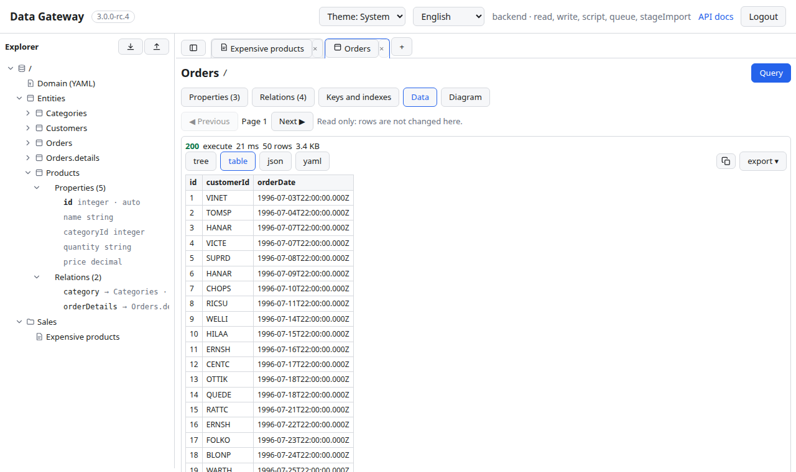
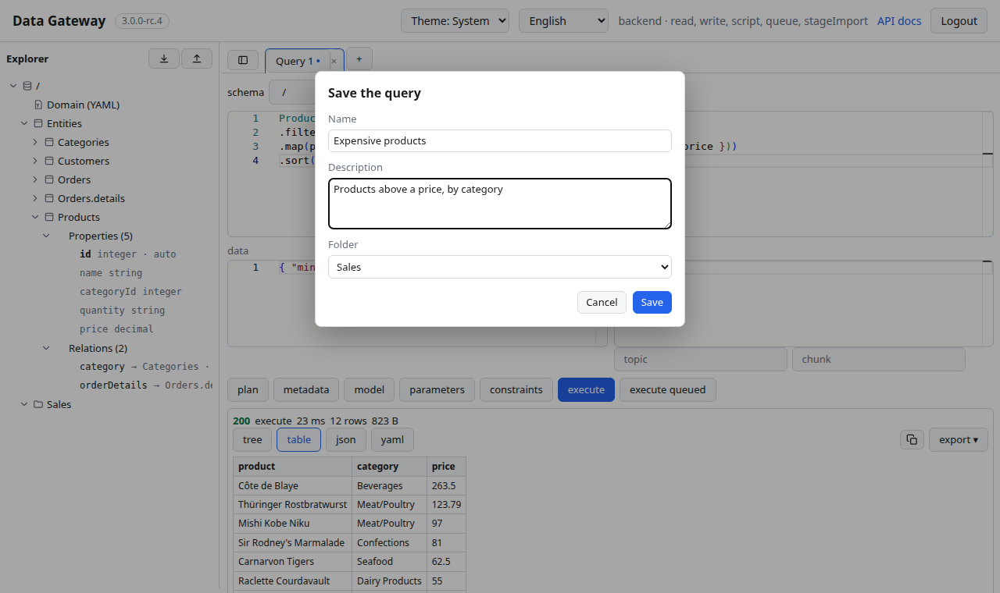

# UI {#ui}

Um tour passo a passo, da primeira conexão até um diagrama, está em [Primeiros passos](../data-gateway/GettingStarted.md#9-the-ui).

A UI do Data Gateway é o **data-gateway-ide**, uma imagem própria
([`flaviorita/data-gateway-ide`](https://hub.docker.com/r/flaviorita/data-gateway-ide)): um explorador dos esquemas e de
suas entidades, o formulário de cada entidade, abas de consulta com o autocompletar do domínio, consultas salvas e
diagramas do domínio. Ela é útil para experimentar consultas, aprender a linguagem e verificar o que um agente faz por MCP.

Como uma IDE de banco de dados, ela se conecta a data gateways, um ou vários, cada um com sua credencial; seus esquemas,
workspaces e projetos ficam neles.

## Implantação {#deploying-it}

Desde a 4.0.0 o gateway não serve nenhuma UI e não responde CORS. A IDE o alcança pela sua porta **`management`**
([Transportes](../data-gateway/Transports.md#management)): as rotas da API REST para todos os esquemas mais a
[administração](../data-gateway/Admin.md). Um gateway sem essa porta não tem IDE, que é o que pode querer um gateway de produção cujos
esquemas vêm em seus volumes.

```yaml
# data-gateway.config.yaml
transports:
  http: { port: 8080 }
  management: { port: 9090 }    # a API da IDE; sem porta, não é exposta
```

```yaml
# docker-compose.yml
services:
  data-gateway:
    image: flaviorita/data-gateway:4.0.0
    # a 9090 não é publicada: só a IDE a alcança, na rede do compose
  ide:
    image: flaviorita/data-gateway-ide:1.0.0
    environment:
      DATA_GATEWAY_IDE_TARGETS: "http://data-gateway:9090,http://data-gateway:8080"
    ports:
      - "127.0.0.1:8090:8080"
```

Com `trustedProxies` de `management` definido para a rede da IDE, o gateway vê o endereço de cada navegador nas suas
[sessões](#sessions); caso contrário, todas as sessões mostram o endereço da IDE.

- **O navegador fala apenas com o servidor da IDE.** Ele serve a página e encaminha cada requisição ao gateway (um
  proxy): REST, MCP e o WebSocket igualmente. Os gateways nunca veem o navegador.
- **`DATA_GATEWAY_IDE_TARGETS`** lista as origens que a IDE pode alcançar, separadas por vírgulas, ou `*` para qualquer
  uma (uma IDE rodando localmente). Sem ela, a IDE não alcança nenhuma e avisa: um proxy aberto alcançaria qualquer host
  da sua rede.
- **A IDE não guarda nenhuma conexão nem credencial.** Elas ficam no navegador. Ela encaminha a credencial ao gateway e
  descarta os cookies e a origem da página.
- **Mantenha `management` em uma rede interna.** Ele grava os esquemas e suas variáveis e roda DDL; o que se publica é a
  IDE.

### Onde a IDE roda {#where-the-ide-runs}

| Você implanta | Para | `management` |
| --- | --- | --- |
| Só o gateway, sem `management` | produção, com os esquemas nos seus volumes: sem IDE nem administração | sem porta |
| O gateway e a imagem da IDE | uma IDE compartilhada no navegador | só na rede interna, nunca publicado: o contêiner da IDE o alcança |
| Só o gateway, com `management` | uma IDE na sua própria máquina: o [aplicativo de desktop](Download.md), ou a imagem com `docker run` | sua máquina precisa alcançar a porta (abaixo) |

Uma IDE na sua máquina alcança um `management` que está em outro lugar sem publicá-lo aberto:

| O gateway roda | Como a IDE o alcança | `management` publicado |
| --- | --- | --- |
| na mesma máquina | `localhost:9090` | — |
| em uma rede interna, ou atrás de uma VPN | `host-interno:9090` | só para essa rede |
| em um servidor, sem VPN | um túnel SSH, `ssh -L 9090:localhost:9090 servidor`, e a conexão em `localhost:9090` | só no loopback do servidor |
| no Kubernetes | `kubectl port-forward svc/data-gateway 9090`, e a conexão em `localhost:9090` | um `Service` interno, sem ingress |

Com um túnel, as abas REST, WebSocket e MCP também precisam do seu caminho: tunelize as portas delas, ou defina as URLs
na conexão (**Outras URLs dos seus transportes**).

## Conexões {#connections}

A IDE não tem página inicial nem login: ela abre no espaço de trabalho e, na primeira vez, em uma **Nova conexão**.

| Campo | O que é |
| --- | --- |
| **Nome** | como a conexão é exibida |
| **Protocolo** e **endereço** | o `management` do gateway como **o servidor da IDE** o alcança: `data-gateway:9090` (host, porta e base path), não o endereço do navegador |
| **Autenticação** | API key (o header, padrão `X-Api-Key`, e a chave), bearer token, basic (usuário e senha) ou nenhuma |
| **Lembrar a chave** | guardar a chave no navegador; caso contrário, ela fica apenas naquela aba e é pedida de novo depois de fechá-la |
| **Outras URLs dos seus transportes** | o REST, o WebSocket e o MCP do gateway, apenas quando a IDE não os alcança nas portas que o gateway informa (um proxy na frente, outra rede) |

**Testar** verifica a conexão: quem é a credencial e a versão do gateway. **Mostrar / Ocultar** mostra a chave que foi
digitada.

### Sua sessão {#sessions}

Conectar faz login no `management` do gateway ([sessões](../data-gateway/Transports.md#sessions)): a IDE guarda o token naquela aba e
toda requisição o leva, nunca a chave.

- Quando a sessão **expira** (30 minutos sem atividade, ou 12 horas) e a chave está à mão, a IDE abre outra por conta
  própria; sem ela, pede a chave.
- Quando é **revogada**, a IDE diz quem a revogou e não volta por conta própria, mesmo com a chave lembrada: salvar a
  conexão de novo a reconecta.
- A IDE mantém aberto o WebSocket de eventos do gateway: a sessão aparece como *conectada*, e um esquema que muda, ou
  algo salvo por outra pessoa, aparece na hora.
- A página de uma conexão lista **Minhas sessões**: as outras da mesma credencial (outro navegador, outro computador),
  com seu endereço, o que estão olhando e quando terminam, para **Fechar** uma ou **Fechar as outras**. Com
  `sessionAdmin`, também **Sessões ativas**: todas as do gateway, por credencial, para **Revogar** uma ou **Revogar
  todas** as de uma credencial.

- A página de uma conexão mostra quem é essa credencial e **seus papéis**: cada permissão, com o que ela permite.
- O explorador lista as conexões, cada uma com seus esquemas; abas de várias conexões podem ficar abertas lado a lado.
  Uma conexão é editada ou removida a partir da sua linha (removê-la a tira apenas da IDE).
- A partir de uma conexão, em abas, com sua credencial: sua **API REST** (Swagger, para experimentar todos os métodos), seu
  **WebSocket** (seus métodos, um console JSON-RPC e o que volta) e seu **MCP** (as tools de um esquema, chamadas com seus
  argumentos). Um transporte que o gateway não expõe fica desabilitado.

**Preferências** (o menu ☰): o tema (Sistema, Claro, Escuro e outros), o idioma (English, Español, Português,
Français, Italiano, Deutsch, Nederlands, Català, Galego, Euskara) e o formato regional dos números e das datas dos
resultados. Elas são lembradas pelo navegador.


## Explorador {#explorer}

À esquerda, as conexões e os esquemas de cada uma. Ele pode ser redimensionado arrastando sua borda e ocultado com o botão de painel
da barra de abas. Para cada esquema:

- **Domínio (YAML).** O domínio do esquema (entidades, propriedades, relações, chaves, enums) em um editor
  **somente leitura**, com realce de sintaxe, busca e recolhimento. Ele mostra apenas o domínio: nunca as fontes, as conexões
  nem o resto da configuração.
- **Entidades.** Cada entidade se expande em:
    - **Propriedades**, com seus tipos (a chave primária em negrito);
    - **Relações**, com a entidade relacionada e a cardinalidade (`customer → Customers · N — 1`); o botão **Abrir**
      de uma relação abre a entidade relacionada.
  O botão **Abrir** (↗) de uma entidade, um duplo clique ou Enter abrem seu [formulário](#entity-form).
- **O que está salvo** no esquema: pastas, consultas e diagramas ([abaixo](#saved-queries-and-diagrams)).

- **Filtro.** A caixa sobre as entidades deixa as que têm o texto no nome ou no de uma propriedade ou relação
  (`21 de 192`); as propriedades e relações que coincidem aparecem sob a sua entidade.
- A largura do explorador é guardada; um duplo clique na borda (ou Enter) a ajusta aos nomes, e as setas a mudam
  pelo teclado (Shift: 60 px).
- Um esquema que não iniciou aparece atenuado, com seu estado e seu motivo.


## Formulário da entidade {#entity-form}

Como uma tabela em uma IDE de banco de dados, em sua própria aba, com estas seções:

| Seção | Mostra |
| --- | --- |
| **Propriedades** | cada propriedade: tipo (ou enum), tamanho, obrigatória, chave primária (e única), autoincremento, padrão, **a entidade e a propriedade que uma chave estrangeira referencia** (um link para ela) e suas expressões de leitura / escrita |
| **Relações** | suas relações (nome, tipo, entidade, de, para, cardinalidade, fraca) e **Referenciada por**: as relações de outras entidades que apontam para ela; cada entidade é um link para seu formulário |
| **Chaves e índices** | chave primária, chave única, índices com seus campos, restrições com sua mensagem e condição |
| **Dados** | suas linhas em uma tabela, **somente leitura**, 50 por página, com Anterior / Próxima; elas podem ser copiadas e exportadas como qualquer resultado |
| **Diagrama** | a entidade e suas vizinhas |

O botão **Consultar** abre uma aba de consulta com `Entity.page(1, 10)`.




## Consultas {#queries}

Cada consulta é uma aba, com seu próprio esquema, texto, dados, opções e resultado; trocar de aba não perde nada. Uma aba é
aberta com **+**, a partir de uma entidade (**Consultar**) ou de uma consulta salva, e fechada com seu ×.

- **Editor** com o autocompletar do domínio do esquema (entidades, propriedades, relações e funções) e os
  erros do λORM marcados no texto durante a digitação. **Modo:** consulta ou script (scripts apenas quando o esquema os tem
  habilitados e a credencial tem `script`).
- **Dados** e **opções** (JSON) e, para execuções enfileiradas, o **tópico** e o **lote**.
- **Ações:** `plan`, `metadata`, `model`, `parameters` (preenche os dados com as variáveis da consulta),
  `constraints`, `execute` (Ctrl+Enter), `execute queued` e, no modo script, `execute script`. Uma ação que a
  credencial não pode usar fica desabilitada, e sua dica diz por quê.
- **Resultado:** estado, operação, tempo, linhas e tamanho, e quatro visualizações: **árvore**, **tabela** (quando o resultado é uma lista
  de linhas), **JSON** e **YAML**. A árvore e a tabela mostram até 200 linhas; as exportações têm todas.
    - O ícone **copiar** copia o que é mostrado (a tabela como texto separado por tabulações, pronto para colar em uma planilha).
    - **Exportar** baixa o resultado inteiro como **JSON**, **YAML** ou **TXT (separado por tabulações)**.
- **Histórico** das últimas consultas de cada esquema, para recuperar uma delas.

- **Um erro com uma sugestão** (`entity Area not found; did you mean Areas?`) tem um botão **usar Areas** que
  substitui o nome na consulta.


## Consultas salvas e diagramas {#saved-queries-and-diagrams}

O **+** de um esquema ou de uma pasta adiciona:

- **Nova pasta.** As pastas se aninham, para organizar o que é salvo.
- **Nova consulta.** Uma aba de consulta cuja pasta é aquela.
- **Novo diagrama.** Veja [Diagramas](#diagrams).

Cada item salvo tem um **nome** e uma **descrição** (exibida quando o ponteiro está sobre ele). Sua linha tem **Editar** (nome,
descrição e pasta) e **Excluir** (com confirmação; uma pasta leva o que contém). Os itens são **movidos arrastando-os**
para uma pasta ou para o esquema. Dois itens do mesmo tipo não podem ter o mesmo nome em uma pasta.

Uma aba de consulta tem **Salvar** (Ctrl+S) e **Salvar como…**: o primeiro salvamento pede o nome, a descrição e a pasta.
Um **•** na aba marca alterações não salvas; depois de salva, ela indica **salvo**. Abrir uma consulta salva que
já está aberta leva à sua aba.



## Diagramas {#diagrams}

Um diagrama do domínio mostra as entidades escolhidas como caixas, com suas propriedades, tipos, **PK** e **FK** (as
obrigatórias em negrito), e as relações como linhas com sua cardinalidade (**1 — N**, **1 — 1**); uma herança é uma
linha tracejada.

**Novo diagrama** pede o nome, a descrição, a pasta e **as entidades**: elas são buscadas, marcadas uma
a uma ou completadas com **Adicionar as vizinhas** (as entidades relacionadas às escolhidas).


Em um diagrama:

| Ação | Como |
| --- | --- |
| Organizar | automático ao abrir (as caixas são posicionadas pelo [ELK](https://eclipse.dev/elk/)); **reorganizar** volta a esse layout |
| Mover uma caixa | arraste-a |
| Mover uma linha | arraste-a para o lado; suas extremidades ficam nas linhas dos campos que ela une; um duplo clique a recoloca |
| Remover uma entidade | o **×** de sua caixa (exibido quando o ponteiro está sobre ela), ou clique na caixa e pressione Delete |
| Adicionar ou remover entidades | **Entidades…** |
| Nomes das relações | **nomes das relações** |
| Apenas os nomes das entidades | **só nomes** |
| Zoom e movimentação | a roda do mouse; arraste o fundo; **ajustar** mostra tudo |
| Abrir uma entidade | duplo clique em sua caixa |
| Exportar | **SVG** ou **PNG** |

O diagrama é salvo (**Salvar** ou Ctrl+S) com a posição de cada caixa e linha, a opção de nomes e as entidades.


## Onde é salvo {#where-it-is-saved}

Com a permissão `workbenchWrite`, o que é salvo (pastas, consultas, diagramas) vai para a pasta `workbench/` de
cada workspace, no gateway ([Administração](../data-gateway/Admin.md)), compartilhado por todos que o usam. Sem ela, fica **no
navegador**, em seu IndexedDB, separado por gateway e por credencial: o que uma credencial salva não é visto com
outra. Apenas o nome da credencial é usado para isso, nunca seu segredo. No navegador:

- Fica naquele navegador, naquele dispositivo: outro navegador ou outro dispositivo não o vê.
- É perdido se os dados do site forem apagados no navegador. Pede-se ao navegador que os mantenha, e o explorador exporta
  **tudo para um arquivo JSON** (⤓) e o importa de volta (⤒), **adicionando** ao que existe ou **substituindo**: um backup,
  uma forma de levá-lo para outro navegador ou de compartilhá-lo com alguém.
- Em um navegador que não permite armazenar dados (algumas janelas privadas), o explorador avisa: o que é salvo dura até a
  página ser fechada.

## Na sua própria aplicação {#in-your-own-application}

A UI é construída com [`@lambdaorm/ui`](https://www.npmjs.com/package/@lambdaorm/ui), uma biblioteca de componentes React
que qualquer aplicação web pode usar com um Data Gateway. O gateway não responde CORS: a aplicação o chama pelo seu
próprio backend, como faz a IDE.

```sh
npm install @lambdaorm/ui react react-dom
```

```tsx
import { Workspace } from '@lambdaorm/ui'
import '@lambdaorm/ui/styles.css'

<Workspace
  baseUrl="/api/gateway"                         // seu backend, que encaminha ao gateway (ele não responde CORS)
  headers={() => ({ 'X-Api-Key': key })}         // como autenticar; a biblioteca não guarda nenhuma credencial
  locale="es"
  theme="dark"
  workspaceKey={`gateway.example.com|${user}`}   // separa o que é salvo
/>
```

| Componente | O que é |
| --- | --- |
| `Workspace` | o espaço de trabalho inteiro: explorador, formulários de entidades, consultas, itens salvos e diagramas |
| `QueryWorkbench` | um editor de consultas com suas ações e seu resultado |
| `QueryTabs` | várias bancadas em abas |
| `DomainDiagram` | um diagrama do domínio (uma entidade e suas vizinhas, o modelo inteiro ou entidades escolhidas) |
| `EntityView` | o formulário de uma entidade |
| `ResultViewer` | um resultado como árvore, tabela, JSON ou YAML, com cópia e exportação |

O que é salvo pode ir para outro lugar além do navegador informando `store` (um `WorkspaceStore`, por exemplo um backend
próprio).

## Administração {#administration-ui}

Pela porta `management` e com suas permissões, o explorador também edita os esquemas (como YAML e como formulários), cria e
remove, salva o que é salvo nos workspaces, define as variáveis das conexões e roda os comandos da CLI: ver
[Administração](../data-gateway/Admin.md). Os esquemas são lidos de novo a cada 5 s: um adicionado, removido ou recarregado aparece
sem recarregar a página, e uma versão nova que não iniciou é marcada com ⚠ e seu motivo.
