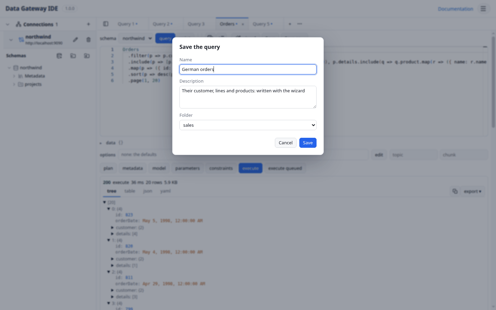

# Projetos {#projects}

O que você guarda de um esquema, sob **projetos** no [explorador](Explorer.md): pastas, consultas e diagramas. Um
projeto é uma pasta no topo; as pastas se aninham para organizar o que está salvo.

## Adicionar {#adding}

O **+** de **projetos** ou de uma pasta:

| Item | O que pede |
| --- | --- |
| **Novo projeto** / **Nova pasta** | um nome, uma descrição e a pasta em que vai |
| **Nova consulta** | abre uma aba de consulta nessa pasta; o seu primeiro **Salvar** pede o seu nome |
| **Novo diagrama** | um nome, uma descrição, a pasta e as entidades ([Diagramas](Diagrams.md#a-new-diagram)) |

## Salvar uma consulta {#saving-a-query}

**Salvar** (Ctrl+S) em uma aba de consulta: na primeira vez, pede um **Nome**, uma **Descrição** e uma **Pasta**;
depois, salva no lugar. **Salvar como…** salva uma cópia com outro nome. O que é salvo: o modo, a consulta ou o
script, os dados, as opções e, quando o [assistente](QueryWizard.md) a escreveu, o assistente.

- Um **•** na aba marca alterações não salvas; uma vez salva, ela diz **salvo**.
- Uma consulta salva cujo esquema é mudado na sua aba é salva como uma nova.
- Abrir uma consulta salva que já está aberta vai para a sua aba.

## Editar, mover, excluir {#editing-moving-deleting}

Cada linha tem **Editar** (o seu nome, descrição e pasta) e **Excluir** (com confirmação; uma pasta leva o que
contém). Os itens são **movidos arrastando-os** para uma pasta, ou para **projetos** para levá-los ao topo, dentro do
mesmo esquema. Dois itens do mesmo tipo não podem ter o mesmo nome em uma pasta (`Já existe um com esse nome aqui.`).
A descrição aparece quando o ponteiro está sobre o item.

## Onde é salvo {#where-it-is-saved}

| A credencial tem | O que é salvo vai para | Visto por |
| --- | --- | --- |
| `workbenchWrite` | a pasta `workbench/` do workspace do esquema, no gateway: um arquivo por item (`sales/German orders.query.yaml`) | todos que usam esse esquema, de qualquer navegador ou do aplicativo de desktop |
| sem `workbenchWrite` | **este navegador**, no seu armazenamento, separado para cada gateway e credencial | só este navegador neste dispositivo, com essa credencial |

No workspace, duas pessoas salvando o mesmo item ao mesmo tempo é detectado: a segunda é avisada de que outra pessoa o
alterou enquanto isso, e o item é lido de novo. Os arquivos de `workbench/` que não podem ser lidos são listados no
explorador, para corrigi-los à mão.

No navegador:

- o que uma credencial salva não é visto com outra (só o nome da credencial é usado para isso, nunca o seu
  segredo);
- some se os dados do site forem apagados; em um navegador que não permite guardar (algumas janelas privadas), o
  explorador o avisa, e dura até a página ser fechada;
- com `workbenchWrite` concedida depois, o explorador oferece uma vez **Copiá-los para o workspace**.

## Exportar e importar {#export-and-import}

**Exportar** (no cabeçalho de **Esquemas**) baixa tudo o que foi salvo com essa conexão para um arquivo JSON
(`lambdaorm-workspace-2026-11-23.json`): um backup, ou uma forma de levá-lo para outro navegador ou para outra pessoa.
**Importar** lê um arquivo assim: **Adicionar ao que existe** (um item com o mesmo id é substituído) ou **Substituir
tudo** (só no navegador: no workspace uma importação sempre adiciona, já que ele é compartilhado).
