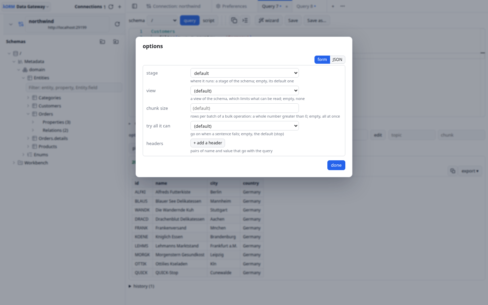

# Abfragen

In einem Abfrage-Tab wird eine Abfrage in der [Sprache](../queries/Query-Language.md) von λORM geschrieben, geprüft
und auf einem Schema des Gateways ausgeführt, mit ihren Daten und Optionen, und ihr Ergebnis als Baum, Tabelle, JSON
oder YAML angesehen. Jeder Tab hat sein eigenes Schema, seinen Text, seine Daten, Optionen und sein Ergebnis; beim
Wechseln der Tabs geht nichts verloren. Ein Tab wird mit dem **+** der Tabs geöffnet, mit **Abfragen** einer
[Entität](Entities.md), aus einer gespeicherten Abfrage, mit **Abfrage des Diagramms** eines
[Diagramms](Diagrams.md) oder vom [Abfrage-Assistenten](QueryWizard.md), der eine aus einem Diagramm schreibt.


## Die Werkzeugleiste {#the-toolbar}

| Steuerelement | Was es tut |
| --- | --- |
| **Schema** | das Schema, auf dem die Abfrage läuft (nur die bereiten; `/` ist das an der Wurzel) |
| **Abfrage** / **Skript** | der Modus: eine Abfrage oder ein [Skript](../data-gateway/Rest.md#script), mehrere Abfragen in einer Transaktion (sie läuft dort, wo das Schema Skripte aktiviert hat). Jeder Modus behält seinen eigenen Text |
| kopieren | kopiert die Abfrage (oder das Skript) |
| formatieren | setzt jede Klausel der Abfrage in eine eigene Zeile ([unten](#format)) |
| **Assistent** | öffnet den [Abfrage-Assistenten](QueryWizard.md) auf dieser Abfrage |
| **Speichern** (Strg+S) / **Speichern unter…** | bewahrt die Abfrage in der [Workbench](Projects.md) auf; **gespeichert** sagt, dass sie keine Änderungen hat |

## Der Editor {#the-editor}

Der Editor kennt die Domäne des Schemas und die Sprache von λORM:

- **Vorschläge** beim Tippen, oder mit Strg+Leertaste:

    | Nach | Schlägt er vor |
    | --- | --- |
    | einer Entität, `Products.`, oder einer Klausel, `….` | die Klauseln: `filter`, `include`, `map`, `sort`, `page`, `first`, `distinct`, `having`, `insert`, `update`, `delete`…, jede mit dem, was sie tut |
    | einer Variablen, `p.` | die Eigenschaften (mit ihrem Typ, PK, Pflicht) und die Beziehungen (`→ Categories`) ihrer Entität |
    | einer Beziehung zu vielen, `p.details.` | die Klauseln einer Beziehung (`map`, `filter`, `include`, `first`…) und die Mitglieder ihrer Entität |
    | einer Eigenschaft, `p.name.` | die Funktionen, die zu ihrem Typ passen (`upper()`, `year()`…), mit ihrer Dokumentation |
    | nichts | die Variablen im Gültigkeitsbereich, die Entitäten und die Funktionen |

- **Fehler**, beim Tippen im Text markiert: eine halbe Sekunde nachdem du aufhörst, liest λORM die Abfrage im Gateway
  und markiert, wo sie fehlschlägt (`entity Area not found`). Das braucht `read`.
- **Strg+Enter** führt die Hauptaktion aus: **execute** (oder **execute script**).


### Formatieren {#format}

Die Schaltfläche formatieren schreibt jede Klausel in eine eigene Zeile, eingerückt, und teilt ein include oder ein map,
das nicht in 80 Spalten passt, auf: ein Element pro Zeile. Zweimal formatieren ergibt denselben Text; die Strings
bleiben, wie sie sind.

```ts
Orders.filter(p => p.customer.country == 'Germany').include(p => p.customer).page(1, 10)
```

```ts
Orders
	.filter(p => p.customer.country == 'Germany')
	.include(p => p.customer)
	.page(1, 10)
```

## Daten {#data}

Die Werte der Parameter der Abfrage, als JSON-Objekt: in `Orders.filter(p => p.customerId == customer)` ist `customer`
ein Parameter, und **Daten** gibt ihn an, `{ "customer": "ALFKI" }`. Solange es leer ist, ist es zugeklappt, mit seinem
Text in einer Zeile; es öffnet sich, wenn etwas es füllt. Die Aktion **parameters** füllt es mit den Parametern der
Abfrage, jeder mit einem Wert seines Typs (`0`, `""`, heute…), und behält die schon vorhandenen.

## Optionen {#options}

Die Optionen, mit denen die Abfrage läuft, in einer Zeile (`keine: die Standardwerte`, oder `stage: default · view:
sales`), und **bearbeiten**, das sie als **Formular** oder als **JSON** öffnet; **fertig** schließt sie:

| Option | Was sie ist |
| --- | --- |
| **Stage** | wo sie läuft: ein Stage des Schemas, zur Auswahl (mit data-gateway 4.4 die, die die Rollen der Zugangsdaten erlauben); leer, sein Standard-Stage |
| **View** | mit data-gateway 4.4, wenn die Rollen der Zugangsdaten mehr als eine ergeben: welche davon; leer, die ihrer Rollen |
| **Blockgröße** | Zeilen pro Block einer Massenoperation |
| **so viel wie möglich versuchen** | weitermachen, wenn eine Anweisung fehlschlägt: (Standard), ja oder nein |
| **Zeitlimit (ms)** | eines Skripts: es stoppt nach dieser Zeit (Skriptmodus) |
| **max. Iterationen** | eines Skripts: seine Schleifen, alle zusammen (Skriptmodus) |
| **Header** | Paare aus Name und Wert, die mit der Abfrage gesendet werden (**Header hinzufügen**) |

Ein leeres Feld wird nicht gesendet. Optionen, die das Formular nicht kennt, bleiben im JSON, wie sie sind.



**Topic** und **Block**, neben den Optionen, sind die von **execute queued**: das Topic der Warteschlange und die
Zeilen pro Nachricht.

## Aktionen {#actions}

| Aktion | Was sie tut | Braucht |
| --- | --- | --- |
| **plan** | die Anweisungen, die sie auf jeder Quelle ausführen würde, ohne sie auszuführen | `read` |
| **metadata** | was die Abfrage liest und liefert: ihre Felder, Typen und Parameter | `read` |
| **model** | die Form ihres Ergebnisses | `read` |
| **parameters** | ihre Parameter; füllt die Daten | `read` |
| **constraints** | die Einschränkungen, die sie prüft | `read` |
| **execute** (Strg+Enter) | führt sie aus | `read`, oder `write` für eine Abfrage, die schreibt |
| **execute queued** | stellt sie in die Warteschlange von **Topic**, um sie später auszuführen | `queue` |
| **execute script** | führt das Skript aus (Skriptmodus) | `script`, und Skripte im Schema aktiviert |

Eine Aktion, die die Zugangsdaten nicht nutzen können, ist deaktiviert, und ihr Tooltip sagt warum
(`„reader“ hat die Berechtigung queue nicht`). **plan**, **metadata**, **model**, **parameters** und **constraints**
lesen nur den Text der Abfrage: Sie senden keine Daten und keine Optionen.

## Das Ergebnis {#the-result}

Der Status, die Operation, ihre Zeit, die Zeilen und die Größe; dann vier Ansichten:

| Ansicht | Zeigt |
| --- | --- |
| **tree** | das Ergebnis, zwei Ebenen aufgeklappt, jede Liste und jedes Objekt mit seiner Größe |
| **table** | die Zeilen als Tabelle, wenn das Ergebnis eine Liste von Zeilen ist; ein Objekt in einer Zelle als JSON |
| **json** / **yaml** | der Text, schreibgeschützt, mit Farben, Einklappen und Suche |

- Baum und Tabelle zeigen bis zu 200 Zeilen (`200 von N Zeilen angezeigt: die Downloads enthalten alle.`); Zahlen und
  Daten folgen dem regionalen Format der [Einstellungen](index.md#the-window) (der Wert, wie er kam, in seinem Tooltip).
- **kopieren** kopiert, was angezeigt wird; die Tabelle als tabulatorgetrennter Text, bereit zum Einfügen in eine
  Tabellenkalkulation.
- **exportieren** lädt das ganze Ergebnis als **JSON**, **YAML** oder **TXT (tabulatorgetrennt)** herunter.
- **Ein Fehler** zeigt seinen Namen, Code und seine Meldung. Wenn das Gateway einen Namen vorschlägt (`entity Area not
  found; did you mean Areas?`), ersetzt **Areas verwenden** ihn in der Abfrage.

## Verlauf {#history}

**Verlauf (N)**, unter dem Ergebnis: die letzten 30 ausgeführten Abfragen jedes Schemas, die neuesten zuerst, mit ihren
Daten und Optionen (nie ein Ergebnis oder Zugangsdaten). Ein Klick holt eine zurück; **Verlauf löschen** leert ihn. Er
wird im Browser aufbewahrt.
