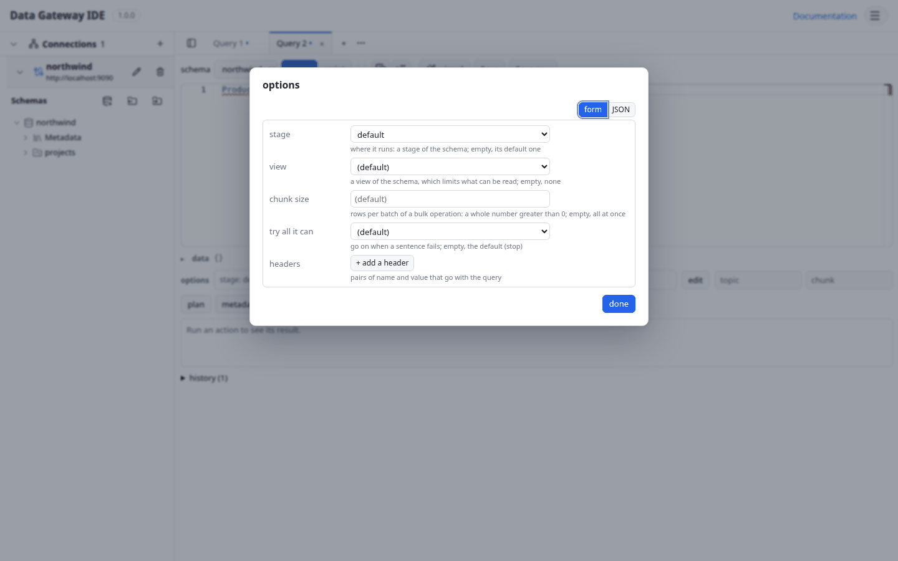

# Consultas {#queries}

Cada consulta es una pestaña con su propio esquema, texto, datos, opciones y resultado; cambiar de pestaña no pierde
nada. Una pestaña se abre con el **+** de las pestañas, con **Consultar** de una entidad, o desde una consulta guardada;
el [asistente de consultas](QueryWizard.md) escribe una desde un diagrama.


## La barra de herramientas {#the-toolbar}

| Control | Qué hace |
| --- | --- |
| **esquema** | el esquema en el que se ejecuta la consulta (solo los que están listos; `/` es el de la raíz) |
| **consulta** / **script** | el modo: una consulta, o un [script](../data-gateway/Rest.md#script), varias consultas en una transacción (solo cuando el esquema tiene los scripts habilitados y el gateway los ofrece). Cada modo conserva su propio texto |
| copiar | copia la consulta (o el script) |
| formatear | pone cada cláusula de la consulta en su propia línea ([abajo](#format)) |
| **asistente** | abre el [asistente de consultas](QueryWizard.md) sobre esta consulta |
| **Guardar** (Ctrl+S) / **Guardar como…** | guarda la consulta en un [proyecto](Projects.md); **guardado** dice que no tiene cambios |

## El editor {#the-editor}

El editor conoce el dominio del esquema y el lenguaje de λORM:

- **Sugerencias** mientras escribes, o con Ctrl+Espacio:

    | Después de | Sugiere |
    | --- | --- |
    | una entidad, `Products.`, o una cláusula, `….` | las cláusulas: `filter`, `include`, `map`, `sort`, `page`, `first`, `distinct`, `having`, `insert`, `update`, `delete`…, cada una con lo que hace |
    | una variable, `p.` | las propiedades (con su tipo, PK, obligatoria) y las relaciones (`→ Categories`) de su entidad |
    | una relación a muchas, `p.details.` | las cláusulas de una relación (`map`, `filter`, `include`, `first`…) y los miembros de su entidad |
    | una propiedad, `p.name.` | las funciones que corresponden a su tipo (`upper()`, `year()`…), con su documentación |
    | nada | las variables al alcance, las entidades y las funciones |

- **Errores** marcados en el texto mientras escribes: medio segundo después de que te detienes, λORM lee la consulta en
  el gateway y marca dónde falla (`entity Area not found`). Necesita `read`.
- **Ctrl+Enter** ejecuta la acción principal: **execute** (o **execute script**).


### Formato {#format}

El botón de formato escribe cada cláusula en su propia línea, con sangría, y divide un include o un map que no entra en
80 columnas, un elemento por línea. Formatear dos veces da el mismo texto; los strings se conservan tal como están.

```ts
Orders.filter(p => p.customer.country == 'Germany').include(p => p.customer).page(1, 10)
```

```ts
Orders
	.filter(p => p.customer.country == 'Germany')
	.include(p => p.customer)
	.page(1, 10)
```

## Datos {#data}

Los valores de los parámetros de la consulta, como un objeto JSON: en `Orders.filter(p => p.customerId == customer)`,
`customer` es un parámetro, y **datos** le da su valor, `{ "customer": "ALFKI" }`. Está plegado mientras está vacío,
con su texto en una línea; se abre cuando algo lo llena. La acción **parameters** lo llena con los parámetros de la
consulta, cada uno con un valor de su tipo (`0`, `""`, hoy…), conservando los que ya estaban.

## Opciones {#options}

Las opciones con las que se ejecuta la consulta, en una línea (`ninguna: las de por defecto`, o
`stage: default · view: sales`), y **editar**, que las abre como formulario o como JSON:

| Opción | Qué es |
| --- | --- |
| **stage** | dónde se ejecuta: un stage del esquema; vacío, el de por defecto |
| **view** | una view del esquema, que limita lo que se puede leer |
| **tamaño de lote** | filas por lote de una operación masiva |
| **intentar todo lo posible** | seguir cuando falla una sentencia |
| **tiempo máximo (ms)** | de un script: se corta después de este tiempo (modo script) |
| **iteraciones máximas** | de un script: sus bucles, todos juntos (modo script) |
| **cabeceras** | pares de nombre y valor que viajan con la consulta |

Un campo vacío no se envía. Las opciones que el formulario no conoce se conservan tal como están en el JSON.



**tópico** y **lote**, junto a las opciones, son los de **execute queued**: el tópico de la cola, y las filas por
mensaje.

## Acciones {#actions}

| Acción | Qué hace | Necesita |
| --- | --- | --- |
| **plan** | las sentencias que ejecutaría en cada source, sin ejecutarlas | `read` |
| **metadata** | lo que la consulta lee y devuelve: sus campos, tipos y parámetros | `read` |
| **model** | la forma de su resultado | `read` |
| **parameters** | sus parámetros; llena los datos | `read` |
| **constraints** | las restricciones que verifica | `read` |
| **execute** (Ctrl+Enter) | la ejecuta | `read`, o `write` para una consulta que escribe |
| **execute queued** | la envía a la cola de **tópico**, para ejecutarla después | `queue` |
| **execute script** | ejecuta el script (modo script) | `script`, y los scripts habilitados en el esquema |

Una acción que la credencial no puede usar está deshabilitada, y su tooltip dice por qué. **plan**, **metadata**,
**model**, **parameters** y **constraints** leen solo el texto de la consulta: no envían datos ni opciones.

## El resultado {#the-result}

El estado, la operación, su tiempo, las filas y el tamaño; luego cuatro vistas:

| Vista | Muestra |
| --- | --- |
| **tree** | el resultado desplegado dos niveles, cada lista y objeto con su tamaño |
| **table** | las filas como una tabla, cuando el resultado es una lista de filas; un objeto en una celda, como JSON |
| **json** / **yaml** | el texto, con colores, plegado y búsqueda |

- El árbol y la tabla muestran hasta 200 filas (`Se muestran 200 de N filas: las descargas tienen todas`); los números
  y las fechas siguen el formato regional de las [preferencias](index.md#the-window) (el valor tal como llegó, en su
  tooltip).
- **copiar** copia lo que se muestra; la tabla, como texto separado por tabulaciones, listo para pegar en una hoja de
  cálculo.
- **exportar** descarga el resultado completo como **JSON**, **YAML** o **TXT (separado por tabulaciones)**.
- **Un error** muestra su nombre, código y mensaje. Cuando el gateway sugiere un nombre (`entity Area not found; did
  you mean Areas?`), **usar Areas** lo reemplaza en la consulta.

## Historial {#history}

**historial (N)**, debajo del resultado: las últimas 30 consultas ejecutadas de cada esquema, la más reciente primero,
con sus datos y opciones (nunca un resultado ni una credencial). Un clic trae una de vuelta; **borrar historial** lo
vacía. Se guarda en el navegador.
