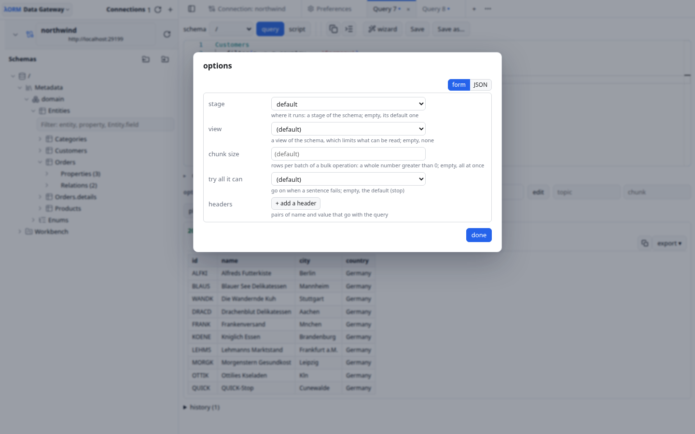

# Queries

A query tab is where a query of λORM's [language](../queries/Query-Language.md) is written, checked and run against a
schema of the gateway, with its data and options, and its result seen as a tree, a table, JSON or YAML. Each tab has its
own schema, text, data, options and result; switching tabs loses nothing. A tab is opened with the **+** of the tabs,
with **Query** of an [entity](Entities.md), from a saved query, from **query of the diagram** of a
[diagram](Diagrams.md), or by the [query wizard](QueryWizard.md), which writes one from a diagram.


## The toolbar

| Control | What it does |
| --- | --- |
| **schema** | the schema the query runs on (only those that are ready; `/` is the one at the root) |
| **query** / **script** | the mode: a query, or a [script](../data-gateway/Rest.md#script), several queries in one transaction (it runs where the schema has scripts enabled). Each mode keeps its own text |
| copy | copies the query (or the script) |
| format | puts each clause of the query on its own line ([below](#format)) |
| **wizard** | opens the [query wizard](QueryWizard.md) on this query |
| **Save** (Ctrl+S) / **Save as…** | keeps the query in the [workbench](Projects.md); **saved** says it has no changes |

## The editor

The editor knows the domain of the schema and λORM's language:

- **Suggestions** while typing, or with Ctrl+Space:

    | After | It suggests |
    | --- | --- |
    | an entity, `Products.`, or a clause, `….` | the clauses: `filter`, `include`, `map`, `sort`, `page`, `first`, `distinct`, `having`, `insert`, `update`, `delete`…, each with what it does |
    | a variable, `p.` | the properties (with their type, PK, required) and the relations (`→ Categories`) of its entity |
    | a relation to many, `p.details.` | the clauses of a relation (`map`, `filter`, `include`, `first`…) and the members of its entity |
    | a property, `p.name.` | the functions that fit its type (`upper()`, `year()`…), with their documentation |
    | nothing | the variables in scope, the entities and the functions |

- **Errors** marked in the text while typing: half a second after you stop, λORM reads the query in the gateway and
  marks where it fails (`entity Area not found`). It needs `read`.
- **Ctrl+Enter** runs the main action: **execute** (or **execute script**).


### Format {#format}

The format button writes each clause on its own line, indented, and splits an include or a map that doesn't fit in 80
columns, one item per line. Formatting twice gives the same text; the strings are kept as they are.

```ts
Orders.filter(p => p.customer.country == 'Germany').include(p => p.customer).page(1, 10)
```

```ts
Orders
	.filter(p => p.customer.country == 'Germany')
	.include(p => p.customer)
	.page(1, 10)
```

## Data

The values of the parameters of the query, as a JSON object: in `Orders.filter(p => p.customerId == customer)`,
`customer` is a parameter, and **data** gives it, `{ "customer": "ALFKI" }`. It is folded while it is empty, with its
text on one line; it opens when something fills it. The **parameters** action fills it with the parameters of the
query, each with a value of its type (`0`, `""`, today…), keeping those already there.

## Options

The options the query runs with, on one line (`none: the defaults`, or `stage: default · view: sales`), and **edit**,
which opens them as a **form** or as **JSON**; **done** closes them:

| Option | What it is |
| --- | --- |
| **stage** | where it runs: a stage of the schema, to choose; empty, its default one |
| **view** | a view of the schema, to choose, which limits what can be read |
| **chunk size** | rows per batch of a bulk operation |
| **try all it can** | go on when a sentence fails: (default), yes or no |
| **timeout (ms)** | of a script: it stops after this time (script mode) |
| **max iterations** | of a script: its loops, all together (script mode) |
| **headers** | pairs of name and value that go with the query (**add a header**) |

An empty field is not sent. Options the form doesn't know are kept as they are in the JSON.



**topic** and **chunk**, next to the options, are those of **execute queued**: the topic of the queue, and the rows
per message.

## Actions

| Action | What it does | Needs |
| --- | --- | --- |
| **plan** | the sentences it would run on each source, without running them | `read` |
| **metadata** | what the query reads and gives: its fields, types and parameters | `read` |
| **model** | the shape of its result | `read` |
| **parameters** | its parameters; fills the data | `read` |
| **constraints** | the constraints it checks | `read` |
| **execute** (Ctrl+Enter) | runs it | `read`, or `write` for a query that writes |
| **execute queued** | sends it to the queue of **topic**, to run later | `queue` |
| **execute script** | runs the script (script mode) | `script`, and scripts enabled in the schema |

An action the credential can't use is disabled, and its tooltip says why (`"reader" has no queue permission`).
**plan**, **metadata**, **model**, **parameters** and **constraints** read only the text of the query: they send no
data and no options.

## The result {#the-result}

The status, the operation, its time, the rows and the size; then four views:

| View | Shows |
| --- | --- |
| **tree** | the result unfolded two levels, each list and object with its size |
| **table** | the rows as a table, when the result is a list of rows; an object in a cell, as JSON |
| **json** / **yaml** | the text, read only, with colours, folding and search |

- The tree and the table show up to 200 rows (`Showing 200 of N rows: the downloads have all of them.`); numbers and
  dates follow the regional format of the [preferences](index.md#the-window) (the value as it came, in its tooltip).
- **copy** copies what is shown; the table, as tab-separated text, ready to paste in a spreadsheet.
- **export** downloads the whole result as **JSON**, **YAML** or **TXT (tab-separated)**.
- **An error** shows its name, code and message. When the gateway suggests a name (`entity Area not found; did you
  mean Areas?`), **use Areas** replaces it in the query.

## History

**history (N)**, under the result: the last 30 queries of each schema that were executed, newest first, with their
data and options (never a result or a credential). A click brings one back; **clear history** empties it. It is kept
in the browser.
