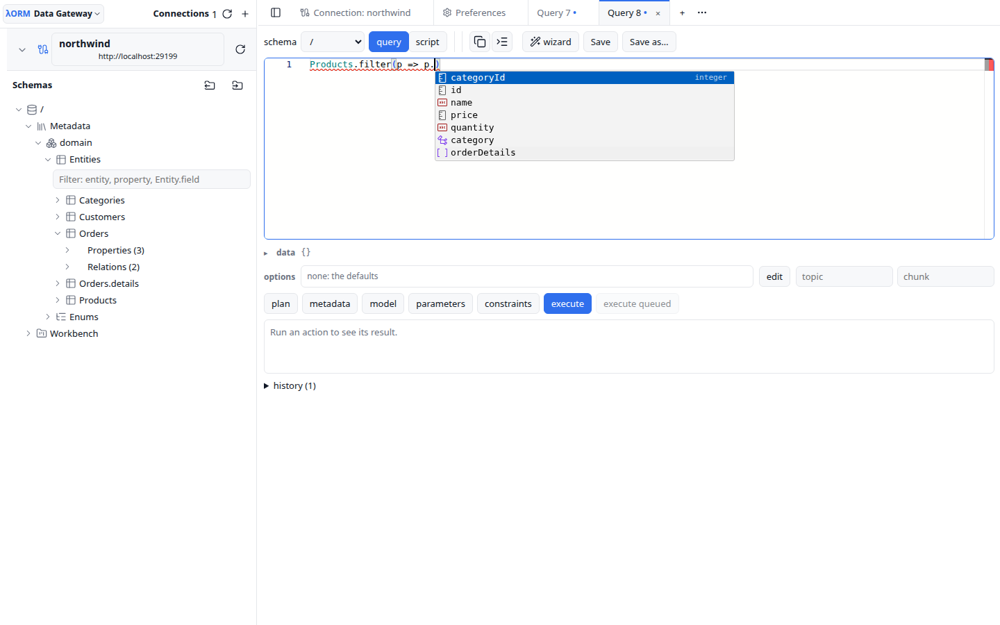
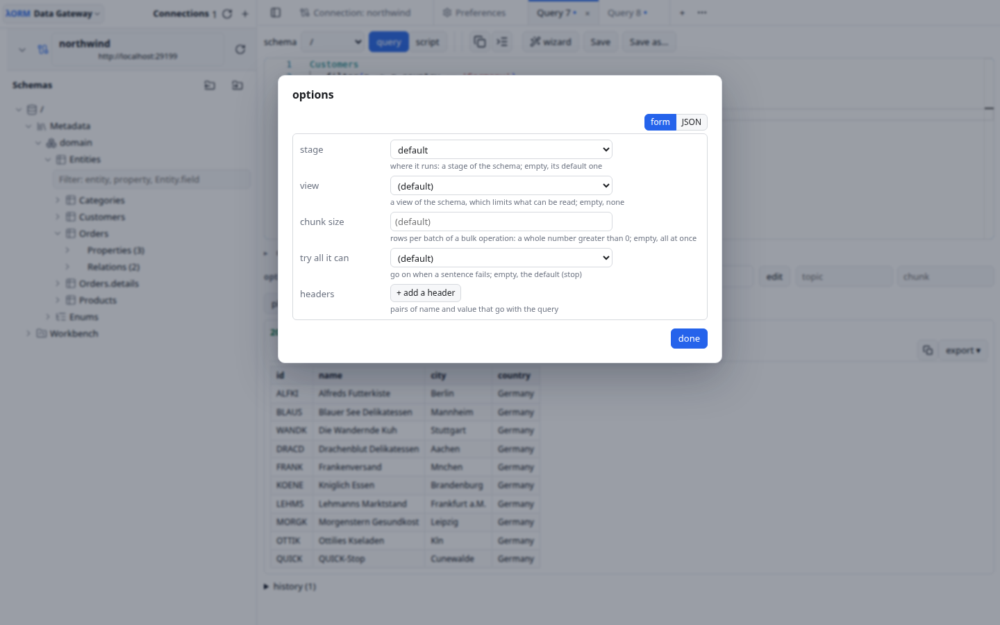

# Consultas {#queries}

Uma aba de consulta é onde uma consulta da [linguagem](../queries/Query-Language.md) do λORM é escrita, verificada e
executada sobre um esquema do gateway, com os seus dados e opções, e o seu resultado visto como árvore, tabela, JSON ou
YAML. Cada aba tem o seu próprio esquema, texto, dados, opções e resultado; trocar de aba não perde nada. Uma aba é
aberta com o **+** das abas, com **Consultar** de uma [entidade](Entities.md), a partir de uma consulta salva, a partir
de **consulta do diagrama** de um [diagrama](Diagrams.md), ou pelo [assistente de consultas](QueryWizard.md), que
escreve uma a partir de um diagrama.


## A barra de ferramentas {#the-toolbar}

| Controle | O que faz |
| --- | --- |
| **esquema** | o esquema em que a consulta roda (só os que estão prontos; `/` é o da raiz) |
| **consulta** / **script** | o modo: uma consulta, ou um [script](../data-gateway/Rest.md#script), várias consultas em uma transação (roda onde o esquema tem os scripts ativados). Cada modo mantém o seu próprio texto |
| copiar | copia a consulta (ou o script) |
| formatar | coloca cada cláusula da consulta em uma linha própria ([abaixo](#format)) |
| **assistente** | abre o [assistente de consultas](QueryWizard.md) sobre esta consulta |
| **Salvar** (Ctrl+S) / **Salvar como…** | guarda a consulta no [workbench](Projects.md); **salvo** diz que ela não tem alterações |

## O editor {#the-editor}

O editor conhece o domínio do esquema e a linguagem do λORM:

- **Sugestões** enquanto você digita, ou com Ctrl+Espaço:

    | Depois de | Sugere |
    | --- | --- |
    | uma entidade, `Products.`, ou uma cláusula, `….` | as cláusulas: `filter`, `include`, `map`, `sort`, `page`, `first`, `distinct`, `having`, `insert`, `update`, `delete`…, cada uma com o que faz |
    | uma variável, `p.` | as propriedades (com o seu tipo, PK, obrigatória) e as relações (`→ Categories`) da sua entidade |
    | uma relação para muitas, `p.details.` | as cláusulas de uma relação (`map`, `filter`, `include`, `first`…) e os membros da sua entidade |
    | uma propriedade, `p.name.` | as funções que cabem no seu tipo (`upper()`, `year()`…), com a sua documentação |
    | nada | as variáveis no escopo, as entidades e as funções |

- **Erros** marcados no texto enquanto você digita: meio segundo depois que você para, o λORM lê a consulta no gateway
  e marca onde ela falha (`entity Area not found`). Precisa de `read`.
- **Ctrl+Enter** executa a ação principal: **execute** (ou **execute script**).



### Formatar {#format}

O botão de formatar escreve cada cláusula em uma linha própria, indentada, e divide um include ou um map que não cabe
em 80 colunas, um item por linha. Formatar duas vezes dá o mesmo texto; as strings são mantidas como estão.

```ts
Orders.filter(p => p.customer.country == 'Germany').include(p => p.customer).page(1, 10)
```

```ts
Orders
	.filter(p => p.customer.country == 'Germany')
	.include(p => p.customer)
	.page(1, 10)
```

## Dados {#data}

Os valores dos parâmetros da consulta, como um objeto JSON: em `Orders.filter(p => p.customerId == customer)`,
`customer` é um parâmetro, e **dados** o fornece, `{ "customer": "ALFKI" }`. Fica recolhido enquanto está vazio, com o
seu texto em uma linha; abre quando algo o preenche. A ação **parameters** o preenche com os parâmetros da consulta,
cada um com um valor do seu tipo (`0`, `""`, hoje…), mantendo os que já estão lá.

## Opções {#options}

As opções com que a consulta roda, em uma linha (`nenhuma: as padrão`, ou `stage: default · view: sales`), e
**editar**, que as abre como **formulário** ou como **JSON**; **pronto** as fecha:

| Opção | O que é |
| --- | --- |
| **stage** | onde roda: um stage do esquema, a escolher (com data-gateway 4.4, os que os papéis da credencial permitem); vazio, o padrão |
| **view** | com data-gateway 4.4, quando os papéis da credencial dão mais de uma: qual delas; vazio, a dos seus papéis |
| **tamanho do lote** | linhas por lote de uma operação em massa |
| **tentar tudo o possível** | continuar quando uma sentença falha: (padrão), sim ou não |
| **tempo máximo (ms)** | de um script: ele para depois desse tempo (modo script) |
| **iterações máximas** | de um script: os seus laços, todos juntos (modo script) |
| **cabeçalhos** | pares de nome e valor que vão com a consulta (**adicionar um cabeçalho**) |

Um campo vazio não é enviado. As opções que o formulário não conhece são mantidas como estão no JSON.



**tópico** e **lote**, ao lado das opções, são os de **execute queued**: o tópico da fila, e as linhas por mensagem.

## Ações {#actions}

| Ação | O que faz | Precisa de |
| --- | --- | --- |
| **plan** | as sentenças que executaria em cada source, sem executá-las | `read` |
| **metadata** | o que a consulta lê e entrega: seus campos, tipos e parâmetros | `read` |
| **model** | a forma do seu resultado | `read` |
| **parameters** | seus parâmetros; preenche os dados | `read` |
| **constraints** | as restrições que ela verifica | `read` |
| **execute** (Ctrl+Enter) | a executa | `read`, ou `write` para uma consulta que escreve |
| **execute queued** | a envia à fila do **tópico**, para executar depois | `queue` |
| **execute script** | executa o script (modo script) | `script`, e os scripts ativados no esquema |

Uma ação que a credencial não pode usar fica desativada, e a sua dica diz por quê (`"reader" não tem a permissão
queue`). **plan**, **metadata**, **model**, **parameters** e **constraints** leem apenas o texto da consulta: não
enviam dados nem opções.

## O resultado {#the-result}

O status, a operação, o seu tempo, as linhas e o tamanho; depois, quatro visões:

| Visão | Mostra |
| --- | --- |
| **tree** | o resultado expandido em dois níveis, cada lista e objeto com o seu tamanho |
| **table** | as linhas como uma tabela, quando o resultado é uma lista de linhas; um objeto em uma célula, como JSON |
| **json** / **yaml** | o texto, somente leitura, com cores, recolhimento e busca |

- A árvore e a tabela mostram até 200 linhas (`Mostrando 200 de N linhas: os downloads têm todas.`); números e datas
  seguem o formato regional das [preferências](index.md#the-window) (o valor como veio, na sua dica).
- **copiar** copia o que está sendo mostrado; a tabela, como texto separado por tabulações, pronto para colar em uma
  planilha.
- **exportar** baixa o resultado inteiro como **JSON**, **YAML** ou **TXT (separado por tabulações)**.
- **Um erro** mostra o seu nome, código e mensagem. Quando o gateway sugere um nome (`entity Area not found; did you
  mean Areas?`), **usar Areas** o substitui na consulta.

## Histórico {#history}

**histórico (N)**, abaixo do resultado: as últimas 30 consultas de cada esquema que foram executadas, as mais recentes
primeiro, com os seus dados e opções (nunca um resultado ou uma credencial). Um clique traz uma de volta; **limpar
histórico** o esvazia. É guardado no navegador.
