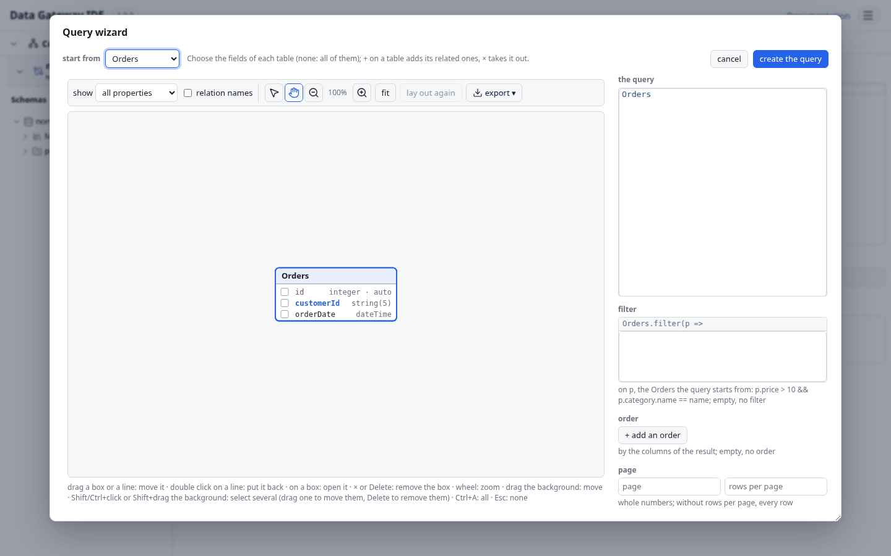
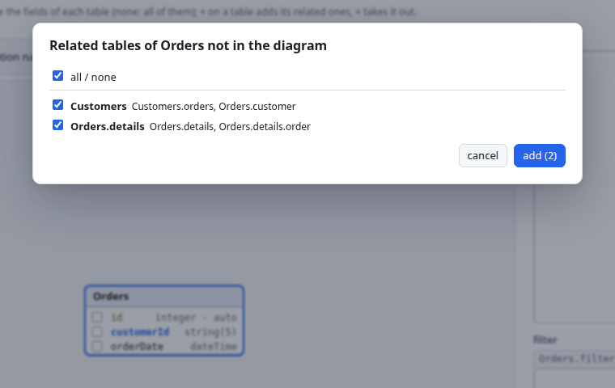
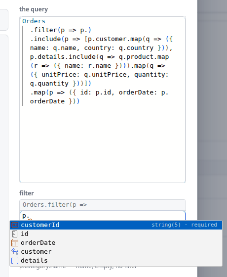
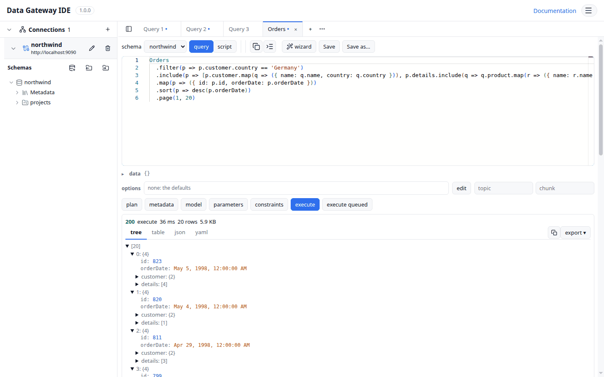
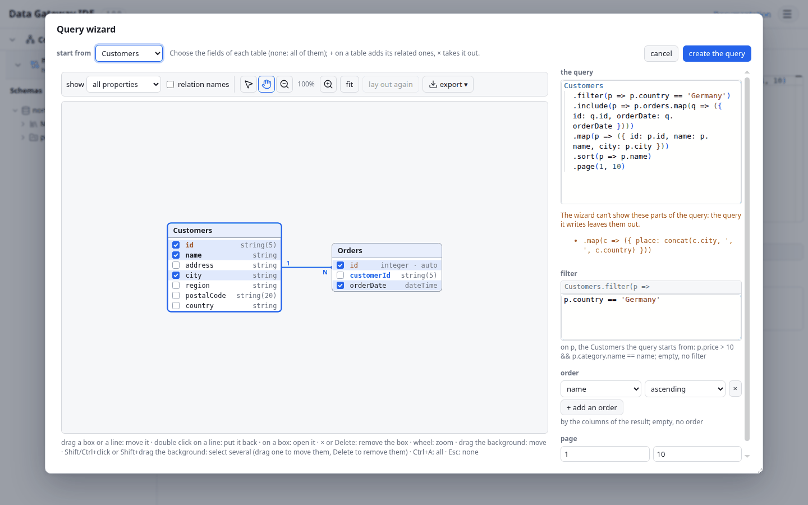

# Abfrage-Assistent

Der Abfrage-Assistent schreibt für dich eine [Abfrage](Queries.md) aus einem Diagramm: Du wählst die Tabellen, hakst
die Felder jeder einzelnen an und gibst einen Filter, eine Reihenfolge und eine Seite an. Er zeigt die Abfrage, wie sie
geschrieben wird, während du wählst, und legt sie in einen Abfrage-Tab, bereit zum Ausführen, Bearbeiten und Speichern.
Er schreibt nur die Abfragesprache von λORM: Was er schreibt, ist das, was du von Hand schreiben würdest, und die
[Abfragesprache](../queries/Query-Language.md) erklärt jeden Teil davon.

Er ist gedacht für:

- **das Lesen verwandter Daten**: eine Bestellung mit ihrem Kunden, ihren Positionen und dem Produkt jeder Position, in
  einer Abfrage;
- **das Lernen der Sprache**: die Abfrage ändert sich, während du ein Feld anhakst oder eine Tabelle hinzufügst;
- **den Beginn einer Abfrage**, die du dann von Hand fertigstellst (ein berechnetes Feld, ein `groupBy`…).


## Ihn öffnen {#opening-it}

Die Schaltfläche **Assistent** eines Abfrage-Tabs öffnet ihn auf dem Schema dieses Tabs. Er öffnet sich immer mit dem,
was der Tab enthält:

| Der Tab enthält | Der Assistent öffnet sich |
| --- | --- |
| nichts, oder eine Abfrage, die nicht von einer Entität ausgeht | auf der ersten Entität des Schemas |
| eine von Hand geschriebene Abfrage | **mit dem, was diese Abfrage liest**: ihre Tabellen, die Felder jeder einzelnen, der Filter, die Reihenfolge und die Seite ([unten](#a-query-written-by-hand)) |
| eine Abfrage, die der Assistent geschrieben hat | so, wie er verlassen wurde: dieselben Tabellen, Felder, Filter, Reihenfolge, Seite, und die Boxen, wo sie waren |
| eine Abfrage, die der Assistent geschrieben hat und die seitdem von Hand bearbeitet wurde | mit dem, was die Abfrage jetzt enthält (wie bei einer von Hand geschriebenen), die Boxen, wo sie waren |

Der Tab braucht ein Schema; der Assistent liest dessen Domäne vom Gateway.

## Die Teile des Assistenten {#the-parts-of-the-wizard}

| Teil | Wo | Was er tut |
| --- | --- | --- |
| **ausgehend von** | oben links | die Entität, von der die Abfrage ausgeht (die Wurzel): jede Zeile des Ergebnisses ist eine ihrer Zeilen |
| **abbrechen** / **Abfrage erstellen** | oben rechts | ihn ohne Änderungen schließen / die Abfrage schreiben (**Abfrage aktualisieren** bei einer Abfrage, die er geschrieben hat) |
| **das Diagramm** | links | die Tabellen der Abfrage, ein Häkchen an jedem Feld; **+** fügt verwandte Tabellen hinzu, **×** entfernt eine |
| **die Abfrage** | rechts, oben | die Abfrage, wie sie geschrieben wird, nur lesen, bei jeder Änderung aktualisiert |
| **Filter** | rechts | die Bedingung, die die Zeilen der Wurzel erfüllen müssen |
| **Reihenfolge** | rechts | die Spalten des Ergebnisses, nach denen die Zeilen sortiert werden |
| **Seite** | rechts | die Seite und die Zeilen pro Seite |

Leer gelassen werden Filter, Reihenfolge und Seite nicht angewendet: Ist nichts gewählt, ist die Abfrage nur der Name
der Entität und liest alle ihre Zeilen mit allen ihren Feldern.

## Schritt für Schritt {#step-by-step}

Ein Beispiel mit Northwind: die Bestellungen deutscher Kunden, mit Name und Land ihres Kunden, den Positionen jeder
Bestellung mit dem Namen ihres Produkts, die letzten zuerst, 20 pro Seite.

### 1. Die Entität, von der ausgegangen wird {#1-the-entity-to-start-from}

Wähle `Orders` in **ausgehend von**. Das Diagramm zeigt ihre Box mit allen ihren Feldern.



**ausgehend von** zu ändern startet den Assistenten von dieser Entität neu: Was gewählt war, wird geleert.

### 2. Die verwandten Tabellen: das + {#2-the-related-tables-the}

Das **+** einer Box (es erscheint, wenn der Mauszeiger über der Box ist) listet die mit ihr verwandten Tabellen, die
nicht im Diagramm sind, mit den Beziehungen, die sie verbinden. Hake `Customers` und `Orders.details` an, dann
**hinzufügen (2)**.



Dann fügt das **+** von `Orders.details` `Products` hinzu, das Produkt jeder Position.

**Wie eine Tabelle verbunden wird.** Jede hinzugefügte Tabelle wird über eine Beziehung einer Tabelle erreicht, die
schon im Assistenten ist: zuerst der Tabelle, deren **+** benutzt wurde, sonst einer beliebigen anderen. Jede Beziehung
wird zu einem eigenen **include**, ob sie eine Zeile liest (der `customer` einer Bestellung) oder viele (die `details`
einer Bestellung):

```ts
Orders.include(p => [p.customer, p.details.include(q => q.product)])
```

Das Ergebnis behält die Form der Domäne: Jede Bestellung hat ihren `customer` in sich und ihre `details`, jedes mit
seinem `product`. Nichts wird zu Spalten der Bestellung abgeflacht.

**Eine Tabelle, die nicht verbunden werden kann.** Das **+** listet auch die Tabellen, die auf diese zeigen (eine
Vererbung, eine nur auf der anderen Seite deklarierte Beziehung). Wenn keine Tabelle des Assistenten eine Beziehung zur
gewählten Tabelle hat, wird sie nicht hinzugefügt, und der Assistent sagt es: `Categories kann nicht verbunden werden:
keine Tabelle des Assistenten hat eine Beziehung zu ihr`. Füge zuerst die Tabelle hinzu, die diese Beziehung hat (hier
`Products`, dessen `category` `Categories` erreicht).

**Eine Tabelle entfernen.** Das **×** einer Box entfernt diese Tabelle, zusammen mit jeder Tabelle, die über sie
erreicht wird, und den gewählten Feldern dieser Tabellen. Die Entität, von der die Abfrage ausgeht, hat kein ×: Um von
einer anderen auszugehen, ändere **ausgehend von**. Mehrere Boxen können ausgewählt werden (Umschalt oder Strg und
Klick, oder Umschalt und den Hintergrund ziehen) und mit Entf auf einmal entfernt werden.

### 3. Die Felder: die Häkchen {#3-the-fields-the-checks}

Ein Klick auf ein Feld hakt es an (die ganze Zeile, nicht nur ihr Kästchen). Für jede Tabelle:

- **kein Feld angehakt**: jedes Feld dieser Tabelle (ihr include hat kein `map`, und die Wurzel hat kein `map`);
- **einige Felder angehakt**: nur diese, in der Reihenfolge der Domäne, nicht in der Reihenfolge, in der sie angehakt
  wurden.

Hake `id` und `orderDate` von `Orders` an, `name` und `country` von `Customers`, `quantity` und `unitPrice` der
Positionen und `name` von `Products`. Jede Tabelle bekommt ihr eigenes `map`:

```ts
Orders
	.include(p => [p.customer.map(q => ({ name: q.name, country: q.country })), p.details.include(q => q.product.map(r => ({ name: r.name }))).map(q => ({ unitPrice: q.unitPrice, quantity: q.quantity }))])
	.map(p => ({ id: p.id, orderDate: p.orderDate }))
```

λORM liest die Schlüssel, die jedes include verbinden, von selbst, auch wenn sie nicht angehakt sind: `customerId` muss
nicht im map von `Orders` sein, damit sein Kunde gelesen wird.

### 4. Der Filter {#4-the-filter}

Der Filter ist der Rumpf eines Lambdas auf `p`, der Entität, von der die Abfrage ausgeht: `Orders.filter(p => …)` wird
davor geschrieben. Er hat die Vorschläge des Abfrage-Editors: `p.` listet die Felder und Beziehungen von `Orders`,
`p.customer.` die von `Customers`, und nach einem Feld seine Funktionen (Strg+Leertaste öffnet sie überall).



Schreibe `p.customer.country == 'Germany'`. Der Filter liest die Wurzel und, über ihre Beziehungen zu einer, die
Tabellen, die sie erreichen (`p.customer.country`). Einige Beispiele:

| Filter | Die Zeilen |
| --- | --- |
| `p.customer.country == 'Germany'` | die Bestellungen deutscher Kunden |
| `p.orderDate.year() == 1997` | die Bestellungen von 1997 |
| `p.customer.country.in(['Germany', 'France'])` | die Bestellungen von Kunden zweier Länder |
| `p.customerId == customer` | die Bestellungen des Kunden, der in den Daten des Tabs angegeben ist (`{ "customer": "ALFKI" }`) |

Ein Name, der kein Feld ist (oben `customer`), ist ein Parameter: Sein Wert kommt in die **Daten** des Abfrage-Tabs. Der
Filter wird im Assistenten nicht geprüft: Der Abfrage-Tab markiert seine Fehler, sobald sie geschrieben ist.

### 5. Die Reihenfolge {#5-the-order}

**+ Reihenfolge hinzufügen** fügt eine Zeile hinzu: eine Spalte und **aufsteigend** oder **absteigend**. Die Spalten
sind die des Ergebnisses der Wurzel: die angehakten Felder der Entität, von der sie ausgeht, oder alle ihre Felder, wenn
keines angehakt ist. Jede Spalte kann einmal verwendet werden; die erste Zeile sortiert zuerst. Ein abgehaktes Feld
nimmt seine Reihenfolge mit.

Wähle `orderDate`, **absteigend**: `.sort(p => desc(p.orderDate))`. Zwei Zeilen ergeben eine Liste:
`.sort(p => [desc(p.orderDate), p.id])`.

### 6. Die Seite {#6-the-page}

**Seite** und **Zeilen pro Seite**, ganze Zahlen größer als 0. Ohne Zeilen pro Seite wird jede Zeile gelesen und die
Seite nicht angewendet; ohne Seite ist es die erste. `20` Zeilen pro Seite ergibt `.page(1, 20)`.

### 7. Die Abfrage erstellen {#7-create-the-query}

**Abfrage erstellen** öffnet einen neuen Abfrage-Tab, nach der Entität benannt, mit der Abfrage:

```ts
Orders
	.filter(p => p.customer.country == 'Germany')
	.include(p => [p.customer.map(q => ({ name: q.name, country: q.country })), p.details.include(q => q.product.map(r => ({ name: r.name }))).map(q => ({ unitPrice: q.unitPrice, quantity: q.quantity }))])
	.map(p => ({ id: p.id, orderDate: p.orderDate }))
	.sort(p => desc(p.orderDate))
	.page(1, 20)
```

**execute** (Strg+Enter) führt sie aus. Jede Bestellung kommt mit ihrem `customer` und ihren `details`:



```json
[
  {
    "id": 823,
    "orderDate": "1998-05-04T22:00:00.000Z",
    "customer": { "name": "Lehmanns Marktstand", "country": "Germany" },
    "details": [
      { "unitPrice": 18, "quantity": 40, "product": { "name": "Chai" } },
      { "unitPrice": 19, "quantity": 20, "product": { "name": "Chang" } }
    ]
  }
]
```

## Zu ihm zurückkehren {#going-back-to-it}

Der Tab behält den Assistenten mit der Abfrage. Die Schaltfläche **Assistent** öffnet ihn wieder so, wie er verlassen
wurde, die Boxen, wo sie waren, und **Abfrage aktualisieren** schreibt die Abfrage dieses Tabs neu (es wird kein neuer
Tab geöffnet; die Daten, die Optionen und das Skript des Tabs bleiben).

**Mit der Abfrage gespeichert.** **Speichern** bewahrt den Assistenten mit der [gespeicherten Abfrage](Projects.md)
auf: Wird sie später geöffnet, auch in einem anderen Browser, wenn sie im Workspace gespeichert ist, öffnet sich ihr
**Assistent** so, wie er verlassen wurde.

**Von Hand bearbeitet.** Eine Abfrage, die der Assistent geschrieben hat, kann von Hand geändert werden: Beim nächsten
Öffnen liest der Assistent die Abfrage, wie sie jetzt ist, und lässt die Boxen, wo sie waren. Was er nicht zeigen kann,
wird aufgelistet (unten), und das Aktualisieren der Abfrage lässt es weg: Kopiere es vorher, oder stelle die Abfrage von
Hand fertig.

## Eine von Hand geschriebene Abfrage {#a-query-written-by-hand}

Seit der IDE 1.0.1 liest der Assistent jede Abfrage des Tabs, soweit er sie zeigen kann (vorher öffnete er sich auf der
Entität, von der die Abfrage ausgeht, ohne etwas gewählt zu haben):

| Die Abfrage hat | Der Assistent |
| --- | --- |
| `Entity` an ihrem Anfang | geht von dieser Entität aus |
| `.filter(x => …)` | nimmt ihn als seinen Filter, auf `p`, egal wie ihre Variable heißt |
| `.include(x => …)` | fügt die Tabelle jeder Beziehung hinzu, mit den Feldern ihres `map` und ihren eigenen includes |
| `.map(x => ({ a: x.a, … }))` | hakt diese Felder an |
| `.sort(x => …)` mit `x.a`, `desc(x.a)`, `asc(x.a)`, `x.a.desc()` | fügt diese Reihenfolgen hinzu (nach Feldern des Ergebnisses) |
| `.page(n, size)` | übernimmt die Seite und die Zeilen pro Seite |

Was er nicht zeigen kann, wird unter **die Abfrage** in Orange aufgelistet und aus der Abfrage, die er schreibt,
weggelassen:

- ein in einem `map` berechnetes oder umbenanntes Feld: `place: concat(c.city, ', ', c.country)`, `total: sum(…)`;
- ein Feld einer Beziehung im map der Wurzel: `customerName: p.customer.name` (der Assistent liest es mit einem
  include);
- ein Filter, eine Reihenfolge oder eine Seite innerhalb eines include: `p.details.filter(…)`;
- eine Klausel, die er nicht schreibt: `groupBy`, `having`, `distinct`, `first`, `last`, ein `insert` oder `update`…;
- eine Beziehung, deren Entität schon über eine andere Beziehung im Assistenten ist.



Eine Abfrage, die nicht von einer Entität des Schemas ausgeht (leer, ein Skript, eine Entität eines anderen Schemas),
öffnet den Assistenten auf der ersten Entität, ohne sie zu lesen.

**Abfrage erstellen** öffnet für eine von Hand geschriebene Abfrage immer einen neuen Tab: Die Abfrage des Tabs bleibt,
wie sie war.

## Was der Assistent schreibt, und was nicht {#what-the-wizard-writes-and-what-it-doesnt}

Der Assistent schreibt Abfragen, die **lesen**: eine Wurzel, ihre includes, einen Filter, die Felder, die Reihenfolge
und die Seite. Für den Rest schreibe die Abfrage von Hand oder stelle die fertig, die er geschrieben hat:

| Du brauchst | Schreibe |
| --- | --- |
| ein berechnetes oder umbenanntes Feld | `.map(p => ({ id: p.id, year: p.orderDate.year() }))` |
| Summen nach einem Feld | `.map(p => ({ country: p.country, count: count(1) }))`, eine [Gruppierung](../queries/Grouping.md) |
| ein Feld einer Beziehung als Spalte der Wurzel | `.map(p => ({ id: p.id, customer: p.customer.name }))` |
| einen Filter eines include | `.include(p => p.details.filter(q => q.quantity > 10))` |
| die erste Zeile | `.first(p => p)` |
| zu schreiben | `insert`, `update`, `delete`…: siehe [Abfragen](../queries/Query-Language.md) |

## Sein Diagramm {#its-diagram}

Das Diagramm des Assistenten ist das von [Diagramme](Diagrams.md), mit den Häkchen der Felder:

- das Mausrad zoomt, das Ziehen des Hintergrunds verschiebt es, **einpassen** zeigt es ganz, **neu anordnen** setzt die
  Boxen zurück;
- eine Box oder eine Linie wird gezogen, um sie zu platzieren, und der Platz wird mit dem Assistenten aufbewahrt;
- **Beziehungsnamen** zeigt den Namen jeder Beziehung auf ihrer Linie;
- **exportieren** speichert das Diagramm als PDF, PNG oder SVG.

## Tastatur {#keyboard}

| Taste | Wo | Tut |
| --- | --- | --- |
| Strg+Leertaste | Filter | öffnet die Vorschläge |
| Escape | Filter, mit offenen Vorschlägen | schließt die Vorschläge (nicht den Assistenten) |
| Escape | überall sonst | schließt den Assistenten ohne Änderungen |
| Entf | Diagramm, Boxen ausgewählt | entfernt sie |
| Strg+A / Esc | Diagramm | wählt jede Box aus / keine |
