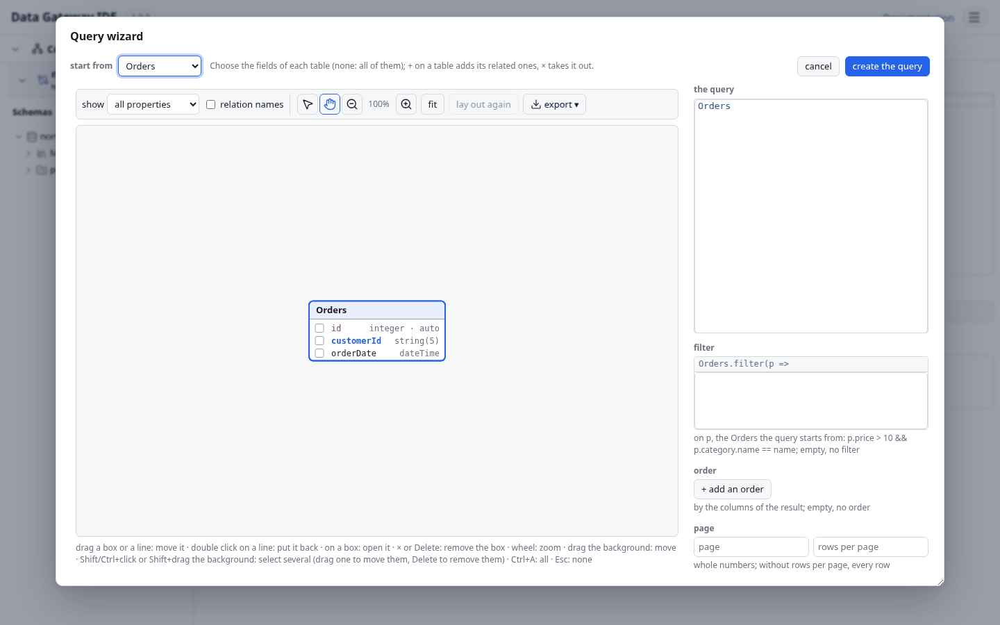
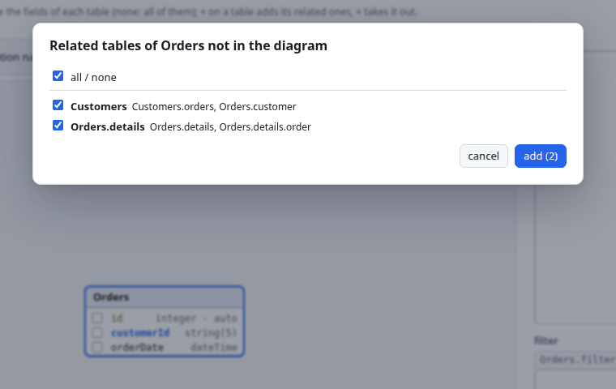
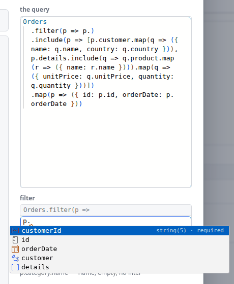
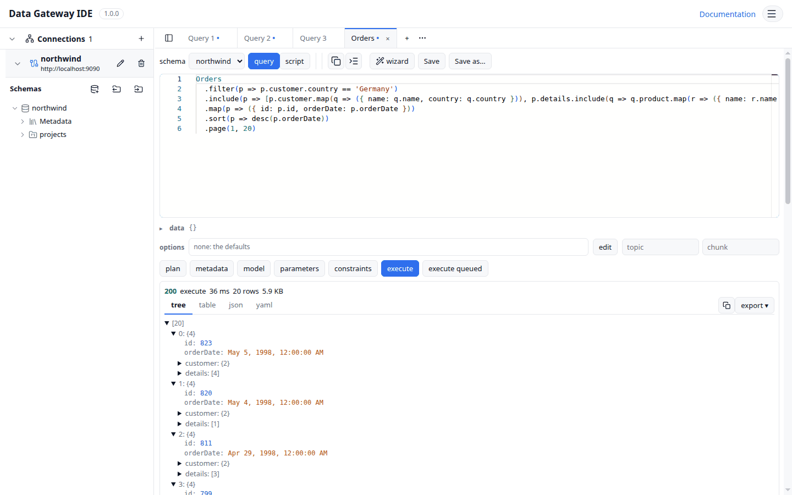
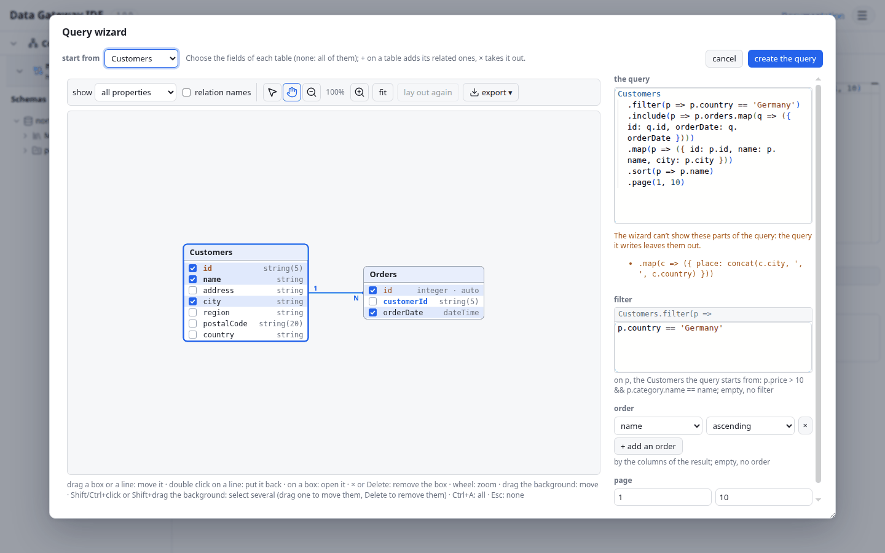

# Asistente de consultas {#query-wizard}

El asistente de consultas escribe una [consulta](Queries.md) por ti a partir de un diagrama: eliges las tablas, marcas
los campos de cada una, y das un filtro, un orden y una página. Muestra la consulta tal como se escribe mientras eliges,
y la pone en una pestaña de consulta, lista para ejecutar, editar y guardar. Escribe solo el lenguaje de consultas de
λORM: lo que escribe es lo que escribirías a mano, y el [Lenguaje de consultas](../queries/Query-Language.md) explica
cada parte.

Sirve para:

- **leer datos relacionados**: un pedido con su cliente, sus líneas y el producto de cada línea, en una consulta;
- **aprender el lenguaje**: la consulta cambia a medida que marcas un campo o agregas una tabla;
- **empezar una consulta** que después terminas a mano (un campo calculado, un `groupBy`…).


## Abrirlo {#opening-it}

El botón **asistente** de una pestaña de consulta lo abre sobre el esquema de esa pestaña. Siempre se abre con lo que
tiene la pestaña:

| La pestaña tiene | El asistente se abre |
| --- | --- |
| nada, o una consulta que no parte de una entidad | en la primera entidad del esquema |
| una consulta escrita a mano | **con lo que lee esa consulta**: sus tablas, los campos de cada una, el filtro, el orden y la página ([abajo](#a-query-written-by-hand)) |
| una consulta que escribió el asistente | como quedó: las mismas tablas, campos, filtro, orden, página, y las cajas donde estaban |
| una consulta que escribió el asistente, editada a mano después | con lo que tiene ahora la consulta (como una escrita a mano), las cajas donde estaban |

La pestaña necesita un esquema; el asistente lee su dominio del gateway.

## Las partes del asistente {#the-parts-of-the-wizard}

| Parte | Dónde | Qué hace |
| --- | --- | --- |
| **partir de** | arriba a la izquierda | la entidad de la que parte la consulta (la raíz): cada fila del resultado es una de sus filas |
| **cancelar** / **crear la consulta** | arriba a la derecha | cerrarlo sin cambios / escribir la consulta (**actualizar la consulta** en una consulta que escribió él) |
| **el diagrama** | a la izquierda | las tablas de la consulta, una casilla en cada campo; **+** agrega tablas relacionadas, **×** saca una |
| **la consulta** | a la derecha, arriba | la consulta tal como se escribe, solo lectura, actualizada con cada cambio |
| **filtro** | a la derecha | la condición que deben cumplir las filas de la raíz |
| **orden** | a la derecha | las columnas del resultado por las que se ordenan las filas |
| **página** | a la derecha | la página y las filas por página |

Vacíos, el filtro, el orden y la página no se aplican: sin nada elegido, la consulta es solo el nombre de la entidad, y
lee todas sus filas con todos sus campos.

## Paso a paso {#step-by-step}

Un ejemplo sobre Northwind: los pedidos de clientes alemanes, con el nombre y el país de su cliente, las líneas de cada
pedido con el nombre de su producto, los últimos primero, 20 por página.

### 1. La entidad de la que partir {#1-the-entity-to-start-from}

Elige `Orders` en **partir de**. El diagrama muestra su caja con todos sus campos.



Cambiar **partir de** vuelve a empezar el asistente desde esa entidad: lo elegido se borra.

### 2. Las tablas relacionadas: el + {#2-the-related-tables-the}

El **+** de una caja (se muestra cuando el puntero está sobre la caja) lista las tablas relacionadas con ella que no
están en el diagrama, con las relaciones que las unen. Marca `Customers` y `Orders.details`, luego **agregar (2)**.



Luego el **+** de `Orders.details` agrega `Products`, el producto de cada línea.

**Cómo se une una tabla.** Cada tabla agregada se alcanza a través de una relación de una tabla que ya está en el
asistente: primero de la tabla cuyo **+** se usó, si no de cualquier otra. Cada relación se convierte en un **include**
propio, tanto si lee una fila (el `customer` de un pedido) como muchas (los `details` de un pedido):

```ts
Orders.include(p => [p.customer, p.details.include(q => q.product)])
```

El resultado mantiene la forma del dominio: cada pedido tiene su `customer` dentro, y sus `details`, cada uno con su
`product`. Nada se aplana en columnas del pedido.

**Una tabla que no se puede unir.** El **+** también lista las tablas que apuntan a esta (una herencia, una relación
declarada solo del otro lado). Cuando ninguna tabla del asistente tiene una relación con la tabla elegida, no se
agrega, y el asistente lo dice: `Categories no se puede unir: ninguna tabla del asistente tiene una relación con ella`.
Agrega primero la tabla que tiene esa relación (aquí, `Products`, cuyo `category` llega a `Categories`).

**Sacar una tabla.** La **×** de una caja saca esa tabla, junto con cada tabla alcanzada a través de ella y los campos
elegidos de ellas. La entidad de la que parte la consulta no tiene ×: para partir de otra, cambia **partir de**. Se
pueden seleccionar varias cajas (Shift o Ctrl y clic, o Shift y arrastrar el fondo) y sacarlas a la vez con Supr.

### 3. Los campos: las casillas {#3-the-fields-the-checks}

Un clic en un campo lo marca (toda la fila, no solo su casilla). Para cada tabla:

- **ningún campo marcado**: todos los campos de esa tabla (su include no tiene `map`, y la raíz no tiene `map`);
- **algunos campos marcados**: solo esos, en el orden del dominio, no en el orden en que se marcaron.

Marca `id` y `orderDate` de `Orders`, `name` y `country` de `Customers`, `quantity` y `unitPrice` de las líneas, y
`name` de `Products`. Cada tabla recibe su propio `map`:

```ts
Orders
	.include(p => [p.customer.map(q => ({ name: q.name, country: q.country })), p.details.include(q => q.product.map(r => ({ name: r.name }))).map(q => ({ unitPrice: q.unitPrice, quantity: q.quantity }))])
	.map(p => ({ id: p.id, orderDate: p.orderDate }))
```

λORM lee por sí solo las claves que unen cada include, aunque no estén marcadas: `customerId` no necesita estar en el
map de `Orders` para que se lea su cliente.

### 4. El filtro {#4-the-filter}

El filtro es el cuerpo de una lambda sobre `p`, la entidad de la que parte la consulta: `Orders.filter(p => …)` se
escribe antes. Tiene las sugerencias del editor de consultas: `p.` lista los campos y relaciones de `Orders`,
`p.customer.` los de `Customers`, y después de un campo, sus funciones (Ctrl+Espacio las abre en cualquier lugar).



Escribe `p.customer.country == 'Germany'`. El filtro lee la raíz, y a través de sus relaciones a una, las tablas a las
que llegan (`p.customer.country`). Algunos ejemplos:

| Filtro | Las filas |
| --- | --- |
| `p.customer.country == 'Germany'` | los pedidos de clientes alemanes |
| `p.orderDate.year() == 1997` | los pedidos de 1997 |
| `p.customer.country.in(['Germany', 'France'])` | los pedidos de clientes de dos países |
| `p.customerId == customer` | los pedidos del cliente dado en los datos de la pestaña (`{ "customer": "ALFKI" }`) |

Un nombre que no es un campo (`customer` arriba) es un parámetro: su valor va en los **datos** de la pestaña de
consulta. El filtro no se verifica dentro del asistente: la pestaña de consulta marca sus errores una vez escrita.

### 5. El orden {#5-the-order}

**+ agregar un orden** agrega una fila: una columna y **ascendente** o **descendente**. Las columnas son las del
resultado de la raíz: los campos marcados de la entidad de la que parte, o todos sus campos cuando no hay ninguno
marcado. Cada columna se puede usar una vez; la primera fila ordena primero. Un campo desmarcado se lleva su orden.

Elige `orderDate`, **descendente**: `.sort(p => desc(p.orderDate))`. Dos filas dan una lista:
`.sort(p => [desc(p.orderDate), p.id])`.

### 6. La página {#6-the-page}

**página** y **filas por página**, enteros mayores que 0. Sin filas por página, se leen todas las filas y la página no
se aplica; sin página, es la primera. `20` filas por página da `.page(1, 20)`.

### 7. Crear la consulta {#7-create-the-query}

**crear la consulta** abre una pestaña de consulta nueva, con el nombre de la entidad, con la consulta:

```ts
Orders
	.filter(p => p.customer.country == 'Germany')
	.include(p => [p.customer.map(q => ({ name: q.name, country: q.country })), p.details.include(q => q.product.map(r => ({ name: r.name }))).map(q => ({ unitPrice: q.unitPrice, quantity: q.quantity }))])
	.map(p => ({ id: p.id, orderDate: p.orderDate }))
	.sort(p => desc(p.orderDate))
	.page(1, 20)
```

**execute** (Ctrl+Enter) la ejecuta. Cada pedido viene con su `customer` y sus `details`:



```json
[
  {
    "id": 823,
    "orderDate": "1998-05-04T22:00:00.000Z",
    "customer": { "name": "Lehmanns Marktstand", "country": "Germany" },
    "details": [
      { "unitPrice": 18, "quantity": 40, "product": { "name": "Chai" } },
      { "unitPrice": 19, "quantity": 20, "product": { "name": "Chang" } }
    ]
  }
]
```

## Volver a él {#going-back-to-it}

La pestaña conserva el asistente con la consulta. El botón **asistente** lo vuelve a abrir como quedó, las cajas donde
estaban, y **actualizar la consulta** reescribe la consulta de esa pestaña (no se abre una pestaña nueva; los datos, las
opciones y el script de la pestaña se mantienen).

**Guardado con la consulta.** **Guardar** conserva el asistente con la [consulta guardada](Projects.md): al abrirla más
tarde, incluso en otro navegador cuando se guarda en el workspace, su **asistente** se abre como quedó.

**Editada a mano.** Una consulta que escribió el asistente se puede cambiar a mano: la próxima vez que se abre el
asistente, lee la consulta como está ahora, manteniendo las cajas donde estaban. Lo que no puede mostrar se lista
(abajo), y actualizar la consulta lo deja afuera: cópialo antes, o termina la consulta a mano.

## Una consulta escrita a mano {#a-query-written-by-hand}

Desde el IDE 1.0.1, el asistente lee cualquier consulta de la pestaña, hasta donde puede mostrarla (antes, se abría en
la entidad de la que parte la consulta, sin nada elegido):

| La consulta tiene | El asistente |
| --- | --- |
| `Entity` al principio | parte de esa entidad |
| `.filter(x => …)` | lo toma como su filtro, sobre `p` sea cual sea el nombre de su variable |
| `.include(x => …)` | agrega la tabla de cada relación, con los campos de su `map` y sus propios includes |
| `.map(x => ({ a: x.a, … }))` | marca esos campos |
| `.sort(x => …)` con `x.a`, `desc(x.a)`, `asc(x.a)`, `x.a.desc()` | agrega esos órdenes (por campos del resultado) |
| `.page(n, size)` | toma la página y las filas por página |

Lo que no puede mostrar se lista debajo de **la consulta**, en naranja, y queda afuera de la consulta que escribe:

- un campo calculado o renombrado en un `map`: `place: concat(c.city, ', ', c.country)`, `total: sum(…)`;
- un campo de una relación en el map de la raíz: `customerName: p.customer.name` (el asistente lo lee con un include);
- un filtro, orden o página dentro de un include: `p.details.filter(…)`;
- una cláusula que no escribe: `groupBy`, `having`, `distinct`, `first`, `last`, un `insert` o `update`…;
- una relación cuya entidad ya está en el asistente, a través de otra relación.



Una consulta que no parte de una entidad del esquema (vacía, un script, una entidad de otro esquema) abre el asistente
en la primera entidad, sin leerla.

**crear la consulta** siempre abre una pestaña nueva para una consulta escrita a mano: la consulta de la pestaña queda
como estaba.

## Lo que el asistente escribe, y lo que no {#what-the-wizard-writes-and-what-it-doesnt}

El asistente escribe consultas que **leen**: una raíz, sus includes, un filtro, los campos, el orden y la página. Para
el resto, escribe la consulta a mano o termina la que escribió:

| Necesitas | Escribe |
| --- | --- |
| un campo calculado o renombrado | `.map(p => ({ id: p.id, year: p.orderDate.year() }))` |
| totales por un campo | `.map(p => ({ country: p.country, count: count(1) }))`, una [agrupación](../queries/Grouping.md) |
| un campo de una relación como columna de la raíz | `.map(p => ({ id: p.id, customer: p.customer.name }))` |
| un filtro de un include | `.include(p => p.details.filter(q => q.quantity > 10))` |
| la primera fila | `.first(p => p)` |
| escribir | `insert`, `update`, `delete`…: ver [Consultas](../queries/Query-Language.md) |

## Su diagrama {#its-diagram}

El diagrama del asistente es el de [Diagramas](Diagrams.md), con las casillas de los campos:

- la rueda hace zoom, arrastrar el fondo lo mueve, **ajustar** lo muestra entero, **acomodar de nuevo** vuelve a
  acomodar las cajas;
- una caja o una línea se arrastra para ubicarla, y el lugar se conserva con el asistente;
- **nombres de relaciones** muestra el nombre de cada relación en su línea;
- **exportar** guarda el diagrama como PDF, PNG o SVG.

## Teclado {#keyboard}

| Tecla | Dónde | Hace |
| --- | --- | --- |
| Ctrl+Espacio | filtro | abre las sugerencias |
| Escape | filtro, con sus sugerencias abiertas | cierra las sugerencias (no el asistente) |
| Escape | en cualquier otro lugar | cierra el asistente sin cambios |
| Supr | diagrama, cajas seleccionadas | las saca |
| Ctrl+A / Esc | diagrama | selecciona todas las cajas / ninguna |
