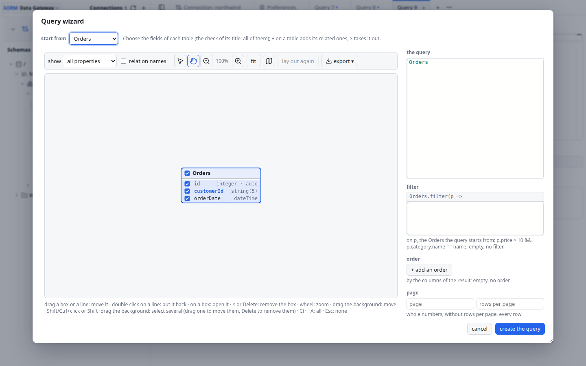
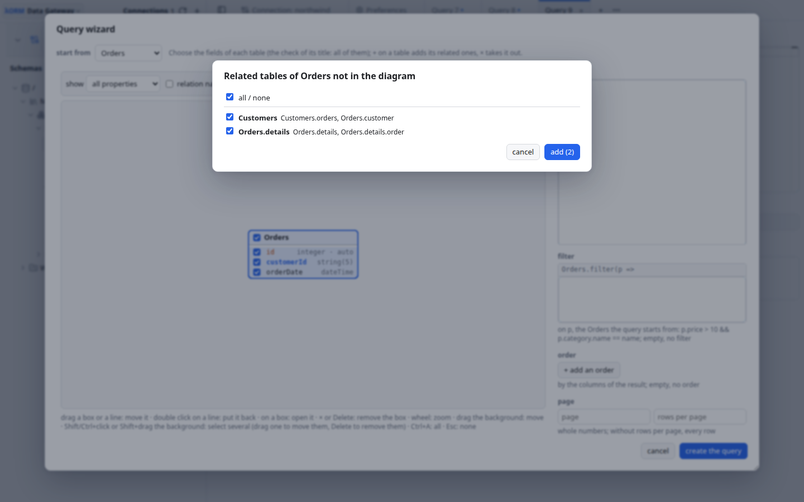
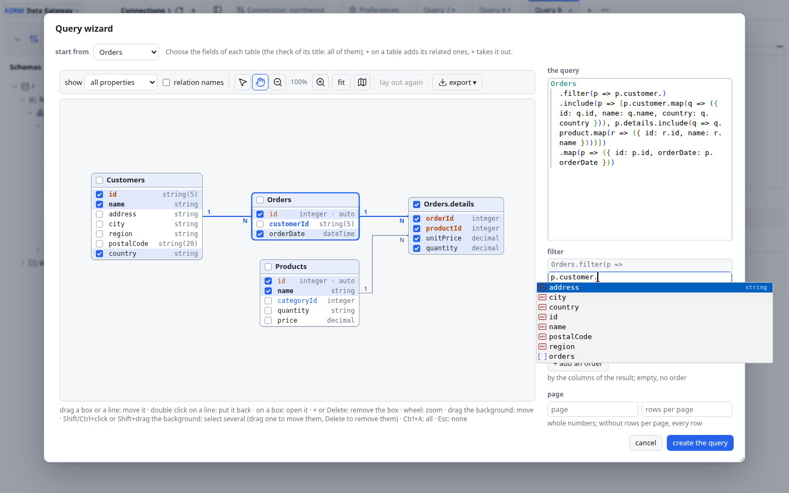
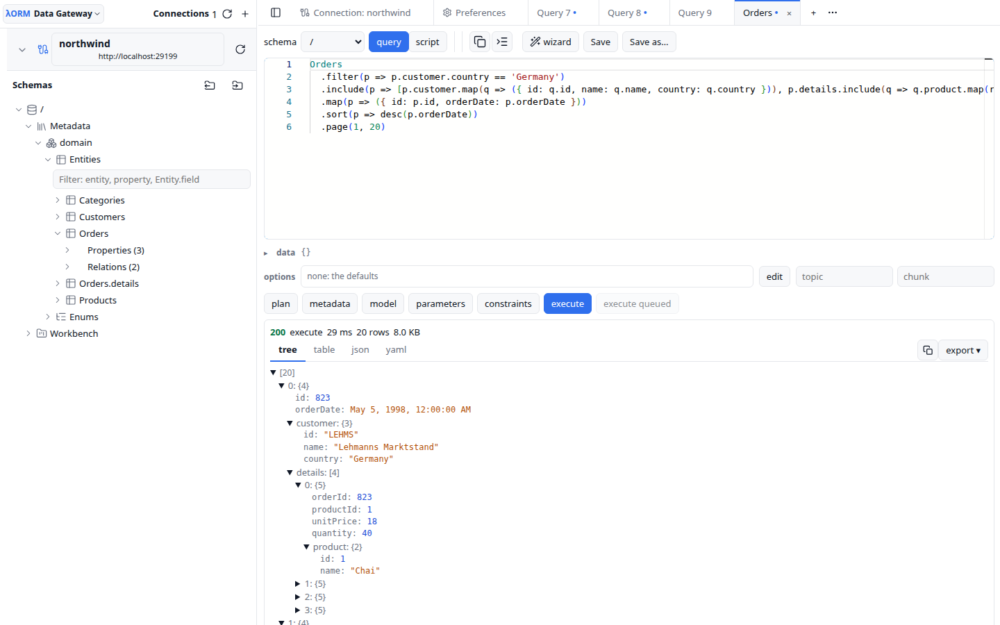
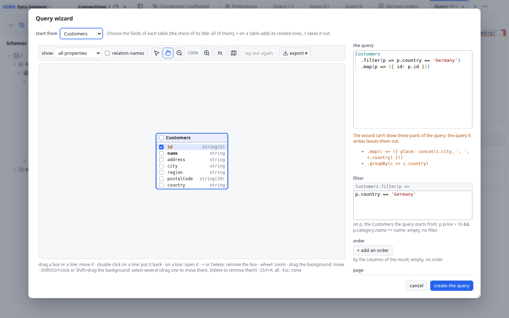

# Query wizard

The query wizard writes a [query](Queries.md) for you from a diagram: you choose the tables, tick the fields of each
one, and give a filter, an order and a page. It shows the query as it is written while you choose, and puts it in a
query tab, ready to run, edit and save. It writes only λORM's query language: what it writes is what you would write
by hand, and the [Query Language](../queries/Query-Language.md) explains every part of it.

It is meant for:

- **reading related data**: an order with its customer, its lines and the product of each line, in one query;
- **learning the language**: the query changes as you tick a field or add a table;
- **starting a query** that you then finish by hand (a computed field, a `groupBy`…).


## Opening it

The **wizard** button of a query tab opens it on the schema of that tab. It always opens on what the tab has:

| The tab has | The wizard opens |
| --- | --- |
| nothing, or a query that doesn't start from an entity | on the first entity of the schema |
| a query written by hand | **with what that query reads**: its tables, the fields of each one, the filter, the order and the page ([below](#a-query-written-by-hand)) |
| a query the wizard wrote | as it was left: the same tables, fields, filter, order, page, and the boxes where they were |
| a query the wizard wrote, edited by hand since | with what the query has now (as for one written by hand), the boxes where they were |

The tab needs a schema; the wizard reads its domain from the gateway.

## The parts of the wizard

| Part | Where | What it does |
| --- | --- | --- |
| **start from** | top left | the entity the query starts from (the root): every row of the result is one of its rows |
| **the diagram** | left | the tables of the query, a check on each field and one in the title of each table; **+** adds related tables, **×** takes one out |
| **the query** | right, at the top | the query as it is written, read only, updated with every change |
| **filter** | right | the condition the rows of the root must meet |
| **order** | right | the columns of the result the rows are sorted by |
| **page** | right | the page and the rows per page |
| **cancel** / **create the query** | bottom right | close it without changes / write the query (**update the query** on a query it wrote) |

Left empty, the filter, the order and the page are not applied: with nothing chosen, the query is only the name of the
entity, and reads all its rows with all their fields.

## Step by step

An example on Northwind: the orders of German customers, with the name and country of their customer, the lines of each
order with the name of their product, the last ones first, 20 per page.

### 1. The entity to start from

Choose `Orders` in **start from**. The diagram shows its box with all its fields.



Changing **start from** starts the wizard again from that entity: what was chosen is cleared.

### 2. The related tables: the +

The **+** of a box (it shows when the pointer is over the box) lists the tables related to it that are not in the
diagram, with the relations that join them. Tick `Customers` and `Orders.details`, then **add (2)**.



Then the **+** of `Orders.details` adds `Products`, the product of each line.

**How a table joins.** Each table added is reached through a relation of a table already in the wizard: first of the
table whose **+** was used, else of any other. Each relation becomes an **include** of its own, whether it reads one row
(the `customer` of an order) or many (the `details` of an order):

```ts
Orders.include(p => [p.customer, p.details.include(q => q.product)])
```

The result keeps the shape of the domain: each order has its `customer` inside it, and its `details`, each one with its
`product`. Nothing is flattened into columns of the order.

**A table that can't join.** The **+** also lists the tables that point to this one (an inheritance, a relation
declared only on the other side). When no table of the wizard has a relation to the table chosen, it is not added, and
the wizard says so: `Categories can’t join: no table of the wizard has a relation to it`. Add first the table that has
that relation (here, `Products`, whose `category` reaches `Categories`).

**Taking a table out.** The **×** of a box takes that table out, together with every table reached through it and the
fields chosen of them. The entity the query starts from has no ×: to start from another one, change **start from**.
Several boxes can be selected (Shift or Ctrl and click, or Shift and drag the background) and taken out at once with
Delete.

### 3. The fields: the checks

A table comes with **every field ticked**: it reads all its fields, and its include has no `map` (nor the root). A
click on a field ticks or unticks it (the whole row, not only its box):

- **unticking a field** leaves the others: the table gets a `map` with the fields still ticked, in the order of the
  domain, not in the order they were ticked;
- **the check in the title** of the table unticks all of them but its primary key, to tick then only the fields you
  want; with some unticked, it ticks them all again;
- **all of them ticked again** is no `map` again. The last field ticked can't be unticked: a table reads at least one.

Untick the title of `Orders` (only `id` stays) and tick `orderDate`; untick the title of `Customers` and tick `name` and
`country`; untick the title of `Products` and tick `name`. Leave the lines with all their fields. Each table with fields
unticked gets its own `map`:

```ts
Orders
	.include(p => [p.customer.map(q => ({ id: q.id, name: q.name, country: q.country })), p.details.include(q => q.product.map(r => ({ id: r.id, name: r.name })))])
	.map(p => ({ id: p.id, orderDate: p.orderDate }))
```

λORM reads the keys that join each include by itself, even when they are not ticked: `customerId` doesn't need to be
in the map of `Orders` for its customer to be read.

### 4. The filter

The filter is the body of a lambda on `p`, the entity the query starts from: `Orders.filter(p => …)` is written
before it. It has the suggestions of the query editor: `p.` lists the fields and relations of `Orders`, `p.customer.`
those of `Customers`, and after a field, its functions (Ctrl+Space opens them anywhere).



Write `p.customer.country == 'Germany'`. The filter reads the root, and through its relations to one, the tables they
reach (`p.customer.country`). Some examples:

| Filter | The rows |
| --- | --- |
| `p.customer.country == 'Germany'` | the orders of German customers |
| `p.orderDate.year() == 1997` | the orders of 1997 |
| `p.customer.country.in(['Germany', 'France'])` | the orders of customers of two countries |
| `p.customerId == customer` | the orders of the customer given in the data of the tab (`{ "customer": "ALFKI" }`) |

A name that is not a field (`customer` above) is a parameter: its value goes in the **data** of the query tab. The
filter is not checked inside the wizard: the query tab marks its errors once it is written.

### 5. The order

**+ add an order** adds a row: a column and **ascending** or **descending**. The columns are those of the result of the
root: the fields ticked of the entity it starts from. Each column can be used once; the first row sorts first; × takes
a row out. A field unticked takes its order with it.

Choose `orderDate`, **descending**: `.sort(p => desc(p.orderDate))`. Two rows give a list:
`.sort(p => [desc(p.orderDate), p.id])`.

### 6. The page

**page** and **rows per page**, whole numbers greater than 0. Without rows per page, every row is read and the page is
not applied; without a page, it is the first one. `20` rows per page gives `.page(1, 20)`.

### 7. Create the query

**create the query** opens a new query tab, named after the entity, with the query:

```ts
Orders
	.filter(p => p.customer.country == 'Germany')
	.include(p => [p.customer.map(q => ({ id: q.id, name: q.name, country: q.country })), p.details.include(q => q.product.map(r => ({ id: r.id, name: r.name })))])
	.map(p => ({ id: p.id, orderDate: p.orderDate }))
	.sort(p => desc(p.orderDate))
	.page(1, 20)
```

**execute** (Ctrl+Enter) runs it. Each order comes with its `customer` and its `details`:



```json
[
  {
    "id": 823,
    "orderDate": "1998-05-04T22:00:00.000Z",
    "customer": { "id": "LEHMS", "name": "Lehmanns Marktstand", "country": "Germany" },
    "details": [
      { "orderId": 823, "productId": 1, "unitPrice": 18, "quantity": 40, "product": { "id": 1, "name": "Chai" } },
      { "orderId": 823, "productId": 2, "unitPrice": 19, "quantity": 20, "product": { "id": 2, "name": "Chang" } }
    ]
  }
]
```

## Going back to it

The tab keeps the wizard with the query. The **wizard** button opens it again as it was left, the boxes where they
were, and **update the query** rewrites the query of that tab (a new tab is not opened; the data, the options and the
script of the tab stay).

**Saved with the query.** **Save** keeps the wizard with the [saved query](Projects.md): opening it later, even in
another browser when it is saved in the workspace, its **wizard** opens as it was left.

**Edited by hand.** A query the wizard wrote can be changed by hand: the next time the wizard opens, it reads the query
as it is now, keeping the boxes where they were. What it can't show is listed (below), and updating the query leaves
it out: copy it before, or finish the query by hand.

## A query written by hand

The wizard reads any query of the tab, as far as it can show it:

| The query has | The wizard |
| --- | --- |
| `Entity` at its start | starts from that entity |
| `.filter(x => …)` | takes it as its filter, on `p` whatever the name of its variable |
| `.include(x => …)` | adds the table of each relation, with the fields of its `map` and its own includes |
| `.map(x => ({ a: x.a, … }))` | ticks those fields (a map with every field of the table is the same as none) |
| `.sort(x => …)` with `x.a`, `desc(x.a)`, `asc(x.a)`, `x.a.desc()` | adds those orders (by fields of the result) |
| `.page(n, size)` | takes the page and the rows per page |

What it can't show is listed under **the query**, in orange, and left out of the query it writes:

- a field computed or renamed in a `map`: `place: concat(c.city, ', ', c.country)`, `total: sum(…)`;
- a field of a relation in the map of the root: `customerName: p.customer.name` (the wizard reads it with an include);
- a filter, order or page inside an include: `p.details.filter(…)`;
- a clause it doesn't write: `groupBy`, `having`, `distinct`, `first`, `last`, an `insert` or `update`…;
- a relation whose entity is already in the wizard, through another relation.



A query that doesn't start from an entity of the schema (empty, a script, an entity of another schema) opens the wizard
on the first entity, without reading it.

**create the query** always opens a new tab for a query written by hand: the query of the tab stays as it was.

## What the wizard writes, and what it doesn't

The wizard writes queries that **read**: a root, its includes, a filter, the fields, the order and the page. For the
rest, write the query by hand or finish the one it wrote:

| You need | Write |
| --- | --- |
| a field computed or renamed | `.map(p => ({ id: p.id, year: p.orderDate.year() }))` |
| totals by a field | `.map(p => ({ country: p.country, count: count(1) }))`, a [grouping](../queries/Grouping.md) |
| a field of a relation as a column of the root | `.map(p => ({ id: p.id, customer: p.customer.name }))` |
| a filter of an include | `.include(p => p.details.filter(q => q.quantity > 10))` |
| the first row | `.first(p => p)` |
| to write | `insert`, `update`, `delete`…: see [Queries](../queries/Query-Language.md) |

## Its diagram

The diagram of the wizard is that of [Diagrams](Diagrams.md), with the checks of the fields:

- the wheel zooms, dragging the background moves it, **fit** shows it all, the outline shows where you are,
  **lay out again** puts the boxes back;
- a box or a line is dragged to place it, and the place is kept with the wizard;
- **relation names** shows the name of each relation on its line;
- **export** saves the diagram as PDF, PNG or SVG.

## Keyboard

| Key | Where | Does |
| --- | --- | --- |
| Ctrl+Space | filter | opens the suggestions |
| Escape | filter, with its suggestions open | closes the suggestions (not the wizard) |
| Escape | anywhere else | closes the wizard without changes |
| Delete | diagram, boxes selected | takes them out |
| Ctrl+A / Esc | diagram | selects every box / none |
