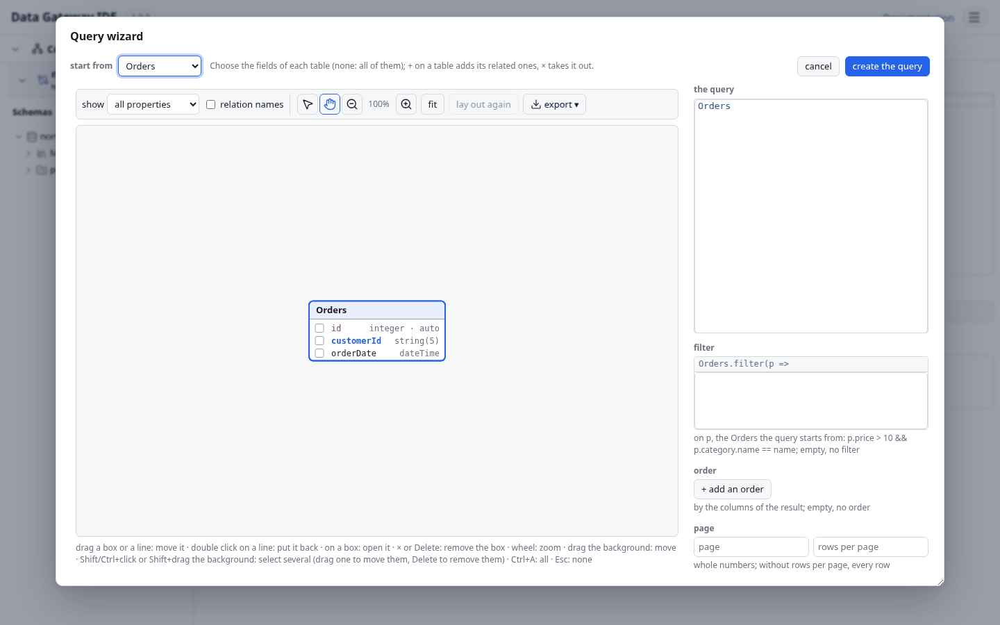
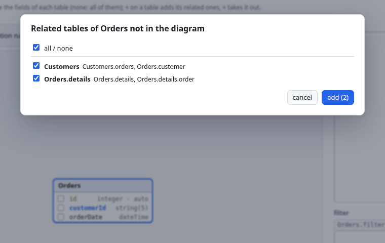
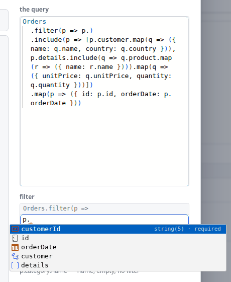
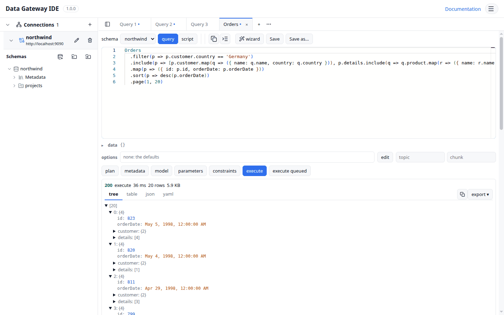
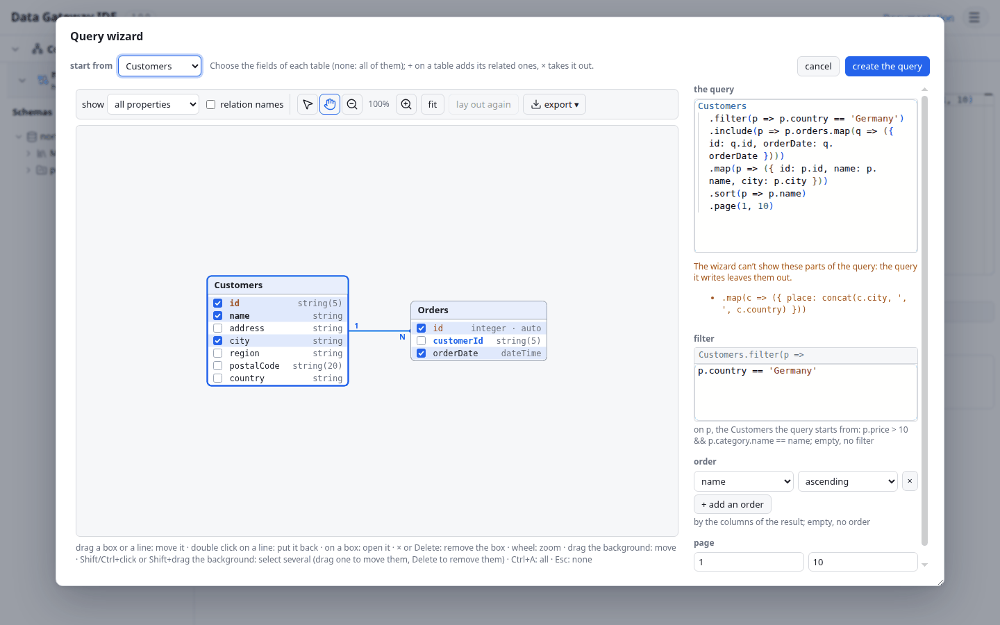

# Assistente de consultas {#query-wizard}

O assistente de consultas escreve uma [consulta](Queries.md) para você a partir de um diagrama: você escolhe as tabelas,
marca os campos de cada uma, e dá um filtro, uma ordem e uma página. Ele mostra a consulta enquanto ela é escrita,
conforme você escolhe, e a coloca em uma aba de consulta, pronta para executar, editar e salvar. Ele escreve apenas a
linguagem de consultas do λORM: o que ele escreve é o que você escreveria à mão, e a
[Linguagem de consultas](../queries/Query-Language.md) explica cada parte dela.

Ele serve para:

- **ler dados relacionados**: um pedido com o seu cliente, as suas linhas e o produto de cada linha, em uma consulta;
- **aprender a linguagem**: a consulta muda conforme você marca um campo ou adiciona uma tabela;
- **começar uma consulta** que você depois termina à mão (um campo calculado, um `groupBy`…).


## Abri-lo {#opening-it}

O botão **assistente** de uma aba de consulta o abre no esquema dessa aba. Ele sempre abre com o que a aba tem:

| A aba tem | O assistente abre |
| --- | --- |
| nada, ou uma consulta que não parte de uma entidade | na primeira entidade do esquema |
| uma consulta escrita à mão | **com o que essa consulta lê**: suas tabelas, os campos de cada uma, o filtro, a ordem e a página ([abaixo](#a-query-written-by-hand)) |
| uma consulta que o assistente escreveu | como foi deixado: as mesmas tabelas, campos, filtro, ordem, página, e as caixas onde estavam |
| uma consulta que o assistente escreveu, editada à mão desde então | com o que a consulta tem agora (como para uma escrita à mão), as caixas onde estavam |

A aba precisa de um esquema; o assistente lê o seu domínio no gateway.

## As partes do assistente {#the-parts-of-the-wizard}

| Parte | Onde | O que faz |
| --- | --- | --- |
| **partir de** | em cima, à esquerda | a entidade de onde a consulta parte (a raiz): cada linha do resultado é uma das suas linhas |
| **cancelar** / **criar a consulta** | em cima, à direita | fechá-lo sem alterações / escrever a consulta (**atualizar a consulta** em uma consulta que ele escreveu) |
| **o diagrama** | à esquerda | as tabelas da consulta, uma marca em cada campo; **+** adiciona tabelas relacionadas, **×** tira uma |
| **a consulta** | à direita, em cima | a consulta como está escrita, somente leitura, atualizada a cada alteração |
| **filtro** | à direita | a condição que as linhas da raiz devem cumprir |
| **ordem** | à direita | as colunas do resultado pelas quais as linhas são ordenadas |
| **página** | à direita | a página e as linhas por página |

Deixados vazios, o filtro, a ordem e a página não se aplicam: sem nada escolhido, a consulta é só o nome da entidade,
e lê todas as suas linhas com todos os seus campos.

## Passo a passo {#step-by-step}

Um exemplo no Northwind: os pedidos de clientes alemães, com o nome e o país do seu cliente, as linhas de cada pedido
com o nome do seu produto, os últimos primeiro, 20 por página.

### 1. A entidade de onde partir {#1-the-entity-to-start-from}

Escolha `Orders` em **partir de**. O diagrama mostra a sua caixa com todos os seus campos.



Mudar **partir de** recomeça o assistente a partir dessa entidade: o que foi escolhido é limpo.

### 2. As tabelas relacionadas: o + {#2-the-related-tables-the}

O **+** de uma caixa (aparece quando o ponteiro está sobre a caixa) lista as tabelas relacionadas a ela que não estão
no diagrama, com as relações que as unem. Marque `Customers` e `Orders.details`, depois **adicionar (2)**.



Depois o **+** de `Orders.details` adiciona `Products`, o produto de cada linha.

**Como uma tabela se une.** Cada tabela adicionada é alcançada por uma relação de uma tabela que já está no assistente:
primeiro da tabela cujo **+** foi usado, senão de qualquer outra. Cada relação vira um **include** próprio, quer leia
uma linha (o `customer` de um pedido) ou muitas (os `details` de um pedido):

```ts
Orders.include(p => [p.customer, p.details.include(q => q.product)])
```

O resultado mantém a forma do domínio: cada pedido tem o seu `customer` dentro dele, e os seus `details`, cada um com o
seu `product`. Nada é achatado em colunas do pedido.

**Uma tabela que não pode se unir.** O **+** também lista as tabelas que apontam para esta (uma herança, uma relação
declarada só do outro lado). Quando nenhuma tabela do assistente tem uma relação com a tabela escolhida, ela não é
adicionada, e o assistente o diz: `Categories não pode ser unida: nenhuma tabela do assistente tem uma relação com
ela`. Adicione antes a tabela que tem essa relação (aqui, `Products`, cuja `category` alcança `Categories`).

**Tirar uma tabela.** O **×** de uma caixa tira essa tabela, junto com cada tabela alcançada por meio dela e os campos
escolhidos delas. A entidade de onde a consulta parte não tem ×: para partir de outra, mude **partir de**. Várias
caixas podem ser selecionadas (Shift ou Ctrl e clique, ou Shift e arrastar o fundo) e tiradas de uma vez com Delete.

### 3. Os campos: as marcas {#3-the-fields-the-checks}

Um clique em um campo o marca (a linha inteira, não só a sua caixinha). Para cada tabela:

- **nenhum campo marcado**: todos os campos dessa tabela (o seu include não tem `map`, e a raiz não tem `map`);
- **alguns campos marcados**: só esses, na ordem do domínio, não na ordem em que foram marcados.

Marque `id` e `orderDate` de `Orders`, `name` e `country` de `Customers`, `quantity` e `unitPrice` das linhas,
e `name` de `Products`. Cada tabela recebe o seu próprio `map`:

```ts
Orders
	.include(p => [p.customer.map(q => ({ name: q.name, country: q.country })), p.details.include(q => q.product.map(r => ({ name: r.name }))).map(q => ({ unitPrice: q.unitPrice, quantity: q.quantity }))])
	.map(p => ({ id: p.id, orderDate: p.orderDate }))
```

O λORM lê sozinho as chaves que unem cada include, mesmo quando não estão marcadas: `customerId` não precisa estar no
map de `Orders` para que o seu cliente seja lido.

### 4. O filtro {#4-the-filter}

O filtro é o corpo de uma lambda sobre `p`, a entidade de onde a consulta parte: `Orders.filter(p => …)` é escrito
antes dele. Ele tem as sugestões do editor de consultas: `p.` lista os campos e as relações de `Orders`, `p.customer.`
os de `Customers`, e depois de um campo, as suas funções (Ctrl+Espaço as abre em qualquer lugar).



Escreva `p.customer.country == 'Germany'`. O filtro lê a raiz e, por meio das suas relações para uma, as tabelas que
elas alcançam (`p.customer.country`). Alguns exemplos:

| Filtro | As linhas |
| --- | --- |
| `p.customer.country == 'Germany'` | os pedidos de clientes alemães |
| `p.orderDate.year() == 1997` | os pedidos de 1997 |
| `p.customer.country.in(['Germany', 'France'])` | os pedidos de clientes de dois países |
| `p.customerId == customer` | os pedidos do cliente informado nos dados da aba (`{ "customer": "ALFKI" }`) |

Um nome que não é um campo (`customer` acima) é um parâmetro: o seu valor vai nos **dados** da aba de consulta. O
filtro não é verificado dentro do assistente: a aba de consulta marca os seus erros depois que ela é escrita.

### 5. A ordem {#5-the-order}

**+ adicionar uma ordem** adiciona uma linha: uma coluna e **crescente** ou **decrescente**. As colunas são as do
resultado da raiz: os campos marcados da entidade de onde ela parte, ou todos os seus campos quando nenhum está
marcado. Cada coluna pode ser usada uma vez; a primeira linha ordena primeiro. Um campo desmarcado leva a sua ordem
com ele.

Escolha `orderDate`, **decrescente**: `.sort(p => desc(p.orderDate))`. Duas linhas dão uma lista:
`.sort(p => [desc(p.orderDate), p.id])`.

### 6. A página {#6-the-page}

**página** e **linhas por página**, inteiros maiores que 0. Sem linhas por página, todas as linhas são lidas e a página
não se aplica; sem uma página, é a primeira. `20` linhas por página dá `.page(1, 20)`.

### 7. Criar a consulta {#7-create-the-query}

**criar a consulta** abre uma nova aba de consulta, com o nome da entidade, com a consulta:

```ts
Orders
	.filter(p => p.customer.country == 'Germany')
	.include(p => [p.customer.map(q => ({ name: q.name, country: q.country })), p.details.include(q => q.product.map(r => ({ name: r.name }))).map(q => ({ unitPrice: q.unitPrice, quantity: q.quantity }))])
	.map(p => ({ id: p.id, orderDate: p.orderDate }))
	.sort(p => desc(p.orderDate))
	.page(1, 20)
```

**execute** (Ctrl+Enter) a executa. Cada pedido vem com o seu `customer` e os seus `details`:



```json
[
  {
    "id": 823,
    "orderDate": "1998-05-04T22:00:00.000Z",
    "customer": { "name": "Lehmanns Marktstand", "country": "Germany" },
    "details": [
      { "unitPrice": 18, "quantity": 40, "product": { "name": "Chai" } },
      { "unitPrice": 19, "quantity": 20, "product": { "name": "Chang" } }
    ]
  }
]
```

## Voltar a ele {#going-back-to-it}

A aba guarda o assistente com a consulta. O botão **assistente** o abre de novo como foi deixado, as caixas onde
estavam, e **atualizar a consulta** reescreve a consulta dessa aba (não se abre uma aba nova; os dados, as opções e o
script da aba permanecem).

**Salvo com a consulta.** **Salvar** guarda o assistente com a [consulta salva](Projects.md): ao abri-la depois, mesmo
em outro navegador quando está salva no workspace, o seu **assistente** abre como foi deixado.

**Editada à mão.** Uma consulta que o assistente escreveu pode ser alterada à mão: na próxima vez que o assistente
abrir, ele lê a consulta como está agora, mantendo as caixas onde estavam. O que ele não pode mostrar é listado
(abaixo), e atualizar a consulta o deixa de fora: copie-o antes, ou termine a consulta à mão.

## Uma consulta escrita à mão {#a-query-written-by-hand}

Desde a IDE 1.0.1, o assistente lê qualquer consulta da aba, até onde pode mostrá-la (antes, ele abria na entidade de
onde a consulta parte, sem nada escolhido):

| A consulta tem | O assistente |
| --- | --- |
| `Entity` no seu início | parte dessa entidade |
| `.filter(x => …)` | o toma como o seu filtro, sobre `p`, qualquer que seja o nome da sua variável |
| `.include(x => …)` | adiciona a tabela de cada relação, com os campos do seu `map` e os seus próprios includes |
| `.map(x => ({ a: x.a, … }))` | marca esses campos |
| `.sort(x => …)` com `x.a`, `desc(x.a)`, `asc(x.a)`, `x.a.desc()` | adiciona essas ordens (por campos do resultado) |
| `.page(n, size)` | toma a página e as linhas por página |

O que ele não pode mostrar é listado sob **a consulta**, em laranja, e deixado de fora da consulta que ele escreve:

- um campo calculado ou renomeado em um `map`: `place: concat(c.city, ', ', c.country)`, `total: sum(…)`;
- um campo de uma relação no map da raiz: `customerName: p.customer.name` (o assistente o lê com um include);
- um filtro, ordem ou página dentro de um include: `p.details.filter(…)`;
- uma cláusula que ele não escreve: `groupBy`, `having`, `distinct`, `first`, `last`, um `insert` ou `update`…;
- uma relação cuja entidade já está no assistente, por meio de outra relação.



Uma consulta que não parte de uma entidade do esquema (vazia, um script, uma entidade de outro esquema) abre o
assistente na primeira entidade, sem lê-la.

**criar a consulta** sempre abre uma aba nova para uma consulta escrita à mão: a consulta da aba fica como estava.

## O que o assistente escreve, e o que não escreve {#what-the-wizard-writes-and-what-it-doesnt}

O assistente escreve consultas que **leem**: uma raiz, os seus includes, um filtro, os campos, a ordem e a página. Para
o resto, escreva a consulta à mão ou termine a que ele escreveu:

| Você precisa de | Escreva |
| --- | --- |
| um campo calculado ou renomeado | `.map(p => ({ id: p.id, year: p.orderDate.year() }))` |
| totais por um campo | `.map(p => ({ country: p.country, count: count(1) }))`, um [agrupamento](../queries/Grouping.md) |
| um campo de uma relação como coluna da raiz | `.map(p => ({ id: p.id, customer: p.customer.name }))` |
| um filtro de um include | `.include(p => p.details.filter(q => q.quantity > 10))` |
| a primeira linha | `.first(p => p)` |
| escrever | `insert`, `update`, `delete`…: veja [Consultas](../queries/Query-Language.md) |

## Seu diagrama {#its-diagram}

O diagrama do assistente é o de [Diagramas](Diagrams.md), com as marcas dos campos:

- a roda dá zoom, arrastar o fundo o move, **ajustar** mostra tudo, **reorganizar** recoloca as caixas;
- uma caixa ou uma linha é arrastada para posicioná-la, e a posição é guardada com o assistente;
- **nomes das relações** mostra o nome de cada relação na sua linha;
- **exportar** salva o diagrama como PDF, PNG ou SVG.

## Teclado {#keyboard}

| Tecla | Onde | Faz |
| --- | --- | --- |
| Ctrl+Espaço | filtro | abre as sugestões |
| Escape | filtro, com as suas sugestões abertas | fecha as sugestões (não o assistente) |
| Escape | em qualquer outro lugar | fecha o assistente sem alterações |
| Delete | diagrama, caixas selecionadas | as tira |
| Ctrl+A / Esc | diagrama | seleciona todas as caixas / nenhuma |
