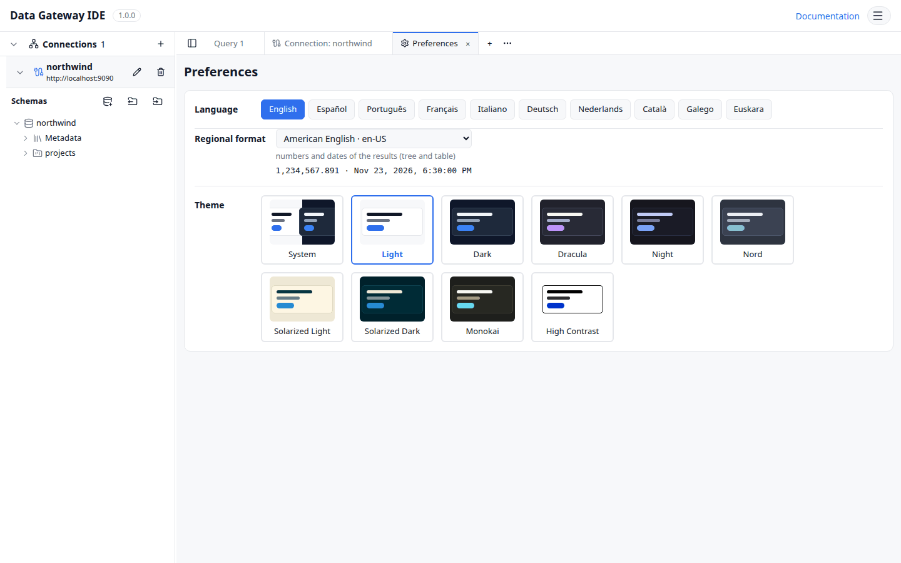
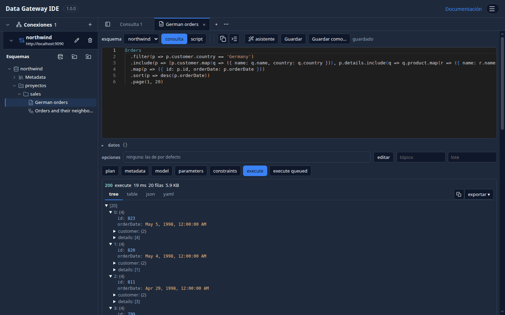

# Data Gateway IDE

Die IDE des Data Gateway: verbinde dich mit deinen Gateways, durchsuche ihre Schemas, lies jede Entität als Formular,
schreibe Abfragen mit Autovervollständigung oder mit dem [Abfrage-Assistenten](QueryWizard.md), zeichne Diagramme und
verwalte die Schemas. Wie eine Datenbank-IDE verbindet sie sich mit Gateways, einem oder mehreren, jedes mit seinen
Zugangsdaten; ihre Schemas, Workspaces und Projekte bleiben in ihnen.

Es gibt sie auf zwei Arten, dieselbe App und dieselbe Version:

- **Die Desktop-App** für Linux, Windows und macOS, [heruntergeladen](Download.md) und auf deinem Rechner ausgeführt:
  Sie verbindet sich von dort.
- **Die Web-IDE**, das Image [`flaviorita/data-gateway-ide`](https://hub.docker.com/r/flaviorita/data-gateway-ide),
  neben den Gateways bereitgestellt und im Browser genutzt ([In einem Container](#in-a-container)).


## Die Seiten dieses Abschnitts {#the-pages-of-this-section}

| Seite | Was sie erklärt |
| --- | --- |
| [Herunterladen](Download.md) | die Desktop-App für jedes System und wie man sie installiert |
| [Erste Schritte](GettingStarted.md) | von der ersten Verbindung zu einer Abfrage, einer Abfrage des Assistenten und einem Diagramm, mit Northwind |
| [Verbindungen](Connections.md) | eine Verbindung zu einem Gateway, ihre Zugangsdaten, ihre Sitzung, ihre Rollen, ihr REST, WebSocket und MCP |
| [Explorer](Explorer.md) | der Baum der Verbindungen und ihrer Schemas, sein Filter, die Tabs |
| [Entitäten](Entities.md) | das Formular einer Entität: Eigenschaften, Beziehungen, Schlüssel, ihre Zeilen und ihr Diagramm |
| [Abfragen](Queries.md) | der Abfrage-Editor, seine Vorschläge, Daten und Optionen, seine Aktionen, das Ergebnis, der Verlauf |
| [Abfrage-Assistent](QueryWizard.md) | eine Abfrage, aus einem Diagramm geschrieben: Tabellen, Felder, Filter, Reihenfolge und Seite |
| [Diagramme](Diagrams.md) | die Diagramme der Domäne: gespeichert, bearbeitet, exportiert |
| [Projekte](Projects.md) | Ordner, gespeicherte Abfragen und Diagramme; wo sie aufbewahrt werden, Export und Import |
| [Verwaltung](Administration.md) | die Schemas, aus der IDE bearbeitet: YAML und Formulare, Variablen, Befehle, neue Schemas |
| [Bereitstellen](Deploying.md) | die Web-IDE in einem Container, ihre Ziele, wo sie läuft und wie sie ein Gateway erreicht |
| [In deiner eigenen Anwendung](Embedding.md) | die Komponenten von `@lambdaorm/ui` in einer React-Anwendung |

## Das Fenster {#the-window}

| Teil | Wo | Was er enthält |
| --- | --- | --- |
| **Die Kopfzeile** | oben | Name und Version der IDE, **Dokumentation** (dieses Wiki, in ihrer Sprache) und das Menü ☰: **Neue Verbindung** und **Einstellungen** |
| **Der Explorer** | links | die Verbindungen und für jede ihre Schemas: Metadaten, Domäne, Entitäten, Projekte ([Explorer](Explorer.md)) |
| **Die Tabs** | rechts | Abfragen, Entitäten, Diagramme, Schemas, Verbindungen und Einstellungen nebeneinander; mehrere Verbindungen gleichzeitig |

**Einstellungen** (Menü ☰ → Einstellungen) enthält:

- **Sprache:** English, Español, Português, Français, Italiano, Deutsch, Nederlands, Català, Galego, Euskara.
- **Regionales Format:** die Kultur der Zahlen und Daten der Ergebnisse (en-US, es-AR, pt-BR, de-DE…), mit einem
  Beispiel.
- **Design:** System (hell oder dunkel wie das System), Hell, Dunkel, Dracula, Night, Nord, Solarized Light, Solarized
  Dark, Monokai, High Contrast.

Der Browser (oder die Desktop-App) merkt sie sich.





## Wohin sie sich verbindet {#where-it-connects}

Die IDE verbindet sich mit dem Port `management` jedes Gateways ([Transporte](../data-gateway/Transports.md#management)),
mit einer [Sitzung](Connections.md#sessions), die mit deinen Zugangsdaten geöffnet wird. Die Desktop-App verbindet sich
von deinem Rechner aus: Für ein Gateway, das nicht darauf läuft, erreichen ein VPN, ein SSH-Tunnel oder ein
`kubectl port-forward` sein `management`, ohne es zu veröffentlichen ([Wo die IDE läuft](Deploying.md#where-the-ide-runs)).

Was sie tun kann, hängt von den Berechtigungen der Zugangsdaten ab: Lesen braucht `read`; Speichern im Workspace
`workbenchWrite`; Verwalten `schemaRead`, `schemaWrite` und die anderen
([Verbindungen → Rollen](Connections.md#roles)).

## In einem Container {#in-a-container}

Für eine Web-IDE, die ein Team gemeinsam nutzt, neben den Gateways, mit `management` nur in ihrem internen Netzwerk:

```sh
docker run -p 127.0.0.1:8090:8080 -e DATA_GATEWAY_IDE_TARGETS='http://data-gateway:9090' flaviorita/data-gateway-ide
```

Siehe [Bereitstellen](Deploying.md).
