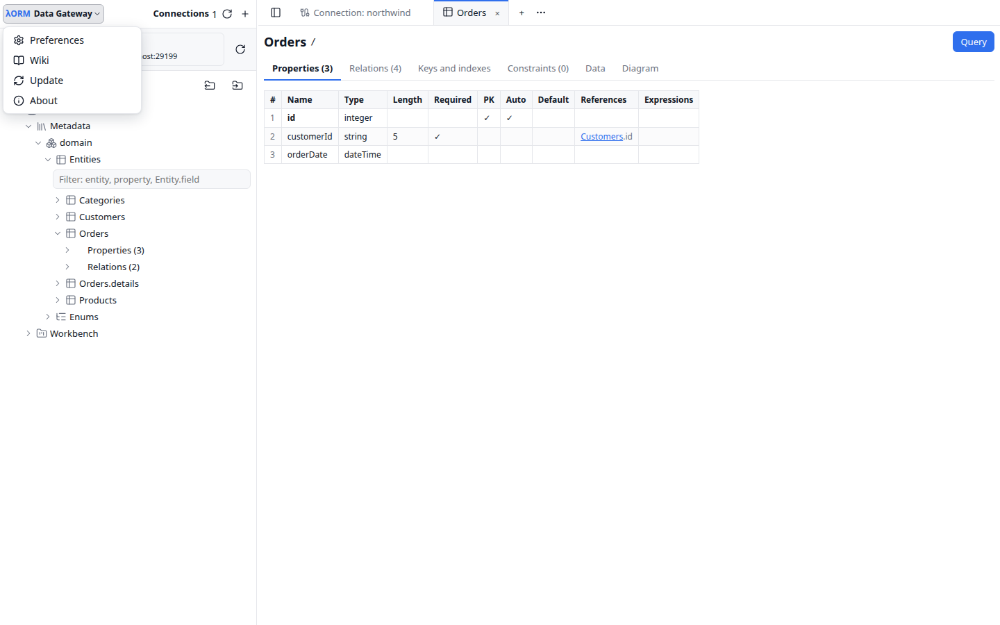
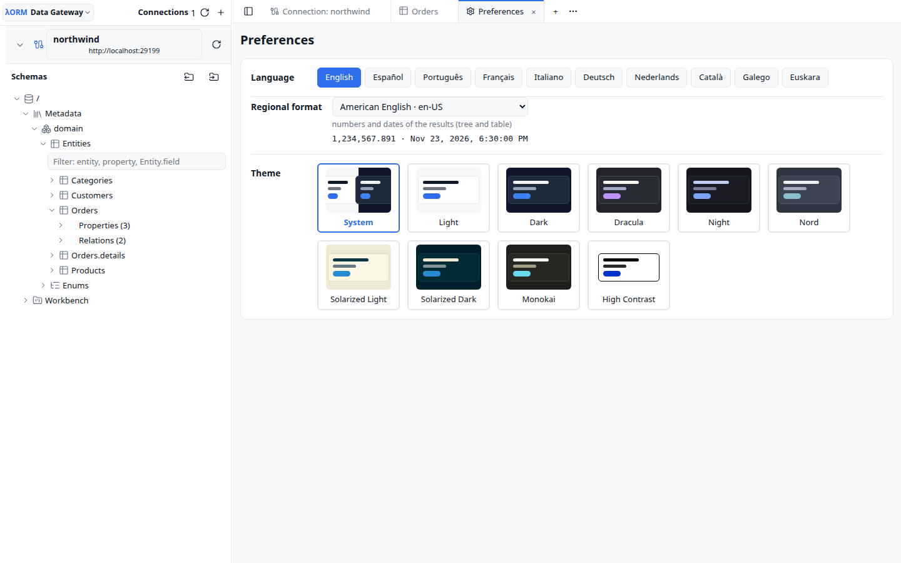
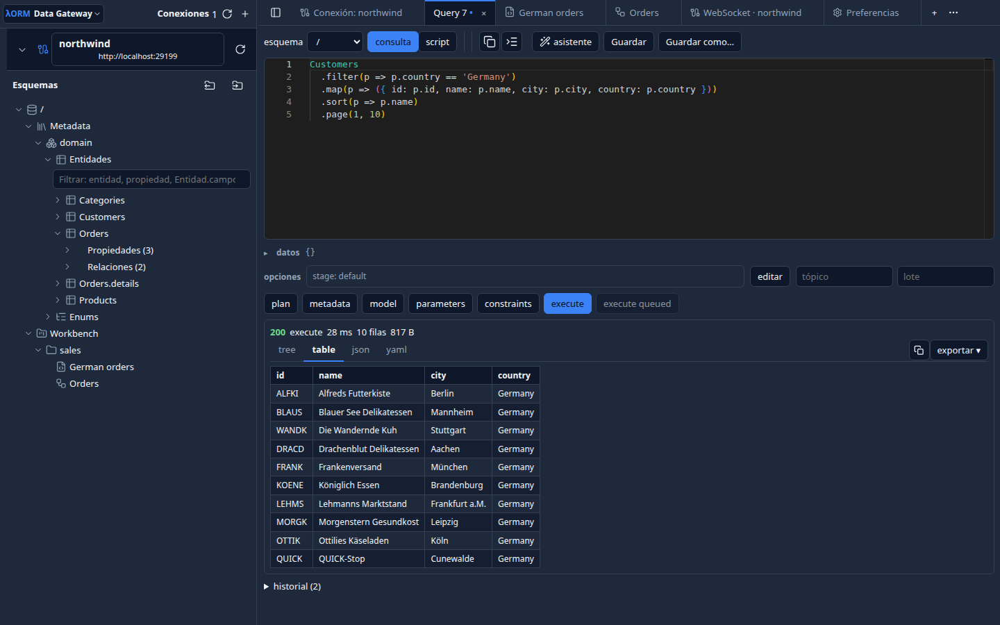

# Data Gateway IDE {#data-gateway-ide}

El IDE del Data Gateway: conéctate a tus gateways, recorre sus esquemas, lee cada entidad como un formulario, escribe
consultas con autocompletado o con el [asistente de consultas](QueryWizard.md), dibuja diagramas y administra los
esquemas. Como un IDE de bases de datos, se conecta a gateways, uno o varios, cada uno con su credencial; sus esquemas,
workspaces y lo que se guarda en ellos quedan en los gateways.

Úsalo para explorar un esquema que no conoces, para probar una consulta antes de que vaya a tu código, para mostrar el
dominio como un diagrama y, con una credencial de administración, para cambiar el esquema y aplicarlo a las bases de
datos.

Viene de dos formas, la misma app y la misma versión:

- **La aplicación de escritorio**, para Linux, Windows y macOS, [descargada](Download.md) y ejecutada en tu máquina: se
  conecta desde ella.
- **El IDE web**, la imagen [`flaviorita/data-gateway-ide`](https://hub.docker.com/r/flaviorita/data-gateway-ide),
  desplegada junto a los gateways y usada desde el navegador ([En un contenedor](#in-a-container)).


## Las páginas de esta sección {#the-pages-of-this-section}

| Página | Qué explica |
| --- | --- |
| [Descargar](Download.md) | la aplicación de escritorio para cada sistema, y cómo instalarla |
| [Primeros pasos](GettingStarted.md) | de la primera conexión a una consulta, una consulta del asistente y un diagrama, sobre Northwind |
| [Conexiones](Connections.md) | una conexión a un gateway, su credencial, su sesión, sus roles, su REST, WebSocket y MCP |
| [Explorador](Explorer.md) | el árbol de las conexiones y sus esquemas, su filtro, las pestañas |
| [Entidades](Entities.md) | la vista de una entidad: propiedades, relaciones, claves, restricciones, sus filas, su diagrama y su historial |
| [Consultas](Queries.md) | el editor de consultas, sus sugerencias, datos y opciones, sus acciones, el resultado, el historial |
| [Asistente de consultas](QueryWizard.md) | una consulta escrita desde un diagrama: tablas, campos, filtro, orden y página |
| [Diagramas](Diagrams.md) | los diagramas del dominio: guardados, editados, exportados |
| [Workbench](Projects.md) | proyectos, carpetas, consultas y diagramas guardados; dónde se guardan, exportar e importar |
| [Administración](Administration.md) | los esquemas editados desde el IDE: YAML y formularios, variables, comandos, stages, código, historial, esquemas nuevos |
| [Despliegue](Deploying.md) | el IDE web en un contenedor, sus destinos, dónde corre y cómo llega a un gateway |
| [En tu propia aplicación](Embedding.md) | los componentes de `@lambdaorm/ui` en una aplicación React |

## La ventana {#the-window}

| Parte | Dónde | Qué tiene |
| --- | --- | --- |
| **El menú λORM Data Gateway ▾** | arriba a la izquierda, sobre el explorador | **Preferencias**, **Wiki** (esta documentación, en el idioma del IDE), **Actualizar** y **Acerca de** |
| **Conexiones** | junto al menú | cuántas conexiones hay, ⟳ (volver a leer todo) y **+** (**Nueva conexión**) |
| **El explorador** | a la izquierda | las conexiones y, para cada una, sus esquemas: metadata, estado, código fuente y workbench ([Explorador](Explorer.md)) |
| **Las pestañas** | a la derecha | consultas, entidades, diagramas, esquemas, conexiones y preferencias, una al lado de otra; varias conexiones a la vez |



**Preferencias** se abre en una pestaña:

- **Idioma:** English, Español, Português, Français, Italiano, Deutsch, Nederlands, Català, Galego, Euskara. La
  primera vez, el idioma del navegador.
- **Formato regional:** la cultura de los números y las fechas de los resultados (en-US, es-AR, pt-BR, de-DE…), con un
  ejemplo.
- **Tema:** Sistema (claro u oscuro según el sistema), Claro, Oscuro, Dracula, Night, Nord, Solarized Light, Solarized
  Dark, Monokai, High Contrast, cada uno con una vista previa de sus colores.

Las recuerda el navegador (o la aplicación de escritorio).





**Actualizar** dice si salió una versión más nueva. La aplicación de escritorio la busca como lo hace
**Ayuda → Check for updates** ([Descargar](Download.md#installing-it)); el IDE web no puede actualizarse solo, así que
muestra la versión nueva y el comando que trae su imagen (`docker pull flaviorita/data-gateway-ide:<version>`), con lo
que hay de nuevo. **Acerca de** muestra la versión, cómo corre (web, o escritorio y su sistema), la versión de
`@lambdaorm/ui`, la licencia y los enlaces a su código fuente y a esta wiki.

Cuando el IDE web se actualiza mientras una página está abierta, la página avisa que hay una versión nueva, con
**Recargar**: lo guardado se mantiene.

## Dónde se conecta {#where-it-connects}

El IDE se conecta al puerto `management` de cada gateway ([Transportes](../data-gateway/Transports.md#management)),
con una [sesión](Connections.md#sessions) abierta con tu credencial. La aplicación de escritorio se conecta desde tu
máquina: para un gateway que no está en ella, una VPN, un túnel SSH o un `kubectl port-forward` llegan a su
`management` sin publicarlo ([Dónde corre el IDE](Deploying.md#where-the-ide-runs)).

Lo que puede hacer depende de los permisos de la credencial: leer necesita `read`; guardar en el workspace,
`workbenchWrite`; administrar, `schemaRead`, `schemaWrite` y los demás
([Conexiones → Roles](Connections.md#roles)). Lo que la credencial no puede hacer no se muestra, o se muestra
deshabilitado con el motivo.

## En un contenedor {#in-a-container}

Para un IDE web compartido por un equipo, junto a los gateways, con `management` solo en su red interna:

```sh
docker run -p 127.0.0.1:8090:8080 -e DATA_GATEWAY_IDE_TARGETS='http://data-gateway:9090' flaviorita/data-gateway-ide
```

Ver [Despliegue](Deploying.md).
