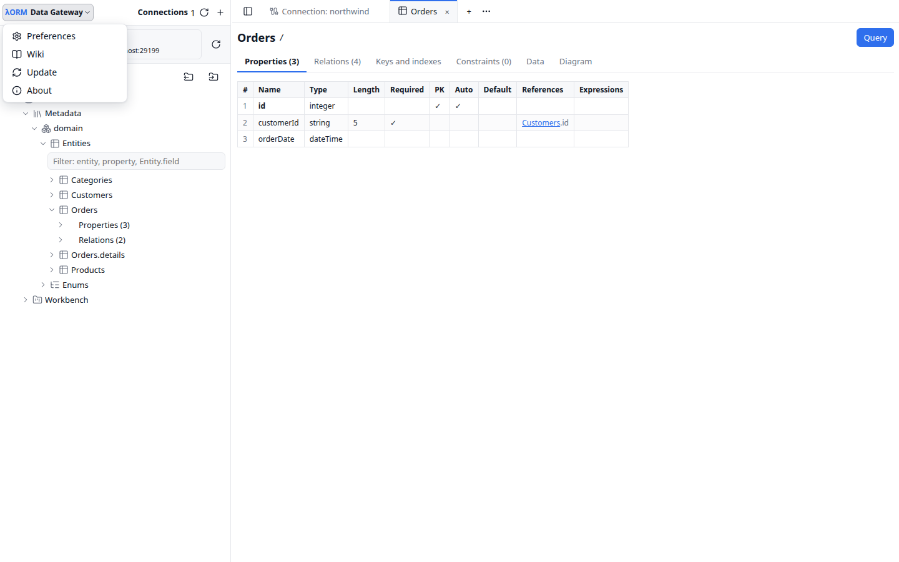

# Data Gateway IDE {#data-gateway-ide}

A IDE do Data Gateway: conecte-se aos seus gateways, percorra os esquemas, leia cada entidade como um formulário,
escreva consultas com autocompletar ou com o [assistente de consultas](QueryWizard.md), desenhe diagramas e administre
os esquemas. Como uma IDE de bancos de dados, ela se conecta a gateways, um ou vários, cada um com sua credencial; os
esquemas, os workspaces e o que neles se salva ficam nos gateways.

Use-a para explorar um esquema que você não conhece, para testar uma consulta antes que ela vá para o seu código, para
mostrar o domínio como um diagrama e, com uma credencial de administração, para alterar o esquema e aplicá-lo aos
bancos de dados.

Ela vem de duas formas, o mesmo app e a mesma versão:

- **O aplicativo de desktop**, para Linux, Windows e macOS, [baixado](Download.md) e executado na sua máquina: ele se
  conecta a partir dela.
- **A IDE web**, a imagem [`flaviorita/data-gateway-ide`](https://hub.docker.com/r/flaviorita/data-gateway-ide),
  implantada junto aos gateways e usada pelo navegador ([Em um contêiner](#in-a-container)).


## As páginas desta seção {#the-pages-of-this-section}

| Página | O que explica |
| --- | --- |
| [Baixar](Download.md) | o aplicativo de desktop para cada sistema, e como instalá-lo |
| [Primeiros passos](GettingStarted.md) | da primeira conexão a uma consulta, uma consulta do assistente e um diagrama, no Northwind |
| [Conexões](Connections.md) | uma conexão a um gateway, sua credencial, sua sessão, seus papéis, seu REST, WebSocket e MCP |
| [Explorador](Explorer.md) | a árvore das conexões e seus esquemas, seu filtro, as abas |
| [Entidades](Entities.md) | a vista de uma entidade: propriedades, relações, chaves, restrições, suas linhas, seu diagrama e seu histórico |
| [Consultas](Queries.md) | o editor de consultas, suas sugestões, dados e opções, suas ações, o resultado, o histórico |
| [Assistente de consultas](QueryWizard.md) | uma consulta escrita a partir de um diagrama: tabelas, campos, filtro, ordem e página |
| [Diagramas](Diagrams.md) | os diagramas do domínio: salvos, editados, exportados |
| [Workbench](Projects.md) | projetos, pastas, consultas e diagramas salvos; onde ficam guardados, exportação e importação |
| [Administração](Administration.md) | os esquemas editados a partir da IDE: YAML e formulários, variáveis, comandos, stages, código, histórico, novos esquemas |
| [Implantação](Deploying.md) | a IDE web em um contêiner, seus destinos, onde ela roda e como alcança um gateway |
| [Na sua própria aplicação](Embedding.md) | os componentes de `@lambdaorm/ui` em uma aplicação React |

## A janela {#the-window}

| Parte | Onde | O que tem |
| --- | --- | --- |
| **O menu λORM Data Gateway ▾** | em cima à esquerda, sobre o explorador | **Preferências**, **Wiki** (esta documentação, no idioma da IDE), **Atualizar** e **Sobre** |
| **Conexões** | ao lado do menu | quantas conexões existem, ⟳ (ler tudo de novo) e **+** (**Nova conexão**) |
| **O explorador** | à esquerda | as conexões e, para cada uma, seus esquemas: metadados, estado, código-fonte e workbench ([Explorador](Explorer.md)) |
| **As abas** | à direita | consultas, entidades, diagramas, esquemas, conexões e preferências, lado a lado; várias conexões ao mesmo tempo |



**Preferências** abre em uma aba:

- **Idioma:** English, Español, Português, Français, Italiano, Deutsch, Nederlands, Català, Galego, Euskara. Na
  primeira vez, o idioma do navegador.
- **Formato regional:** a cultura dos números e datas dos resultados (en-US, es-AR, pt-BR, de-DE…), com um exemplo.
- **Tema:** Sistema (claro ou escuro, como o sistema), Claro, Escuro, Dracula, Night, Nord, Solarized Light, Solarized
  Dark, Monokai, High Contrast, cada um com uma prévia das suas cores.

Elas são lembradas pelo navegador (ou pelo aplicativo de desktop).


**Atualizar** diz se saiu uma versão mais nova. O aplicativo de desktop a procura como faz **Help → Check for updates**
([Baixar](Download.md#installing-it)); a IDE web não pode se atualizar sozinha, então mostra a nova versão e o comando
que baixa a sua imagem (`docker pull flaviorita/data-gateway-ide:<version>`), com o que há de novo. **Sobre** mostra a
versão, como ela roda (web, ou desktop e o seu sistema), a versão de `@lambdaorm/ui`, a licença e os links para o seu
código-fonte e para esta wiki.

Quando a IDE web é atualizada enquanto uma página está aberta, a página avisa que há uma nova versão, com
**Recarregar**: o que está salvo permanece.

## Onde ela se conecta {#where-it-connects}

A IDE se conecta à porta `management` de cada gateway ([Transportes](../data-gateway/Transports.md#management)),
com uma [sessão](Connections.md#sessions) aberta com a sua credencial. O aplicativo de desktop se conecta a partir da
sua máquina: para um gateway que não está nela, uma VPN, um túnel SSH ou um `kubectl port-forward` alcançam o seu
`management` sem publicá-lo ([Onde a IDE roda](Deploying.md#where-the-ide-runs)).

O que ela pode fazer depende das permissões da credencial: ler precisa de `read`; salvar no workspace, de
`workbenchWrite`; administrar, de `schemaRead`, `schemaWrite` e das demais
([Conexões → Papéis](Connections.md#roles)). O que a credencial não pode fazer não é mostrado, ou aparece desativado
com o motivo.

## Em um contêiner {#in-a-container}

Para uma IDE web compartilhada por uma equipe, junto aos gateways, com `management` só na rede interna deles:

```sh
docker run -p 127.0.0.1:8090:8080 -e DATA_GATEWAY_IDE_TARGETS='http://data-gateway:9090' flaviorita/data-gateway-ide
```

Veja [Implantação](Deploying.md).
