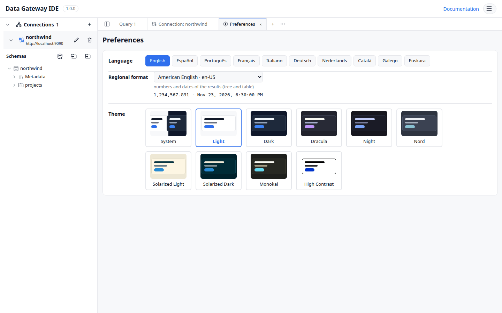
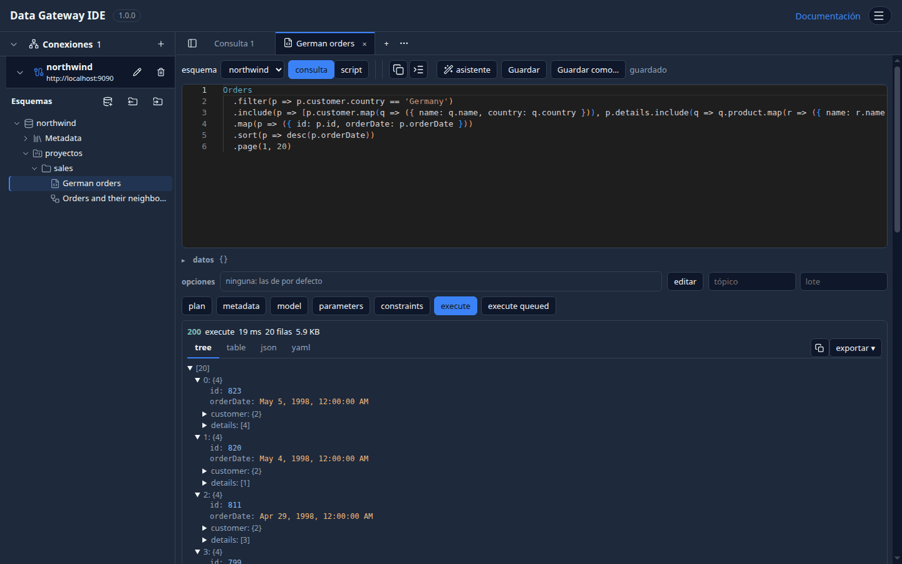

# Data Gateway IDE

A IDE do Data Gateway: conecte-se aos seus gateways, percorra os esquemas, leia cada entidade como um formulário,
escreva consultas com autocompletar ou com o [assistente de consultas](QueryWizard.md), desenhe diagramas e administre
os esquemas. Como uma IDE de bancos de dados, ela se conecta a gateways, um ou vários, cada um com sua credencial; os
esquemas, workspaces e projetos ficam neles.

Ela vem de duas formas, o mesmo app e a mesma versão:

- **O aplicativo de desktop**, para Linux, Windows e macOS, [baixado](Download.md) e executado na sua máquina: ele se
  conecta a partir dela.
- **A IDE web**, a imagem [`flaviorita/data-gateway-ide`](https://hub.docker.com/r/flaviorita/data-gateway-ide),
  implantada junto aos gateways e usada pelo navegador ([Em um contêiner](#in-a-container)).


## As páginas desta seção {#the-pages-of-this-section}

| Página | O que explica |
| --- | --- |
| [Baixar](Download.md) | o aplicativo de desktop para cada sistema, e como instalá-lo |
| [Primeiros passos](GettingStarted.md) | da primeira conexão a uma consulta, uma consulta do assistente e um diagrama, no Northwind |
| [Conexões](Connections.md) | uma conexão a um gateway, sua credencial, sua sessão, seus papéis, seu REST, WebSocket e MCP |
| [Explorador](Explorer.md) | a árvore das conexões e seus esquemas, seu filtro, as abas |
| [Entidades](Entities.md) | o formulário de uma entidade: propriedades, relações, chaves, suas linhas e seu diagrama |
| [Consultas](Queries.md) | o editor de consultas, suas sugestões, dados e opções, suas ações, o resultado, o histórico |
| [Assistente de consultas](QueryWizard.md) | uma consulta escrita a partir de um diagrama: tabelas, campos, filtro, ordem e página |
| [Diagramas](Diagrams.md) | os diagramas do domínio: salvos, editados, exportados |
| [Projetos](Projects.md) | pastas, consultas e diagramas salvos; onde ficam guardados, exportação e importação |
| [Administração](Administration.md) | os esquemas editados a partir da IDE: YAML e formulários, variáveis, comandos, novos esquemas |
| [Implantação](Deploying.md) | a IDE web em um contêiner, seus destinos, onde ela roda e como alcança um gateway |
| [Na sua própria aplicação](Embedding.md) | os componentes de `@lambdaorm/ui` em uma aplicação React |

## A janela {#the-window}

| Parte | Onde | O que tem |
| --- | --- | --- |
| **O cabeçalho** | em cima | o nome e a versão da IDE, **Documentação** (esta wiki, no seu idioma) e o menu ☰: **Nova conexão** e **Preferências** |
| **O explorador** | à esquerda | as conexões e, para cada uma, seus esquemas: metadados, domínio, entidades, projetos ([Explorador](Explorer.md)) |
| **As abas** | à direita | consultas, entidades, diagramas, esquemas, conexões e preferências, lado a lado; várias conexões ao mesmo tempo |

**Preferências** (menu ☰ → Preferências) tem:

- **Idioma:** English, Español, Português, Français, Italiano, Deutsch, Nederlands, Català, Galego, Euskara.
- **Formato regional:** a cultura dos números e datas dos resultados (en-US, es-AR, pt-BR, de-DE…), com um exemplo.
- **Tema:** Sistema (claro ou escuro, como o sistema), Claro, Escuro, Dracula, Night, Nord, Solarized Light, Solarized
  Dark, Monokai, High Contrast.

Elas são lembradas pelo navegador (ou pelo aplicativo de desktop).





## Onde ela se conecta {#where-it-connects}

A IDE se conecta à porta `management` de cada gateway ([Transportes](../data-gateway/Transports.md#management)),
com uma [sessão](Connections.md#sessions) aberta com a sua credencial. O aplicativo de desktop se conecta a partir da
sua máquina: para um gateway que não está nela, uma VPN, um túnel SSH ou um `kubectl port-forward` alcançam o seu
`management` sem publicá-lo ([Onde a IDE roda](Deploying.md#where-the-ide-runs)).

O que ela pode fazer depende das permissões da credencial: ler precisa de `read`; salvar no workspace, de
`workbenchWrite`; administrar, de `schemaRead`, `schemaWrite` e das demais
([Conexões → Papéis](Connections.md#roles)).

## Em um contêiner {#in-a-container}

Para uma IDE web compartilhada por uma equipe, junto aos gateways, com `management` só na rede interna deles:

```sh
docker run -p 127.0.0.1:8090:8080 -e DATA_GATEWAY_IDE_TARGETS='http://data-gateway:9090' flaviorita/data-gateway-ide
```

Veja [Implantação](Deploying.md).
