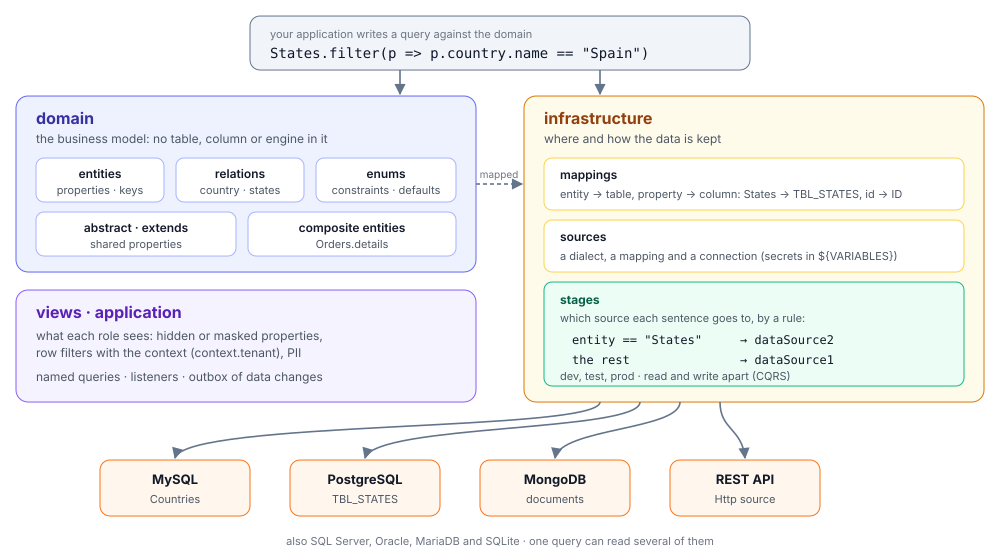

# Schema {#schema}

Dieser Abschnitt erklärt das Schema von λORM: was es enthält, wie es definiert und verwendet wird und wie es mit den Datenbanken synchronisiert wird.

Das Schema enthält die gesamte Konfiguration, die das ORM benötigt. Es trennt das Geschäftsmodell (**Domäne**) von der Persistenz der Daten (**Infrastruktur**):

- In der Domäne sind die Entitäten und Enums, die das Geschäftsmodell abbilden, vollständig sauber, ohne irgendein Attribut, das sie an die Persistenz koppelt.
- Alle Abfragen werden gegen das Geschäftsmodell geschrieben und sind daher vom physischen Datenmodell entkoppelt.
- In der Infrastruktur wird alles definiert, was nötig ist, um die Daten in den verschiedenen Quellen (Datenbanken) zu speichern und zu lesen.

Das Schema kann in einer YAML- oder JSON-Datei (üblicherweise `lambdaORM.yaml`) geschrieben oder bei der Initialisierung des ORM als Objekt übergeben werden.

Seine Quellen können Datenbanken (MySQL, MariaDB, PostgreSQL, SQL Server, Oracle, MongoDB, SQLite) und REST-APIs sein, gemischt im selben Stage.

Alle Ausdrücke, mit denen Bedingungen und Aktionen definiert werden, werden von der Expression-Engine [3xpr](https://www.npmjs.com/package/3xpr) ausgewertet.

## Auf einen Blick {#at-a-glance}

Eine Abfrage wird gegen die **Domäne** geschrieben. Die **Sichten** bestimmen, was jede Rolle davon sieht, und die **Infrastruktur** bestimmt, wo jede Entität liegt: ihr Mapping benennt die Tabellen und Spalten, und die Regeln der Stage schicken jeden Satz an seine Quelle.

## Beispiel {#example}

Dieses Beispiel zeigt einen Stage, der zwei Quellen verwendet: Quelle 1 ist MySQL und enthält die Tabelle `Countries`, Quelle 2 ist PostgreSQL und enthält die Tabelle `States`.

Bei der Entität `Countries` sind die Namen der Tabelle und ihrer Spalten identisch mit den Namen der Entität und ihrer Eigenschaften, daher muss kein Mapping geschrieben werden.
Bei der Entität `States` unterscheiden sich die Namen der Tabelle und ihrer Spalten, daher werden sie im Mapping definiert.

## In diesem Abschnitt {#in-this-section}

- [Definition](SchemaDefinition.md): jeder Schlüssel des Schemas.
- [Ausdrücke](SchemaDefinition-Expressions.md), [Umgebungsvariablen](SchemaDefinition-EnvironmentVariables.md) und [Komposit-Entitäten](SchemaDefinition-Composite.md).
- [Verwendung des Schemas](Schema-Use.md): wie das Schema geladen und das Modell generiert wird.
- Beispiele: [Einfach](SchemaExample-Basic.md), [Erweitern](SchemaExample-Extend.md), [Mehrere Stages](SchemaExample-MultiplesStages.md), [Stage mit mehreren Quellen](SchemaExample-StageMultiplesSources.md), [Komposit](SchemaExample-Composite.md) und [Listener](SchemaExample-Listener.md).
- [Sichten](Views.md), [Kontext und Zeilenfilter](Context.md), [Observability](Observability.md) und [Eine REST-API als Quelle](HttpSource.md).
- [Synchronisierung](SchemaSynchronization.md): push, pull, fetch, introspect, incorporate, [Migrationen](SchemaSynchronization-Migrations.md) und [Seed](SchemaSynchronization-Seed.md).
- [Datenbank-Engines](Engines.md): Unterschiede zwischen den Datenbank-Engines (PostgreSQL, MySQL, MariaDB, SQL Server, Oracle, SQLite und MongoDB).

Das [Data Gateway](../data-gateway/index.md) stellt ein Schema über das Netzwerk bereit; seine eigenen Einstellungen befinden sich in einer separaten [Konfigurationsdatei](../data-gateway/Configuration.md).
