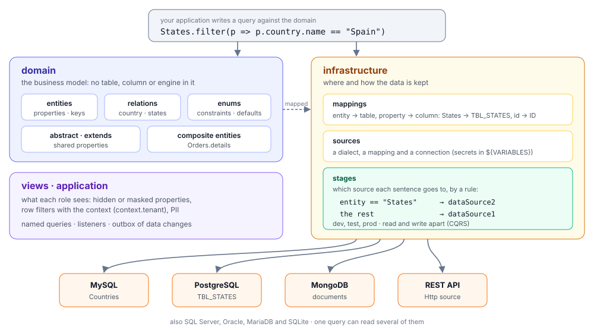

# Esquema {#schema}

Esta seção explica o esquema do λORM: o que ele contém, como é definido e usado, e como é sincronizado com os bancos de dados.

O esquema contém toda a configuração de que o ORM precisa. Ele separa o modelo de negócio (**domain**) da persistência dos dados (**infrastructure**):

- No domínio, as entidades e os enums que representam o modelo de negócio são completamente limpos, sem nenhum atributo que os acople à persistência.
- Todas as consultas são escritas sobre o modelo de negócio, de modo que ficam desacopladas do modelo físico dos dados.
- Na infraestrutura, define-se tudo o que é necessário para armazenar e ler os dados nas diferentes fontes (bancos de dados).

O esquema pode ser escrito em um arquivo YAML ou JSON (normalmente `lambdaORM.yaml`), ou passado como um objeto quando o ORM é inicializado.

Suas fontes podem ser bancos de dados (MySQL, MariaDB, PostgreSQL, SQL Server, Oracle, MongoDB, SQLite) e APIs REST, combinados no mesmo stage.

Todas as expressões usadas para definir condições e ações são avaliadas pelo mecanismo de expressões [3xpr](https://www.npmjs.com/package/3xpr).

## Num relance {#at-a-glance}

Uma consulta é escrita sobre o **domínio**. As **views** decidem o que cada papel vê dele, e a **infraestrutura** decide onde cada entidade vive: o seu mapping nomeia as tabelas e colunas, e as regras do stage enviam cada sentença à sua fonte.

## Exemplo {#example}

Este exemplo mostra um stage que usa duas fontes: a fonte 1 é MySQL e contém a tabela `Countries`, e a fonte 2 é PostgreSQL e contém a tabela `States`.

Para a entidade `Countries`, os nomes da tabela e de suas colunas são os mesmos que os nomes da entidade e de suas propriedades, portanto nenhum mapeamento precisa ser escrito.
Para a entidade `States`, os nomes da tabela e de suas colunas são diferentes, então o mapeamento os define.

## Nesta seção {#in-this-section}

- [Definição](SchemaDefinition.md): todas as chaves do esquema.
- [Expressões](SchemaDefinition-Expressions.md), [Variáveis de ambiente](SchemaDefinition-EnvironmentVariables.md) e [Entidades compostas](SchemaDefinition-Composite.md).
- [Uso do esquema](Schema-Use.md): como carregar o esquema e gerar o modelo.
- Exemplos: [Básico](SchemaExample-Basic.md), [Extend](SchemaExample-Extend.md), [Múltiplos stages](SchemaExample-MultiplesStages.md), [Stage com múltiplas fontes](SchemaExample-StageMultiplesSources.md), [Composto](SchemaExample-Composite.md) e [Listener](SchemaExample-Listener.md).
- [Views](Views.md), [Contexto e filtros de linhas](Context.md), [Observabilidade](Observability.md) e [Uma API REST como fonte](HttpSource.md).
- [Sincronização](SchemaSynchronization.md): push, pull, fetch, introspect, incorporate, [migrações](SchemaSynchronization-Migrations.md) e [seed](SchemaSynchronization-Seed.md).
- [Mecanismos de banco de dados](Engines.md): diferenças entre os mecanismos de banco de dados (PostgreSQL, MySQL, MariaDB, SQL Server, Oracle, SQLite e MongoDB).

O [Data Gateway](../data-gateway/index.md) publica um esquema pela rede; suas próprias configurações estão em um [arquivo de configuração](../data-gateway/Configuration.md) separado.
