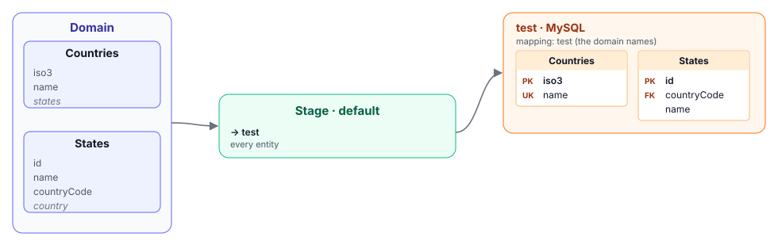

# Einfaches Schema-Beispiel {#basic-schema-example}

Diese Seite zeigt ein einfaches Schema: zwei miteinander in Beziehung stehende Entitäten, die in einer MySQL-Datenbank gespeichert werden.

Ein einfaches Schema definiert die Entitäten, das Mapping und die Quellen:

- Die **Entitäten** definieren die Eigenschaften, Beziehungen und Schlüssel.
- Das **Mapping** definiert, wie die Entitäten auf die Tabellen der Datenbank abgebildet werden.
- Die **Quellen** definieren den Dialekt und die Verbindung jeder Datenbank.

Viele Schlüssel können weggelassen werden, da sie einen Standardwert haben. Zum Beispiel:

- Eine Eigenschaft ohne `type` ist ein String.
- Eine Eigenschaft ohne `required` ist nicht erforderlich (es sei denn, sie ist Teil des Primär- oder Unique Keys).
- Eine String-Eigenschaft ohne `length` ist `TEXT` auf PostgreSQL und `VARCHAR(80)` auf den anderen Datenbank-Engines.
- Ohne Mapping-Angaben haben die Tabellen und Spalten dieselben Namen wie die Entitäten und Eigenschaften.

## Schema-Beispiel {#schema-example}

In diesem Schema hat `Countries` viele `States`: Die Beziehung `states` von `Countries` gibt die Liste seiner Bundesstaaten zurück, und die Beziehung `country` von `States` gibt das zugehörige Land zurück.
Das Mapping `test` ist leer, daher haben die Tabellen und Spalten dieselben Namen wie die Entitäten und Eigenschaften.



```yaml
domain:
  entities:
    - name: Countries
      primaryKey: ["iso3"]
      uniqueKey: ["name"]
      properties:
        - name: name
          required: true
        - name: iso3
          length: 3
          required: true
      relations:
        - name: states
          type: manyToOne
          composite: true
          from: iso3
          entity: States
          to: countryCode
    - name: States
      primaryKey: ["id"]
      uniqueKey: ["countryCode", "name"]
      properties:
        - name: id
          type: integer
          required: true
        - name: name
          required: true
        - name: countryCode
          required: true
          length: 3
      relations:
        - name: country
          from: countryCode
          entity: Countries
          to: iso3
infrastructure:
  mappings:
    - name: test          
  sources:
    - name: test
      dialect: MySQL
      mapping: test
      connection:
        host: localhost
        port: 3306
        user: test
        password: test
        database: test
  stages:
    - name: default
      sources:
        - name: test
```

## Labs {#labs}

- [CLI – simple](https://github.com/lambda-orm/lambdaorm-labs/tree/main/labs/cli/01-simple)
